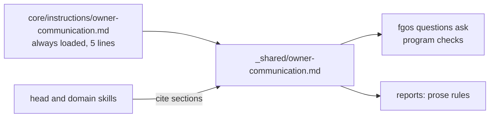

discussion: open

## Seed

Opened by the secretary (Miu) on the owner's order, 2026-11-22. The owner wants the lessons from today distilled into one common place so every agent (heads, leads, workers) talks to the human the same way: complete information, one clear action, low cognitive load.

- **Outcome:** one shared source, loaded by every agent, that covers questions, status reports and incident reports.
- **Input to read first:** `plans/reports/secretary-261122-1254-agent-human-communication.md` (what exists, seven gaps with evidence, open design points) and `core/skills/_shared/decision-question.md` (the existing five-part rule for questions).
- **Constraints:** extend or replace the existing source, never add a parallel one (design principle 1); change every caller and remove the old text in the same change (L10); rules a program can check go to `fgos questions ask`, the rest stays prose. The owner prefers that agents do read-only work first and bring findings plus a recommendation, so park owner questions in the store with a recommended option and a stated default instead of waiting.
- **Non-goals:** changing the approved-frame rule or the product priority order.
- **Open design points for the shaper:** one file or two; which checks are program-enforced; how a stale question is withdrawn (asker duty, or a watcher flagging a question whose plan is done).
- **Source ids:** `p-wb6rkwpjsg`.

## 1. Trạng thái hiện tại

Round 1 (2026-11-22 13:05, shaper `owner-communication`). Domain: coding (the change edits fgOS core skills, the always-loaded instruction and possibly the `fgos questions` door; `domains/coding/AGENTS.md` only routes item lifecycle, nothing it settles bears on this topic).

Scouted the current sources (section 3 cites them). Nothing is settled yet. Proposed answer for every open point is written in section 3 as **provisional**, each with its default and what would reverse it, so a planner could start even if the owner never answers.

Open owner questions (parked in the store, shaping continues around them):

- **q-von37r6ef6** — how a stale question is withdrawn (section 3 row "Stale questions").
- **q-xkrbp66xy6** — which rules become program checks in `fgos questions ask` (section 3 row "Program checks").

Not blocked by either question: the file layout, the prose rules for read-only-work-first, names and ids, status reports and incident reports.

## 2. Mục tiêu & đề bài

Today every agent that speaks to the owner follows only one shared rule, the five-part decision question, and that rule covers one act: asking the owner to choose. Status reports, progress reports and incident reports have no shared shape (three head skills each say only "at most 10 lines, full report in a file"); nothing says read-only work is done before speaking; nothing says how to introduce a role, lane or id; nothing says a status claim must name its source and age; and a question that went moot stays in the owner's queue because only its asker may cancel it and askers rotate away. On 2026-11-22 this cost the owner seven avoidable frictions (the secretary's report lists them with evidence). The outcome is one shared source, always loaded by every head, lead and worker in every CLI, that defines how an agent communicates with the owner: what it does before speaking, the common rules for any owner message, the decision question, the status report, the incident report, and the life of an open question until it is answered or withdrawn. Rules a program can measure are checked by the `fgos questions ask` door; the rest stays prose. It replaces the existing text rather than sitting beside it, and every caller moves in the same change.

## 3. Vấn đề rõ / chưa rõ

| Point | State | Evidence | Current answer |
|---|---|---|---|
| Where it is loaded so every agent sees it | clear | `core/instructions/*.md` with `appliesTo: ["*"]` is rendered into each project's `AGENTS.md` by `src/setup/instruction-projections.mjs` (adapter `portable-agents-md`), which every agent CLI reads; `decision-question.md` is already one of them | The always-loaded instruction stays the door; it carries a short summary and points to the full fragment. |
| One file or two | **provisional** | `core/skills/_shared/decision-question.md` (53 lines) is cited by about 20 source files (6 core skills, 6 coding-domain skills, 4 platform docs, reading map, AGENTS render) plus 4 code/test refs (`src/state/decision-question.mjs`, `src/state/status-fsm.mjs`, `test/docs/rul11-anchor-phrase.test.mjs`, `test/state/awaiting.test.mjs`); generated copies under `.agents/skills` and `plugins/fgOS` rebuild with `npm run build:skills` | **Default: one file.** Rename the fragment to `core/skills/_shared/owner-communication.md` and the instruction to `core/instructions/owner-communication.md`; the decision question becomes one section of it; every caller moves and the old paths are removed in the same change (L10). Two files would split one act (speaking to the owner) across two doors, and the common rules (names, source and age, answer friction) apply to both. Reverse if the single file goes past about 150 lines, or the owner wants questions kept as a separately citable law. |
| Read-only work first | provisional | Report gap 1: two secretary messages asked permission to read or check | Prose rule: reading, checking, re-verifying and drafting are done before speaking; a message never asks permission for read-only work; it brings findings plus a recommendation. Only a write, a spend outside the approved frame, or an outward action is asked. |
| Common rules for any owner message | provisional | Gaps 2, 4, 5 | Prose: outcome first; one action per item; first mention of a role, lane, id or term gets one plain phrase; a pointer to a numbered item says which item; every status claim names its source and age and the evidence of activity (last write, last land), and says what was not checked. |
| Status / progress report shape | provisional | Gap 6; `core/skills/fgos-lead/SKILL.md:76`, `fgos-secretary/SKILL.md:93`, `fgos-supervisor/SKILL.md:112` each repeat "at most 10 lines, full report in a file" | Section in the shared file: outcome; done (with ids explained); checked and not checked; owner decisions (one per item, recommendation first, lettered, default); at most 10 lines, full report in a file named by `fgos convention path --kind report`. The three skills drop their own lines and point to it. |
| Incident report shape | provisional | Gap 6 | Same frame plus: impact now, what was done to contain it, what is still at risk, the one decision needed. |
| Answer friction | provisional | Gap 5: owner answers "A", "ok", "ok duyệt" | Options lettered A-D, recommended one first and marked, a stated default ("no answer by <when> → I take A"). Whether the store enforces part of this: **q-xkrbp66xy6**. |
| Program checks | **open, owner question q-xkrbp66xy6** | `packages/questions/contracts/questions-input.v1.json` already checks headline ≤120 chars on one line, 2-4 options, exactly one recommended, scope allows/forbids, `blocks`; it has no field for a default | Recommended: add a required `parts.ifUnanswered` (what the asker does, and when, if no answer comes) and require the headline to end with "?"; the store letters options A-D when it renders, so the asker writes nothing extra. Everything else stays prose. |
| Stale questions | **open, owner question q-von37r6ef6** | Gap 3: 5 of 8 open questions were moot. `packages/questions/contracts/refusals.v1.json` `not-asker`: only the asker, a session holding the same `head:` role, or (migrated / role-less asker) any head may cancel. Questions spec §5. The store never looks at the state behind the `ref`. | Recommended: asker duty (prose) plus a read-time flag: `fgos questions` marks a question `refDone` when its `plan:` ref's plan or phase is done, and the secretary may cancel a question so flagged. Needs a questions spec §5 change. |
| Shared memory of lessons | provisional | Gap 7 | Solved by the outcome itself: the lesson lives in the shared fragment, not in one head's memory. No memory mechanism is built. |
| Approved-frame rule, priority order | non-goal | Seed | Moved into the new file unchanged. |

## 4. Quyết định đã chốt

| D-ID | Decision | Source | Date |
|---|---|---|---|

(None yet. A point gets a D-ID only after it holds across more than one round.)

## 5. Q&A log

- 2026-11-22 13:05 — Round 1. Shaper scouted `decision-question.md` (fragment and instruction), `questions-input.v1.json`, `refusals.v1.json`, questions spec §4-§5, the report sections of `fgos-lead`, `fgos-secretary`, `fgos-supervisor`, and `instruction-projections.mjs`. Wrote provisional answers for every point. Parked two owner questions (stale-question mechanism, program checks); the other points carry defaults that a planner can use if the owner does not object.

## 6. Thiết kế đã chốt {#design}

Nothing is settled yet. Draft shape under the provisional answers, for the owner to react to:

One shared fragment, `core/skills/_shared/owner-communication.md`, replaces `decision-question.md`. The always-loaded instruction `core/instructions/owner-communication.md` (replacing `decision-question.md`, `appliesTo: ["*"]`) gives every agent in every CLI a five-line summary and the pointer. Sections of the fragment:

1. **Before you speak** — do read-only work first; never ask permission to read, check or draft.
2. **Every owner message** — outcome first; one action per item; explain names and ids on first use; status claims carry source, age, activity evidence and what was not checked.
3. **Decision question** — today's five parts, approved frame and "make it easy to answer", plus lettered options and a stated default.
4. **Status and progress report** — fixed order, at most 10 lines, full report in a file.
5. **Incident report** — the same order plus impact, containment and remaining risk.
6. **Life of an open question** — the asker withdraws it the moment it is moot; whoever presents it re-checks it against live state first; the mechanism from Q1.

`fgos questions ask` checks what Q2 settles; every other rule stays prose.

## 7. Danh mục hạng mục / task {#tasks}

Filled once Q1 and Q2 are answered and the shape holds for a second round.
