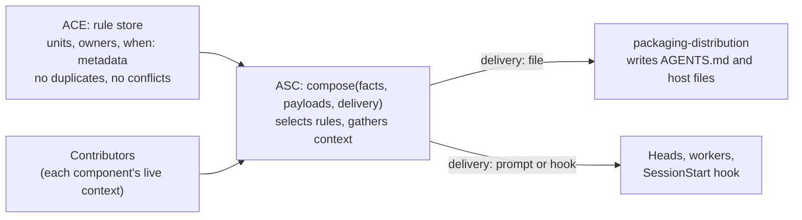

discussion: open

## 1. Trạng thái hiện tại

2026-11-25 16:10 — P2 measured ([report](../../reports/research-261125-1601-fgos-rule-duplicates-and-conflicts.md)). Word matching finds almost nothing (16 near-verbatim pairs, mostly boilerplate), but reading by meaning finds 31 clusters of one rule restated in other words (about 14% of the rule statements) and 14 conflicts or drift, 6 of them medium or above, mostly in the dispatch rules; the worst is `AGENTS.md:216` (decide before every Agent call) against `core/skills/fgos-researching/SKILL.md:69-75` (research branches skip decide). Almost every conflict is between rules that share no id and no wording, so ACE needs detection by content, not only by id. Open: P1, P3, and what to do with the 14 conflicts.

2026-11-25 — Opened by DOCOS (lead:DOCOS, session forgentx-d5) in the chat with the owner. Two decisions are settled: what ACE and ASC each are (ACE-D1), and the three roles ACE, ASC and packaging-distribution (ACE-D2). Under way: measuring duplicate and conflicting rules by content in the fgOS-owned rule text (P2), which decides how much duplicate and conflict detection ACE needs now. Open: P1 (does ACE become its own component, out of packaging-distribution) and P3 (the contract between ACE and ASC).

## 2. Mục tiêu & đề bài

The owner's original idea was ACE alone: one place that organizes, stores and manages every rule in the system, and that keeps them free of duplicates and conflicts. While working on agent starts, the owner saw that a second thing is needed, ASC (Agent Start Context, discussion [ds-2d55ty37zz](../ds-2d55ty37zz-agent-start-door-and-context-seam/DISCUSSION.md)): one place that, when an agent starts, recognizes what the agent is about to do and sets the context that fits, and one place where every other module or component supplies context to an agent at start. The two are separate components joined by a contract, not one component in two slices. Today ACE exists only as a small core: the Node instruction registry, composition and projection in `src/setup/instruction-registry.mjs`, `instruction-composition.mjs` and `instruction-projections.mjs` (about 2,360 lines, built 2026-09-14 in commit `04be428b6`), owned by packaging-distribution, with the contract [instruction-composition-and-projection.md](../../../docs/platform/packaging-distribution/contracts/instruction-composition-and-projection.md) still a draft. It manages 7 rule files and renders the `fgos:instruction-projection` block of `AGENTS.md` (about 100 of its 818 lines). Most fgOS rules live outside it: the hand-written sections of `AGENTS.md`, persona and head openings, and skill text. Duplicates are caught only by id (`DUPLICATE_ID`) and conflicts only when an author declares `conflictsWith`, `supersedes` or `dependsOn`. The rules AgentKit loads three times are outside fgOS and belong to backlog `p-7eb9e65b` (owner 2026-11-25).

## 3. Vấn đề rõ / chưa rõ

| P | Point | State | Notes |
|---|---|---|---|
| P1 | Does ACE become its own component, with its own spec, taking the registry out of packaging-distribution? | open | DOCOS leans yes: ACE-D1 makes ACE its own authority. The split can come after ASC, since ASC needs only the contract. `fgos authority locate` finds no row that owns "the one store of every rule" (2026-11-25), so the component row is new. |
| P2 | How many fgOS-owned rules are duplicated or in conflict by content? | measured | 519 normative statements from 84 files: 31 duplicate clusters (about 20.7 KB of 149.7 KB, ±30%), 14 conflicts or drift, 6 medium or above ([report](../../reports/research-261125-1601-fgos-rule-duplicates-and-conflicts.md)). Detection by content is needed; the report suggests one owner per rule with pointers elsewhere, and a write-time check against the nearest existing rules, with a full sweep as a scheduled audit. |
| P3 | The contract between ACE and ASC | open | Sketch: ASC asks ACE for the rules whose `when:` facts match; ACE guarantees each rule has one owner, no duplicate and no conflict. `when:` is metadata stored in ACE; the matcher belongs to ASC. |
| P4 | Proposal §4.7.2 places task-scoped selection, budgets and reading plans in ACE | settled by ACE-D2 | Those belong to ASC, which alone knows what the agent is about to do. §4.7.2 is amended to say so. |

## 4. Quyết định đã chốt

| D-ID | Decision | Date | Source |
|------|----------|------|--------|
| ACE-D1 | **ACE** (Agent Context Engine) is the one place that organizes, stores and manages every rule in the system, keeping them free of duplicates and conflicts; it does not know which agent is starting. **ASC** (Agent Start Context) is the one place that, when an agent starts, recognizes what it is about to do and sets the context that fits, and the one place where every other module supplies context at start; rules from ACE are one of its inputs, contributors the other. They are two components joined by a contract, not one component in slices. | 2026-11-25 | owner in chat with DOCOS, 14:53, held at 15:51 |
| ACE-D2 | Three roles. ACE owns the rule store: units, owners, `when:` metadata, duplicate and conflict detection; it writes no file and knows no agent. ASC owns selection: it takes the start facts, selects rules from ACE, gathers contributor context and returns ordered blocks; it writes no host file and spawns nothing. Packaging-distribution owns writing files: which file for which CLI, block markers, keeping other tools' blocks, doctor drift rows and their repair; it selects no rule. `fgos setup` calls ASC `compose` with standing facts and the file delivery, then writes the blocks. Dependency order ACE ← ASC ← packaging-distribution. | 2026-11-25 | owner agreed 15:51 ("đồng ý, ghi quyết định") |

## 5. Q&A log

- 2026-11-25 13:56 — Owner: open a separate item for the AgentKit rules loaded three times. DOCOS found it already in `p-7eb9e65b` and proposal §4.7.2, and added the measurement there (`673ae4f77`, landed `875126f8e`).
- 2026-11-25 14:00 — Owner: ASC and ACE look like two phases of one job; how should they be discussed, and how are their discussions and plans stored? DOCOS: ASC has backlog `p-25q7tz6jtt`, discussion `ds-2d55ty37zz` and plan `261122-1946-agent-start-context`; ACE had only proposal §4.7.2 and ledger row PF-I007, and nothing on disk tied the two.
- 2026-11-25 14:53 — Owner: at first there was only ACE, the store of every rule with duplicate and conflict control; ASC came later, the one place that sets an agent's context at start and where every component supplies it. Recorded as ACE-D1.
- 2026-11-25 15:04 — Owner: is ACE still tied to packaging-distribution, is it done? DOCOS: not done; only the registry core exists, inside packaging-distribution, managing 7 rule files.
- 2026-11-25 15:51 — Owner: so packaging-distribution uses ACE to render what it needs? DOCOS: through ASC, so there is one selector; the three roles as in ACE-D2. Owner agreed and asked to record the decisions and measure duplicate rules.
- 2026-11-25 16:10 — Measurement done: 31 duplicate clusters, 14 conflicts or drift. DOCOS read the cited lines of the three worst conflicts (`AGENTS.md:216` and `:229`, `fgos-researching/SKILL.md:69-75`, `fgos-lead/SKILL.md:51`) and they hold.

## 6. Thiết kế đã chốt {#design}

ACE is the lowest layer and knows nothing above it. ASC is the only selector: every way an agent gets start text, including the static `AGENTS.md` written at setup, goes through `compose`, so every path gives the same answer for the same facts. Packaging-distribution only writes what ASC returns.

## 7. Danh mục hạng mục / task {#tasks}

### Measure duplicate and conflicting rules {#task-measure-rule-duplicates}

- **Goal:** count rules duplicated or in conflict by content across the fgOS-owned rule text, with each pair cited by file and line.
- **D-IDs:** ACE-D1.
- **Verify:** the report under `plans/reports/` lists each pair and the method; a reader can rerun the method.
