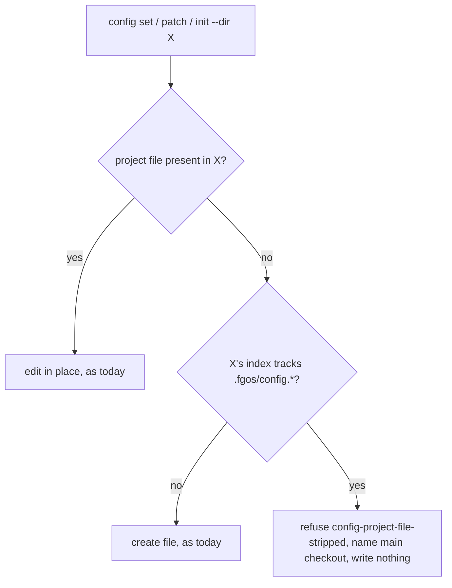

discussion: settled

## Hand-off {#handoff}

- **Outcome:** a config write never creates a project config file in a checkout whose Git index tracks that file but whose working copy lacks it (the stripped, skip-worktree `.fgos` of a worktree made by `fgos worktree create`). It refuses by name and names the remedy, and the refusal leaves every file byte-identical. Plain `fgos` stops being the reason a caller reaches for `--dir`: inside a linked worktree it runs the owning project's release (D5, task-launcher-in-linked-worktree).
- **Constraints:** the rule lives in the Config component's write transaction (`packages/config/rust/src/write.rs`, `commit_observed`), the one door every `set`, `unset`, `patch`, `migrate`, `refresh-docs` and `init` write goes through. No new mechanism beside it (L10). Config learns "is this path tracked" through the existing Git driver port, never a hand-rolled `git` call (design principles 1, 2, 3). Data-loss risk: the planner backs up `.fgos/config.yaml` in the main checkout before any manual reproduction. No env switch or test-only branch.
- **Non-goals:** redirecting a write from a worktree to the main checkout's file (D2); letting a worker branch commit `.fgos` changes (already forbidden, D4); changing why `fgos worktree create` strips `.fgos`, or what config a stripped worktree reads (separate item if wanted, §3 row 6).
- **Acceptance criteria:**
  1. A test seeds a checkout whose `.fgos/config.yaml` is tracked, removed from the working copy and marked skip-worktree; `config set` (and `patch`, `init` with the project target) in that checkout refuses with one named code (draft: `config-project-file-stripped`) whose message names the main checkout and the remedy, and the directory listing and every byte of `.fgos` are unchanged afterwards.
  2. The same test with a plain untracked, absent project file still creates the file as today (no regression for a fresh project).
  3. `refusals` registry and `docs/platform/config/spec.md` section 11 (write transaction) list the new code; CHANGELOG `[Unreleased]` gets one line.
  4. The existing commit guards are named as the owning proofs of "a stripped config cannot reach a commit" (D4); no second copy of their cases is added.
  5. `npm test` and `cargo test --workspace` green.
- **Open points blocking only a part:** none. Q1 (`q-4xd2a3eqxq`) answered 2026-11-26, recorded as D5.
- **Source:** backlog row p-mfllw32ynj; friction `worktree-stripped-config-set-writes-fresh-file`.

## 1. Trạng thái hiện tại

Settled 2026-11-26 in one scouting pass. Code read confirms the incident still reproduces in today's code: `commit_observed` installs a new file with `install_once_with_mode` whenever the project file is absent, with no check that Git tracks the path. The config refusal (D1), no redirect (D2), placement (D3) and the commit-guard reading (D4) are settled from code evidence and the owner's stated outcome. Q1 (how plain `fgos` behaves inside a linked worktree) was answered by the owner on 2026-11-26 and is recorded as D5. Nothing is open.

## 2. Mục tiêu & đề bài

On 2026-11-17 a caller in the main checkout ran `fgos config set --dir <linked worktree>` because plain `fgos` refused inside that worktree ("no .fgos/installation found"). The worktree, made by `fgos worktree create`, had its `.fgos` stripped and every tracked `.fgos` path marked skip-worktree. The config write saw no project file and created a fresh 12-line `.fgos/config.yaml` in place of the tracked 273-line one; skip-worktree hid it from `git status`. The owner's outcome: this write must never happen and a hidden overwrite must not be possible. The change is small and lives in the Config write door, plus a launcher fix that removes the push toward `--dir`.

## 3. Vấn đề rõ / chưa rõ

| # | Point | State | Evidence |
|---|---|---|---|
| 1 | Does today's code still create a fresh file? | Clear: yes | `packages/config/rust/src/write.rs` `commit_observed`: `None => install_once_with_mode(...)`, no tracked-path check |
| 2 | How the worktree gets stripped | Clear | `packages/git/rust/src/worktree.rs:935` marks every `ls-files .fgos` path `--skip-worktree`, then `strip_worktree_state` removes `.fgos` |
| 3 | Can the fresh file reach a commit? | Clear: no through fgOS doors; no for staged deletion by hand | `packages/git/rust/src/scoped_commit.rs:371` `is_store_path` (no checkout commit carries `.fgos`), scoped commit drops skip-worktree paths (`:1574`); `.githooks/pre-commit` refuses staged `.fgos` deletion on any branch and any `.fgos` change on `fgw/*`; land restores `.fgos` from the target (`packages/git/rust/src/land.rs:578`) |
| 4 | Why callers use `--dir` | Clear | `packages/distribution/rust/src/launcher.rs` walks up only for `.fgos/installation`; a worktree outside the main checkout has none |
| 5 | Launcher behaviour in a linked worktree | Clear: D5 (owner answer to Q1) | `q-4xd2a3eqxq` |
| 6 | A stripped worktree reads no project config except `command` keys (taken from the main checkout, spec section 5 rule 6) | Out of scope; noted only | `write.rs` `without_project`; spec `docs/platform/config/spec.md:190` |

authority: `fgos authority locate` names component `config` as owner of the write rule; no new component or decision kind, no `declare` needed.

## 4. Quyết định đã chốt

| ID | Decision | Why | Date |
|---|---|---|---|
| D1 | A project config write refuses, by one named code, when the target checkout's Git index tracks `.fgos/config.yaml` (or legacy `config.json`) but the working copy lacks it. The message names the main checkout and says to run the write there. Nothing is written. | Owner outcome; the only state where "create" silently shadows tracked content (§3 rows 1-2). | 2026-11-26 |
| D2 | No redirect: the write never goes to the main checkout's file from a worktree `--dir`. | A hidden cross-checkout write is the same class of surprise, and it would leave the main checkout dirty, which refuses other heads' lands (AGENTS.md "Writes to main"). A worker branch cannot commit `.fgos` anyway, so editing tracked content inside the worktree lands nowhere. | 2026-11-26 |
| D3 | The check sits in `commit_observed` (and `init` for the project target) in the Config component, before the lock, using the Git driver port to ask whether the path is tracked. | One write door for every config verb (design principle 1); Config owns the decision (authority locate); Git facts come only through the Git driver (principles 2-3). | 2026-11-26 |
| D5 | Inside a linked worktree with no `.fgos/installation` of its own, installed `fgos` runs the owning project's release: it reads the worktree's `.git` file (`gitdir:`) and that git dir's `commondir`, resolves the main checkout, and runs the release named by the main checkout's activation under the existing release trust rules. Anything odd (relative or missing `gitdir`, missing `commondir`, a common dir not named `.git`, no activation there) is refused by name, as today. | Owner answer to Q1 (`q-4xd2a3eqxq`), the recommended option; removes the push toward `--dir` (§3 row 4). | 2026-11-26 |
| D4 | No new commit guard. The scoped-commit store-path rule, the pre-commit `.fgos` deletion and worker-branch guards, and land's restore of `.fgos` already own "a stripped config cannot reach main"; the plan names them as owning proofs and adds none. | §3 row 3; design principle 8 (one proof). | 2026-11-26 |

## 5. Q&A log

- **2026-11-26 08:55** — Shaper scouted the write path, the worktree strip, the commit doors and the launcher (citations in §3). Settled D1-D4 from that evidence and the owner's stated outcome; nothing in them depends on owner taste.
- **2026-11-26 09:00** — Asked Q1 in the question store as `q-4xd2a3eqxq`.
- **2026-11-26 09:46** — Owner answered Q1: "Run the owning project's release". Recorded as D5; the launcher task is unblocked.

### Q1 {#Q1}

Inside a linked worktree, should installed `fgos` run the owning project's release, or refuse and name the door? Recommended: run the owning project's release (read the worktree's `.git` file and `commondir`, refuse anything odd). Blocks only task-launcher-in-linked-worktree. Question id: `q-4xd2a3eqxq`.

**Answer (owner, 2026-11-26):** run the owning project's release. → D5.

## 6. Thiết kế đã chốt {#design}

A config write has one door, `commit_observed` in `packages/config/rust/src/write.rs`. Before it takes the project lock it already resolves the target file and reads its current bytes. The new rule adds one fact to that step: when the target is the project file, the current bytes are absent, and the checkout's Git index tracks that path, the write stops with a named refusal and touches nothing. The fact comes from the Git driver port the Config component already depends on through its roots, not from a new shell call. A fresh project (path not tracked) is unchanged: the write creates the file as today. Nothing redirects to the main checkout. Commits stay guarded by the doors that already exist: no fgOS checkout commit carries a `.fgos` path, the pre-commit hook refuses staged `.fgos` deletions and worker-branch `.fgos` changes, and land rewrites `.fgos` from the target before it verifies. Separately, plain `fgos` inside a linked worktree runs the owning project's release (D5), resolved through the worktree's `.git` file and `commondir` and refusing anything odd, so callers stop needing `--dir` for everyday work.

## 7. Danh mục hạng mục / task {#tasks}

### Config refuses to create a stripped project file {#task-config-refuses-stripped-project-file}

- **Goal:** D1 and D3 in code, with acceptance criteria 1-3.
- **§6 excerpt:** the tracked-but-absent check in `commit_observed` and the project `init`.
- **D-IDs:** D1, D2, D3.
- **Siblings:** independent of the launcher task.
- **Draft verify:** `cargo test -p fgos-config` (the new stripped-worktree case beside the existing write-transaction tests), then `npm test` and `cargo test --workspace`.

### Name the owning commit proofs {#task-name-commit-proofs}

- **Goal:** D4: the plan's verify section cites the existing tests that prove a store path cannot be committed or land changed; if one of the three guards has no owning test, extend its owning file, never add a copy.
- **D-IDs:** D4.
- **Draft verify:** `rg -n "is_store_path|skip-worktree" packages/git/rust/tests test/` lists the owning tests.

### Plain fgos in a linked worktree {#task-launcher-in-linked-worktree}

- **Goal:** remove the push toward `--dir`: run the owning project's release from a linked worktree (D5).
- **D-IDs:** D5.
- **Blocked by:** nothing (Q1 answered).
- **Draft verify:** `cargo test -p fgos-distribution launcher` with a linked-worktree case.
