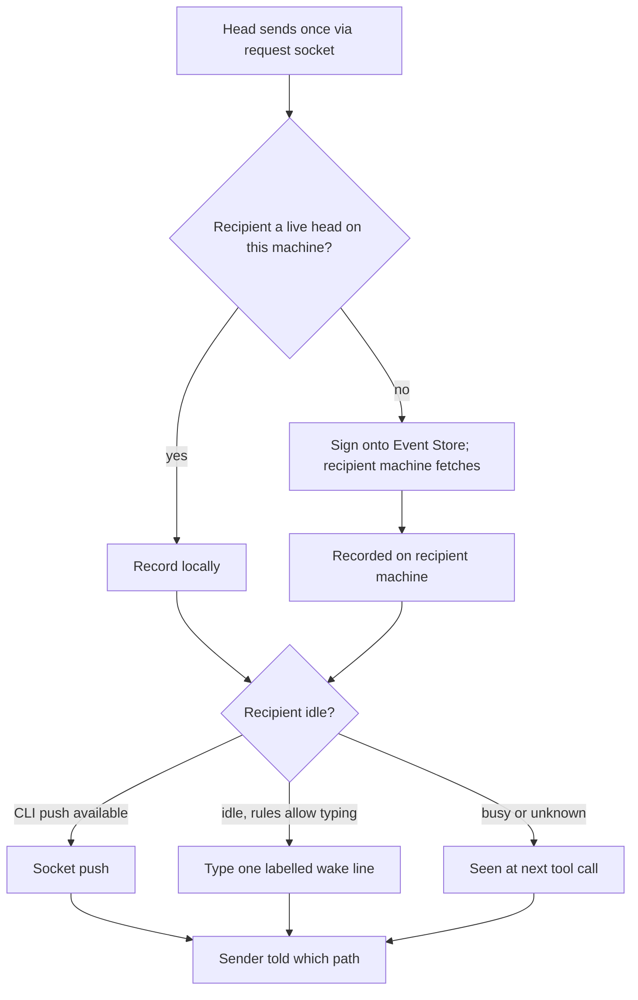

discussion: settled

## Hand-off {#handoff}

Settled 2026-11-25 23:10 for the **agent-to-agent** part (owner: "thảo luận agent-agent trước"). The owner channel and the missing-grant request of p-nnaksnxtwu are not settled here; they need a new discussion that cites this one (§3 row 12).

- **Outcome:** every head (secretary, supervisor, lead, planner, shaper) reaches a peer head from inside its confinement by sending once; the mailbox send door picks the fastest available path (local record on the same machine, Event Store across machines), wakes an idle recipient (CLI push, else one typed labelled wake line, else next tool call) and answers which path it took or the real cause of a refusal.
- **Constraints:** HC-D1 to HC-D5; no persona gains power over another (lead and planner recipient limits stay; the only new row is reading one's own inbox); typed text is only the fixed labelled wake line under `agent-mailbox/spec.md` §15.8 rules, never message content; no new channel or component (authority: `agent-mailbox`); one owning proof per behaviour, one live wiring probe.
- **Non-goals:** the owner channel and grant requests (next discussion); Claude Code `SendMessage` as a rung; a faster cross-machine wake than the Event Store sync; the mailbox head finder beside Identity (p-5igcekysul); latency measurement (p-whvn2fgyep, after this lands).
- **Acceptance criteria:** (1) the cause of tonight's confined `host-failed` and `lock-unavailable` is proven and fixed; (2) from inside the cage, each persona's `mailbox send` records and its own read returns mail, through the request socket; (3) no forwarded refusal is a bare `host-failed`; (4) mail queued for an old generation is offered once to the successor; (5) an idle recipient of each drained CLI on the same machine is woken within the declared bound without focus change, dialog answer or merge with half-typed input; (6) the send answer names the path taken; (7) one `_shared` know-how file replaces the three skill copies, and `agent-mailbox/spec.md` matches main; (8) a live probe from every confined persona, plus one cross-machine send read after a fetch.
- **Open points blocking only some parts:** the attach-record release question (spec §15.8, question 17) blocks only task-typed-wake; the root cause found by task-diagnose-confined-mail may reshape task-mail-through-socket.
- **Tasks:** §7. **Sources:** p-nnaksnxtwu (agent-to-agent part), p-rchuoa2v3k, p-ia2v33b54u, p-bifjfd5rix.

## Seed

Opened by the secretary (Miu) on the owner's order, 2026-11-25. Owner: Miu and the supervisor are the owner's two hands; if they cannot communicate they cannot ask for the power they need, so they stay stuck and silent.

- **Outcome:** every head has a guaranteed channel to the owner and to a peer head from inside its confinement, a refusal always names its cause, and a head refused for lack of a verb or door can file a request naming the missing grant.
- **Evidence (2026-11-25):** Miu's grant-probe result could not reach the heads-operate lead: `fgos session type` refused `target-not-stuck`; `fgos mailbox send` to the lead's role and handle failed `host-failed` with no reason; a head's mailbox cannot reach the owner (`unknown-name`).
- **Gather, do not add (RUL11):** `p-rchuoa2v3k`, `p-ia2v33b54u`, `p-5igcekysul`, `p-whvn2fgyep`, `p-bifjfd5rix`, `p-wb6rkwpjsg` (settled discussion ds-cfsfcbknl6 covers the owner side of wording and the question door).
- **Read first:** `src/session-host/head-grants.mjs`, `docs/platform/agent-mailbox/spec.md`, `docs/platform/supervision/spec.md` section 1.1.

## 1. Trạng thái hiện tại

Round 6 (2026-11-25 23:10, shaper). **Settled for agent to agent; handed to a planner (see Hand-off).** Round 5 (23:06): Domain: coding (fgOS platform). Authority: `agent-mailbox` owns the channel; no new component.

**Scope now:** agent to agent only (owner, 22:39). The owner channel (ds-cfsfcbknl6) and the missing-grant request are set aside, to be taken up after.

**Settled this session:** HC-D1 (a channel always exists; the sender lacks the capability to use all of it, so the door must carry the know-how), HC-D2 (fastest available channel first, then step down), HC-D3 (the mailbox carries the content in both scopes, same machine and cross machine). Provisional, one round old: typing into the recipient's pane is the wake layer and types only one labelled wake line, never the message (owner "đồng ý", 22:46).

**Answered 23:05:** the send door walks the ladder (owner chose B; `q-hcnhbtf74z` cancelled as answered in chat). The head sends once and reads one answer naming the path taken.

**Next:** §7 task list drafted; one more round to confirm the typed-wake shape and the door choice, then the agent-to-agent part settles. Not verified: the confined send failure's cause (diagnose first in the plan).

## 2. Mục tiêu & đề bài

Agents (heads: secretary, supervisor, lead, planner, shaper) must always be able to reach each other, from inside their confinement, by the fastest channel available for that message, stepping down until one delivers, with the sender always told which channel delivered or why none did. Four cases are distinguished: same machine or cross machine, and same CLI or different CLI. Speed depends on two axes: the transport (same machine: seconds; cross machine: the recipient machine's next Event Store fetch) and the recipient CLI's wake channel (woken, seen at the next tool call, or read on demand). The sender's CLI hardly matters. The mailbox carries every message in both scopes; typing one labelled wake line into an idle recipient's pane is the universal wake on the same machine. This gathers existing rows (RUL11) and widens no head's grants.

## 3. Vấn đề rõ / chưa rõ

| # | Point | State | Current view | Evidence |
|---|---|---|---|---|
| 1 | Who walks the ladder | provisional, owner chose B (23:05) | The send door: the head sends once; the door picks local or remote, wakes the recipient and answers which path it took. The head never chooses a channel. | `mailbox_remote.rs` header; HC-D1 |
| 2 | The four cases | provisional | See §6 table. | spec §6.2, §7, §15.2; `mailbox_remote.rs`, `mailbox_sync.rs` |
| 3 | Typed wake line | provisional (owner agreed once) | Only the fixed labelled line, only under the §15.8 rules (idle and empty composer, no dialog, no focus change, one outstanding nudge, fall back on unknown). The door types it, so no head needs `session type` for this. | spec §15.8, §8.1 |
| 4 | Claude Code `SendMessage` as a rung | decided by analysis, report to owner | Not a rung: it has no record, framing or delivery report (K1, spec §7.2), and the typed wake already gives every same-machine CLI a seconds-level wake. | spec §7.2 |
| 5 | Mailbox inside the cage | clear (fix) | Send and read through the request socket so the host writes the record; diagnose today's `host-failed` first. | p-rchuoa2v3k, p-ia2v33b54u |
| 6 | Mail across rotation | clear (fix) | Addressed to the role, follows a rotation, offered once. | p-bifjfd5rix |
| 7 | Every refusal names cause and next step | clear (fix) | No bare `host-failed`. | forwarder.rs:509 |
| 8 | Cross-machine latency | known limit | Recorded, not delivered, until the recipient machine fetches (`eventStore.sync.intervalSec`, 300 s, only while an fgOS process runs there); a faster cross-machine wake is not in scope. | spec §15.2 |
| 9 | agy not drained | known limit | Typed wake plus `inbox` is its path. | spec §7.3 |
| 10 | Spec staleness | fix in the plan | `agent-mailbox/spec.md` header and §15.2 still call cross-machine mail later and built on a branch; code on main has it. | `apps/fgos/src/wiring/mailbox_*.rs` |
| 11 | Shared know-how | provisional | One `_shared` file, short: "send once, read the answer"; the three private copies in the secretary, supervisor and lead skills move into it. | HC-D1 |
| 14 | Reading one's own mail from the cage | clear (gap found) | No row of the permission table names `mailbox inbox`, so a confined head's explicit read is decided `ask` today and its hook drain fails `lock-unavailable`. Reading one's own inbox is needed for the door to work; it is one base `head` row, not a wider power over others. | `packages/session-host/contracts/head-permissions.v1.json` (no `mailbox inbox` row) |
| 12 | Owner channel, missing-grant request | deferred (owner 22:39) | Next discussion step after agent-to-agent. | p-wb6rkwpjsg, head_request.rs:1572 |
| 13 | Mailbox head finder beside Identity; latency measurement | out of scope / later | Own rows. | p-5igcekysul, p-whvn2fgyep |

## 4. Quyết định đã chốt

| D-ID | Decision | Date | Basis |
|---|---|---|---|
| HC-D1 | A channel always exists; what fails is the sender's capability to use all of it. The know-how lives in the door and in refusals, not only in each head's skill. | 2026-11-25 | owner 22:18, held through rounds 3-4 |
| HC-D2 | Use the fastest channel available for this message first, then step down to the next; the sender learns which channel delivered or why none did. | 2026-11-25 | owner 22:20, held through rounds 3-4 |
| HC-D3 | Agent to agent, the mailbox carries the message in both scopes: locally on the same machine, through the Event Store across machines (local head always wins). No supervision-event rung. | 2026-11-25 | owner 22:19 (two scopes) and 22:39; scout of `mailbox_remote.rs`; held rounds 3-4 |
| HC-D4 | The mailbox send door walks the ladder: the head sends once and reads one answer naming the path taken; no head chooses a channel. | 2026-11-25 | owner B 23:05, confirmed 23:10 |
| HC-D5 | Typing into the recipient's pane is the wake layer only: one fixed labelled wake line under the §15.8 rules, typed by the send door; the message content stays in the mailbox. | 2026-11-25 | owner 22:46, confirmed 23:10 |

## 5. Q&A log

- **2026-11-25 22:10, shaper, round 1.** Scouted the permission table, the forwarder refusal path and `ask_owner`. Finding: the owner door and the unmatched-verb grant request already exist; the peer door (mailbox inside the cage) and reasonless refusals are the real gaps. Parked `q-ng4ojyph5r` (mailbox or queue as the peer door).
- **2026-11-25 22:15, owner (chat).** Asked for the goal and the current state; shaper restated both.
- **2026-11-25 22:17, owner.** Agreed to the six fix steps (mailbox through the socket, grants unchanged, mail by role, sender always knows the result, a guaranteed fallback, a live probe per persona).
- **2026-11-25 22:18, owner.** "luôn có khả năng trao đổi nhưng người gửi không có đủ năng lực để sử dụng hết khả năng." Shaper added step 7: shared know-how, self-teaching refusals, a probe that breaks the mailbox and checks the head falls back.
- **2026-11-25 22:19, owner.** "về trao đổi thực chất chỉ có 2 phạm vi, xuyên máy hoặc cùng máy." Shaper mapped same machine to the mailbox and cross machine to the Event Store.
- **2026-11-25 22:20, owner.** "nguyên tắc là phải sử dụng kênh khả dụng cho kết quả truyền tải nhanh nhất trước, sau đó thử xuống các kênh khác." Supersedes the single-door framing of `q-ng4ojyph5r`; new open point §3 row 1.
- **2026-11-25 22:39, owner.** "thảo luận agent-agent trước. cần phân biệt các case xuyên máy, cùng máy, cùng cli, khác cli." Scope narrowed to agent-to-agent; owner channel (ds-cfsfcbknl6) and the missing-grant request are set aside for now. Scout: cross-machine mail is already built in the mailbox (`apps/fgos/src/wiring/mailbox_remote.rs`, `mailbox_sync.rs`: Event Store stream `project:mailbox`, signed, "recorded" until the recipient machine fetches; "a local head always wins"), so `agent-mailbox/spec.md` §15.2 calling it later is stale. The round-2 rung "supervision event as the cross-machine rung" is withdrawn: the mailbox already covers both scopes. Speed depends on two axes: the transport (same machine or not) and the recipient CLI's wake channel (spec §6.2 tiers push/turn/pull); the sender's CLI matters only where a CLI has its own native peer channel (Claude Code `SendMessage`, out of mailbox policy per K1, spec §7.2).
- **2026-11-25 22:45, owner.** "type in là một phương pháp hiệu quả đặc biệt không được nhắc tới." Scout: typing into the recipient's pane is the one wake channel that works for every CLI in a terminal on the same machine, idle or not, without hooks (p-rchuoa2v3k: mail typed to the lead by `session type` arrives while the confined read fails; `agent-mailbox/spec.md` §7 measured agy woken by a typed line in 19.1 s). The design already exists and was shelved on 2026-10-20 for lack of a consumer: §15.8 typed-signal rules (idle and empty composer only, no open dialog, one short labelled line, no focus change, one outstanding nudge, fall back when unknown). Risks it answers: typed text reaches the model as user input (§8.1 says peer text never carries user authority), it can merge with the owner's half-typed line or answer a dialog, and it cannot cross machines. Today only the supervisor and secretary may type, and only into a session an open supervision event names (`target-not-stuck`).

- **2026-11-25 22:46, owner.** "đồng ý" to the typed wake being one labelled line only, the content staying in the mailbox. Shaper decided by analysis, to report: Claude Code `SendMessage` is not a rung (§3 row 4). HC-D1, HC-D2, HC-D3 minted.
- **2026-11-25 23:04, owner.** "đi thang là sao". Shaper explained with tonight's case: A, the head tries channels itself (Miu stopped after two); B, one `mailbox send` tries them and answers which path it took.
- **2026-11-25 23:05, owner.** "chọn B". `q-hcnhbtf74z` cancelled with that reason. Shaper drafted §7.
- **2026-11-25 23:10, owner.** "đồng ý" to the §7 task list and the own-inbox row. HC-D4 and HC-D5 minted (held two rounds). Shaper settled the agent-to-agent part and wrote the hand-off; the owner channel and the grant request go to a new discussion.

## 6. Thiết kế đã chốt {#design}

Settled (HC-D1 to HC-D5).

A head sends a message once, through its request socket, to the mailbox send door. The door walks the ladder for it: if the recipient is a live head on this machine the message is recorded locally; otherwise it is signed onto the Event Store for the recipient's machine. On the machine that holds the recipient, the fastest wake its CLI allows is used: Claude Code sessions started to accept get a socket push; any other idle recipient in a terminal gets one typed, labelled wake line under the §15.8 rules; otherwise the message is seen at the recipient's next tool call. The sender's answer always names which path was taken (recorded locally and woken, recorded and waiting for the next tool call, recorded for another machine) or the real cause of a refusal.

| Case | Transport | Wake on the recipient's machine | Expected time |
|---|---|---|---|
| Same machine, same CLI | mailbox, local record | CLI push if available, else typed wake line, else next tool call | seconds |
| Same machine, different CLI | mailbox, local record | by the recipient's CLI, same order | seconds |
| Cross machine, same CLI | mailbox via Event Store | after the recipient machine fetches, same order | minutes (sync interval) |
| Cross machine, different CLI | mailbox via Event Store | same as above | minutes |

## 7. Danh mục hạng mục / task {#tasks}

Draft, agent-to-agent part only. Order is dependency order; each task owns one behaviour proof at the lowest layer, and task-live-probe is the one wiring proof above them.

### Diagnose confined mail {#task-diagnose-confined-mail}
- Goal: prove why a confined head's `mailbox send` fails (`host-failed` tonight, `event-store-unavailable` read-only FS on 2026-11-22) and why its read fails `lock-unavailable`, before changing anything.
- §6: "A head sends a message once, through its request socket".
- D-IDs: HC-D1. Sources: p-rchuoa2v3k, p-ia2v33b54u.
- Verify (draft): a reproduced failure from a confined head with the real cause named in the report.

### Mail through the request socket {#task-mail-through-socket}
- Goal: every head persona sends and reads its own mail through the request socket; the host writes the record and the lock; no confined process opens either. Adds the base `head` row for reading one's own inbox (§3 row 14); recipient limits of lead and planner stay.
- Refusals: every forwarded refusal carries its real code; bare `host-failed` is gone (`packages/session-host/rust/src/forwarder.rs:509`).
- Depends on: task-diagnose-confined-mail.
- Verify (draft): the session-host forwarder and mailbox verb tests for send and inbox from a confined persona.

### Mail follows a rotation {#task-mail-follows-rotation}
- Goal: mail queued for a head's old generation is offered to its successor exactly once.
- Sources: p-bifjfd5rix.
- Verify (draft): mailbox record test across a generation bump.

### The send door wakes the recipient {#task-typed-wake}
- Goal: after recording, `mailbox send` wakes an idle recipient on its machine by the fastest channel: CLI push where accepted, else one typed labelled wake line under the §15.8 rules, else next tool call. The door types; no head needs `session type` for this. The answer names the path taken.
- Builds the shelved design of `agent-mailbox/spec.md` §15.8 (composer state with fixtures, focus-neutral typing, one outstanding nudge, the open attach-record question 17).
- D-IDs: HC-D2, HC-D3. Depends on: task-mail-through-socket.
- Verify (draft): agent-protocol composer fixtures per CLI plus a mailbox nudge test; live case: an idle head of each drained CLI wakes within the bound without focus change or merging with half-typed input.

### One shared know-how file and the spec {#task-knowhow-and-spec}
- Goal: one `core/skills/_shared` file saying "send once, read the answer, here is what each answer means"; the secretary, supervisor and lead skills point to it instead of their own copies. `agent-mailbox/spec.md` header and §15.2 updated to what main holds; §15.8 moves from later to built.
- D-IDs: HC-D1.

### Live probe from every confined persona {#task-live-probe}
- Goal: secretary, supervisor, lead, planner and shaper each send to a peer and read a reply from inside the cage, on the same machine; one cross-machine send is recorded and read after a fetch. This is the wiring proof, not a copy of the lower tests.
- Depends on: all tasks above.

## Q1 {#Q1}

Which door is the one guaranteed head-to-head channel? Superseded on 2026-11-25 22:20 by the owner's ladder principle (fastest available first, then step down); `q-ng4ojyph5r` superseded by `q-hcnhbtf74z`.

## Q2 {#Q2}

Who walks the ladder: each head by itself, taught by a shared skill and by refusals that name the next rung, or one send door that tries the rungs in order and reports which delivered? Recommended: the door. Five-part form in the question store; id: `q-hcnhbtf74z`. Answered by the owner in chat on 2026-11-25 23:05: B, the door walks it; the question was cancelled with that reason.
