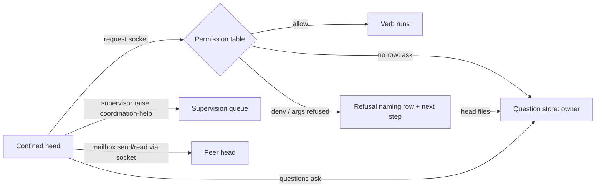

discussion: open

## Seed

Opened by the secretary (Miu) on the owner's order, 2026-11-25. Owner: Miu and the supervisor are the owner's two hands; if they cannot communicate they cannot ask for the power they need, so they stay stuck and silent.

- **Outcome:** every head has a guaranteed channel to the owner and to a peer head from inside its confinement, a refusal always names its cause, and a head refused for lack of a verb or door can file a request naming the missing grant.
- **Evidence (2026-11-25):** Miu's grant-probe result could not reach the heads-operate lead: `fgos session type` refused `target-not-stuck`; `fgos mailbox send` to the lead's role and handle failed `host-failed` with no reason; a head's mailbox cannot reach the owner (`unknown-name`).
- **Gather, do not add (RUL11):** `p-rchuoa2v3k`, `p-ia2v33b54u`, `p-5igcekysul`, `p-whvn2fgyep`, `p-bifjfd5rix`, `p-wb6rkwpjsg` (settled discussion ds-cfsfcbknl6 covers the owner side of wording and the question door).
- **Read first:** `src/session-host/head-grants.mjs`, `docs/platform/agent-mailbox/spec.md`, `docs/platform/supervision/spec.md` section 1.1.

## 1. Trạng thái hiện tại

Round 1 (2026-11-25 22:10, shaper). Domain: coding (fgOS platform, session-host and agent-mailbox). Authority: `fgos authority locate` names `agent-mailbox` and `questions` as the owning components; no new component is needed so far.

The scouting changes the shape of the seed. Two of the three doors the item asks for already exist and are granted to every head; the third (peer to peer) is the one that is broken:

- **Owner channel exists.** Every head persona inherits `questions ask|ack|cancel` and `supervisor raise --kind coordination-help` from the base `head` row of `packages/session-host/contracts/head-permissions.v1.json`. The `unknown-name` Miu hit was the mailbox, which is not the owner door; supervision spec 1.1 already says owner decisions go through the question store.
- **Grant request exists for unmatched verbs.** An argv that no row of the permission table matches is decided `ask`: `ask_owner` in `packages/run-supervisor/rust/src/head_request.rs:1572` files a five-part owner question carrying the exact argv and answers `asked` with the question id. What is missing: a `deny` row and an `args`-limited row (e.g. a lead's `mailbox send --to` outside `head:secretary-*|head:supervisor-*`) refuse flat, and the refusal text does not tell the head that it can file a request or how.
- **Peer channel is broken inside the cage.** Mail send from a confined head fails (`host-failed` with no reason, p-nnaksnxtwu; `event-store-unavailable` read-only FS, p-ia2v33b54u); mail read fails `lock-unavailable` (p-rchuoa2v3k); mail is lost across a rotation (p-bifjfd5rix). `session type` only works on a target named by an open supervision event, by design.
- **Bare `host-failed`** is the fallback code of `packages/session-host/rust/src/forwarder.rs:509` when the host verb's output carries no code the forwarder can parse.

Open: which door is the guaranteed peer channel (q- id below, parked). Everything else is shaped provisionally in §3 and can move without that answer.

Parked owner questions: `q-ng4ojyph5r` (§3 row 1, [Q1](#Q1)).

## 2. Mục tiêu & đề bài

A head (secretary, supervisor, lead, planner, shaper) runs inside a confinement cage and talks to the world only through its request socket and the permission table. When it lacks a verb or a route, today it often cannot say so: the refusal is flat, sometimes reasonless (`host-failed`), and the mailbox it would use to tell a peer is itself broken inside the cage. The goal is that no head is ever both stuck and silent: it always has one working door to the owner, one working door to a peer head, every refusal names its cause and the next step, and a refusal for a missing grant turns into a request the owner (through Miu) can answer, without the head needing the very thing it lacks. This gathers six existing backlog rows into one shape instead of adding a seventh mechanism (RUL11), and it does not widen any head's powers: answering a request stays the owner's.

## 3. Vấn đề rõ / chưa rõ

| # | Point | State | Current view | Evidence |
|---|---|---|---|---|
| 1 | Which door is the guaranteed peer channel (head to head) | open, owner question `q-ng4ojyph5r` | Recommend: fix the mailbox inside the cage (send and read through the request socket) and keep it the one peer door; the supervision queue stays the help door, not a chat. | p-rchuoa2v3k, p-ia2v33b54u, p-bifjfd5rix; supervision spec 1.1 |
| 2 | Which door is the guaranteed owner channel | provisional | The question store (`questions ask`), already granted to every head; no new verb. The mailbox does not reach the owner and should not. | head-permissions.v1.json `head` row; supervision spec 1.1 |
| 3 | How a head requests a missing grant | provisional | Reuse the existing `ask` decision (`ask_owner`). Extend only the refusal: a `deny`, `argv-not-allowed` or `recipient-not-allowed` refusal names the row that refused and the exact next step (`fgos questions ask` with the argv), so the head can file it itself. `deny` rows stay hard. | forwarder.rs:41-55, head_request.rs:1572 |
| 4 | Who receives a grant request | provisional | The owner, through the question store; Miu relays as today. No separate secretary inbox. | supervision spec 1.1; ds-cfsfcbknl6 |
| 5 | Bare `host-failed` | clear (fix) | Every forwarded refusal carries a domain code; `host-failed` with no parseable code becomes a defect with the host's own stderr tail attached, and the case Miu hit gets its real code. | forwarder.rs:509, head-request.mjs:197 |
| 6 | Mail lost across rotation | clear (fix, belongs to the peer door) | Folded in under row 1 whichever door wins, if the mailbox wins. | p-bifjfd5rix |
| 7 | Mailbox head finder beside Identity | open, scope | Likely out of this shape (it is an identity-boundary cleanup, not a communication gap); keep as its own row unless the confined-read fix touches it. | p-5igcekysul |
| 8 | Mailbox latency and reliability measurement | open, scope | Measure-first item; a later step once the cage door works, not a blocker. | p-whvn2fgyep |
| 9 | Owner-side wording | settled elsewhere | ds-cfsfcbknl6 owns the owner-facing form; this discussion uses it. | p-wb6rkwpjsg |

## 4. Quyết định đã chốt

| D-ID | Decision | Date | Basis |
|---|---|---|---|

(None yet; no point has held across more than one round.)

## 5. Q&A log

- **2026-11-25 22:10, shaper, round 1.** Scouted the permission table, the forwarder refusal path and `ask_owner`. Finding: the owner door and the unmatched-verb grant request already exist; the peer door (mailbox inside the cage) and reasonless refusals are the real gaps. Parked one owner question on the peer door (§3 row 1): `q-ng4ojyph5r`.

## 6. Thiết kế đã chốt {#design}

Not yet settled. Provisional shape: three doors, each already in the code, made reliable rather than added to.

## 7. Danh mục hạng mục / task {#tasks}

Draft only; filled once §3 row 1 is answered.

## Q1 {#Q1}

Which door is the one guaranteed head-to-head channel? Recommended: fix the mailbox inside the cage (send and read through the request socket, mail follows a rotation, refusals name their cause) and keep it the one peer door; the alternative is to carry peer messages on the supervision queue. Five-part form in the question store; id: `q-ng4ojyph5r`.
