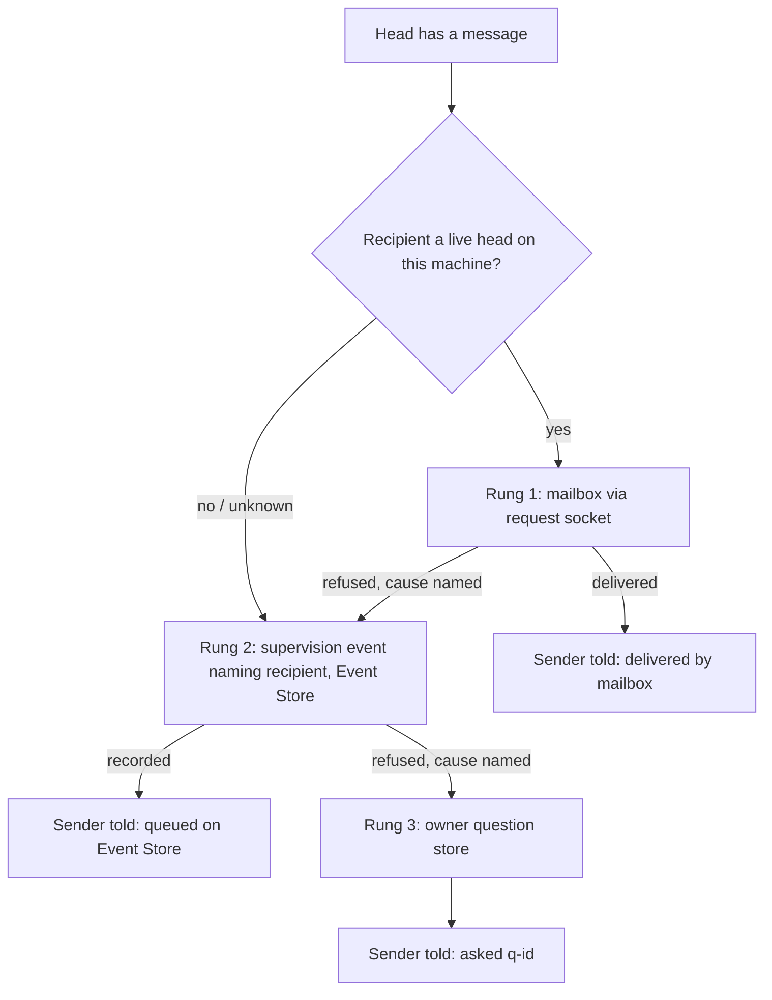

discussion: open

## Seed

Opened by the secretary (Miu) on the owner's order, 2026-11-25. Owner: Miu and the supervisor are the owner's two hands; if they cannot communicate they cannot ask for the power they need, so they stay stuck and silent.

- **Outcome:** every head has a guaranteed channel to the owner and to a peer head from inside its confinement, a refusal always names its cause, and a head refused for lack of a verb or door can file a request naming the missing grant.
- **Evidence (2026-11-25):** Miu's grant-probe result could not reach the heads-operate lead: `fgos session type` refused `target-not-stuck`; `fgos mailbox send` to the lead's role and handle failed `host-failed` with no reason; a head's mailbox cannot reach the owner (`unknown-name`).
- **Gather, do not add (RUL11):** `p-rchuoa2v3k`, `p-ia2v33b54u`, `p-5igcekysul`, `p-whvn2fgyep`, `p-bifjfd5rix`, `p-wb6rkwpjsg` (settled discussion ds-cfsfcbknl6 covers the owner side of wording and the question door).
- **Read first:** `src/session-host/head-grants.mjs`, `docs/platform/agent-mailbox/spec.md`, `docs/platform/supervision/spec.md` section 1.1.

## 1. Trạng thái hiện tại

Round 2 (2026-11-25 22:25, shaper, owner live in chat). Domain: coding (fgOS platform). Authority: `fgos authority locate` names `agent-mailbox` and `questions` as owners; no new component so far.

Settled direction this round (owner, provisional until it holds one more round):

- **The real gap is know-how, not only mechanism.** A channel always exists; the sending head lacks the capability to use all of it (Miu stopped after `session type` and `mailbox send` failed, though `supervisor raise` and `questions ask` worked).
- **Communication has exactly two scopes: same machine and cross machine.** Same machine is the mailbox (`agent-mailbox/spec.md`: one machine, one project, live heads only). Cross machine is the Event Store (question store, supervision queue), synced through git.
- **Principle: use the fastest available channel first, then step down to the next.** Communication is a ladder ordered by delivery speed, each rung gated by whether it is available for this message right now, not one fixed door.

Open: who walks the ladder, the head itself (taught by a shared skill and by refusals) or the send door automatically. Parked as `q-hcnhbtf74z` (§3 row 1, [Q2](#Q2)). `q-ng4ojyph5r` (mailbox or queue as the one peer door) is superseded by the ladder principle.

## 2. Mục tiêu & đề bài

A head (secretary, supervisor, lead, planner, shaper) runs inside a confinement cage and talks to the world only through its request socket and the permission table. Today it can be stuck and silent: the refusal is flat or reasonless (`host-failed`), the mailbox is broken inside the cage, and the head does not know which other channel still works. The goal is that no head is ever both stuck and silent. Communication has two scopes, same machine and cross machine; for every message the head (or its door) uses the fastest channel available for that scope first and steps down until one delivers, every refusal names its cause and the next rung, and a refusal for a missing grant becomes a request the owner (through Miu) can answer without the head needing what it lacks. This gathers six backlog rows into one shape instead of a seventh mechanism (RUL11) and widens no head's powers.

## 3. Vấn đề rõ / chưa rõ

| # | Point | State | Current view | Evidence |
|---|---|---|---|---|
| 1 | Who walks the ladder: the head (skill + refusal hints) or the send door (one send tries rungs in order) | open, owner question `q-hcnhbtf74z` ([Q2](#Q2)) | Recommend the door: a deterministic walk the head cannot get wrong, which is the owner's own diagnosis (heads lack the capability). | owner round 2; design principle 5 |
| 2 | The ladder order | provisional (owner principle) | Same machine, recipient live: mailbox (seconds). Otherwise or when it fails: Event Store, a supervision event naming the recipient (minutes, crosses machines). Last: question store to the owner (human latency). `session type` is not a rung: it is the supervisor's hands-on act on a stuck session. | `agent-mailbox/spec.md` §1 scope; `questions/spec.md` machine field |
| 3 | "Available" | provisional | Decided per message from live facts: is the recipient a live head on this machine (Identity), is the mailbox breaker closed, does the head's table allow the rung. Never from a cached guess. | design principle 5 |
| 4 | Mailbox inside the cage | clear (fix) | Send and read go through the request socket so the host writes the record; the cause of today's send failure is not proven yet, so the plan diagnoses first. | p-rchuoa2v3k, p-ia2v33b54u |
| 5 | Mail across rotation | clear (fix) | Mail is addressed to the role, follows a rotation, offered once. | p-bifjfd5rix |
| 6 | Every refusal names cause and next rung | clear (fix) | No bare `host-failed`; a refusal names the row or rung that refused and the next rung this head may use, read from the permission table so it never drifts. | forwarder.rs:509, head-request.mjs:197 |
| 7 | Missing-grant request | provisional | Reuse the existing `ask` decision (`ask_owner`); `deny` rows stay hard but their refusal names the request step. | head_request.rs:1572 |
| 8 | Shared know-how | provisional | One `_shared` file on the two scopes and the ladder, referenced by every head skill; the three private copies (secretary, supervisor, lead skills) move into it. | `core/skills/fgos-{secretary,supervisor,lead}/SKILL.md` |
| 9 | Does the supervision queue cross machines for a peer message | open, not verified | To check before planning: questions are acted on only by the asker's machine; whether a supervision event raised on A is seen by the supervisor on B is unread. | `questions/spec.md` machine rule |
| 10 | Mailbox head finder beside Identity | out of scope | Own row. | p-5igcekysul |
| 11 | Mailbox latency measurement | later | After the ladder works. | p-whvn2fgyep |
| 12 | Owner-side wording | settled elsewhere | ds-cfsfcbknl6. | p-wb6rkwpjsg |

## 4. Quyết định đã chốt

| D-ID | Decision | Date | Basis |
|---|---|---|---|

(None yet; the three owner points of round 2 are minted once they hold through the next round.)

## 5. Q&A log

- **2026-11-25 22:10, shaper, round 1.** Scouted the permission table, the forwarder refusal path and `ask_owner`. Finding: the owner door and the unmatched-verb grant request already exist; the peer door (mailbox inside the cage) and reasonless refusals are the real gaps. Parked `q-ng4ojyph5r` (mailbox or queue as the peer door).
- **2026-11-25 22:15, owner (chat).** Asked for the goal and the current state; shaper restated both.
- **2026-11-25 22:17, owner.** Agreed to the six fix steps (mailbox through the socket, grants unchanged, mail by role, sender always knows the result, a guaranteed fallback, a live probe per persona).
- **2026-11-25 22:18, owner.** "luôn có khả năng trao đổi nhưng người gửi không có đủ năng lực để sử dụng hết khả năng." Shaper added step 7: shared know-how, self-teaching refusals, a probe that breaks the mailbox and checks the head falls back.
- **2026-11-25 22:19, owner.** "về trao đổi thực chất chỉ có 2 phạm vi, xuyên máy hoặc cùng máy." Shaper mapped same machine to the mailbox and cross machine to the Event Store.
- **2026-11-25 22:20, owner.** "nguyên tắc là phải sử dụng kênh khả dụng cho kết quả truyền tải nhanh nhất trước, sau đó thử xuống các kênh khác." Supersedes the single-door framing of `q-ng4ojyph5r`; new open point §3 row 1.

## 6. Thiết kế đã chốt {#design}

Not yet settled; provisional shape after round 2.

Communication is a ladder in two scopes. For each message the fastest rung available for it is tried first; a rung that is not available or fails yields to the next, and the sender always learns which rung delivered or why none did. Rungs, fastest first: the mailbox (same machine, recipient a live head), a supervision event naming the recipient on the Event Store (crosses machines), and the owner question store (human). Every rung is reached from inside the cage through the request socket, so no head needs a write it lacks. A refusal names its cause and the next rung. A missing grant is asked through the existing `ask` path. Heads learn the ladder from one shared skill file, and the refusal text repeats the next step at the moment it is needed.

## 7. Danh mục hạng mục / task {#tasks}

Draft only; filled once §3 row 1 is answered.

## Q1 {#Q1}

Which door is the one guaranteed head-to-head channel? Superseded on 2026-11-25 22:20 by the owner's ladder principle (fastest available first, then step down); `q-ng4ojyph5r` superseded by `q-hcnhbtf74z`.

## Q2 {#Q2}

Who walks the ladder: each head by itself, taught by a shared skill and by refusals that name the next rung, or one send door that tries the rungs in order and reports which delivered? Recommended: the door. Five-part form in the question store; id: `q-hcnhbtf74z`.
