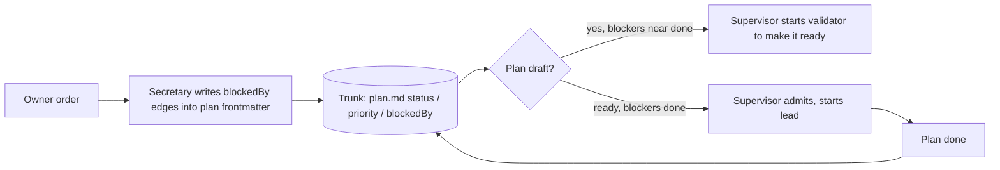

discussion: open

## Seed

Opened by the secretary (Miu) on the owner order relayed by lead:SUPERVISOR, goal set 2026-11-26. Read the source backlog rows first; they hold the evidence. Park owner questions in the question store instead of waiting on them.

- **Outcome:** a command or standing order that drives the owner's release sequence of plans to done, in order, without waiting to be asked, and survives head rotation. Settle what the command is, who runs it and where the order is kept.

## 1. Trạng thái hiện tại

Round 1 (2026-11-26, shaper head `release-chain-command`). Domain: supervision (fgOS platform; no `domains/supervision/AGENTS.md` exists, so the supervision spec is the doctrine read).

The first scout found that most of the mechanism already exists. Plan frontmatter already carries `priority` and `blockedBy`, and the supervisor admits a `ready` plan only when every `blockedBy` plan is `done` (`docs/platform/supervision/spec.md`, Shared Entities row "Plan", line 73; flow "Wake to admission", line 131). The owner's order today lives only in backlog row p-755psfxpmh and in the secretary's habit of comparing it on each wake; none of the named plans encodes it (all are P1 with empty `blockedBy`). So the order is held by a person-like loop, not by state, and it is lost when the secretary rotates or forgets.

Leading framing (proposed, not settled): the "command" is not a new engine. The order is written into the plans themselves as `blockedBy` edges, which the supervisor already honours and which live on the trunk and survive any rotation. What is genuinely missing is listed in §3: draft plans that nobody drives to `ready`, backlog-only items that have no plan, a cap of two full test suites, and what "released" means.

Open owner questions: q-anofq5k6pf (Q1) (what "released" means), q-wwsaazcrbz (Q2) (how the two-suite cap is held). Shaping continues on everything they do not block.

## 2. Mục tiêu & đề bài

The owner gave a release sequence of plans (backlog p-755psfxpmh): two plans in parallel first (heads-operate 261124-0004 and land-door 261125-1558), then three that each wait on one of those, then the keeper skeleton, then fillers, then two low-priority plans last, with never more than two full test suites at once and three land-cost backlog items queued right after step 2. Today this order is carried by the secretary reading a backlog row on each wake; it stalls whenever she is not woken, when a plan in the sequence is still `draft`, or when an item has no plan at all, and it is lost on rotation if the next secretary does not read the row. The discussion settles one way to hold such an order as state, so the supervision machinery drives it to done without anyone asking, and so it works for any project using fgOS, not only for this one sequence.

## 3. Vấn đề rõ / chưa rõ

| # | Point | State | Evidence / note |
|---|-------|-------|-----------------|
| 1 | Where the order is kept | Leaning: plan frontmatter `blockedBy` (+ `priority`) | Supervisor already admits by `blockedBy` + priority (supervision spec l.73, l.131). Durable on trunk, survives rotation, no new door (L10). A separate "sequence file" would be a second authority over admission order. |
| 2 | Draft plans in the sequence | Open | shaper-worktree 261125-1557, backlog-index-generated 261125-1556, orchestration-skeleton 261122-0056, watcher-counts 261125-1558, confinement-to-rust 261124-1853 are `draft`. Supervisor admits only `ready`. Nobody is named to validate them to `ready` in order. Candidate: the supervisor starts a validator/planner for a draft plan once all its `blockedBy` are done (or earlier, so it is ready in time). |
| 3 | Backlog items with no plan | Open | p-l54vuzupa5, p-6sd4fslxv7, p-vyzy7isj3z, p-oq4hnkqyai have no plan; `blockedBy` can only name plans. Candidate: a planner is opened for them now, and their plans carry the `blockedBy` edge. |
| 4 | Two full test suites at most | Open — q-wwsaazcrbz (Q2) | No suite cap exists: `supervisor.maxLeads: 4` (`core/config-standard/supervisor.yaml`) and lanes count workers, not suites. |
| 5 | What "released" means | Open — q-anofq5k6pf (Q1) | Plan `done` (landed on main) vs. a staged and activated fgOS release after each step. Releases are stopped now (q-cmio6uyrqz: release checks fail). |
| 6 | Who runs it | Leaning: the supervisor, as today | The supervisor already admits on wake; the order needs no new runner once it is state. The secretary's role shrinks to writing the edges when the owner gives an order. |
| 7 | How an owner order becomes edges | Open | Who writes `blockedBy` into other plans' frontmatter (secretary lands portfolio files; the plan contract owns frontmatter). |
| 8 | Current state of the sequence | Clear | Step 1 done (261124-0004 done, 261125-1558 land-door done). head-lifecycle-events 261124-2143 running. delete-dead-node 261122-2108 done. |
| 9 | `fgos supervisor plans` from this head | Friction | Refused `ref-invalid: case:head-window-c-1143-…` from inside this shaper head; read frontmatter directly instead. |
| 10 | Component authority | Not yet run | `fgos authority locate` to be run once the shape (row 1, 2) holds. |

## 4. Quyết định đã chốt

| D-ID | Decision | Date | Ground |
|------|----------|------|--------|

(none yet; points in §3 have held for one round only)

## 5. Q&A log

- 2026-11-26 08:50 — Round 1 opened by shaper head. Read p-755psfxpmh, supervision spec, plan frontmatter of the nine named plans, `core/config-standard/supervisor.yaml`. Found that admission by `blockedBy` already exists and the order is not encoded; framed the gaps in §3. Parked two owner questions: Q1 q-anofq5k6pf (does a step end at plan done or at a release; recommended: plan done), Q2 q-wwsaazcrbz (two-suite cap; recommended: maxLeads 2 in project config).

## 6. Thiết kế đã chốt {#design}

Not settled yet. Working sketch (round 1):

## 7. Danh mục hạng mục / task {#tasks}

Not filled until the shape in §3 rows 1, 2 and 4 holds.
