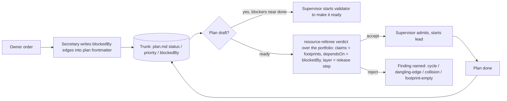

discussion: open

## Seed

Opened by the secretary (Miu) on the owner order relayed by lead:SUPERVISOR, goal set 2026-11-26. Read the source backlog rows first; they hold the evidence. Park owner questions in the question store instead of waiting on them.

- **Outcome:** a command or standing order that drives the owner's release sequence of plans to done, in order, without waiting to be asked, and survives head rotation. Settle what the command is, who runs it and where the order is kept.

## 1. Trạng thái hiện tại

Round 1 (2026-11-26, shaper head `release-chain-command`). Domain: supervision (fgOS platform; no `domains/supervision/AGENTS.md` exists, so the supervision spec is the doctrine read).

The first scout found that most of the mechanism already exists. Plan frontmatter already carries `priority` and `blockedBy`, and the supervisor admits a `ready` plan only when every `blockedBy` plan is `done` (`docs/platform/supervision/spec.md`, Shared Entities row "Plan", line 73; flow "Wake to admission", line 131). The owner's order today lives only in backlog row p-755psfxpmh and in the secretary's habit of comparing it on each wake; none of the named plans encodes it (all are P1 with empty `blockedBy`). So the order is held by a person-like loop, not by state, and it is lost when the secretary rotates or forgets.

Leading framing (proposed, not settled): the "command" is not a new engine. The order is written into the plans themselves as `blockedBy` edges, which the supervisor already honours and which live on the trunk and survive any rotation. What is genuinely missing is listed in §3: draft plans that nobody drives to `ready`, backlog-only items that have no plan, a cap of two full test suites, and what "released" means.

Round 2 (2026-11-26 09:46): the owner answered both parked questions. Q1 q-anofq5k6pf: a step ends when its plan is `done` on main, not at a release (D1). Q2 q-wwsaazcrbz: the two-suite cap is held by `supervisor.maxLeads: 2` in this project's config, no new suite counter (D2). Open owner question: Q3 q-uxc2kj2bms (does an unqueued ready plan still start). Still open: §3 rows 2, 3, 7 (who drives drafts to `ready`, plans for backlog-only items, who writes the edges) and row 10 (authority locate).

Owner directive (2026-11-26 10:00): every conflict between plans is judged by the `resource-referee` component, used fully and without carve-outs (D3). Scout found the supervisor's admission does not use it today: `admissible()` in `packages/supervision/rust/src/portfolio.rs:256` hard-codes its own rule (calls write-scope directly, compares a ready plan only against `running` plans, checks `blockedBy` by hand, and lets a running plan with an incomparable footprint hold back nobody). Only the planner door `fgos resource-check` (`apps/fgos/src/wiring/resource_check.rs`) calls the referee, and only within one plan's phases. New §3 rows 11-13 carry what this changes.

Owner follow-up (10:06): the rule injected before planning must remind planners to use the referee in their own planning. Scout: that rule is `core/skills/_shared/plan-contract.md` ("Before running any planning skill, read this contract"), read by `fgos-coding-planning`, `fgos-coding-validating` and this skill. It already tells the planner to run `fgos resource-check` on its own phases, but its cross-plan rule (ready plan overlapping another active plan, resolved by `blockedBy`) names no referee call, and its enforcing check `scripts/plan-contract-check.mjs` calls write-scope directly and checks waves by hand. §3 row 14.

Settled 10:20 (D4): the cross-plan judgement has one door. One shared function turns the portfolio into referee units and returns the verdict; planners reach it through a new `fgos resource-check` mode, the supervisor's admission calls the same function directly. No owner question was needed; the owner agreed in chat.

## 2. Mục tiêu & đề bài

The owner gave a release sequence of plans (backlog p-755psfxpmh): two plans in parallel first (heads-operate 261124-0004 and land-door 261125-1558), then three that each wait on one of those, then the keeper skeleton, then fillers, then two low-priority plans last, with never more than two full test suites at once and three land-cost backlog items queued right after step 2. Today this order is carried by the secretary reading a backlog row on each wake; it stalls whenever she is not woken, when a plan in the sequence is still `draft`, or when an item has no plan at all, and it is lost on rotation if the next secretary does not read the row. The discussion settles one way to hold such an order as state, so the supervision machinery drives it to done without anyone asking, and so it works for any project using fgOS, not only for this one sequence.

## 3. Vấn đề rõ / chưa rõ

| # | Point | State | Evidence / note |
|---|-------|-------|-----------------|
| 1 | Where the order is kept | Leaning: plan frontmatter `blockedBy` (+ `priority`) | Supervisor already admits by `blockedBy` + priority (supervision spec l.73, l.131). Durable on trunk, survives rotation, no new door (L10). A separate "sequence file" would be a second authority over admission order. |
| 2 | `ready` (quality) vs queued (delivery) | Direction set by owner 10:27; admission rule open — q-uxc2kj2bms (Q3) | Today one status means both "complete and validated" and "start it": the supervisor starts any `ready` plan once its `blockedBy` are done and a lead slot is free (supervision spec l.131, `portfolio.rs` `admissible()`). Owner: separate them. **Quality axis:** `draft → ready` means only that the plan is complete and passes the plan contract check; setting it starts nothing. **Delivery axis:** a plan is put in the delivery queue at a step of the owner's order. The owner's sequence holds `draft` plans (shaper-worktree 261125-1557, backlog-index-generated 261125-1556, orchestration-skeleton 261122-0056, watcher-counts 261125-1558, confinement-to-rust 261124-1853), so queue membership is a separate frontmatter field, not a status value; it is likely the same field as the release step of row 12. **Drafts in the queue:** the supervisor starts a planner/validator for a queued `draft` early, so it is `ready` when its step comes; this answers who drives drafts. **Admission:** ready AND blockers done AND referee accepts (D3, D4) AND a lead slot free (D2); whether "AND queued" is required, or unqueued ready plans still start after the queue, is Q3. |
| 3 | Backlog items with no plan | Open | p-l54vuzupa5, p-6sd4fslxv7, p-vyzy7isj3z, p-oq4hnkqyai have no plan; `blockedBy` can only name plans. Candidate: a planner is opened for them now, and their plans carry the `blockedBy` edge. |
| 4 | Two full test suites at most | Settled — D2 (q-wwsaazcrbz) | Held by `supervisor.maxLeads: 2` in project config (`.fgos/config.yaml`); default `4` in `core/config-standard/supervisor.yaml` is unchanged. No suite counter is built; one lead runs at most one full suite at a time. |
| 5 | What "released" means | Settled — D1 (q-anofq5k6pf) | A step ends when its plan is `done` on main; no staged/activated release is required between steps (releases stay stopped under q-cmio6uyrqz without blocking the chain). |
| 6 | Who runs it | Leaning: the supervisor, as today | The supervisor already admits on wake; the order needs no new runner once it is state. The secretary's role shrinks to writing the edges when the owner gives an order. |
| 7 | How an owner order becomes edges | Open | Who writes `blockedBy` into other plans' frontmatter (secretary lands portfolio files; the plan contract owns frontmatter). |
| 8 | Current state of the sequence | Clear | Step 1 done (261124-0004 done, 261125-1558 land-door done). head-lifecycle-events 261124-2143 running. delete-dead-node 261122-2108 done. |
| 9 | `fgos supervisor plans` from this head | Friction | Refused `ref-invalid: case:head-window-c-1143-…` from inside this shaper head; read frontmatter directly instead. |
| 10 | Component authority | Partly run | `fgos authority locate "resolve conflicts between plans competing for shared resources"` ranks `supervision` first; the conflict verdict itself is owned by `resource-referee` (`docs/platform/resource-referee/spec.md` §1: callers must stop hard-coding "may these units run together"). Re-run once rows 11-13 hold. |
| 11 | Plan-vs-plan conflicts go through resource-referee | Settled — D3 (owner directive) | Supervisor admission today bypasses the referee (`portfolio.rs:256`). Target: the portfolio is fed to the referee as units, one per plan: `claims` = footprint as `path` claims, `dependsOn` = `blockedBy`, and the verdict decides admission. The referee floor then gives for free: `cycle` in `blockedBy`, `dangling-edge` for a `blockedBy` naming no plan, `footprint-empty` refused by name instead of skipped, collisions between plans. |
| 12 | How the release sequence maps onto referee layers | Open | Candidate: each step of the owner's sequence is a declared `layer`; `declared-layers-valid` checks the order agrees with `blockedBy`; `no-exclusion-in-one-layer` refuses two plans of one step whose footprints collide. Needs: which plans form the unit set (ready + running + draft in the chain?), and where `layer` is written (plan frontmatter has no such field today; plan contract owns frontmatter). |
| 14 | Planners told to use the referee, within and across plans | Settled in direction (D3, owner 10:06); wording open | Target: plan-contract.md tells every planner to (a) run `fgos resource-check --plan` on its own phases (exists), and (b) check its plan against the other active plans through the referee before setting `ready` (missing: one door per D4 — a shared portfolio-to-units function behind a new `fgos resource-check` mode, the same function the supervisor's admission calls); `scripts/plan-contract-check.mjs` (pre-land) calls the referee instead of write-scope + hand wave rules. Edits to plan-contract.md, the check and skills are planner/implementation work; this discussion only fixes the requirement. |
| 13 | Gaps the referee cannot express today for this use | Open | (a) The two-lead cap (D2) is a count of running plans; the catalog's `max-layer-width` counts non-read-only units per declared layer and is advisory by default (class settable). Whether D2 stays as `maxLeads` or is also expressed as `max-layer-width` is open. (b) No Node binding exists (spec §8); fine, admission is Rust. (c) Spec §9 says "layers stay serial" is a run-time rule left to the supervisor. "Without limits" (D3) means any gap found here is closed by extending the referee through its contract, not by a side rule in supervision (L10). |

## 4. Quyết định đã chốt

| D-ID | Decision | Date | Ground |
|------|----------|------|--------|
| D1 | A step of the release sequence ends when its plan is `done` on main; the next step's `blockedBy` is satisfied by that, with no release in between. | 2026-11-26 | Proposed round 1; owner answer to q-anofq5k6pf ("Done on main ends a step") |
| D3 | Every conflict between plans (footprint collision, `blockedBy` order, cycles, dangling waits) is judged by the `resource-referee` component, used fully; supervision keeps no overlap or order rule of its own, and a gap in the referee is closed by extending the referee, not by a side rule. | 2026-11-26 | Owner directive in chat 10:00 ("sử dụng được một cách tối đa, nhuần nhuyễn và không có giới hạn component resource-referee trong việc giải quyết xung đột giữa các plan"); recorded as settled because it is an explicit owner order, not a single answer to an open question |
| D4 | Cross-plan conflicts have one door: a single shared function maps the portfolio to referee units (`claims` = footprint, `dependsOn` = `blockedBy`, `layer` = release step) and returns the referee verdict. Planners call it through a new `fgos resource-check` mode before setting `ready`; supervisor admission calls the same function in-process. No second mapping exists. | 2026-11-26 | Shaper proposal 10:20 (design principle 1, one door; D3), owner "đồng ý" in chat |
| D2 | The "two full test suites at most" cap is held by `supervisor.maxLeads: 2` in the project config, not by a new suite counter. | 2026-11-26 | Proposed round 1; owner answer to q-wwsaazcrbz ("Set maxLeads to 2 in project config") |

## 5. Q&A log

- 2026-11-26 08:50 — Round 1 opened by shaper head. Read p-755psfxpmh, supervision spec, plan frontmatter of the nine named plans, `core/config-standard/supervisor.yaml`. Found that admission by `blockedBy` already exists and the order is not encoded; framed the gaps in §3. Parked two owner questions: Q1 q-anofq5k6pf (does a step end at plan done or at a release; recommended: plan done), Q2 q-wwsaazcrbz (two-suite cap; recommended: maxLeads 2 in project config).
- 2026-11-26 09:46 — Owner answered Q1 q-anofq5k6pf: "Done on main ends a step" → D1. Owner answered Q2 q-wwsaazcrbz: "Set maxLeads to 2 in project config" → D2. Both matched the round-1 recommendation, so they are recorded as settled. Setting the config value is planner/implementation work, not this discussion's.
- 2026-11-26 10:00 — Owner directive in chat: resolve conflicts between plans through `resource-referee`, fully and without limits → D3. Scouted `docs/platform/resource-referee/spec.md`, `packages/supervision/rust/src/portfolio.rs:243-269`, `apps/fgos/src/wiring/resource_check.rs`: admission bypasses the referee today. Added §3 rows 11-13; §6 sketch updated.
- 2026-11-26 10:06 — Owner: the pre-planning rule must remind planners to use the referee in their planning. Scouted `core/skills/_shared/plan-contract.md` l.1-8, 95-99, 131-134 and `scripts/plan-contract-check.mjs` l.57-69, 157-167: within-plan use is already asked for; cross-plan use and the check itself bypass the referee. Added §3 row 14 under D3.
- 2026-11-26 10:20 — Owner asked what "a new resource-check flag or the supervisor calls it itself" meant. Shaper explained both callers need the same judgement and proposed one shared function used by both; owner: "đồng ý" → D4.
- 2026-11-26 10:30 — Owner asked whether pkm should be used here, then answered it: no. The referee already sits on the `graph` package (cycles, layers, exclusion pairs; `docs/platform/graph/spec.md`) and `write-scope`; pkm is the documentation store behind document identity and `fgos authority locate` (`docs/platform/system-overview/spec.md` l.151) and judges no plan conflicts. Non-goal: pkm in plan-conflict judgement.
- 2026-11-26 10:27 — Owner: row 2 must separate `ready` (quality, complete, fit to do) from being in the queue for delivery. Shaper reframed row 2 into a quality axis and a delivery axis; queue membership is a separate field because the owner's sequence holds drafts. Parked Q3 q-uxc2kj2bms: does a ready plan outside the queue still start by itself (recommended: no, only queued plans are delivered).

## 6. Thiết kế đã chốt {#design}

Not settled yet. Working sketch (round 1):

## 7. Danh mục hạng mục / task {#tasks}

Not filled until the shape in §3 rows 1, 2 and 4 holds.
