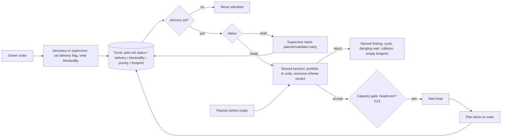

discussion: paused

## Hand-off

**Content settled by the owner 2026-11-26 12:2x; planner held by owner order ("chốt settled, khoan giao cho planner").** The marker stays `paused` on purpose: a landed `settled` raises `discussion-settled` and the supervisor starts a planner at once (supervision spec l.137, `packages/supervision/rust/src/discussion_source.rs` `marker_of`), and there is no hold. To hand off, change the frontmatter `status` and this marker to `settled` and land; nothing else in this file needs to change.

- **Outcome:** the owner's release order of plans is state on the trunk and the supervisor drives it to done in order, without being asked, across head rotation: a `delivery` flag beside `status`, order in `blockedBy` + `priority`, admission only of flagged `ready` plans that the `resource-referee` accepts and the capacity gate allows. Works for any project using fgOS.
- **Constraints:** every conflict between plans is judged by `resource-referee` through one shared function (D3, D4); no overlap or order rule outside it; `ready` means quality only (D5); a step ends at `done` on main (D1); concurrency follows measured machine capacity, never a fixed count (D13); no new component (row 10); plan frontmatter stays owned by the plan contract.
- **Non-goals:** a sequence file; a cross-plan `layer` (D8); pkm in conflict judgement; a fixed run cap or `maxLeads: 2` (D13); the backlog-to-ready pipeline (D10, separate topic); designing the capacity gate (backlog p-tyowvhthul).
- **Acceptance criteria:** (1) a `ready` plan without `delivery` is never admitted; (2) a flagged `draft` gets a planner/validator started; (3) a flagged `ready` plan is admitted only when the referee verdict over the portfolio accepts it, and a reject names its finding (cycle, dangling `blockedBy`, collision, empty footprint); (4) planners and `scripts/plan-contract-check.mjs` reach the same verdict through the same function; (5) `plan-contract.md` tells planners to run the portfolio check before `ready`; (6) the plans of p-755psfxpmh carry `delivery` and `blockedBy` in the owner's order; (7) `npm test` and `cargo test --workspace` green.
- **Open points blocking only part:** task-run-cap waits on backlog p-tyowvhthul (capacity gate); row 15 (interface to the backlog-to-ready pipeline) is decided by that topic and blocks nothing here.
- **Source ids:** p-755psfxpmh; D1-D13 in §4; tasks in §7.

## Seed

Opened by the secretary (Miu) on the owner order relayed by lead:SUPERVISOR, goal set 2026-11-26. Read the source backlog rows first; they hold the evidence. Park owner questions in the question store instead of waiting on them.

- **Outcome:** a command or standing order that drives the owner's release sequence of plans to done, in order, without waiting to be asked, and survives head rotation. Settle what the command is, who runs it and where the order is kept.

## 1. Trạng thái hiện tại

Settled in content 2026-11-26 12:2x (D1-D13); planner held by the owner, marker `paused` until the owner says hand off (see Hand-off).

Round 1 (2026-11-26, shaper head `release-chain-command`). Domain: supervision (fgOS platform; no `domains/supervision/AGENTS.md` exists, so the supervision spec is the doctrine read).

The first scout found that most of the mechanism already exists. Plan frontmatter already carries `priority` and `blockedBy`, and the supervisor admits a `ready` plan only when every `blockedBy` plan is `done` (`docs/platform/supervision/spec.md`, Shared Entities row "Plan", line 73; flow "Wake to admission", line 131). The owner's order today lives only in backlog row p-755psfxpmh and in the secretary's habit of comparing it on each wake; none of the named plans encodes it (all are P1 with empty `blockedBy`). So the order is held by a person-like loop, not by state, and it is lost when the secretary rotates or forgets.

Leading framing (proposed, not settled): the "command" is not a new engine. The order is written into the plans themselves as `blockedBy` edges, which the supervisor already honours and which live on the trunk and survive any rotation. What is genuinely missing is listed in §3: draft plans that nobody drives to `ready`, backlog-only items that have no plan, a cap of two full test suites, and what "released" means.

Round 2 (2026-11-26 09:46): the owner answered both parked questions. Q1 q-anofq5k6pf: a step ends when its plan is `done` on main, not at a release (D1). Q2 q-wwsaazcrbz: the two-suite cap is held by `supervisor.maxLeads: 2` in this project's config, no new suite counter (D2). Settled 11:16: D7 (secretary and supervisor both write the order), D8 (no `layer` across plans), D9 (cap stays maxLeads), D10 (backlog-to-ready pipeline is its own topic; row 15 is the interface). Settled 11:05: queue membership is a `delivery` flag beside `status`, settable on a draft (D5); only plans flagged for delivery are admitted, a `ready` plan without the flag waits (D6, Q3 option A). No owner question is open. Still open: §3 rows 2, 3, 7 (who drives drafts to `ready`, plans for backlog-only items, who writes the edges) and row 10 (authority locate).

Owner directive (2026-11-26 10:00): every conflict between plans is judged by the `resource-referee` component, used fully and without carve-outs (D3). Scout found the supervisor's admission does not use it today: `admissible()` in `packages/supervision/rust/src/portfolio.rs:256` hard-codes its own rule (calls write-scope directly, compares a ready plan only against `running` plans, checks `blockedBy` by hand, and lets a running plan with an incomparable footprint hold back nobody). Only the planner door `fgos resource-check` (`apps/fgos/src/wiring/resource_check.rs`) calls the referee, and only within one plan's phases. New §3 rows 11-13 carry what this changes.

Owner follow-up (10:06): the rule injected before planning must remind planners to use the referee in their own planning. Scout: that rule is `core/skills/_shared/plan-contract.md` ("Before running any planning skill, read this contract"), read by `fgos-coding-planning`, `fgos-coding-validating` and this skill. It already tells the planner to run `fgos resource-check` on its own phases, but its cross-plan rule (ready plan overlapping another active plan, resolved by `blockedBy`) names no referee call, and its enforcing check `scripts/plan-contract-check.mjs` calls write-scope directly and checks waves by hand. §3 row 14.

Settled 10:20 (D4): the cross-plan judgement has one door. One shared function turns the portfolio into referee units and returns the verdict; planners reach it through a new `fgos resource-check` mode, the supervisor's admission calls the same function directly. No owner question was needed; the owner agreed in chat.

## 2. Mục tiêu & đề bài

The owner gave a release sequence of plans (backlog p-755psfxpmh): two plans in parallel first (heads-operate 261124-0004 and land-door 261125-1558), then three that each wait on one of those, then the keeper skeleton, then fillers, then two low-priority plans last, with never more than two full test suites at once and three land-cost backlog items queued right after step 2. Today this order is carried by the secretary reading a backlog row on each wake; it stalls whenever she is not woken, when a plan in the sequence is still `draft`, or when an item has no plan at all, and it is lost on rotation if the next secretary does not read the row. The discussion settles one way to hold such an order as state, so the supervision machinery drives it to done without anyone asking, and so it works for any project using fgOS, not only for this one sequence.

## 3. Vấn đề rõ / chưa rõ

| # | Point | State | Evidence / note |
|---|-------|-------|-----------------|
| 1 | Where the order is kept | Settled — D11 | Order between plans is `blockedBy` (+ `priority` as tie-break) in plan frontmatter on the trunk; intent is the `delivery` flag (D5). No sequence file (it would be a second authority over admission). Survives rotation. |
| 2 | `ready` (quality) vs queued (delivery) | Settled — D5, D6 | **Quality:** `draft → ready` means only that the plan is complete and passes the plan contract check; setting it starts nothing. **Delivery:** a `delivery` flag in plan frontmatter, beside `status`, records that the owner wants the plan delivered; it may be set on a `draft` (the owner's sequence holds five drafts: 261125-1557, 261125-1556, 261122-0056, 261125-1558, 261124-1853). Order stays in `blockedBy` (+ `priority`); the flag carries only intent. A new status value was rejected: it cannot mark a draft, and every status reader would change. **Drafts flagged for delivery:** the supervisor starts a planner/validator for them early so they are `ready` when their turn comes. **Admission:** flagged AND `ready` AND referee accepts (D3, D4: blockers done, no collision) AND a lead slot free (D2). Exact key name and values are the planner's (plan contract owns frontmatter). Prior art: GitHub merge queue / auto-merge, Kubernetes Job `spec.suspend`, Kanban commitment point, Airflow `dags_are_paused_at_creation` all keep ready from starting work without an explicit commitment. |
| 3 | Backlog items with no plan (and no discussion) | Split out — new topic (D10) | p-l54vuzupa5, p-6sd4fslxv7, p-vyzy7isj3z, p-oq4hnkqyai have not even a discussion. Owner 11:16: the path backlog item → clarify (on intake: rewrite a terse request so it is explicit, classify it) → triage against the managed goals (goal priority) → discover (agent collects facts into the discussion) → exploring only when discover is incomplete → planning → `ready`, must run by itself and **just in time**: not so early that the codebase drifts under the plan, early enough that a `ready` plan is waiting when its turn in the delivery queue comes. Work already has most stages (domain workflows `domains/<domain>/workflows/*.yaml`, phases clarify/discover/plan/execute, `fgos triage`, the `intent` score; `docs/platform/work-state/spec.md` #12, #21, #26), but it runs only for Work items, not for portfolio backlog rows, and it leans to coding (default domain `coding`; `fgos ready` reads stage `executing`; `delivered` means "code in the main tree"). Owner wants it extracted from Work into an independent, domain-agnostic workflow. This is a topic of its own; this discussion only fixes the interface (§3 row 15). |
| 4 | How many things run at once | Settled — D13 (supersedes D2) | Owner 12:18: no fixed count. The number of running threads, heads and workers together, follows the machine's measured capacity; a fixed number leaves the machine idle when it could work and lets too much start at once at other times. Scout: `supervisor.maxLeads` is soft (only reported, `supervisor.rs:190`; obeyed from skill prose); lanes are hard but a fixed `workerSlots.ceiling`; a load guard (loadavg / free memory) was proposed on 2026-11-18 (`7655f4f3e`, Q2 option a) and never built; backlog **p-tyowvhthul** already asks to raise the lane count from measured capacity (provider seats, memory, free disk); OOM and full-disk incidents: p-6htu2ae64o, q-pmhxzsfpr7. `/proc` reads have one door: `packages/process/rust/src/platform/linux.rs` (doors model `process-facts-proc.yaml`). This discussion only fixes the interface: admission (and seat start) ask one capacity gate; its inputs, thresholds and counting of heads are p-tyowvhthul's. Until it lands, no config value changes (`maxLeads` stays at its default; D2's `maxLeads: 2` is not applied). |
| 5 | What "released" means | Settled — D1 (q-anofq5k6pf) | A step ends when its plan is `done` on main; no staged/activated release is required between steps (releases stay stopped under q-cmio6uyrqz without blocking the chain). |
| 6 | Who runs it | Settled — D12 | The supervisor, on each wake, as today: admission per D6 through the referee (D3, D4). No new runner. |
| 7 | Who writes the order (delivery flag, `blockedBy`) | Settled — D7 | Both the secretary and the supervisor; both already land portfolio files with `land --paths`. |
| 8 | Current state of the sequence | Clear | Step 1 done (261124-0004 done, 261125-1558 land-door done). head-lifecycle-events 261124-2143 running. delete-dead-node 261122-2108 done. |
| 9 | `fgos supervisor plans` from this head | Friction | Refused `ref-invalid: case:head-window-c-1143-…` from inside this shaper head; read frontmatter directly instead. |
| 10 | Component authority | Settled — no new component | `fgos authority locate` answers are noisy (durable-file, work-driver…); owners by spec instead: plan frontmatter incl. `delivery` = plan contract (`core/skills/_shared/plan-contract.md`, supervision spec l.73); admission and the portfolio→units function = `supervision` (owns the portfolio reader, spec l.45); the verdict = `resource-referee`; the `fgos resource-check` door = its wiring `apps/fgos/src/wiring/resource_check.rs`. No `fgos authority declare` needed. |
| 11 | Plan-vs-plan conflicts go through resource-referee | Settled — D3 (owner directive) | Supervisor admission today bypasses the referee (`portfolio.rs:256`). Target: the portfolio is fed to the referee as units, one per plan: `claims` = footprint as `path` claims, `dependsOn` = `blockedBy`, and the verdict decides admission. The referee floor then gives for free: `cycle` in `blockedBy`, `dangling-edge` for a `blockedBy` naming no plan, `footprint-empty` refused by name instead of skipped, collisions between plans. |
| 12 | Referee `layer` across plans | Settled — D8: not used | `layer` is the referee's name for a declared wave: `fgos resource-check --plan` turns each phase into a unit whose `layer` is its `wave` column (`apps/fgos/src/wiring/resource_check.rs:458-479`), and the referee checks that a phase's wave is later than its dependencies and that colliding phases are not in one wave. Across plans no one declares a wave: order is `blockedBy`, and the `graph` package derives the layers. No `layer` field goes into plan frontmatter. |
| 14 | Planners told to use the referee, within and across plans | Settled in direction (D3, owner 10:06); wording open | Target: plan-contract.md tells every planner to (a) run `fgos resource-check --plan` on its own phases (exists), and (b) check its plan against the other active plans through the referee before setting `ready` (missing: one door per D4 — a shared portfolio-to-units function behind a new `fgos resource-check` mode, the same function the supervisor's admission calls); `scripts/plan-contract-check.mjs` (pre-land) calls the referee instead of write-scope + hand wave rules. Edits to plan-contract.md, the check and skills are planner/implementation work; this discussion only fixes the requirement. |
| 13 | Two-lead cap as a referee check | Settled — D9: no | The referee's `max-layer-width` means "at most N phases in one declared wave". With no declared layers across plans (D8) it judges nothing, so the cap of two leads stays `supervisor.maxLeads: 2` (D2). Any real gap found later is still closed inside the referee (D3). |
| 15 | Interface to the backlog-to-ready pipeline | Open, owned by the new topic | This discussion consumes: a plan that is `ready` with the `delivery` flag (D5, D6). The new pipeline produces it just in time. Open there: whether the delivery commitment can sit on a backlog row before any plan exists, and how "just in time" is timed (e.g. start discover/planning when the item's predecessors in the order near done). |

## 4. Quyết định đã chốt

| D-ID | Decision | Date | Ground |
|------|----------|------|--------|
| D1 | A step of the release sequence ends when its plan is `done` on main; the next step's `blockedBy` is satisfied by that, with no release in between. | 2026-11-26 | Proposed round 1; owner answer to q-anofq5k6pf ("Done on main ends a step") |
| D3 | Every conflict between plans (footprint collision, `blockedBy` order, cycles, dangling waits) is judged by the `resource-referee` component, used fully; supervision keeps no overlap or order rule of its own, and a gap in the referee is closed by extending the referee, not by a side rule. | 2026-11-26 | Owner directive in chat 10:00 ("sử dụng được một cách tối đa, nhuần nhuyễn và không có giới hạn component resource-referee trong việc giải quyết xung đột giữa các plan"); recorded as settled because it is an explicit owner order, not a single answer to an open question |
| D4 | Cross-plan conflicts have one door: a single shared function maps the portfolio to referee units (`claims` = footprint, `dependsOn` = `blockedBy`, `layer` = release step) and returns the referee verdict. Planners call it through a new `fgos resource-check` mode before setting `ready`; supervisor admission calls the same function in-process. No second mapping exists. | 2026-11-26 | Shaper proposal 10:20 (design principle 1, one door; D3), owner "đồng ý" in chat |
| D5 | Delivery intent is a `delivery` flag in plan frontmatter, separate from `status`; it can be set on a `draft`. It carries only intent; order stays in `blockedBy` and `priority`. `ready` means quality only. | 2026-11-26 | Owner 10:27 (separate ready from queued), shaper analysis 10:58 (a status value cannot mark a draft), owner 11:05 "dùng cờ delivery" |
| D6 | Only plans flagged for delivery are admitted; a `ready` plan without the flag never starts by itself. A flagged `draft` gets a planner/validator started early. | 2026-11-26 | Q3 q-uxc2kj2bms option A, chosen by the owner in chat 11:05 ("chọn A"); prior art in §3 row 2 |
| D7 | Both the secretary and the supervisor may write the delivery order into plans: set the `delivery` flag and write `blockedBy`. | 2026-11-26 | Owner 11:16 ("cả secretary và supervisor đều nên làm được") |
| D8 | No `layer` across plans: order between plans is `blockedBy`, and the referee's `graph` derives layers; `layer` stays the per-plan wave. | 2026-11-26 | Owner asked what layer is for (11:16); scout of `resource_check.rs:458-479`; row 12 |
| D9 | The two-lead cap stays `supervisor.maxLeads` (D2); the referee's `max-layer-width` is not used for it. | 2026-11-26 | Follows from D8; row 13 |
| D10 | The backlog-to-ready pipeline (clarify, goal triage, discover, optional exploring, planning, just-in-time) is a separate topic, extracted from Work as a domain-agnostic workflow; this discussion keeps only the interface (row 15). | 2026-11-26 | Owner 11:16; RUL11 (work outside this discussion's frame becomes its own item) |
| D11 | The order between plans is held in plan frontmatter: `blockedBy`, with `priority` as tie-break; intent is the `delivery` flag. No separate sequence file. | 2026-11-26 | Leaning since round 1 (row 1), unchanged through D3-D10; owner agreed 12:12 |
| D12 | The supervisor drives the chain on each wake through admission (D6); no new runner. | 2026-11-26 | Leaning since round 1 (row 6); owner agreed 12:12 |
| D13 | Supersedes D2. Concurrency is not a fixed number: what runs at once (heads and workers together) follows the machine's measured capacity. Admission and seat start ask one capacity gate; designing it is backlog p-tyowvhthul. Until then no cap config is changed. | 2026-11-26 | Owner 12:18 ("số luồng chạy … phải được tính trên năng lực thực tế của máy, ép số kiểu này thì lúc rảnh không ai làm, lúc tự nhiên bật quá trời"); scout row 4 |
| D2 | **Superseded by D13.** The "two full test suites at most" cap is held by `supervisor.maxLeads: 2` in the project config, not by a new suite counter. | 2026-11-26 | Proposed round 1; owner answer to q-wwsaazcrbz ("Set maxLeads to 2 in project config") |

## 5. Q&A log

- 2026-11-26 08:50 — Round 1 opened by shaper head. Read p-755psfxpmh, supervision spec, plan frontmatter of the nine named plans, `core/config-standard/supervisor.yaml`. Found that admission by `blockedBy` already exists and the order is not encoded; framed the gaps in §3. Parked two owner questions: Q1 q-anofq5k6pf (does a step end at plan done or at a release; recommended: plan done), Q2 q-wwsaazcrbz (two-suite cap; recommended: maxLeads 2 in project config).
- 2026-11-26 09:46 — Owner answered Q1 q-anofq5k6pf: "Done on main ends a step" → D1. Owner answered Q2 q-wwsaazcrbz: "Set maxLeads to 2 in project config" → D2. Both matched the round-1 recommendation, so they are recorded as settled. Setting the config value is planner/implementation work, not this discussion's.
- 2026-11-26 10:00 — Owner directive in chat: resolve conflicts between plans through `resource-referee`, fully and without limits → D3. Scouted `docs/platform/resource-referee/spec.md`, `packages/supervision/rust/src/portfolio.rs:243-269`, `apps/fgos/src/wiring/resource_check.rs`: admission bypasses the referee today. Added §3 rows 11-13; §6 sketch updated.
- 2026-11-26 10:06 — Owner: the pre-planning rule must remind planners to use the referee in their planning. Scouted `core/skills/_shared/plan-contract.md` l.1-8, 95-99, 131-134 and `scripts/plan-contract-check.mjs` l.57-69, 157-167: within-plan use is already asked for; cross-plan use and the check itself bypass the referee. Added §3 row 14 under D3.
- 2026-11-26 10:20 — Owner asked what "a new resource-check flag or the supervisor calls it itself" meant. Shaper explained both callers need the same judgement and proposed one shared function used by both; owner: "đồng ý" → D4.
- 2026-11-26 10:30 — Owner asked whether pkm should be used here, then answered it: no. The referee already sits on the `graph` package (cycles, layers, exclusion pairs; `docs/platform/graph/spec.md`) and `write-scope`; pkm is the documentation store behind document identity and `fgos authority locate` (`docs/platform/system-overview/spec.md` l.151) and judges no plan conflicts. Non-goal: pkm in plan-conflict judgement.
- 2026-11-26 10:27 — Owner: row 2 must separate `ready` (quality, complete, fit to do) from being in the queue for delivery. Shaper reframed row 2 into a quality axis and a delivery axis; queue membership is a separate field because the owner's sequence holds drafts. Parked Q3 q-uxc2kj2bms: does a ready plan outside the queue still start by itself (recommended: no, only queued plans are delivered).
- 2026-11-26 10:58 — Owner: a new axis or one more status value? Shaper: a status value cannot mark a draft that is already in the owner's order, and every status reader would change; a small flag beside status is enough, since order already lives in `blockedBy`.
- 2026-11-26 11:02 — Owner: what does the world do with a ready but unqueued item? Shaper: Kanban commitment point, Scrum sprint planning, GitHub merge queue / auto-merge, SAFe release train, Kubernetes `suspend`/Kueue, Airflow paused-at-creation — ready never starts work without an explicit commitment, and the commitment is a flag beside the state.
- 2026-11-26 11:05 — Owner: "chọn A, dùng cờ delivery" → D5, D6. Q3 answered in chat; cancelled in the store with that reason.
- 2026-11-26 11:16 — Owner: row 7 both secretary and supervisor (→ D7); asked what `layer` is for (→ D8, D9 after explanation); row 3 needs deeper thought: backlog rows have no discussion yet; extract the clarify/triage/discover/plan logic from Work into an independent domain-agnostic workflow, goal-driven triage, discover before planning, exploring only when discover is incomplete, run just in time so plans do not go stale. Shaper: that is its own topic (D10); raised a coordination hand-off for the secretary to open it; row 15 holds the interface.
- 2026-11-26 12:2x — Owner: "chốt settled, khoan giao cho planner". Hand-off block written; marker kept `paused` because a landed `settled` starts a planner immediately and nothing can hold it.
- 2026-11-26 12:18 — Owner rejected fixed caps (A, B and C alike): run count must follow real machine capacity, heads and workers together → D13 supersedes D2; the gate is backlog p-tyowvhthul; task-run-cap now depends on it.
- 2026-11-26 12:12 — Owner agreed to close rows 1, 6, 10, regenerate §6, fill §7 and settle, but asked whether `maxLeads` is a suggestion or hard, and whether the cap belongs on lanes rather than leads. Scout found D2's premise weak (row 4); row 4 reopened, D2 under review. Rows 1, 6 → D11, D12; row 10 closed (no new component).

## 6. Thiết kế đã chốt {#design}

**What it is.** No new engine. The owner's release order is state in the plans themselves, and the supervisor's existing admission drives it.

- **Two axes on a plan (D5).** `status` is quality and lifecycle: `draft → ready` means only that the plan is complete and passes the plan contract check; setting it starts nothing. A separate `delivery` flag in plan frontmatter records that the owner wants the plan delivered; it may be set on a `draft`.
- **Order (D11).** `blockedBy` between plans, `priority` as tie-break. No sequence file, no cross-plan `layer` (D8); the referee's `graph` derives the layers.
- **Who writes the order (D7).** The secretary or the supervisor, on an owner order: set `delivery`, write `blockedBy`, land with `land --paths`.
- **Admission (D6, D12).** On each wake the supervisor admits a plan when: it carries `delivery`, it is `ready`, the referee verdict over the portfolio accepts it (blockers `done` on main per D1, no footprint collision with running plans, no cycle, no dangling wait, no empty footprint), and the capacity gate reports headroom (D13; designed under p-tyowvhthul). A flagged `draft` gets a planner/validator started early so it is `ready` when its turn comes. A `ready` plan without the flag never starts.
- **One door for conflicts (D3, D4).** One shared function in `supervision` maps the portfolio to referee units (`claims` = footprint as `path` claims, `dependsOn` = `blockedBy`) and returns the `resource-referee` verdict. Supervisor admission calls it in-process; planners reach it through a new `fgos resource-check` mode before setting `ready`; `scripts/plan-contract-check.mjs` calls the referee too. No overlap or order rule lives outside the referee; a gap is closed by extending the referee. pkm is not involved.
- **Planner rule (D3, row 14).** `plan-contract.md` tells every planner to run the referee on its own phases (exists) and on its plan against the portfolio (new).
- **Out of scope (D10).** Producing `ready` plans from backlog rows just in time (clarify, goal triage, discover, planning) is a separate topic; this design consumes its output (row 15).

## 7. Danh mục hạng mục / task {#tasks}

### Delivery flag in the plan contract {#task-delivery-flag}
Goal: plan frontmatter gains an optional `delivery` flag beside `status`, settable on `draft`; `ready` documented as quality only. Owner: plan contract + check. D5, D6, D11. Siblings: needed by admission and seed tasks. Verify: `node scripts/plan-contract-check.mjs --all` passes; a plan with a malformed flag fails by name.

### Portfolio verdict through the referee, one door {#task-portfolio-referee}
Goal: one function in `supervision` maps the portfolio to referee units and returns the verdict; a new `fgos resource-check` mode exposes it to planners. D3, D4, D8. Siblings: admission and plan-check tasks call it. Verify: `cargo test -p fgos-supervision` and `cargo test -p fgos` cases for cycle, dangling `blockedBy`, cross-plan collision, empty footprint.

### Admission uses the verdict and the delivery flag {#task-admission}
Goal: replace the hand-written rule in `admissible()` (`packages/supervision/rust/src/portfolio.rs:256`) with: flagged AND `ready` AND referee accept AND run cap; start a planner/validator for a flagged `draft`; update supervision spec flow "Wake to admission" and the supervisor skill. D6, D12. Depends on the two tasks above and on row 4. Verify: `cargo test -p fgos-supervision` (wake/admission tests), `fgos supervisor plans` shows unflagged ready plans as not admissible.

### Plan contract check and planner rule use the referee {#task-plan-check}
Goal: `scripts/plan-contract-check.mjs` judges same-wave and cross-plan overlap through the referee instead of write-scope plus hand rules; `core/skills/_shared/plan-contract.md` tells planners to run the portfolio mode before `ready`. D3, row 14. Depends on task-portfolio-referee. Verify: `npm test` (plan-contract check suite), `npm run build:skills`.

### Capacity gate at admission {#task-run-cap}
Goal: admission asks one capacity gate (measured machine capacity, heads and workers counted) instead of a fixed `maxLeads`. D13. The gate itself is designed under backlog p-tyowvhthul; this task only wires admission to it. Depends on p-tyowvhthul and task-admission. Verify: the owning admission test admits while the gate reports headroom and holds when it does not.

### Seed the current release order {#task-seed-order}
Goal: set `delivery` and `blockedBy` on the plans of backlog p-755psfxpmh in the owner's order (D7). Depends on task-delivery-flag. Verify: plan-contract check passes; `fgos supervisor plans` lists them in the order.
