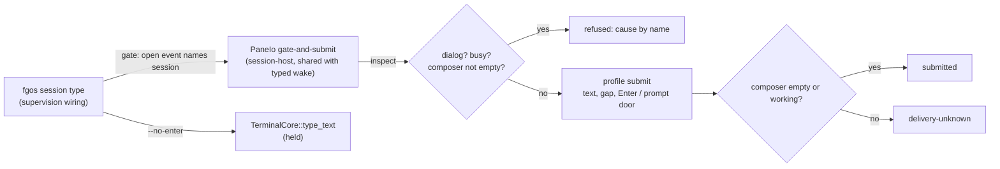

discussion: settled

## Hand-off to the planner

- **Outcome:** `fgos session type <head> --text <t>` submits the line, so the head acts on it. The answer says
  `submitted` only when the pane shows the line was taken. Otherwise it refuses by name and never answers `typed`
  for text left unsent. The three source rows are one fault and get one plan.
- **Constraints:** Submitting uses the per-CLI submit already in `fgos_agent_protocol::terminal` (profile
  `enter_gap_ms`, a separate `Enter` key, `submit_by_prompt_door` where a profile sets it, `composer_state` to
  confirm). It goes through the one session-host `PaneIo` gate-and-submit call that plan `261125-2313` phase 5
  adds for the typed wake. It adds no second typing path (L10, design principle 1, RUL104). The verb keeps its
  existing gate: it types only into a session that an open supervision event names. The text is never put
  through a shell.
- **Non-goals:** a new wake channel; changing the mailbox typed wake's own rules (no typing into a non-empty
  composer, one outstanding nudge); keys or dialog answers through `session type`; clearing leftover drafts in
  panes today (a one-time manual job, see O2).
- **Acceptance criteria:**
  1. Owning proof at the session-host layer, against the fake herdr: for each CLI profile a head runs (claude,
     codex, agy, pi, omp), the call sends the text, waits that profile's gap, then sends a separate `Enter`, or
     makes one prompt-door send where the profile says so. It never relies on a newline inside the pasted text.
     The `submitted`, `composer-not-empty`, `dialog-open`, `busy`, `foreground-not-agent`, `no-cli-profile` and
     `delivery-unknown` answers are each proven.
  2. One wiring proof in `apps/fgos/tests/supervision_verbs.rs`: the verb's JSON reports `submitted: true`, or
     the refusal cause, and never `typed: true` alone.
  3. `--no-enter` keeps the old type-only behaviour, and its answer says `held` (owner's wording in
     `p-nroysfhtso`).
  4. Live check: on a real Claude Code head, `fgos session type` with a check line makes the head start a turn
     with no second `\r`. Record the quoted screen before and after in the plan's report.
  5. `npm test` and `cargo test --workspace` are green. The `CHANGELOG.md` `[Unreleased]` line names the new
     `submitted` answer and `--no-enter`. The supervisor skill's wake step drops the "type `\r` alone" workaround.
- **Depends on:** plan `261125-2313` phase 5 landing first. Its footprint holds
  `packages/session-host/rust/src/pane_io.rs`, and its gate-and-submit call is the one this plan reuses (D3).
- **Open points that block only some parts:** O1 is whether herdr `pane send-text` replaces text already in a
  composer, as `p-lfwmzs6zsr` claims, or appends to it. The live check of criterion 4 settles it. Neither answer
  changes D4. O2 is the leftover drafts in live heads today, which is a manual job for the supervisor.
- **For the secretary:** `p-lfwmzs6zsr` (2026-11-23) is a third copy of the same fault. Fold it into this plan's
  source together with the other two.

## 1. Trạng thái hiện tại

Settled on 2026-11-26 in one round of scouting. The cause is proven from source (D1), and every point is decided
by analysis inside the "Done when" of the source rows. No owner question is open. Last step: hand off to the planner.

## 2. Mục tiêu & đề bài

The supervisor wakes an idle head by typing a check line into its pane with `fgos session type`. The line lands in
the head's input box and is never sent, yet the verb answers `typed: true`. So a stuck lead or planner stays stuck
and nobody sees it, which is the owner's main complaint. The fault was found on 2026-11-23
(`plans/reports/report-261123-1718-supervisor-wake.md`, `p-lfwmzs6zsr`) and again on 2026-11-25
(`p-cdsvrsfnui`, `p-nroysfhtso`). This topic proves the cause, picks the fix that reuses what already submits text
into agent panes, and states how done is proven.

## 3. Vấn đề rõ / chưa rõ

| # | Point | State | Evidence / decision |
|---|---|---|---|
| 1 | Does the verb never send Enter, or send one the CLI ignores? | clear | Both. It never sends one by design, and a newline inside pasted text is swallowed. D1 |
| 2 | Reuse or build a submit? | clear | Reuse the profile submit through phase 5's `PaneIo` call. D2, D3 |
| 3 | Behaviour when the composer already holds text | clear | Refuse `composer-not-empty` and quote the draft. D4 |
| 4 | Keep a type-only mode? | clear | `--no-enter`, from the owner's row. D5 |
| 5 | Does `pane send-text` replace or append to existing input? | open (O1) | Claimed in `p-lfwmzs6zsr`, unproven. The live check settles it, and D4 holds either way |
| 6 | Leftover unsent lines in live heads now | open (O2) | Manual one-time job. Not this plan's |
| 7 | Owning component | clear | `fgos authority locate` puts the pane-submit call in `session-host` and the verb in `supervision` |

## 4. Quyết định đã chốt

| D-ID | Decision | Rounds held | Source |
|---|---|---|---|
| D1 | Cause, proven from code. `type_into_session` (`apps/fgos/src/wiring/supervision.rs:1777`) calls `TerminalCore::type_text`, which calls `send_text(pane, text, submit=false)` (`packages/terminal-control/rust/src/core.rs:916-920`), which runs `herdr pane send-text` (`driver/herdr.rs:776-785`). No Enter is ever sent, and test `type_text_sends_text_exactly_once_via_pane_send_text` (commit `42a64d3bf`) locks that in. A newline put in the text does not help. `--text` refuses one, and inside a paste a CLI reads it as a newline (`agent-protocol/.../terminal/mod.rs:260-261`). The supervisor's evidence of 2026-11-25 22:15 agrees: a bare `\r` sent alone submitted the held line | analysis | source + `p-nroysfhtso` notes |
| D2 | Submit through the per-CLI profile that already delivers briefs (`Adapter::deliver_brief`: type, `enter_gap_ms`, separate `Enter`, prompt door when `submit_by_prompt_door`, confirm by composer). Do not add Enter handling to `terminal-control`, which knows no CLI | analysis | design principles 1, 2; RUL104 |
| D3 | One gate-and-submit call on session-host `PaneIo` serves both the mailbox typed wake (plan `261125-2313` phase 5) and `session type`. This plan waits for phase 5 to land and reuses that call. It does not land a second one ahead of it | analysis | L10; phase-5 footprint holds `pane_io.rs` |
| D4 | A non-empty composer is refused `composer-not-empty`, with the draft quoted, and nothing is typed. A session that has an open dialog is refused `dialog-open`. A working one is refused `busy`. A head with no CLI profile is refused `no-cli-profile`. These are the same causes phase 5 uses, so a person's half-typed text is never sent on their behalf | analysis | `p-lfwmzs6zsr` "without losing text already in the input"; agent-mailbox spec §11 rule 5 |
| D5 | `--no-enter` keeps the type-only path (`type_text`), and its answer says `held`. Its existing test stays as that path's proof | analysis | owner's "Done when" in `p-nroysfhtso` |
| D6 | The verb's answer becomes `{session, submitted: true}` or a refusal with a cause. `typed: true` for text left unsent is removed | analysis | owner's "Done when" in `p-cdsvrsfnui` |

## 5. Q&A log

- 2026-11-26 08:50: Opened from the seed. The start ritual found no open owner question on this topic (5 open
  questions, all about other plans).
- 2026-11-26 08:55: Scouting traced the verb down to herdr `pane send-text` (D1). It found the per-CLI submit in
  agent-protocol (D2) and the matching typed wake in plan `261125-2313` phase 5 (D3), and found a third duplicate
  row, `p-lfwmzs6zsr`.
- 2026-11-26 09:00: D2 to D6 were decided by analysis inside the source rows' "Done when" (D-ADR0030: decide and
  report). Settled and handed to the planner.

## 6. Thiết kế đã chốt {#design}

`fgos session type` stops being a raw paste. After its existing gate (an open supervision event names the session),
it resolves the head's pane and CLI and calls one session-host `PaneIo` gate-and-submit call. It is the same call
the mailbox typed wake uses. That call inspects the pane and refuses by name (`dialog-open`, `busy`,
`composer-not-empty` with the draft quoted, `foreground-not-agent`, `no-cli-profile`). Otherwise it types the text
and submits it the way that CLI's profile says: a gap, then a separate `Enter`, or one prompt-door send. It then
confirms that the composer emptied or the head started working. Confirmed gives `submitted`, and anything else
gives `delivery-unknown`. `--no-enter` keeps today's type-only path and answers `held`. `terminal-control` stays
CLI-agnostic. Nothing in it changes.

## 7. Danh mục hạng mục / task {#tasks}

### Session type submits through the shared pane call {#task-session-type-submits}

- **Goal:** the outcome and acceptance criteria of the hand-off block.
- **§6 excerpt:** the verb calls the shared `PaneIo` gate-and-submit, and `--no-enter` keeps `type_text`.
- **D-IDs:** D1 to D6.
- **Siblings:** after plan `261125-2313` phase 5 (D3). It also unblocks the keeper work, which needs a wake that
  works (`p-cdsvrsfnui` notes).
- **Draft verify:** `cargo test -p fgos-session-host && cargo test -p fgos --test supervision_verbs`, then the
  live check of criterion 4.
