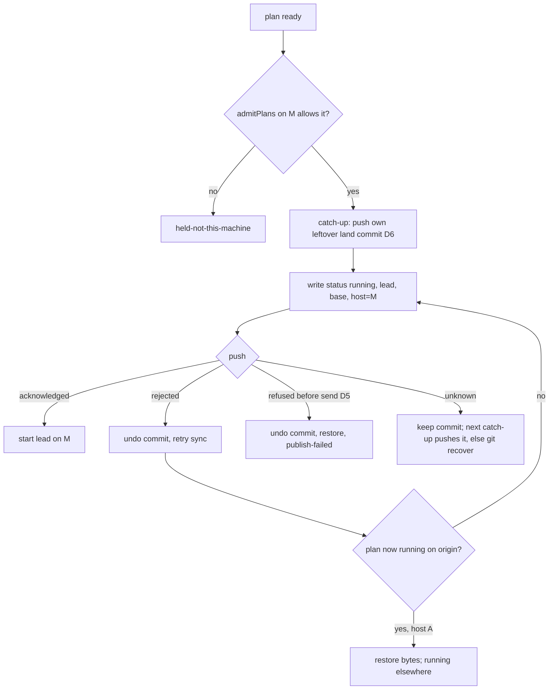

discussion: settled

## Hand-off to the planner

- **Outcome.** When a plan becomes `running`, origin shows at once which lead runs it and on which machine.
  - The first machine whose admission push reaches origin owns the plan.
  - No other machine admits it, watches it or restarts its lead.
  - An admission commit either reaches origin or is undone. It never sits on one machine's local main.
- **Constraints.**
  - Owning components: `admission`, from `fgos authority locate`, and the paths land in `packages/supervision/rust/src/land.rs`.
  - The machine name comes from Identity (`packages/identity/rust/src/machine.rs`). Nothing reads a hostname.
  - No new lock and no new push mechanism (L10, RUL104). Fix the existing paths land and its orphan push, and add the
    `host` field.
  - A new config key goes into `core/config-standard` and `core/config-schema` only, scoped `global-only`.
  - The plan contract (`plan-v1`) accepts `host`, and a CHANGELOG line names the change.
  - Proofs follow design principle 8: extend the owning tests in `packages/supervision/rust/tests/land.rs`, `wake.rs`
    and `apps/fgos/tests/supervision_verbs.rs`.
- **Non-goals.**
  - Assigning a machine when a plan goes `ready` (option B), and pinning a plan to a machine (option C). If wanted
    later, they are separate items.
  - Moving or reassigning plans already running.
  - Any change to branch lands of leads.
  - Cleaning up the pending Git operation that blocked the push on 2026-11-27. That belongs to `fgos git recover`.
- **Acceptance criteria.**
  1. Admission writes `status: running`, `lead`, `base` and `host: <Identity machine id>` in one commit, and
     `plan-v1` checks `host`.
  2. A paths land whose push the Git door refuses before sending anything (for example `resource-recovery-required` or
     `resource-busy`) undoes its local commit and restores the path. A test reproduces the 2026-11-27 shape: commit,
     pre-send refusal, local main equal to origin afterwards.
  3. A catch-up that finds local main ahead only by this checkout's own earlier land-door commit pushes that commit
     instead of refusing `write-branch-ahead`. A test proves why ded8d6557 was not recognised as its own and covers
     that case.
  4. Two machines admitting the same plan end with exactly one claim on origin. The loser restores its bytes and the
     plan reads as running on the winner's machine. Proven with two clones of one bare remote.
  5. `supervisor plans` and the keeper never start or restart the lead of a running plan whose `host` is another
     machine, and show it as running elsewhere. A running plan with no `host` belongs to this machine only while
     its lead is live here; otherwise it is held as `host-unnamed` and raised, never restarted.
  6. `supervisor.admitPlans` is a global-only list of plan-directory globs. When it is absent, every plan is
     admissible. A plan outside it is held as `held-not-this-machine`.
  7. The supervision spec (admission rules, reason codes, shared entities) states 1-6. `npm test` and
     `cargo test --workspace` are green.
- **Open points that block only some parts.** None.
- **Sources.** p-p5k2htczq3; owner chat 2026-11-27; observe record `fgos.supervisor.wake` at 07:32:22Z and 07:33:07Z
  (`.fgos/observe/records/fc4222ff-0936-4c7a-a78e-68d49e6badce.jsonl`).

## 1. Trạng thái hiện tại

Settled on 2026-11-27, round 2.

- Round 1 split the topic into durability (an admission must reach origin) and placement (which machine may admit
  which plan).
- In round 2 the owner chose placement A in chat: the first machine to push its admission to origin claims the plan.
  The owner also said the machine name comes from Identity. q-xub4gdaonb was cancelled as answered in chat.
- The owner pointed out that this session runs on fg-server itself. That let D3 be diagnosed from this machine's
  observe records. It has two holes, both in existing code (D5, D6).

Nothing is open. The next step is a planner.

## 2. Mục tiêu & đề bài

When a plan moves to `running`, every machine must see at once who runs it and on which machine, so that no other
machine starts it and no admission can sit unpushed on one machine's local main.

Today, admission (`admit` in `apps/fgos/src/wiring/supervision.rs`) writes `status: running`, `lead` and `base`
through `admitted_text` (`packages/supervision/rust/src/portfolio.rs`). It then publishes the file through the paths
land of a head's `session write` (`apps/fgos/src/wiring/session_write_publish.rs`), which commits and then pushes.

## 3. Vấn đề rõ / chưa rõ

| Item | State | Evidence |
|---|---|---|
| An admission commit can stay on local main without its push. The keeper's `docs(keeper): write plans/261127-1220-confined-rust-offline/plan.md` (ded8d6557) sat about 10 minutes unpushed and refused every land on fg-server (`land-target-ahead`) | observed | a session pushed it by hand, then reverted it (03888152b) because the plan was not fg-server's |
| D1. A paths land commits on local main **before** it pushes. A push the remote rejects is undone. Any other push error keeps the commit, as if the outcome were unknown | observed | `paths_attempt` and `push_local` in `packages/supervision/rust/src/land.rs` |
| D2. A later land already pushes such an orphan commit, but only under the merge slot and only if the Git WAL shows a `ScopedCommit` from this main checkout. Otherwise it refuses `land-target-ahead` | observed | `sync_target` (`pushed_orphan`) in `land.rs`; `main_checkout_scoped_commits` in `packages/git/rust/src/inspect.rs`; commit 37e4ee719 |
| D3. Why ded8d6557 stayed. First hole: at 14:32:22 the admission's push was refused **before anything was sent** with `resource-recovery-required`, because a dead pending Git operation lay on the ref. The land treated that like an unknown outcome and kept the commit. Second hole: at 14:33:07 the next admission's catch-up, which holds the merge slot, did not recognise the commit as its own and refused `write-branch-ahead` | settled → D5, D6 | `fgos.supervisor.wake` records at 07:32:22Z (`publish-failed:resource-recovery-required`) and 07:33:07Z (`publish-failed:write-branch-ahead`) in `.fgos/observe/records/fc4222ff-….jsonl`; the pre-send refusal is in `packages/git/rust/src/refs.rs:168` (dead chain, no live writer). The planner proves exactly why the second hole did not recognise the commit (criterion 3) |
| D4. Admission never starts a lead on a failed publish, so a stranded admission is a held plan, not a double run on its own machine. The real risk is cross-machine: other machines cannot see the claim, and another machine's supervisor sees no live lead for a running plan | observed | `admit` in `apps/fgos/src/wiring/supervision.rs:824-880`; `leadLive` is read from local holders (supervision spec, line 265) |
| Which machine may admit which plans | settled → D1, D3 | owner chose A, 2026-11-27 |
| The machine name | settled → D2 | Identity machine id, for example `fg-server-sqs7es` (`<stateRoot>/machine-id`) |
| Race: two machines admit one plan at once | settled → D7 | the loser's push is rejected and its commit undone. The retry's fast-forward refuses `main-checkout-dirty-overlap` (`packages/git/rust/src/land.rs:37`), and admit restores its bytes. No last-writer-wins path exists |

## 4. Quyết định đã chốt

| D-ID | Decision | Date | Source |
|---|---|---|---|
| D1 | Placement: any machine may admit a ready plan. The first admission whose push reaches origin claims it. Origin is the only lock | 2026-11-27 | owner chat 15:14 ("chọn A"), recommended in round 1 (q-xub4gdaonb, cancelled as answered in chat) |
| D2 | Admission writes `host: <Identity machine id>`, and `plan-v1` accepts it. Nothing reads a hostname | 2026-11-27 | owner chat ("chúng ta có component identity mà"); `packages/identity/rust/src/machine.rs` |
| D3 | A machine may narrow what it admits with `supervisor.admitPlans`, a global-only list of plan-directory globs. When the key is absent, every plan is admissible. A plan outside the list is held `held-not-this-machine` | 2026-11-27 | part of option A as asked in q-xub4gdaonb; config spec "project file is not trusted for machine keys" |
| D4 | A running plan with another machine's `host` is never started, watched or restarted here; it shows as running elsewhere. A running plan without `host` is this machine's only while its lead is live here; otherwise it is held `host-unnamed` and raised for judgement | 2026-11-27 | D4 row in §3; same pattern as `leadUnnamed` |
| D5 | A paths land undoes its local commit when the Git door refuses the push before sending anything. Only an unknown outcome keeps the commit | 2026-11-27 | D3 row in §3, first hole |
| D6 | A catch-up that finds local main ahead only by this checkout's own land-door commit pushes it through the existing `pushed_orphan` path. The fix goes where recognition failed, not into a new mechanism | 2026-11-27 | D3 row in §3, second hole; L10 |
| D7 | No new claim lock. The existing rejection-undo, `main-checkout-dirty-overlap` and `admission-plan-stale` together make origin the lock, and a two-clone test proves it | 2026-11-27 | race row in §3 |

## 5. Q&A log

- 2026-11-27 15:20 (+07): shaper round 1 scouted admission, the paths land and the orphan push (D1-D4 of §3). Asked
  the owner Q1, placement, as q-xub4gdaonb.
- 2026-11-27 15:12 (+07): the owner asked for a restatement of the goal, what is done, what remains and what is
  blocked. Answered in chat.
- 2026-11-27 15:14 (+07): the owner chose A and asked to settle the design.
- 2026-11-27 15:15 (+07): the owner said this machine is fg-server. The round-1 note that this session runs
  elsewhere was wrong, because `hostname` returns empty inside the sandbox. Diagnosed D3 from local observe records.
- 2026-11-27 15:16 (+07): the owner said "chúng ta có component identity mà". The machine name is the Identity
  machine id (D2).
- 2026-11-27 15:25 (+07): race scouted (D7). Q1 cancelled as answered in chat. Settled.

## 6. Thiết kế đã chốt {#design}

A plan's claim is its admission commit on origin. A claim that is not on origin does not exist.

**Admission.** The keeper on machine M (its Identity machine id) considers a `ready` plan only if
`supervisor.admitPlans` on M is absent or matches the plan's directory. Admission then takes four steps:

1. Catch up main. If local main is ahead only by M's own earlier land-door commit, push that commit first (D6).
2. Read `plan.md`. Refuse if it is no longer the plan that was judged (`admission-plan-stale`).
3. Write `status: running`, `lead`, `base` and `host: M` in one paths land.
4. Only on a landed commit, start the lead.

**Push outcomes of the paths land.**

| Outcome | Local commit | Path bytes |
|---|---|---|
| Acknowledged | stays (it is on origin) | — |
| Rejected (remote moved) | undone; retry from a fresh sync | kept, or the retry refuses `main-checkout-dirty-overlap` and admit restores the original |
| Refused before sending (D5) | undone | admit restores the original |
| Unknown (may have reached origin) | kept, named; next catch-up pushes it if it is this checkout's own (D6), else `fgos git recover` | — |

**Two machines, one plan.** A and B both see the plan `ready`. Each commits its claim locally, then pushes, and
origin accepts one of them, say A's. B's push is rejected and B undoes its commit. B's retry fast-forwards main,
which now carries A's claim. B's own edit of the same file is dirty, so the fast-forward refuses
`main-checkout-dirty-overlap` and B restores its bytes. B's next wake reads the plan as `running` with `host: A` and
leaves it alone (D4).

**Watching.** `supervisor plans` on M splits running plans into three groups:

- `host: M`: watched, and a dead lead is restarted as today.
- `host` is another machine: shown as running elsewhere, never restarted.
- No `host`: M's only while its lead is live on M; otherwise held as `host-unnamed` and raised.

## 7. Danh mục hạng mục / task {#tasks}

### Push outcomes of the paths land {#task-push-outcomes}

- Goal: a pre-send push refusal undoes the local commit (D5). Catch-up recognises and pushes this checkout's own
  leftover land-door commit (D6), with the cause of the 2026-11-27 miss proven first.
- D-IDs: D5, D6. Owner: the paths land in `packages/supervision/rust/src/land.rs`, plus
  `packages/git/rust/src/inspect.rs` if recognition is the hole.
- Siblings: independent of the other two tasks. Land it first, because it removes the stranding on every head
  write, not only admission.
- Draft verify: `cargo test -p fgos-supervision --test land` and `cargo test -p fgos-git`.

### Host on the plan record {#task-host-field}

- Goal: admission writes `host` from Identity, `plan-v1` accepts it (D2), and the two-clone race test passes (D7).
- D-IDs: D1, D2, D7. Owner: `admission` (`portfolio.rs` `admitted_text`, `wiring/supervision.rs` `admit`), plus
  the plan contract check.
- Siblings: the next task reads `host`.
- Draft verify: `cargo test -p fgos-supervision` and `node scripts/plan-contract-check.mjs`.

### Machine-aware admission and watching {#task-machine-aware}

- Goal: `supervisor.admitPlans` (D3) and the three running-plan groups with `host-unnamed` (D4), plus the spec text.
- D-IDs: D3, D4. Owner: `admission` and keeper wiring, config standard and schema, and
  `docs/platform/supervision/spec.md`.
- Siblings: depends on the host-field task.
- Draft verify: `cargo test -p fgos-supervision --test wake`, `cargo test -p fgos --test supervision_verbs` and
  `npm test`.
