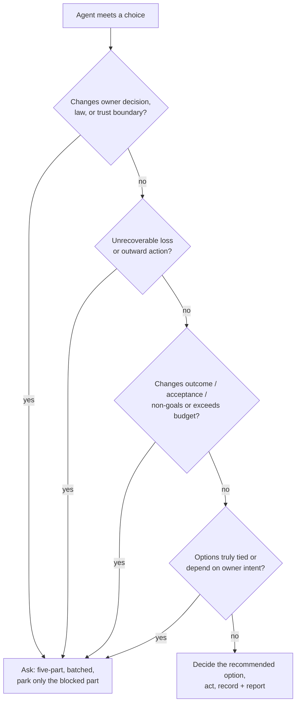

discussion: open

## Seed

Opened by the supervisor on the owner order relayed by the secretary (Miu), 2026-11-26 09:57. Park owner questions in the question store instead of waiting on them.

- **Outcome:** a skill set that tells every agent when a question to the owner is truly needed, so a head decides inside its approved frame and does not stall overnight on a question it could have settled itself.
- **Trigger:** night stall from q-myvzcbz3sx and q-vqyxe5oi6j.
- **Read first:** AGENTS.md product priority 2 (Release con người); core/skills/_shared/decision-question.md.
- **Evidence (open owner questions to judge against the rule):** q-qzchcwl7ya, q-5sog3pzmqn, q-pmhxzsfpr7, q-pkvxdfpg3n, q-ubi34e6xd3.

## 1. Trạng thái hiện tại

Round 1, 2026-11-26 10:15 +07, by the shaper. Domain: platform-wide, since the rule applies to every head in every domain. The doctrine read was AGENTS.md priority 2 and `core/skills/_shared/decision-question.md`. No domain `AGENTS.md` applies.

I scouted all 10 questions in the evidence (the seed's 7 plus the 3 others open today) and sorted them into six classes (§3 row 3). Main finding: the three footprint-widen questions were not a judgment lapse. The current rule *made* them owner questions. `decision-question.md` defines the approved frame as "scope (which files/contracts may change) + budget" and says "about to leave the frame: stop and ask". A footprint is a file list, so every extra file is a frame exit. The fix starts with the definition of the frame, not with agent discipline.

I proposed a draft rule of four ask-triggers (§6). It is provisional and has no D-ID yet.

Open:
- **Q1, parked as q-otq7dwgory:** is the file footprint part of the approved frame? (§3 row 4)
- Whether the deliverable is skill text only or also includes door changes (§3 row 6). This comes after Q1.
- How "decide and report" reaches the owner: a plain report line, or a notice the owner can veto (§3 row 7).

## 2. Mục tiêu & đề bài

Heads stall for hours, overnight included, on questions they could have decided. On 2026-11-25 two leads asked to widen their plan footprints by one or two small files that their own acceptance criteria needed. The owner answered both with the recommended option at 01:44Z, about 8.5 hours later, and five dependent phases waited the whole time. AGENTS.md priority 2 already says to decide inside the approved frame, ask only when truly needed, and batch questions. The rule that defines the frame is too literal, though, and no shared text says which situations truly need the owner. The goal is one shared rule, plus the skill text that points to it, that every agent (lead, supervisor, secretary, shaper, planner, worker) applies the same way. Under it an agent asks only when the answer truly belongs to the owner. Otherwise it decides, records the decision where the owner can see and reverse it, and keeps going. Success is measured against the real questions: under the new rule the night-stall questions would not have been asked, and the questions that truly need the owner still would be.

## 3. Vấn đề rõ / chưa rõ

| # | Vấn đề | Trạng thái | Ghi chú |
|---|---|---|---|
| 1 | Where "when to ask" is written today | **Rõ** | AGENTS.md priority 2 gives the intent. `core/skills/_shared/decision-question.md` § Approved frame gives the rule: "Inside the frame, decide and report; do not ask. About to leave the frame: stop and ask." `fgos-supervisor/SKILL.md:166` says "Decide outside the approved frame: ask". `fgos-lead/SKILL.md:77-80` maps three land refusals straight to owner questions, and `:86` names `questions ask` as the only escalation channel. `plan-contract.md:77` says "only what the owner alone can answer" but gives no test for it. |
| 2 | Why the trigger questions were asked | **Rõ** | The frame is defined as "which files/contracts may change". A footprint widening is therefore a frame exit under the letter of the rule. A lead also cannot edit its own footprint (PS-24, `footprint-change-refused`, see ds-mzyircswox §3 row 3). The lead had no legal way to decide. |
| 3 | Classification of the 10 questions in the evidence | **Rõ (draft)** | **A. Footprint widen serving the plan's own acceptance:** q-myvzcbz3sx (2 files, about 8.5h wait), q-vqyxe5oi6j (1 match arm in a file another plan also lists, about 9h), q-qzchcwl7ya (missed file, about 47 min). All three were answered with the recommendation. Draft verdict: should not reach the owner. **B. Re-asking a decision the owner already made:** q-5sog3pzmqn. ACE-D3 and ASC-D1 were settled in chat, but `authority declare` accepts only an answered q-id. Draft verdict: the door should accept the settled D-ID. **C. Hygiene that blocks nothing:** q-pkvxdfpg3n (delete branches of a done plan) and q-ubi34e6xd3 (stop a duplicate run). Draft verdict: do the reversible part (merged branches whose commits are on main; a duplicate run that can be rerun), leave what could lose work, record it, and do not ask. **D. Urgent, with possible loss:** q-pmhxzsfpr7 (disk full, discard about 21G of superseded worktrees; it blocks every land). Draft verdict: decide when only regenerable artifacts are lost (build output; branches kept); ask only if uncommitted work would go. **E. Trust or security boundary:** q-okdzvolti3 (let unit sandboxes read `~/.cargo`). Draft verdict: a real owner question. **F. Changes an owner decision:** q-ee2f2g3aoj (amend PS-24). Draft verdict: a real owner question. **Unclear:** q-bvvdct5edg (`fgos git recover` in the main checkout). The lead skill routes it to the owner; whether that is a judgment or only a missing grant is open. |
| 4 | **Is the file footprint part of the approved frame?** | **CHƯA RÕ: owner question q-otq7dwgory** | This decides class A. Recommended answer: no. The frame is the outcome, acceptance criteria, non-goals, settled decisions and budget. The footprint is a coordination list (who may write what, so parallel plans don't collide), and widening it in service of the plan's own acceptance is decide-and-report. Overlap with another running plan is already only a warning (`plan-contract.md:131-133`). |
| 5 | Draft ask-triggers | **Provisional** | Ask only if at least one of these holds. (T1) It changes an owner-settled decision, a locked law, or a trust/security boundary (sandbox, credentials, grants). (T2) It causes loss that git or a rerun cannot restore, or it acts outward (publish, send, spend outside the budget). (T3) It changes the outcome, acceptance criteria or non-goals, or it goes past the budget. (T4) The options are truly tied, or they depend on owner intent or taste. Otherwise decide, record, report. Hold for one more round. |
| 6 | Skill text only, or doors too | **Provisional: both, sized after Q1** | Text alone cannot fix class A (PS-24 refuses the lead's self-widening) or class B (`authority declare --approved-by` takes only a q-id). If the owner says no on Q1, the doors must accept the agent's recorded decision. This overlaps ds-mzyircswox (the widen door), and the two must not design that door twice. |
| 7 | How "decide and report" reaches the owner | **Chưa rõ, not yet asked** | Options: a report line in the next batch the secretary relays, or a "decided, veto by <time>" notice in the question store that does not block. Scout next round whether the store has a non-blocking kind (`fgos questions` currently has only ask/answer/ack/cancel). |
| 8 | Prior art | **Rõ** | The `gate-bypass` mechanism, which was meant to reduce yes/no gates, was on but almost never ran (1.6% of the whole history; ds-5i3t6na4ym round 7). The lesson for this design: a rule that depends on a checker the agent cannot satisfy does not reduce questions. ds-hme6khnird built the store (where questions go), not when to ask. |

## 4. Quyết định đã chốt

| D-ID | Tóm tắt | Nguồn / rationale |
|---|---|---|

(None yet. §3 rows 5-6 are provisional and row 4 waits on q-otq7dwgory.)

## 5. Q&A log

- 2026-11-26 10:15 +07, shaper, round 1: Scouted all 10 questions in the evidence and the current rule text (§3 rows 1-3, 8). Found that the frame definition ("which files may change") is what turned footprint widenings into owner questions. Drafted four ask-triggers (§3 row 5). Parked Q1 as q-otq7dwgory: is the footprint part of the frame?

## 6. Thiết kế đã chốt {#design}

Draft, not settled. One shared rule replaces the § Approved frame paragraph of `core/skills/_shared/decision-question.md`. Every skill that tells an agent to ask cites that rule instead of restating it.

- **Frame** = the outcome, acceptance criteria and non-goals, the owner-settled decisions and locked laws, and the budget, all recorded at approval. The file footprint is a coordination list, not part of the frame (pending Q1).
- **Ask** only when at least one of T1-T4 holds (§3 row 5). Batch the questions and use the five-part form.
- **Otherwise decide**: pick the recommended option, act, and record the decision where the owner can see and reverse it (channel open, §3 row 7). A reversible action does not wait for anyone.
- **Partial progress first**: when one part truly needs the owner, do the safe part now and park only that part (classes C and D).

## 7. Danh mục hạng mục / task {#tasks}

Draft, to be filled once Q1 is answered.

### Shared ask rule {#task-shared-ask-rule}
- Goal: rewrite § Approved frame in `core/skills/_shared/decision-question.md` as the T1-T4 rule, and repoint `fgos-lead` (refusal table rows 77-80), `fgos-supervisor:164-166`, `plan-contract.md:77` and the secretary at it.
- Draft verify: re-judge the 10 questions in §3 row 3 against the new text. Classes A, B and C would not be asked; classes E and F would be.

### Doors accept an agent's recorded decision {#task-doors}
- Goal (depends on Q1): the footprint widen (shared with ds-mzyircswox) and `authority declare` accept a settled D-ID or recorded decision instead of only an answered q-id.
