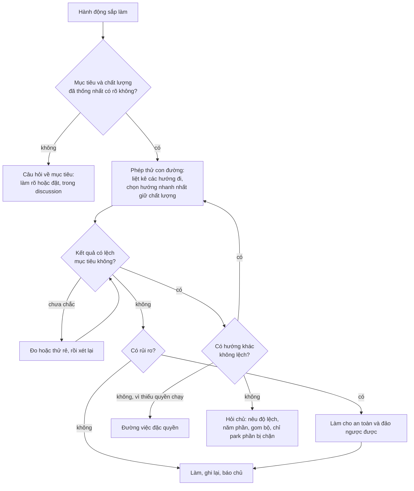

discussion: open

## Seed

Opened by the supervisor on the owner order relayed by the secretary (Miu), 2026-11-26 09:57. Park owner questions in the question store instead of waiting on them.

- **Outcome:** a skill set that tells every agent when a question to the owner is truly needed, so a head decides inside its approved frame and does not stall overnight on a question it could have settled itself.
- **Trigger:** night stall from q-myvzcbz3sx and q-vqyxe5oi6j.
- **Read first:** AGENTS.md product priority 2 (Release con người); core/skills/_shared/decision-question.md.
- **Evidence (open owner questions to judge against the rule):** q-qzchcwl7ya, q-5sog3pzmqn, q-pmhxzsfpr7, q-pkvxdfpg3n, q-ubi34e6xd3.

## 1. Trạng thái hiện tại

Vòng 5, 2026-11-26 11:05 +07. Chủ đưa ra mô hình bốn thành phần: mục tiêu, hướng đi, hành động, hệ quả. Chỉ hỏi khi hành động sinh hệ quả (lệch mục tiêu) mà không có hướng đi nào tránh được. Chọn giữa các hướng đi thì agent tự làm. §6 đã viết lại quanh mô hình này; phép thử con đường là cách tìm hướng đi. Còn hai điểm cần chủ xác nhận: tầng mục tiêu nào được tính, và câu hỏi về mục tiêu. Phần dưới là trạng thái vòng 2.

Chủ đã nêu nguyên tắc (§5, 10:15). Chủ chỉ trả lời câu hỏi **hướng đi**: thay đổi rất lớn về chức năng, về cách tổ chức, hoặc lập một bộ luật mới. Câu hỏi về **tác vụ actionable** phải được biến thành việc tìm cách làm an toàn và đảo ngược được; có cách thì làm rồi báo, chỉ hỏi khi không còn đường nào khác. Phạm vi là mọi câu hỏi, không chỉ các câu trong seed.

Đã lọc toàn bộ 163 câu trong kho (bốn agent Haiku, bằng chứng ở [evidence-question-classification.md](evidence-question-classification.md)). Kết quả: 70% không cần hỏi, 17% là "thiếu tay" (head bị nhốt không chạy được bước host), 13% là hướng đi. Chủ chọn đúng phương án đề xuất 89/94 lần. Năm lần chủ chọn khác đều rơi vào đúng hai chỗ: hạ tiêu chí nghiệm thu, và nới ranh giới tin cậy thường trực. Bộ mẫu hỏi / không hỏi ở §6. Vẫn là bản nháp, chưa có D-ID.

q-otq7dwgory (footprint có thuộc khung không) đã cancel vì nguyên tắc của chủ trả lời nó: mở footprint để đạt acceptance của chính plan là actionable.

Còn mở:
- **Lớp "thiếu tay"** (§3 row 10): khoảng 45 câu không phải quyết định mà là nhờ chủ chạy hộ. Cần xác định plan 261124-0004-heads-operate-without-owner (done 25/11 22:08) đã đóng lớp này chưa trước khi đề xuất gì thêm.
- Kênh "đã quyết, báo chủ" (§3 row 7).
- Phạm vi giao: chỉ văn bản skill, hay cả cửa (§3 row 6).

## 2. Mục tiêu & đề bài

Heads stall for hours, overnight included, on questions they could have decided. On 2026-11-25 two leads asked to widen their plan footprints by one or two small files that their own acceptance criteria needed. The owner answered both with the recommended option at 01:44Z, about 8.5 hours later, and five dependent phases waited the whole time. Across the whole store the pattern holds: 163 questions in seven days, the recommended option picked 95% of the time, 193 hours of total waiting. The owner's principle (§5, 2026-11-26 10:15) is the target. The owner answers only direction questions: a very large change of functionality, of how things are organized, or a new rule set. Every actionable question becomes a search for a safe, reversible way to do the work, which the agent then does and reports. It asks only when no such way exists. The goal is one shared rule, plus a set of ask / don't-ask templates, that every agent (lead, supervisor, secretary, shaper, planner, worker) applies the same way, so that only direction questions reach the owner.

## 3. Vấn đề rõ / chưa rõ

| # | Vấn đề | Trạng thái | Ghi chú |
|---|---|---|---|
| 1 | Where "when to ask" is written today | **Rõ** | AGENTS.md priority 2 gives the intent. `core/skills/_shared/decision-question.md` § Approved frame gives the rule ("Inside the frame, decide and report; about to leave the frame: stop and ask"). Also `fgos-supervisor/SKILL.md:164-166`, `fgos-lead/SKILL.md:77-80,86` (refusal → owner question) and `plan-contract.md:77` ("only what the owner alone can answer", with no test). |
| 2 | Why the trigger questions were asked | **Rõ** | The frame is defined as "which files/contracts may change", so each extra file was a frame exit. PS-24 forbids a lead from editing its own footprint. The leads followed the rule. |
| 3 | The ten seed questions | **Rõ** | Superseded by the full classification in row 9. |
| 4 | Is the footprint part of the frame | **Rõ (owner principle, 10:15)** | No. A widening that serves the plan's own acceptance is actionable. q-otq7dwgory was cancelled with that reason. The 40 footprint-widen questions in the store: 30/30 answered with the recommendation. |
| 5 | Ask-triggers | **Provisional, replaced by §6** | The four draft triggers (T1-T4) of round 1 are folded into the templates in §6. |
| 6 | Skill text only, or doors too | **Chưa rõ** | Text alone cannot remove a question that a door forces: `authority declare --approved-by` takes only an answered q-id (class "reconfirm-settled-decision", 4 questions), and PS-24 refuses a lead's self-widening (ds-mzyircswox). Size after row 10. |
| 7 | How "decided, reporting" reaches the owner | **Chưa rõ** | The store has only ask/answer/ack/cancel. Options: a report line in the batch Miu relays, or a non-blocking "decided, reverse if you disagree" record. |
| 8 | Prior art | **Rõ** | `gate-bypass` almost never ran (1.6%; ds-5i3t6na4ym round 7). The lesson: a rule that depends on a checker the agent cannot satisfy does not reduce questions. ds-hme6khnird built the store, not the when-to-ask rule. |
| 9 | Classification of all 163 questions | **Rõ (evidence)** | [evidence-question-classification.md](evidence-question-classification.md). no-ask 114 (70%), hands 28 (17%), direction 21 (13%). The owner picked the recommended option 89/94 times. The 5 overrides: 3 acceptance narrowings (q-lnjt5zzbfq, q-aanvfxaopa, q-trgzaa34ua), 1 standing trust-boundary widening (q-nt7ptsq2nd), 1 hands (q-ddj673fmju). All 10 org-structure and 5 new-rule questions were settled in chat discussion, then cancelled. |
| 10 | **The hands class** | **Chưa rõ** | About 45 questions (missing-grant-or-door 44, git-recovery-ops 20, and the host-only cleanups, overlapping) ask the owner to *run* a host step: full suites, release activation, worktree removal, config patch, `fgos git recover`. They are not decisions. Prior art: p-g5ktat4kej → plan 261124-0004-heads-operate-without-owner (done 2026-11-25 22:08); q-werrxi4i7i was redirected by the owner to "a generic escalation door bounded by protected things" (ds-liu5g4k3gh). Next: check whether hands questions still come after 2026-11-25 22:08 (2 on 2026-11-26 so far) before proposing anything. |

## 4. Quyết định đã chốt

| D-ID | Tóm tắt | Nguồn / rationale |
|---|---|---|
| WA-D1 | Phạm vi là mọi câu hỏi agent gửi chủ, không chỉ các câu trong seed. | Owner 10:15; giữ nguyên qua các vòng 2-8. |
| WA-D2 | Chủ chỉ trả lời câu hỏi đặt hoặc đổi hướng đi. Một việc actionable thì không hỏi "nguy hiểm, có làm không"; agent tìm cách làm an toàn và đảo ngược được, làm, rồi báo. Chỉ hỏi khi không còn cách nào khác, và khi hỏi thì hỏi về cách làm. | Owner 10:15; giữ qua các vòng 3-8. Bằng chứng: chủ chọn đúng phương án đề xuất 89/94 lần (evidence file). |
| WA-D3 | Mở footprint để đạt acceptance của chính plan là việc actionable, không phải câu hỏi cho chủ. | Theo WA-D2; q-otq7dwgory đã cancel. 40 câu trong kho, 30/30 chọn đề xuất. |
| WA-D4 | Phần "plan ready nghĩa là chạy được không cần chủ" tách thành discussion riêng ds-que32ftgg6; discussion này chỉ giữ luật hỏi lúc thực thi. | Shaper quyết 11:45 khi chủ hỏi có nên tách không; discussion mới đã chạy. |
| WA-D5 | Một agent không được tự suy ra ý định cao hơn của chủ để vượt qua một outcome hay acceptance đã ghi. Đổi một mục tiêu đã duyệt là câu hỏi cho chủ. | Vòng 6: ba câu component-authority là lệch thật so với outcome đã ghi (plan 261121-2110, 261124-1433); chủ đã sửa đúng ở các chỗ đó. Không bị lật lại ở vòng 7-8. |

Còn tạm, chưa chốt: mô hình bốn thành phần (chủ nói chỉ là gợi ý; đã qua phép kiểm trên bằng chứng nhưng chưa được chủ xác nhận là luật); ba chỗ hở của mô hình; kênh báo cáo (vòng 8); lớp "thiếu tay".

## 5. Q&A log

- 2026-11-26 10:15 +07, shaper, round 1: Scouted all 10 seed questions and the current rule text. Found that the frame definition ("which files may change") is what turned footprint widenings into owner questions. Drafted four ask-triggers. Parked q-otq7dwgory: is the footprint part of the frame?
- 2026-11-26 10:15 +07, owner (chat, round 2): Phạm vi không chỉ là các câu trong seed; đây là một nguyên tắc áp cho mọi câu hỏi. Chủ trả lời câu hỏi **quyết định hướng đi**: thay đổi rất lớn về chức năng, về cách tổ chức, hoặc tạo ra một bộ luật mới. Câu hỏi về **tác vụ actionable** không phải "nó nguy hiểm, anh có làm không" (không có tính xây dựng); nó là động lực để tìm cách làm an toàn và đảo ngược được nếu fail. Có cách ổn thì làm rồi báo chủ; chỉ hỏi khi không còn cách nào khác. Việc tiếp theo: dùng agent rẻ lọc toàn bộ câu hỏi trong kho, phân nhóm, và đưa ra mẫu "gặp loại này thì hỏi / không hỏi".
- 2026-11-26 10:40 +07, shaper, round 2: Cancelled q-otq7dwgory (answered by the principle). Exported 163 questions from the store. Four Haiku agents classified them; the shaper merged the results and drafted the templates in §6. Evidence: evidence-question-classification.md.

- 2026-11-26 10:35 +07, shaper, round 3: Gave the shaper's own position: agree with the principle, with five pushbacks. (1) The line between direction and actionable lies in the consequence, not the topic; proposed test: "does it set or lower a standard that outlives this task?" (2) Reversible means within one step and not reaching outside the repo (fgOS runs on other projects). (3) Decide-and-report drifts unless someone reads the decisions aggregated by plan and file. (4) The 70% figure is the rule applied to itself; the 95% figure and the 5 overrides are the real evidence. (5) Direction questions belong in a discussion, not in a night-time A/B store question (all 15 org/rule questions were settled in chat, then cancelled). Also: "find a way" never means escaping the cage; the hands class needs one structural door.
- 2026-11-26 10:45 +07, owner (chat): Agrees with point 1. The three acceptance overrides (q-lnjt5zzbfq, q-aanvfxaopa on plan 261121-2110-component-authority-doors; q-trgzaa34ua on plan 261124-1433-authority-declare-update) are all component-authority. Owner direction: component-authority's core must be released first and be done, so that it is there to govern everything that appears afterwards. The bar is lowered temporarily: related things it would need to check are no longer required to be checked first. It only needs to exist, so it governs the new things and at the same time knows and remembers the old unresolved ones; the old ones are then solved one by one. Waiting for the old ones before releasing it would leave every new thing unchecked meanwhile.
- 2026-11-26 10:50 +07, shaper, round 3: Reading of the owner's answer: the three overrides were not the owner lowering a bar case by case. They were one standing direction ("ship the governor first; it ledgers the old debt") that existed only in the owner's head, so each lead re-derived the opposite recommendation per phase. Proposed refinement of test 1: applying a recorded direction is actionable; only setting or changing a direction is an owner question, asked once and recorded where agents read it. Pushback raised: lower the bar on what the governor manages, never on the governor's own core correctness (q-trgzaa34ua closed with 50 unexplained cargo failures in the full suite).

- 2026-11-26 10:55 +07, owner (chat): "Một hướng đi chưa được ghi ra" is itself a sign of the communication quality between owner and agent; the owner cannot realistically remember which direction to tell the agent. Clean is the goal, the final wish; the best way of reaching it matters more.
- 2026-11-26 11:00 +07, shaper, round 4: Accepted. The burden cannot be "the owner writes every direction down". The agent must derive the path itself. Evidence that it could have: AGENTS.md product priority already orders Ship Faster (1) above DoD (3) and Polish after DoD (4), and the three leads recommended the polish-first path anyway. The missing piece is a path test the agent runs before recommending: what end goal does this serve, and which order reaches it best? A piece that governs or unlocks others lands first; known debt goes into the thing that will track it. Only when the path cannot be derived from the goal, the priorities and the role of the piece is it an owner question, and then it is asked as "the best path I see is X because …", not "clean now or debt?". The pushback on the governor's own correctness stays open.

- 2026-11-26 10:46 +07, owner (chat): Praised the path test ("phép thử về con đường"); had it been applied before this exchange, the exchange would not have been needed.
- 2026-11-26 10:50 +07, shaper, round 4: Self-check: the shaper did not apply the path test either. q-otq7dwgory (round 1) could have been derived from the goal "agents ask only when truly needed" plus priority 2, without asking. The path test is now step 0 of §6.
- 2026-11-26 10:53 +07, owner (chat, round 5): Bối cảnh có bốn thành phần: mục tiêu đang có (kết quả), hướng đi (các cách khác nhau để đạt mục tiêu), hành động sắp diễn ra (chủ thể của câu hỏi), hệ quả. Chỉ gọi là hệ quả (hậu quả) khi kết quả của hành động dẫn tới khác mục tiêu đang có. Hành động có thể là một trong các hướng đi. Tín hiệu quan trọng của một câu hỏi là hành động sinh ra hệ quả (lệch mục tiêu). Hướng đi là cách thông minh để tới mục tiêu với chất lượng đã thống nhất mà chi phí rẻ hơn, trong bối cảnh này chính là thời gian nhanh hơn.
- 2026-11-26 11:05 +07, shaper, round 5: Regenerated §6 around the four-part model. What follows from the model: choosing between directions is never an owner question; a risk is not a consequence but work to make safe; uncertainty about deviation is resolved by cheap measurement, not by asking; a phase acceptance is the planner's chosen direction, not the owner's goal. The model itself answers the governor-correctness question from round 3: a red core falls below the agreed quality (a deviation), while named debt around it is a direction. Two refinements proposed in chat: which goal level counts, and what happens when the goal itself is unclear.
- 2026-11-26 11:17 +07, owner (chat): Do not trust the owner fully; the model is only a suggestion. Use it only if it is truly good, and think deeply about it.
- 2026-11-26 11:30 +07, shaper, round 6: Stress-tested the model against the five overrides, with source. **Correction of rounds 3-5:** the three component-authority overrides were real deviations from the approved goal, not directions. Plan 261121-2110's Outcome says "Every door `debt` entry is gone … the door guard allows debt on no other row", and plan 261124-1433's acceptance 6 requires full `npm test` and `cargo test --workspace`. The leads were right to ask. The shaper's claims that "step 0 would have solved them" and "a phase acceptance is only the planner's direction" were wrong; the second is retracted. An agent that re-derives the owner's higher intent and overrides a written outcome is guessing, and here the guess would only have been right by luck. The model passes this test: it says ask exactly where the owner overrode. Three gaps the model leaves: (a) side effects on other active goals, other plans or other projects using fgOS, which meet this goal but harm another; (b) time: a direction that reaches the goal far past an owner order or budget; (c) the agent's own misjudgment of deviation, which needs recorded decisions and an aggregated review. Where the path test really belongs: at shaping and planning, cutting a goal into a core outcome and a later cleanup outcome (as plan 261121-2110 eventually did with phases 12a-12c), so execution meets fewer deviations. A legitimate ask should be cheap: propose the path, park only the blocked part, keep moving. Also noted: in q-trgzaa34ua the owner did close the governor's own plan without the full suite, against the shaper's round-3 pushback.
- 2026-11-26 11:38 +07, owner (chat): (1) Agrees with the three gaps. The portfolio should manage a set of goals and the current milestone, so that agents can recognise the goal (raised in another discussion). (2) Did not understand "the path test belongs at shaping and planning, not at execution". This is the owner's pain: he believes every question was settled in the plan and walks away trusting it will be delivered; on return, the plan has silly questions and has sometimes not even been activated.
- 2026-11-26 11:50 +07, shaper, round 7: (1) The managed goal set is already being shaped in ds-3in4yb5thk-backlog-to-ready-pipeline (§3 row 5, owner question q-pvl344blv5). This discussion consumes it rather than designing it: the deviation check reads the active goal set and milestone from there (gap a). (2) Scout: about 140 of the 163 questions carry a `plan:` ref, so they were asked after a plan existed. The main classes are ones the plan could have foreseen. Footprint widens (40): the planner listed files by reading, not by tracing the change to its real entry (missed `src/cli/command-registry.mjs`, `apps/fgos/src/routing.rs`). Hands (about 45): acceptance demanded steps (full suites, release activation) that the plan's own executor, a confined head, cannot run. Cleanup (18): the plan does not say what happens to worktrees and branches at the end. Acceptance deviations (8): the outcome bundled the core and the cleanup into one promise. Three plans account for 66 questions (261122-0118 heads-stable-and-able 29, 261121-2110 component-authority-doors 22, 261120-0625 work-data-model 15). Reading: "ready" today means "written and checked for shape", not "executable without the owner". Proposed: plan readiness includes an "owner-free run" check, and the owner's approval carries pre-decided fallbacks, so foreseeable deviations are already answered at approval.
- 2026-11-26 11:40 +07, owner (chat): Should this become two separate discussions?
- 2026-11-26 11:45 +07, shaper, round 7: Decided to split, since the path test gives a clear answer. The execution-time ask rule is close to settled, while plan readiness is just starting and touches planning, the plan contract, the validator and approval; bundled, the ripe part would wait for the unripe one. It does not go into ds-3in4yb5thk either, which owns the flow to `ready`, not what `ready` guarantees. This discussion keeps the execution-time rule. The new topic "a ready plan runs without the owner" was handed to the supervisor as coordination event 40cb311fe7105ff0.
- 2026-11-26 12:23 +07, owner (chat): Did not understand the "decided, reporting" channel (§3 row 7).
- 2026-11-26 12:30 +07, shaper, round 8: Explained it with the q-myvzcbz3sx example. Proposed, provisional: no new channel. A self-decision is recorded where the work lives (commit message, the plan's phase table, the discussion log). Miu aggregates those records into her normal report when the owner returns, grouped by plan and by file. A repeated pattern (for example ten widens into the same hot file) is raised as a direction question. A new non-blocking record kind in the question store is rejected, since it would make the system bigger (RUL104).
- 2026-11-26 13:32 +07, owner (chat): Do not hand this to a planner yet. Asked what is settled so far.
- 2026-11-26 13:35 +07, shaper: Minted WA-D1 to WA-D5 for the points that have held across rounds (§4). Everything else stays provisional. No hand-off.
- 2026-11-26 13:40 +07, owner (chat): Asked for other angles to add to the four-part model. Agrees with the report channel, but feels Miu is far less active than the supervisor, although by design they hold equal power. Asked what the hands class is.
- 2026-11-26 13:50 +07, shaper, round 9: Proposed three angles to add to the model, all provisional. (1) **Who holds the information:** the owner holds intent, taste and the order between goals; the agent holds the facts. Ask only for information only the owner has; a fact the agent can gather is never a question. (2) **Precedent:** a class of question the owner has answered the same way several times is a recorded direction, applied without asking (40 footprint widens, 30/30 the same answer). (3) **Cost of waiting against cost of being wrong:** once an action is made reversible, being wrong costs one revert, while waiting cost 193 hours in seven days; reversible actions do not wait. On Miu: the channel depends on Miu being active, and backlog p-dgs2lsfudr already records her 15-minute tick stopping for hours. Proposed: the channel must not depend on Miu's tick. The records sit where the work lives, and the digest is pulled when the owner returns. Miu's liveness is its own item, outside this discussion. On the hands class (scout of `packages/session-host/contracts/head-permissions.v1.json`): the supervisor row now allows `git recover`, `worktree remove --delivered-to main` and `config patch`; `release activate` is denied to every head by design; full `npm test` and `cargo test --workspace` are not `fgos` verbs, so no head can run them. Also, `core/skills/fgos-lead/SKILL.md:80` still tells a lead to "ask the owner to run `fgos git recover`", although the supervisor holds that grant, which explains q-bvvdct5edg (2026-11-26).
- 2026-11-26 14:15 +07, owner (chat, round 10): (a) Cost of waiting against cost of being wrong is the innovative angle. An agent can handle larger and more complex work than a person. Splitting work into many small steps, each careful to cause no disturbance, creates countless extra steps spent only on keeping things stable. An agent needs one big step: inside it things may be messy, but when it ends the work is done. What it needs is an isolated environment and one strict step before it starts that seals the current state, so the work can be reversed if the result is not as wanted. (b) "Who holds the information" is hard to understand. (c) Precedent: unclear whether the observer and friction system records friction and other events continuously and periodically turns them into improvements and new rules. That is where precedent should live, not in each agent's memory.
- 2026-11-26 14:25 +07, shaper, round 10: (a) Adopted as the concrete meaning of "safe and reversible" in WA-D2: isolate, seal the state before, take one big step, then a strict final check; reverse to the seal on failure. Limits raised in chat: the seal must cover state outside the worktree (event store, config, release activation, remote), or the step must not touch it before land; and the final check carries all the weight, so it must be strict. Plan shape (step granularity) belongs to ds-que32ftgg6 and was passed on through coordination event 83040765c1c5a4d6. (b) Restated: "where does the answer live? If in the machine (code, logs, state, docs), look it up; ask only when it lives in the owner's head (what he wants, what matters more)". (c) Scout: friction has 785 records but almost none since 2026-09-11 (zero until 2026-11-17, about 33 in November). The coach (p-kmavlfevvu, plan 261122-2110, draft) is the only planned synthesis and does not read owner-question answers. Nothing in the supervisor or secretary skills synthesises friction periodically. Precedent is moved out of this discussion: coordination event 83040765c1c5a4d6 asks to add owner-question answers to the coach's inputs.

## 6. Thiết kế đã chốt {#design}

Bản nháp vòng 5, chưa chốt. Một luật dùng chung thay cho đoạn § Approved frame trong `core/skills/_shared/decision-question.md`. Mọi skill có chỗ bảo agent hỏi thì trỏ về luật này, không viết lại.

### Mô hình bốn thành phần (chủ, vòng 5)

| Thành phần | Nghĩa |
|---|---|
| **Mục tiêu** | Kết quả đã thống nhất, cùng chất lượng đã thống nhất (gồm cả các ràng buộc chủ đã đặt: luật, ranh giới tin cậy). |
| **Hướng đi** | Các cách hành động khác nhau để đạt *cùng* mục tiêu đó. Hướng đi thông minh là hướng đạt mục tiêu với chất lượng đã thống nhất mà chi phí rẻ hơn; trong bối cảnh này chi phí chủ yếu là thời gian. |
| **Hành động** | Chủ thể của câu hỏi: việc sắp làm. Nó là một trong các hướng đi. |
| **Hệ quả** | Chỉ gọi là hệ quả khi kết quả của hành động **lệch khỏi mục tiêu**: kết quả khác, hoặc chất lượng thấp hơn mức đã thống nhất. |

**Luật.** Tín hiệu duy nhất để hỏi chủ là: hành động sẽ sinh ra hệ quả (lệch mục tiêu), **và** không có hướng đi nào khác đạt mục tiêu mà tránh được độ lệch đó. Chọn giữa các hướng đi không phải câu hỏi: agent tự chọn hướng nhanh nhất mà vẫn giữ chất lượng đã thống nhất, làm, rồi báo.

**Phép thử con đường** (vòng 4) là cách agent tìm ra các hướng đi trước khi kết luận là có hệ quả:
1. Hành động này phục vụ mục tiêu nào?
2. Thứ tự nào tới mục tiêu đó nhanh nhất? Mảnh nào quản lý hoặc mở khoá các mảnh khác thì lên trước. Nợ đã biết thì ghi vào chính thứ sẽ theo dõi nó, không chặn đường. Đối chiếu thứ tự ưu tiên sản phẩm: Ship Faster > Release con người > DoD > Polish sau DoD.
3. Rủi ro của một hướng đi không phải là hệ quả. Rủi ro là việc cần làm cho an toàn và đảo ngược được (sao lưu, dry-run, làm phần an toàn trước, giữ dữ liệu). Chưa chắc kết quả có lệch không thì đi đo hoặc thử với chi phí thấp, không hỏi.
4. Chỉ khi mọi hướng đều lệch mục tiêu mới hỏi. Khi hỏi thì nêu độ lệch ("hướng tốt nhất em thấy là X; nó lệch mục tiêu ở chỗ Y, vì …"), không hỏi "có làm không".

**Câu hỏi về mục tiêu** là một loại khác: khi mục tiêu hoặc chất lượng đã thống nhất chưa rõ, hoặc khi việc đang làm đề xuất đặt mục tiêu mới. Khi đó hỏi để làm rõ hoặc đặt mục tiêu, thường trong một discussion, không phải một câu A/B.

### Áp vào bằng chứng

| Nhóm trong kho | Hướng đi hay hệ quả | Kết luận |
|---|---|---|
| Mở footprint (40) | Hướng đi: thêm vài file để đạt đúng acceptance của plan | Không hỏi |
| Dọn dẹp (18), phục hồi git/ops (20), xin xác nhận điều đã chốt (4) | Hướng đi có rủi ro: làm cho an toàn rồi làm | Không hỏi |
| Ba câu component-authority (q-lnjt5zzbfq, q-aanvfxaopa, q-trgzaa34ua) | **Lệch thật** so với kết quả đã duyệt. Outcome của plan 261121-2110 ghi "every door `debt` entry is gone … the door guard allows debt on no other row"; acceptance 6 của plan 261124-1433 đòi full `npm test` và `cargo test --workspace`. Chọn "nợ có tên" hay "đóng trên test tập trung" là đổi mục tiêu đã duyệt. | **Hỏi là đúng.** Chỗ cần sửa là cách hỏi (đưa sẵn con đường, chỉ park phần bị chặn) và lúc lập plan (tách mục tiêu lõi khỏi mục tiêu dọn dẹp), không phải bỏ câu hỏi. |
| Đổi tổ chức (10), luật mới (5), đổi chức năng lớn (2) | Đặt hoặc đổi mục tiêu hay ràng buộc | Câu hỏi về mục tiêu, thường bàn trong discussion |
| Nới ranh giới tin cậy thường trực (q-nt7ptsq2nd, q-okdzvolti3) | Ranh giới tin cậy là một phần chất lượng đã thống nhất; nới nó là lệch | Hỏi, trừ khi có hướng khác không cần nới |
| Thiếu tay (~45) | Không phải câu hỏi: agent bị nhốt không chạy được bước host | Đi đường việc đặc quyền (§3 row 10) |

## 7. Danh mục hạng mục / task {#tasks}

Draft; to be filled once §3 rows 6, 7 and 10 settle.

### Shared ask rule {#task-shared-ask-rule}
- Goal: replace § Approved frame in `core/skills/_shared/decision-question.md` with the §6 rule and templates. Repoint `fgos-lead` (the refusal table, rows 77-80), `fgos-supervisor:164-166`, `plan-contract.md:77` and the secretary at it.
- Draft verify: re-judge the 163 questions in the evidence file against the new text. Only H1-H6 reach the owner.

### Doors accept a recorded decision {#task-doors}
- Goal: the footprint widen (shared with ds-mzyircswox) and `authority declare` accept a settled D-ID or a recorded agent decision, not only an answered q-id.

### Hands class {#task-hands}
- Goal: pending §3 row 10.
