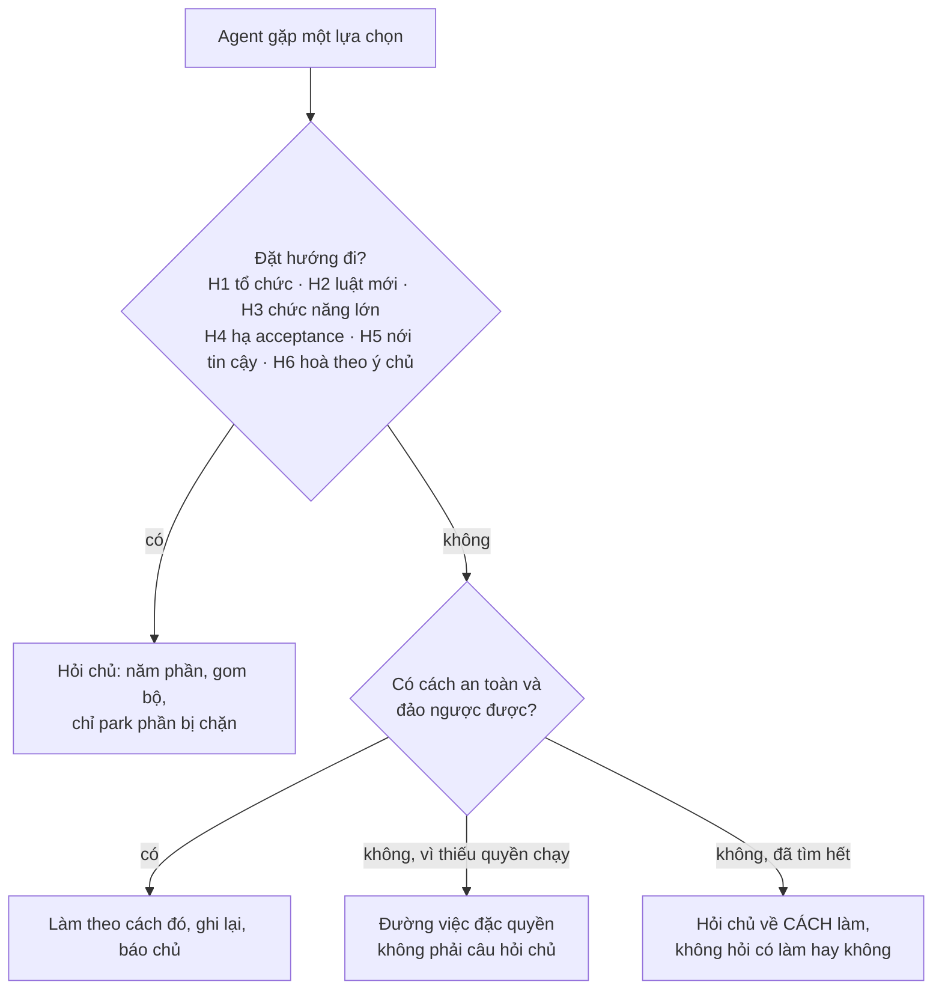

discussion: open

## Seed

Opened by the supervisor on the owner order relayed by the secretary (Miu), 2026-11-26 09:57. Park owner questions in the question store instead of waiting on them.

- **Outcome:** a skill set that tells every agent when a question to the owner is truly needed, so a head decides inside its approved frame and does not stall overnight on a question it could have settled itself.
- **Trigger:** night stall from q-myvzcbz3sx and q-vqyxe5oi6j.
- **Read first:** AGENTS.md product priority 2 (Release con người); core/skills/_shared/decision-question.md.
- **Evidence (open owner questions to judge against the rule):** q-qzchcwl7ya, q-5sog3pzmqn, q-pmhxzsfpr7, q-pkvxdfpg3n, q-ubi34e6xd3.

## 1. Trạng thái hiện tại

Vòng 2, 2026-11-26 10:40 +07.

Chủ đã nêu nguyên tắc (§5, 10:15). Chủ chỉ trả lời câu hỏi **hướng đi**: thay đổi rất lớn về chức năng, về cách tổ chức, hoặc lập một bộ luật mới. Câu hỏi về **tác vụ actionable** phải được biến thành việc tìm cách làm an toàn và đảo ngược được; có cách thì làm rồi báo, chỉ hỏi khi không còn đường nào khác. Phạm vi là mọi câu hỏi, không chỉ các câu trong seed.

Đã lọc toàn bộ 163 câu trong kho (bốn agent Haiku, bằng chứng ở [evidence-question-classification.md](evidence-question-classification.md)). Kết quả: 70% không cần hỏi, 17% là "thiếu tay" (head bị nhốt không chạy được bước host), 13% là hướng đi. Chủ chọn đúng phương án đề xuất 89/94 lần. Năm lần chủ chọn khác đều rơi vào đúng hai chỗ: hạ tiêu chí nghiệm thu, và nới ranh giới tin cậy thường trực. Bộ mẫu hỏi / không hỏi ở §6. Vẫn là bản nháp, chưa có D-ID.

q-otq7dwgory (footprint có thuộc khung không) đã cancel vì nguyên tắc của chủ trả lời nó: mở footprint để đạt acceptance của chính plan là actionable.

Còn mở:
- **Lớp "thiếu tay"** (§3 row 10): khoảng 45 câu không phải quyết định mà là nhờ chủ chạy hộ. Cần xác định plan 261124-0004-heads-operate-without-owner (done 25/11 22:08) đã đóng lớp này chưa trước khi đề xuất gì thêm.
- Kênh "đã quyết, báo chủ" (§3 row 7).
- Phạm vi giao: chỉ văn bản skill, hay cả cửa (§3 row 6).

## 2. Mục tiêu & đề bài

Heads stall for hours, overnight included, on questions they could have decided. On 2026-11-25 two leads asked to widen their plan footprints by one or two small files that their own acceptance criteria needed. The owner answered both with the recommended option at 01:44Z, about 8.5 hours later, and five dependent phases waited the whole time. Across the whole store the pattern holds: 163 questions in seven days, the recommended option picked 95% of the time, 193 hours of total waiting. The owner's principle (§5, 2026-11-26 10:15) is the target. The owner answers only direction questions: a very large change of functionality, of how things are organized, or a new rule set. Every actionable question becomes a search for a safe, reversible way to do the work, which the agent then does and reports. It asks only when no such way exists. The goal is one shared rule, plus a set of ask / don't-ask templates, that every agent (lead, supervisor, secretary, shaper, planner, worker) applies the same way, so that only direction questions reach the owner.

## 3. Vấn đề rõ / chưa rõ

| # | Vấn đề | Trạng thái | Ghi chú |
|---|---|---|---|
| 1 | Where "when to ask" is written today | **Rõ** | AGENTS.md priority 2 gives the intent. `core/skills/_shared/decision-question.md` § Approved frame gives the rule ("Inside the frame, decide and report; about to leave the frame: stop and ask"). Also `fgos-supervisor/SKILL.md:164-166`, `fgos-lead/SKILL.md:77-80,86` (refusal → owner question) and `plan-contract.md:77` ("only what the owner alone can answer", with no test). |
| 2 | Why the trigger questions were asked | **Rõ** | The frame is defined as "which files/contracts may change", so each extra file was a frame exit. PS-24 forbids a lead from editing its own footprint. The leads followed the rule. |
| 3 | The ten seed questions | **Rõ** | Superseded by the full classification in row 9. |
| 4 | Is the footprint part of the frame | **Rõ (owner principle, 10:15)** | No. A widening that serves the plan's own acceptance is actionable. q-otq7dwgory was cancelled with that reason. The 40 footprint-widen questions in the store: 30/30 answered with the recommendation. |
| 5 | Ask-triggers | **Provisional, replaced by §6** | The four draft triggers (T1-T4) of round 1 are folded into the templates in §6. |
| 6 | Skill text only, or doors too | **Chưa rõ** | Text alone cannot remove a question that a door forces: `authority declare --approved-by` takes only an answered q-id (class "reconfirm-settled-decision", 4 questions), and PS-24 refuses a lead's self-widening (ds-mzyircswox). Size after row 10. |
| 7 | How "decided, reporting" reaches the owner | **Chưa rõ** | The store has only ask/answer/ack/cancel. Options: a report line in the batch Miu relays, or a non-blocking "decided, reverse if you disagree" record. |
| 8 | Prior art | **Rõ** | `gate-bypass` almost never ran (1.6%; ds-5i3t6na4ym round 7). The lesson: a rule that depends on a checker the agent cannot satisfy does not reduce questions. ds-hme6khnird built the store, not the when-to-ask rule. |
| 9 | Classification of all 163 questions | **Rõ (evidence)** | [evidence-question-classification.md](evidence-question-classification.md). no-ask 114 (70%), hands 28 (17%), direction 21 (13%). The owner picked the recommended option 89/94 times. The 5 overrides: 3 acceptance narrowings (q-lnjt5zzbfq, q-aanvfxaopa, q-trgzaa34ua), 1 standing trust-boundary widening (q-nt7ptsq2nd), 1 hands (q-ddj673fmju). All 10 org-structure and 5 new-rule questions were settled in chat discussion, then cancelled. |
| 10 | **The hands class** | **Chưa rõ** | About 45 questions (missing-grant-or-door 44, git-recovery-ops 20, and the host-only cleanups, overlapping) ask the owner to *run* a host step: full suites, release activation, worktree removal, config patch, `fgos git recover`. They are not decisions. Prior art: p-g5ktat4kej → plan 261124-0004-heads-operate-without-owner (done 2026-11-25 22:08); q-werrxi4i7i was redirected by the owner to "a generic escalation door bounded by protected things" (ds-liu5g4k3gh). Next: check whether hands questions still come after 2026-11-25 22:08 (2 on 2026-11-26 so far) before proposing anything. |

## 4. Quyết định đã chốt

| D-ID | Tóm tắt | Nguồn / rationale |
|---|---|---|

(None yet. The owner principle of 10:15 is one round old; the §6 templates wait for one more round before any D-ID.)

## 5. Q&A log

- 2026-11-26 10:15 +07, shaper, round 1: Scouted all 10 seed questions and the current rule text. Found that the frame definition ("which files may change") is what turned footprint widenings into owner questions. Drafted four ask-triggers. Parked q-otq7dwgory: is the footprint part of the frame?
- 2026-11-26 10:15 +07, owner (chat, round 2): Phạm vi không chỉ là các câu trong seed; đây là một nguyên tắc áp cho mọi câu hỏi. Chủ trả lời câu hỏi **quyết định hướng đi**: thay đổi rất lớn về chức năng, về cách tổ chức, hoặc tạo ra một bộ luật mới. Câu hỏi về **tác vụ actionable** không phải "nó nguy hiểm, anh có làm không" (không có tính xây dựng); nó là động lực để tìm cách làm an toàn và đảo ngược được nếu fail. Có cách ổn thì làm rồi báo chủ; chỉ hỏi khi không còn cách nào khác. Việc tiếp theo: dùng agent rẻ lọc toàn bộ câu hỏi trong kho, phân nhóm, và đưa ra mẫu "gặp loại này thì hỏi / không hỏi".
- 2026-11-26 10:40 +07, shaper, round 2: Cancelled q-otq7dwgory (answered by the principle). Exported 163 questions from the store. Four Haiku agents classified them; the shaper merged the results and drafted the templates in §6. Evidence: evidence-question-classification.md.

## 6. Thiết kế đã chốt {#design}

Bản nháp vòng 2, chưa chốt. Một luật dùng chung thay cho đoạn § Approved frame trong `core/skills/_shared/decision-question.md`; mọi skill có chỗ bảo agent hỏi thì trỏ về luật này, không viết lại.

**Nguyên tắc.** Chủ chỉ trả lời câu hỏi đặt hướng đi. Một câu về tác vụ không bao giờ được hỏi dạng "nguy hiểm, có làm không"; agent đổi nó thành câu "làm thế nào để an toàn và đảo ngược được", tự tìm cách, làm, rồi báo. Chỉ hỏi khi đã tìm mà không có cách nào, và khi hỏi thì hỏi về cách, không hỏi về có làm hay không.

### Mẫu HỎI chủ (hướng đi)

| # | Loại | Dấu hiệu nhận ra | Ví dụ trong kho |
|---|---|---|---|
| H1 | Đổi tổ chức hoặc chủ sở hữu | thêm, gộp hoặc xoá một component; đổi ai sở hữu việc gì; đổi kênh chính giữa các head | q-7wd766tu4p, q-ng4ojyph5r, q-ee2f2g3aoj |
| H2 | Luật hoặc chính sách mới | một quy tắc sẽ áp cho mọi agent, mọi plan hay mọi lần gọi; đổi một luật khoá hoặc một quyết định chủ đã chốt | q-djyjckiygr, q-nfgvjge6zg, q-otq7dwgory |
| H3 | Đổi chức năng lớn | hành vi người dùng thấy đổi hẳn, hoặc mở hay đóng một hướng sản phẩm | q-6yhs63ru4i, q-kml4ipaweg |
| H4 | Hạ tiêu chí nghiệm thu | đóng việc mà bỏ hoặc nới một acceptance; nhận "nợ có tên" thay vì làm đủ | q-trgzaa34ua, q-lnjt5zzbfq, q-aanvfxaopa (3/5 lần chủ chọn khác đề xuất) |
| H5 | Nới ranh giới tin cậy thường trực | grant toàn cục, sandbox đọc hoặc ghi rộng hơn mà vẫn giữ lại về sau, credential | q-nt7ptsq2nd (chủ chọn khác đề xuất), q-okdzvolti3 |
| H6 | Hoà thật, phụ thuộc ý chủ | các phương án ngang nhau sau phân tích, và chọn cái nào là chuyện ý muốn chứ không phải kỹ thuật | q-t6xfzdl3eu |

### Mẫu KHÔNG HỎI (actionable: tìm cách, làm, báo)

| # | Loại | Cách an toàn mặc định | Ví dụ, số lượng |
|---|---|---|---|
| K1 | Mở footprint để đạt acceptance của chính plan | thêm đúng những đường dẫn cần; trùng plan khác thì báo supervisor điều phối; ghi vào commit | 40 câu, 30/30 chọn đề xuất (q-myvzcbz3sx, q-vqyxe5oi6j, q-qzchcwl7ya) |
| K2 | Dọn dẹp | chỉ xoá thứ đã có trên main hoặc tái tạo được (branch đã merge, worktree đã land, build output, run trùng); thứ có thể mất việc thì giữ lại và ghi thành item | 18 câu (q-pkvxdfpg3n, q-ubi34e6xd3) |
| K3 | Phục hồi hoặc vận hành theo cửa có sẵn | chạy đúng cửa mà lỗi chỉ tên (`fgos git recover`, …); ghi lại ref và trạng thái trước để quay lui | 20 câu (q-bvvdct5edg) |
| K4 | Xin xác nhận lại điều đã chốt | dẫn D-ID hoặc câu trả lời đã có rồi làm; nếu một cửa đòi q-id thì đó là lỗi của cửa, ghi thành item | 4 câu (q-5sog3pzmqn) |
| K5 | Đánh đổi kỹ thuật có phương án rõ | chọn phương án phân tích đã chọn; ghi lý do; làm sao cho đảo được (nhánh, cờ cấu hình) | resource-or-cost, priority theo phụ thuộc kỹ thuật, product-behaviour nhỏ |
| K6 | Rủi ro mà cần quyết, dạng "có làm không" | đổi thành "làm sao an toàn": sao lưu, dry-run, làm phần an toàn trước, giữ dữ liệu; disk đầy thì xoá thứ tái tạo được trước | q-pmhxzsfpr7 |

### Lớp thứ ba: THIẾU TAY (không phải câu hỏi)

Head bị nhốt không chạy được bước host (full suite, activate release, xoá worktree, patch config, git recover). Đây là nhờ chạy hộ, không phải quyết định. Theo nguyên tắc "tìm cách", việc này phải đi qua đường dành cho việc đặc quyền, không đi qua kho câu hỏi của chủ. Chi tiết đang mở ở §3 row 10.

## 7. Danh mục hạng mục / task {#tasks}

Draft; to be filled once §3 rows 6, 7 and 10 settle.

### Shared ask rule {#task-shared-ask-rule}
- Goal: replace § Approved frame in `core/skills/_shared/decision-question.md` with the §6 rule and templates. Repoint `fgos-lead` (the refusal table, rows 77-80), `fgos-supervisor:164-166`, `plan-contract.md:77` and the secretary at it.
- Draft verify: re-judge the 163 questions in the evidence file against the new text. Only H1-H6 reach the owner.

### Doors accept a recorded decision {#task-doors}
- Goal: the footprint widen (shared with ds-mzyircswox) and `authority declare` accept a settled D-ID or a recorded agent decision, not only an answered q-id.

### Hands class {#task-hands}
- Goal: pending §3 row 10.
