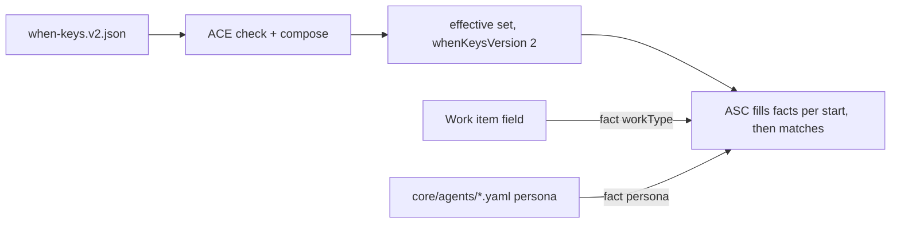

discussion: open

# Rename the `when:` label key

## 1. Trạng thái hiện tại

2026-11-26: discussion opened by the supervisor on the owner's order via Miu (supervisor event 362188c03b862986). It is split out of `plans/discussions/ds-que32ftgg6-ready-plan-runs-unattended/DISCUSSION.md` section 6 and its points D2 and D3; backlog row `p-2vep73teju`. Split rule (owner round 6): only the ACE part of ds-que32ftgg6 (the `when:` labels) comes here, so a planner can run fast for ACE; everything else stays in ds-que32ftgg6, which gets a pointer to this discussion for the label part.

Round 1 (18:20-18:50, shaper, distill + scout): §2, §3, §6 and §7 drafted from ds-que32ftgg6 §6, D2 and D3, checked against the code on `61e425e23`. Carried over as settled: D1.

Rounds 2-5 (18:25-18:40, owner in chat): delivery vs moment explained (§5); **D2 settled: this discussion covers only ACE's `when:` labels.** `workType` is an ACE label; renaming the Work item field `kind` and the persona file field `role:` stay with ds-que32ftgg6 (§3 rows 3, 8), as does everything else there (owner round 6 corrected the shaper's idea of sending them to new backlog rows). Shaper proposals in §3 rows 4-7 and 9 stand unless the owner objects.

Open: **q-47jzaaqnpq** (§3 row 2): are `setup` and `hook` values of `agentLifecycle`, or delivery channels (so `hand-opened` becomes a `sessionType` value)? Shaper recommends A, widened in round 2: `agentLifecycle` values are hook-event moments, starting with `start` and `rotate`.

## 2. Mục tiêu & đề bài

The `when:` key registry of the agent context engine (`packages/agent-context-engine/contracts/when-keys.v1.json`, shipped with ACE plan 261125-1631) has one overloaded key, `kind` (`head`, `worker`, `setup`, `hook`), that mixes two questions: what form the session takes, and at what moment its context is put together. Its `role` key mixes a persona (lead) with a part in a workflow step (producer, reviewer), and its `cli` key gives the agent program but not the model family. The work kind (bug, feature, ...) has no key at all, so a rule cannot be scoped to one kind of work. ds-que32ftgg6 fixed names and meanings for a three-group key set (what the work is, who the agent is, when in its life) in D2 and D3. This discussion turns that naming into a change a planner can run: the final key list with values and value sources, every caller that moves in the same change (L10), the old names deleted (RUL104), and the order against the agent start context plan 261122-1946 (ASC), which cites the old keys in four phases and must start after the rename. The win for projects using fgOS: rule units can be aimed at one kind of work, one session form and one agent family, so each agent gets only the rules that apply to it.

## 3. Vấn đề rõ / chưa rõ

| # | Vấn đề | Trạng thái | Ghi chú / bằng chứng |
|---|---|---|---|
| 1 | Names and meanings of the key set | **Settled (D1, carried from ds-que32ftgg6 D2, D3)** | Three groups. What the work is: `domain`, `workType`, `workflow`, `stage`, `project`. Who the agent is: `persona` (its charter, one of `core/agents/*.yaml`), `role` (the part in one workflow step only), `sessionType`, `agentFamily`, `agentCli`. When in its life: `agentLifecycle`. A seat address (`head:<persona>-<name>`) is an instance name, never a key. |
| 2 | Values of `agentLifecycle` and `sessionType`; where `setup`, `hook` and ASC's `hand-opened` go | **Open: owner, q-47jzaaqnpq** | D2 lists `setup`, `hook` and session start as `agentLifecycle` values. Scout: `setup` is the AGENTS.md block `fgos setup` writes once into a file, read by whoever opens the repo; `hook` is the SessionStart hook of a session the owner opened by hand (ASC plan lines 90, 110; ASC phase 10 adds a fourth start kind `hand-opened`). Both say *how the text is delivered*, and ASC already carries delivery as its own field (ASC-D8: "each caller passes typed facts, payloads and a delivery"). Shaper proposal: `sessionType` = `head`, `worker`, `hand-opened`; `agentLifecycle` = the moment: `start`, `rotate` (successor after a session rotation, ASC phase 7); `setup` and `hook` are not key values, they are ASC deliveries. The alternative keeps D2's wording literally. This reinterprets an owner decision, so it is asked, not decided. |
| 3 | Work item field `kind` → `workType` | **Stays in ds-que32ftgg6 (D2, owner rounds 5-6)** | `workType` is a label in ACE's registry only. Whether the Work item field is renamed stays with ds-que32ftgg6 §6, not here. Scout kept for that owner: the field is Work item Data Dictionary row 3 (`docs/platform/work-state/spec.md:64`), stored in the append-only event log and printed in `--json` envelopes. ASC fills the `workType` fact from whatever the Work item field is called. |
| 4 | Registry file version | **Proposed (shaper, round 1)** | `when-keys.v1.json` is a shipped contract, and the effective set records `whenKeysVersion` (ACE spec line 146). No rule unit carries a `when:` today (`core/instructions`, `domains/*/instructions`, `components/*/instructions`: zero hits), so nothing in force is re-keyed. Proposal: write `when-keys.v2.json`, move the Rust loader (`packages/agent-context-engine/rust/src/when_keys.rs:11`) and the vectors to it, delete v1 in the same change. |
| 5 | `agentCli` values | **Proposed (shaper, round 1)** | D3's examples say `claude-code`; the live source, the agent-protocol adapters, uses ids `claude`, `codex`, `agy`, `pi`, `omp` (`packages/agent-protocol/contracts/agent-protocol.v1.json:40`). Proposal: values stay the adapter ids; renaming CLI ids across the repo is out of scope (RUL104). `agentFamily: claude` and `agentCli: claude` read alike but are different keys. |
| 6 | `agentFamily` value source | **Proposed (shaper, round 1)** | The runner keys `modelPolicies` by family (`core/config-standard/runner.yaml`: `claude`, `gemini`), but no `openai` there and no adapter-to-family map anywhere. Proposal: a static enum `claude`, `openai`, `gemini` in the registry, extended by editing data; a live source only once a family map exists for another reason. |
| 7 | `role` narrowed to the workflow-step part | **Proposed (shaper, round 1)** | Today's `role` source is "head roles and unit roles" (`when-keys.v1.json`). New source: the domain registry's `roleGraph` (`domains/coding/registry.yaml`). Head names (lead, supervisor) move to `persona`. |
| 8 | Persona file field `role:` | **Out of scope (follows D2, round 5)** | Owner round 4 asked why `summary`. Scout: the field mixes workflow roles (`Reviewer`, `Implementer`, `Researcher`, `Panelist`) with free-text titles (`Lead session (executes one plan)`); its only reader is `scripts/project-agents.mjs` (required at line 45, printed as the heading `# ${def.role}` at line 136), so it is in fact the persona's title, and `summary` was only a placeholder; `title` fits better. It is not an ACE key, so by D2 it stays with ds-que32ftgg6 §6; the `title` finding is recorded here for that discussion to pick up. |
| 9 | Order against ASC 261122-1946 | **Proposed (shaper, round 1)** | ASC is `draft` and cites the old keys in phases 2, 3, 5, 7 and 10 (`kind=head`, `cli`, `kind=hand-opened`). Proposal: ASC `blockedBy` this item's plan, and ASC's phase texts are updated to the new names by the ASC planner when it re-validates (not by this item: a plan file is outside this item's footprint). |
| 10 | The rule unit's own `kind` field (`law`, `procedure`) | **Out of scope (shaper, round 1)** | `rule-unit.v1.json` and `rust/src/rule.rs:264` use `kind` for the unit's category; this is a separate contract from the `when:` keys. Recorded so nobody folds it in by accident; if it should also be renamed, that is its own backlog row. |

## 4. Quyết định đã chốt

| D-ID | Tóm tắt | Nguồn / rationale |
|---|---|---|
| D1 | The key set and meanings of ds-que32ftgg6 D2 + D3 (§3 row 1) are the basis of this item: `workType`, `sessionType`, `agentFamily`, `agentCli`, `agentLifecycle`, with `persona` = charter and `role` = part in a workflow step; `cli` and today's `kind` key are deleted. | Carried over; held stable across rounds 11-16 of ds-que32ftgg6 and confirmed by the owner's order that opened this discussion (backlog `p-2vep73teju`). |
| D2 | Scope: this discussion is the ACE part of ds-que32ftgg6 only: the agent context engine's `when:` label registry and its readers (one component, plus the registry's row in the authority model). Everything else, including renaming the Work item field `kind` and the persona file field `role:`, stays in ds-que32ftgg6; the backlog row's "Done when" list is narrowed accordingly. | Owner round 5 (18:3x): "workType thì cũng là label trong ACE thôi, liên quan gì work?"; round 6 (18:31): "tách phần đó ra một discussion khác để làm plan và chạy nhanh cho ACE, mọi việc khác ở lại với discussion cũ". |

## 5. Q&A log

- 2026-11-26 18:50 +07, shaper (distill + scout), round 1: extracted from `plans/discussions/ds-que32ftgg6-ready-plan-runs-unattended/DISCUSSION.md` §3 rows 12, 14-18, §4 D2-D3, §6 "Hình dạng mới của bộ nhãn `when:`", and from backlog row `p-2vep73teju`. Scouted `when-keys.v1.json`, the ACE Rust loader and vectors, the ASC plan, the Work state spec, the agent-protocol contract, `core/agents/*.yaml` and `scripts/project-agents.mjs`. Found the delivery-vs-moment split (§3 row 2) and the Work field's history and public-output reach (§3 row 3); both parked for the owner.

- 2026-11-26 18:25 +07, owner (chat), round 2: asked what delivery is; noted that Claude has a whole set of hooks, and a hook may inject rules, not only check. Shaper: delivery is ASC's channel enum (`opening`, `prompt-arg`, `agent-file`, `hook-context`; ASC phase 2). A hook fires at many moments (`packages/distribution/contracts/agent-hooks.v1.json` today: SessionStart 4, UserPromptSubmit 1, PreToolUse 9, PostToolUse 2, Stop 5), so `hook` cannot be one moment: the moment is the hook's event, the channel is `hook-context`. This strengthens option A of q-47jzaaqnpq and shows `agentLifecycle` values are the hook-event moments (start, prompt, before-tool, after-tool, stop, rotate), added as data only when a composer injects rules at that moment.

- 2026-11-26 18:3x +07, owner (chat), round 3: asked whether the change touches only ACE or spreads to other components. Shaper: the key rename proper touches only ACE plus its authority row (no reader of the keys exists yet: ASC is a draft, no rule unit has `when:`); the spread came from the two field renames carried from D3 (persona `role:`, owned by agent definitions; Work `kind`, owned by work-state). Proposed ACE-only scope.

- 2026-11-26 18:3x +07, owner (chat), round 4: asked why `role:` becomes `summary`. Shaper: §3 row 8; `summary` was a placeholder, the field is used as the title, propose `title`.

- 2026-11-26 18:3x +07, owner (chat), round 5: `workType` is only an ACE label; renaming Work belongs to that other plan. Shaper: D2 (ACE-only scope); §3 rows 3 and 8 out of scope; §6 and §7 regenerated.

- 2026-11-26 18:31 +07, owner (chat), round 6: scope was wrong: only the small ACE part (labels / `when:`) is split out, to plan and run fast for ACE; everything else stays with the old discussion. Shaper: D2 reworded; §3 rows 3 and 8 now stay in ds-que32ftgg6 instead of going to new backlog rows. The pointer in ds-que32ftgg6 is outside this shaper's file and is left to the session that holds it.

## 6. Thiết kế đã chốt {#design}

Draft; final once q-47jzaaqnpq is answered (§3 row 2). Scope per D2: ACE only.

The engine's registry of `when:` keys becomes version 2, in three groups. Each group answers one question about a start, and a rule unit names any subset; an absent key means "any".

| Group | Key | Values | Value source | Replaces |
|---|---|---|---|---|
| What the work is | `domain` | coding, marketing, council | `domains/` ids | unchanged |
| | `workType` | bug, chore, design, docs, feature, task | `domains/<d>/registry.yaml` `classification.kind` | new |
| | `workflow` | feature, bugfix, content-publish | workflow presets | unchanged, optional |
| | `stage` | a step of the workflow | stages of the preset | unchanged, unused by default |
| | `project` | project id | activated project registry | unchanged |
| Who the agent is | `persona` | shaper, lead, planner, supervisor, ... | persona definitions | meaning fixed: the charter |
| | `role` | producer, reviewer, implementer, researcher | domain `roleGraph` | narrowed |
| | `sessionType` | head, worker (+ hand-opened, if q-47jzaaqnpq says so) | static | half of `kind` |
| | `agentFamily` | claude, openai, gemini | static | new |
| | `agentCli` | claude, codex, agy, pi, omp | agent-protocol adapters | `cli` |
| When in its life | `agentLifecycle` | start, rotate (or setup, hook, start per q-47jzaaqnpq) | static | other half of `kind` |

Moving in the same change, all inside ACE: the registry file (v1 deleted), the Rust loader and its tests, the vectors that carry `whenKeysVersion` or the `kind` key, the contract texts naming `when-keys.v1.json`, the ACE spec's key paragraph (`docs/platform/agent-context-engine/spec.md` lines 66-69) and its decision history; outside ACE only the registry's row in `packages/component-authority/model/contracts.yaml` and a `CHANGELOG.md` line. The Work item field and the persona `role:` field are untouched here; they stay with ds-que32ftgg6 (D2). ASC starts after this lands.

## 7. Danh mục hạng mục / task {#tasks}

### Key registry v2 {#task-key-registry-v2}

- Goal: `when-keys.v2.json` with the §6 table; every reader moved; v1 deleted.
- Change points (scouted round 3):
  - `packages/agent-context-engine/contracts/when-keys.v1.json` -> `when-keys.v2.json` (`version: 2`; keys `kind`, `cli` deleted; `workType`, `sessionType`, `agentFamily`, `agentCli`, `agentLifecycle` added; `role` source narrowed).
  - `packages/agent-context-engine/rust/src/when_keys.rs:11` (`include_str!`) and its doc comment; `rust/src/set.rs:125-135` reader accepts version 2 only.
  - Vectors: `contracts/vectors/effective-set.json` and `refusals/rule-set-digest-mismatch.json` (`whenKeysVersion: 1` -> 2), `refusals/rule-when-value-invalid.json` (uses `kind`).
  - `contracts/refusals.v1.json` lines 9, 75 and `contracts/rule-unit.v1.json:165` name `when-keys.v1.json`.
  - `rust/tests/set.rs` (version fixtures).
  - `packages/component-authority/model/contracts.yaml:1771-1778` contract row id and path.
  - `docs/platform/agent-context-engine/spec.md` lines 66-69 (key list) and its decision history (one row for this rename).
  - `CHANGELOG.md` `[Unreleased]` one line.
- D-IDs: D1, D2. §3 rows 2, 4-7, 9.
- Sibling: ASC 261122-1946 blockedBy this (its phases 2, 3, 5, 7, 10 cite `kind`/`cli`; updated by the ASC planner).
- Draft verify: `cargo test -p agent-context-engine` and `npm test` green; `rg -n 'when-keys\.v1' packages docs core` returns nothing.
