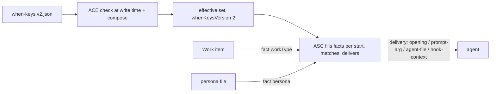

discussion: settled

> **Hand-off to the planner (2026-11-26 18:40 +07).**
> *Outcome:* the agent context engine's `when:` key registry becomes version 2 with the three-group key set of §6: `kind` and `cli` are gone, `workType`, `sessionType`, `agentFamily`, `agentCli` and `agentLifecycle` exist, `role` means only the part in a workflow step. Rule units can then be aimed at one kind of work, one session form, one agent family or CLI, and one moment in an agent's life.
> *Constraints:*
> - only ACE and its readers change, plus the registry's row in the authority model and one `CHANGELOG.md` line (D2);
> - `when-keys.v1.json` is deleted in the same change, no second registry kept (D4, L10);
> - values come from the sources in §6; nothing outside the registry is renamed (CLI ids, Work item fields, persona files);
> - an `agentLifecycle` value is added only when something composes rules at that moment (D3, RUL104).
>
> *Non-goals:*
> - the Work item field `kind` and the persona file field `role:` (they stay in ds-que32ftgg6, D2);
> - the rule unit's own `kind` field (`law`, `procedure`);
> - ASC's delivery field and any hook that injects rules;
> - editing ASC 261122-1946's phase texts (its planner does that when it re-validates);
> - the standing-rule units U1-U7 of ds-que32ftgg6.
>
> *Acceptance:*
> - `packages/agent-context-engine/contracts/when-keys.v2.json` holds exactly the §6 keys, values and sources; `when-keys.v1.json` is gone and `rg -n 'when-keys\.v1' packages docs core` returns nothing;
> - an effective set carries `whenKeysVersion: 2`; a set with version 1 is refused `rule-set-version-unsupported`;
> - a unit with `when: {kind: [...]}` or `when: {cli: [...]}` is refused `rule-when-key-unknown`; a unit with `when: {sessionType: [hand-opened]}` passes; a unit with `when: {agentLifecycle: [setup]}` is refused `rule-when-value-invalid`;
> - `cargo test --workspace` and `npm test` green;
> - ASC 261122-1946 lists this plan in `blockedBy`.
>
> *Open points blocking only some parts:* none.
> *Sources:* backlog `p-2vep73teju`; ds-que32ftgg6 §3 rows 12, 14-18, D2, D3, §6; supervisor event 362188c03b862986.

# Rename the `when:` label keys of the agent context engine

## 1. Trạng thái hiện tại

**Settled 2026-11-26 18:40 +07** (owner round 8: "A, đồng ý hết"). Handed to the planner.

Opened by the supervisor on the owner's order via Miu (supervisor event 362188c03b862986), split out of `plans/discussions/ds-que32ftgg6-ready-plan-runs-unattended/DISCUSSION.md`; backlog row `p-2vep73teju`. Split rule (owner round 6): only the ACE part of ds-que32ftgg6 (the `when:` labels) comes here, so a planner can run fast for ACE; everything else stays in ds-que32ftgg6, which stays `paused` and points here for the label part.

Settled: D1 (names and meanings), D2 (ACE only), D3 (session form and lifecycle values; `setup` and `hook` are deliveries), D4 (registry v2, value sources, order against ASC). q-47jzaaqnpq was answered in chat and cancelled in the store with that answer. Nothing open.

## 2. Mục tiêu & đề bài

The `when:` key registry of the agent context engine (`packages/agent-context-engine/contracts/when-keys.v1.json`, shipped with ACE plan 261125-1631) has one overloaded key, `kind` (`head`, `worker`, `setup`, `hook`), that mixes three questions: what form the session takes, at what moment its context is put together, and how the text is delivered. Its `role` key mixes a persona (lead) with a part in a workflow step (producer, reviewer), and its `cli` key gives the agent program but not the model family. The work kind (bug, feature, ...) has no key, so a rule cannot be scoped to one kind of work. ds-que32ftgg6 fixed names and meanings for a three-group key set in its D2 and D3. This discussion turns that naming into a change a planner can run inside ACE alone: the final keys, values and value sources, the old keys deleted in the same change, and ASC 261122-1946, which cites the old keys, ordered after it. The win for projects using fgOS: rule units can be aimed at one kind of work, one session form, one agent family and one moment, so each agent gets only the rules that apply to it.

## 3. Vấn đề rõ / chưa rõ

| # | Vấn đề | Trạng thái | Ghi chú / bằng chứng |
|---|---|---|---|
| 1 | Names and meanings of the key set | **Settled (D1)** | Three groups. What the work is: `domain`, `workType`, `workflow`, `stage`, `project`. Who the agent is: `persona` (its charter, one of `core/agents/*.yaml`), `role` (the part in one workflow step only), `sessionType`, `agentFamily`, `agentCli`. When in its life: `agentLifecycle`. A seat address (`head:<persona>-<name>`) is an instance name, never a key. |
| 2 | Values of `agentLifecycle` and `sessionType`; where `setup`, `hook` and ASC's `hand-opened` go | **Settled (D3, owner round 8, option A)** | `setup` is the AGENTS.md block `fgos setup` writes into a file; `hook` is a hook's output injected into context. Both are deliveries (ASC's enum `opening`, `prompt-arg`, `agent-file`, `hook-context`, ASC phase 2). A hook fires at many moments (`packages/distribution/contracts/agent-hooks.v1.json`: SessionStart, UserPromptSubmit, PreToolUse, PostToolUse, Stop) and may inject rules, not only check (owner round 2), so the moment is the hook's event, not "hook". |
| 3 | Work item field `kind` → `workType` | **Stays in ds-que32ftgg6 (D2)** | `workType` is a label in ACE's registry only. Scout kept for that discussion: the field is Work item Data Dictionary row 3 (`docs/platform/work-state/spec.md:64`), stored in the append-only event log and printed in `--json` envelopes. ASC fills the `workType` fact from whatever the Work item field is called. |
| 4 | Registry file version | **Settled (D4)** | `when-keys.v1.json` is a shipped contract and the effective set records `whenKeysVersion` (ACE spec line 146). No rule unit carries a `when:` today (`core/instructions`, `domains/*/instructions`, `components/*/instructions`: zero hits), so nothing in force is re-keyed. |
| 5 | `agentCli` values | **Settled (D4)** | The live source, the agent-protocol adapters, uses ids `claude`, `codex`, `agy`, `pi`, `omp` (`packages/agent-protocol/contracts/agent-protocol.v1.json:40`); `claude-code` in ds-que32ftgg6 D3 was an example. `agentFamily: claude` and `agentCli: claude` read alike but are different keys. |
| 6 | `agentFamily` value source | **Settled (D4)** | The runner keys `modelPolicies` by family (`core/config-standard/runner.yaml`: `claude`, `gemini`), with no `openai` and no adapter-to-family map anywhere, so a static enum. |
| 7 | `role` narrowed to the workflow-step part | **Settled (D4)** | Today's source is "head roles and unit roles" (`when-keys.v1.json`); new source: the domain registry's `roleGraph` (`domains/coding/registry.yaml`). Head names (lead, supervisor) are `persona` values. |
| 8 | Persona file field `role:` | **Stays in ds-que32ftgg6 (D2)** | Finding kept for that discussion: the field mixes workflow roles (`Reviewer`, `Implementer`, `Researcher`, `Panelist`) with free-text titles (`Lead session (executes one plan)`); its only reader is `scripts/project-agents.mjs` (required at line 45, printed as the heading at line 136), so it is the persona's title; `title` fits better than the placeholder `summary`. |
| 9 | Order against ASC 261122-1946 | **Settled (D4)** | ASC is `draft` and cites the old keys in phases 2, 3, 5, 7 and 10 (`kind=head`, `cli`, `kind=hand-opened`). |
| 10 | The rule unit's own `kind` field (`law`, `procedure`) | **Out of scope** | `rule-unit.v1.json` and `rust/src/rule.rs:264` use `kind` for the unit's category, a separate contract from the `when:` keys. |

## 4. Quyết định đã chốt

| D-ID | Tóm tắt | Nguồn / rationale |
|---|---|---|
| D1 | The key set and meanings of ds-que32ftgg6 D2 + D3 (§3 row 1) are the basis of this item: `workType`, `sessionType`, `agentFamily`, `agentCli`, `agentLifecycle`, with `persona` = charter and `role` = part in a workflow step; `cli` and today's `kind` key are deleted. | Carried over; held stable across rounds 11-16 of ds-que32ftgg6 and confirmed by the owner's order that opened this discussion (backlog `p-2vep73teju`). |
| D2 | Scope: this discussion is the ACE part of ds-que32ftgg6 only: the agent context engine's `when:` label registry and its readers (one component, plus the registry's row in the authority model). Everything else, including renaming the Work item field `kind` and the persona file field `role:`, stays in ds-que32ftgg6, which stays `paused`. | Owner round 5 (18:3x): "workType thì cũng là label trong ACE thôi, liên quan gì work?"; round 6 (18:31): "tách phần đó ra một discussion khác để làm plan và chạy nhanh cho ACE, mọi việc khác ở lại với discussion cũ". |
| D3 | `sessionType` = `head`, `worker`, `hand-opened`. `agentLifecycle` = the moment in the agent's life; v2 starts with `start` and `rotate` (successor after a session rotation), and the hook-event moments (`prompt`, `before-tool`, `after-tool`, `stop`) are added to the registry as data only when something composes rules at that moment. `setup` and `hook` are not key values: they are ASC deliveries (`agent-file`, `hook-context`). This refines the wording of ds-que32ftgg6 D2. | Rounds 1-2 (shaper scout; owner on hooks injecting rules), owner round 8 (18:37): "A, đồng ý hết" to q-47jzaaqnpq option A. |
| D4 | (a) Write `when-keys.v2.json` and delete v1 in the same change; (b) `agentCli` values are the agent-protocol adapter ids `claude`, `codex`, `agy`, `pi`, `omp`; (c) `agentFamily` is a static enum `claude`, `openai`, `gemini`, extended by editing data; (d) `role` values come from the domain `roleGraph`, head names are `persona` values; (e) ASC 261122-1946 is `blockedBy` this plan and its planner updates the key names in its phases. | Shaper proposals rounds 1-3 (§3 rows 4-7, 9), owner round 8 (18:37): "đồng ý hết". |

## 5. Q&A log

- 2026-11-26 18:50 +07, shaper (distill + scout), round 1: extracted from `plans/discussions/ds-que32ftgg6-ready-plan-runs-unattended/DISCUSSION.md` §3 rows 12, 14-18, §4 D2-D3, §6 "Hình dạng mới của bộ nhãn `when:`", and from backlog row `p-2vep73teju`. Scouted `when-keys.v1.json`, the ACE Rust loader and vectors, the ASC plan, the Work state spec, the agent-protocol contract, `core/agents/*.yaml` and `scripts/project-agents.mjs`. Found the delivery-vs-moment split (§3 row 2) and the Work field's history and public-output reach (§3 row 3); both parked for the owner.

- 2026-11-26 18:25 +07, owner (chat), round 2: asked what delivery is; noted that Claude has a whole set of hooks, and a hook may inject rules, not only check. Shaper: delivery is ASC's channel enum (`opening`, `prompt-arg`, `agent-file`, `hook-context`; ASC phase 2). A hook fires at many moments (`packages/distribution/contracts/agent-hooks.v1.json` today: SessionStart 4, UserPromptSubmit 1, PreToolUse 9, PostToolUse 2, Stop 5), so `hook` cannot be one moment: the moment is the hook's event, the channel is `hook-context`. This strengthens option A of q-47jzaaqnpq and shows `agentLifecycle` values are the hook-event moments (start, prompt, before-tool, after-tool, stop, rotate), added as data only when a composer injects rules at that moment.

- 2026-11-26 18:3x +07, owner (chat), round 3: asked whether the change touches only ACE or spreads to other components. Shaper: the key rename proper touches only ACE plus its authority row (no reader of the keys exists yet: ASC is a draft, no rule unit has `when:`); the spread came from the two field renames carried from D3 (persona `role:`, owned by agent definitions; Work `kind`, owned by work-state). Proposed ACE-only scope.

- 2026-11-26 18:3x +07, owner (chat), round 4: asked why `role:` becomes `summary`. Shaper: §3 row 8; `summary` was a placeholder, the field is used as the title, propose `title`.

- 2026-11-26 18:3x +07, owner (chat), round 5: `workType` is only an ACE label; renaming Work belongs elsewhere. Shaper: D2 (ACE-only scope).

- 2026-11-26 18:31 +07, owner (chat), round 6: scope was wrong: only the small ACE part (labels / `when:`) is split out, to plan and run fast for ACE; everything else stays with the old discussion. Shaper: D2 reworded; §3 rows 3 and 8 stay in ds-que32ftgg6 instead of going to new backlog rows.

- 2026-11-26 18:35 +07, owner (chat), round 7: authorised the shaper to edit both discussions in one land, after this one's content is settled; ds-que32ftgg6 stays `paused`, this one goes to the planner.

- 2026-11-26 18:37 +07, owner (chat), round 8: "A, đồng ý hết": option A of q-47jzaaqnpq and proposals a-e. Shaper: D3, D4 minted; §6 final; q-47jzaaqnpq cancelled in the store with the chat answer; settled.

## 6. Thiết kế đã chốt {#design}

The engine's registry of `when:` keys becomes version 2, in three groups. Each group answers one question about a start: what the work is, who the agent is, and when in its life the rules are put together. A rule unit names any subset of keys; an absent key means "any"; several values for one key mean any of them. How the text reaches the agent (a file written at setup, a hook's injected output, an opening message, a CLI argument) is not a key: it is ASC's delivery, chosen by the caller.

| Group | Key | Values in v2 | Value source | Replaces |
|---|---|---|---|---|
| What the work is | `domain` | coding, marketing, council | `domains/` ids (live) | unchanged |
| | `workType` | bug, chore, design, docs, feature, task | `domains/<d>/registry.yaml` `classification.kind` (live) | new |
| | `workflow` | feature, bugfix, content-publish | workflow presets (live) | unchanged, optional |
| | `stage` | a step of the workflow | stages of the preset (live) | unchanged, unused by default |
| | `project` | project id | activated project registry (live) | unchanged |
| Who the agent is | `persona` | shaper, lead, planner, supervisor, ... | persona definitions (live) | meaning fixed: the charter |
| | `role` | producer, reviewer, implementer, researcher | domain `roleGraph` (live) | narrowed: part in a workflow step |
| | `sessionType` | head, worker, hand-opened | static | part of `kind` |
| | `agentFamily` | claude, openai, gemini | static | new |
| | `agentCli` | claude, codex, agy, pi, omp | agent-protocol adapters (live) | `cli` |
| When in its life | `agentLifecycle` | start, rotate (later, as data: prompt, before-tool, after-tool, stop) | static | part of `kind` |

What changes, all inside ACE: the registry file (v1 deleted), the Rust loader and its tests, the vectors that carry `whenKeysVersion` or the `kind` key, the contract texts naming `when-keys.v1.json`, the ACE spec's key paragraph and its decision history. Outside ACE only the registry's row in `packages/component-authority/model/contracts.yaml` and one `CHANGELOG.md` line. ASC starts after this lands and adopts the new names in its own phases.

## 7. Danh mục hạng mục / task {#tasks}

### Key registry v2 {#task-key-registry-v2}

- Goal: `when-keys.v2.json` with the §6 table; every reader moved; v1 deleted.
- §6: the whole table. D-IDs: D1-D4.
- Change points (scouted on `61e425e23`):
  - `packages/agent-context-engine/contracts/when-keys.v1.json` -> `when-keys.v2.json` (`version: 2`).
  - `packages/agent-context-engine/rust/src/when_keys.rs:11` (`include_str!`) and its doc comment; `rust/src/set.rs:125-135` reader accepts version 2 only; `rust/tests/set.rs`.
  - Vectors: `contracts/vectors/effective-set.json` and `refusals/rule-set-digest-mismatch.json` (`whenKeysVersion` 1 -> 2), `refusals/rule-when-value-invalid.json` (uses `kind`); a vector for a removed key and one for `agentLifecycle: [setup]`.
  - `contracts/refusals.v1.json` lines 9, 75 and `contracts/rule-unit.v1.json:165` name `when-keys.v1.json`.
  - `packages/component-authority/model/contracts.yaml:1771-1778` contract row id and path.
  - `docs/platform/agent-context-engine/spec.md` lines 66-69 (key list) and one decision-history row.
  - `CHANGELOG.md` `[Unreleased]` one line.
- Sibling: ASC 261122-1946 `blockedBy` this (its phases 2, 3, 5, 7, 10 cite `kind`/`cli`).
- Draft verify: `cargo test -p agent-context-engine`, then `cargo test --workspace` and `npm test` green; `rg -n 'when-keys\.v1' packages docs core` returns nothing.
