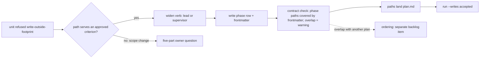

discussion: paused

> **Closed without a planner (owner, 2026-11-26).** The owner closed this discussion and chose not to hand it to a planner: too much work and resource for now. The design below stays as the record. To resume, the owner reopens it by name; nothing here is queued.

## Hand-off

- **Outcome:** a running plan widens its own footprint mid-run through one verb, inside the frame the owner approved, with no owner question and no supervisor hand edit. The verb writes the frontmatter list and the phase row together, and a contract check keeps the two copies from drifting. A planner can start for a plan that has no discussion.
- **Constraints:**
  - The footprint still bounds `run --writes` and the branch diff of `land`.
  - PS-24 is amended, not dropped. A lead changes its own footprint only through the widen verb, and every other lead footprint change stays `footprint-change-refused` (D1).
  - The widen names the acceptance criterion it serves. A widening the lead cannot tie to an approved criterion is a scope change and goes to the owner as a five-part question (D1).
  - Overlap with another active plan is reported as a warning naming that plan, never refused (plan contract §5 for running plans). Ordering the two plans is out of scope (D2).
  - The supervision spec's decision history records the PS-24 amendment (L5 question 6).
- **Non-goals:**
  - Automatic ordering or rebase when a widened path overlaps another plan. That is its own backlog item, handed to the secretary (D2).
  - Deriving the frontmatter from the phase table (one physical copy). Two copies are kept, and a check holds them equal (D3).
  - Any widening of the lead's grant: it still writes only its plan directory.
- **Acceptance criteria:**
  1. A lead whose unit is refused `write-outside-footprint` runs the widen verb for its own plan and phase with the path and the acceptance criterion it serves. `plan.md` lands with the path in both the frontmatter list and the phase row, and the same `run --writes` is then accepted. One test owns this end to end.
  2. The supervisor can run the same verb for any running plan.
  3. A lead changing its own footprint any other way (a plain paths land of `plan.md`) is still refused `footprint-change-refused`. A lead widening another plan is refused.
  4. A widened path that overlaps another active plan's footprint lands, and the result names the overlapping plan.
  5. `plan-contract-check` fails a plan whose phase-table footprint has a path the frontmatter list does not cover. A run over today's plans reports any existing drift instead of hiding it.
  6. `fgos session start planner <plan-dir>` starts for a live plan with no discussion. An unknown key still refuses `discussion-not-found`.
  7. The supervision spec states the amended PS-24 and the widen door, and the plan contract states the drift rule.
- **Open, blocking only parts:** none. Planner decides the verb's name and which component owns it (`fgos authority locate` returned `supervision/plan-vocabulary.v1` and `session-host/head-permissions.v1` as nearest rows; no row owns "plan footprint edit", so the planner either places it under supervision or records a `fgos authority declare`).
- **Sources:** p-lfsc4czpgh; owner decisions in this chat (§5, 2026-11-26 12:41 +07); evidence questions q-xcuwpxa4kn, q-4qtu54bnxz, q-myvzcbz3sx, q-vqyxe5oi6j, q-ep6wknrzop.

## Seed

Opened by the secretary (Miu) on the owner order relayed by lead:SUPERVISOR, goal set 2026-11-26. Read the source backlog rows first; they hold the evidence. Park owner questions in the question store instead of waiting on them.

- **Outcome:** one door through which a running plan's footprint is widened, with the footprint kept in one place, and a planner able to start for a plan that has no discussion. This is the item that stops every plan from stalling on owner footprint questions (q-myvzcbz3sx and q-vqyxe5oi6j are parked on it today).
- **Priority:** first of the order; every other plan waits on it overlapping footprints.
- **Related:** `ds-izwfo6f267-parallel-decomposition-footprint-avoidance`.

## 1. Trạng thái hiện tại

Closed by the owner on 2026-11-26, not handed to a planner (too much work and resource for now). The design reached a settled shape in round 2 (D1-D4, §6, §7) and stays as the record for whenever the owner reopens it. No owner question is open; q-ee2f2g3aoj was cancelled as superseded. The overlap-ordering idea (D2) went to the secretary as its own backlog row request. Until this is built, a widen still goes through an owner answer and a supervisor hand edit of both footprint copies, as on 2026-11-26 08:51 (dece50514).

## 2. Mục tiêu & đề bài

A running plan is bounded by its footprint: the run door refuses a `--writes` path outside it, and the land door refuses a branch diff outside it. Leads routinely discover mid-phase that one or two files outside the footprint are needed to meet a criterion the owner already approved. Today that becomes an owner question. All five on record were answered "widen". Then a hand edit follows, because the lead may not edit its own footprint (PS-24) and a planner cannot start for a plan with no discussion. The footprint is written twice (frontmatter list and phase-table column) and only the frontmatter is read by the doors, so a half edit still refuses the unit. On 2026-11-25 this parked the owner's bottleneck phase about 40 minutes. The goal is that a plan widens its own footprint mid-run through one verb, within the approved frame, writing both copies in one commit with a check that keeps them equal. The owner is involved only when a widening goes beyond the approved acceptance criteria. Ordering two plans whose footprints come to overlap is a separate coordination capability. A planner can also start for a plan with no discussion, for re-planning beyond a footprint change.

## 3. Vấn đề rõ / chưa rõ

| # | Vấn đề | Trạng thái | Ghi chú |
|---|---|---|---|
| 1 | Which copy do the doors read | **Rõ** | Only frontmatter. `footprintOf` in `src/session-host/head-plan.mjs:110` feeds `run --writes` (`head-request.mjs:384`), branch land and lead paths land (`head-request.mjs:292,304`). Supervision spec: "The commit-time footprint check reads only the frontmatter footprint" (`docs/platform/supervision/spec.md:224`). |
| 2 | Is the phase-table copy checked against the frontmatter | **Rõ: no** | `scripts/plan-contract-check.mjs` checks phase rows only for emptiness, readability and same-wave overlap (146-167), frontmatter only for presence and readability (288-299). → D3. |
| 3 | Who may write plan files today | **Rõ** | `packages/session-host/contracts/head-permissions.v1.json`: supervisor, secretary and planner write `plans`; lead writes only `plans/<its dir>`; a lead paths land changing its own `footprint` is `footprint-change-refused` (PS-24, `docs/platform/supervision/spec.md:152,221`). |
| 4 | Why a planner cannot start | **Rõ** | `src/session-host/head-plan.mjs:186-203`: planner resolves only a discussion directory → `discussion-not-found`. → D4. |
| 5 | Cross-plan overlap when widening a running plan | **Rõ** | Plan contract §5: overlap for a `running` plan is a warning (`core/skills/_shared/plan-contract.md:131-133`). The widen reports it; ordering is D2's separate item. |
| 6 | Owning authority | **Rõ (planner places it)** | Nearest rows: `supervision/plan-vocabulary.v1`, `session-host/head-permissions.v1`; no row owns "plan footprint edit". |
| 7 | Does a widening need the owner | **Rõ → D1** | No, inside the approved frame. Evidence: q-4qtu54bnxz answered by lead:SUPERVISOR "inside the approved frame"; q-xcuwpxa4kn, q-myvzcbz3sx, q-vqyxe5oi6j, q-ep6wknrzop all answered with the recommended "widen". The "no" options only degraded an approved criterion (land partial plus follow-up, or a workaround missing the criterion as written). |
| 8 | Planner for a plan without discussion | **Rõ → D4** | Held unchanged across rounds 1 and 2. |
| 9 | One source vs. two checked copies | **Rõ → D3** | Held unchanged across rounds 1 and 2. |
| 10 | How the widen proves it is inside the frame | **Rõ (follows D1)** | Names the acceptance criterion it serves. Round 1's `--approved-by <q-id>` is dropped with q-ee2f2g3aoj. |
| 11 | Ordering when a mid-run footprint change overlaps another plan | **Rõ → D2, out of scope** | Separate backlog item via the secretary. |

## 4. Quyết định đã chốt

| D-ID | Tóm tắt | Nguồn / rationale |
|---|---|---|
| D1 | A running plan widens its own footprint mid-run inside the approved frame, with no owner question: the lead (or the supervisor) calls one widen verb naming the path, the phase and the acceptance criterion it serves. PS-24 is amended so that this verb is the only way a lead changes its own footprint. A widening not tied to an approved criterion is a scope change and goes to the owner. | Owner decision in chat, 2026-11-26 12:41 +07, after the root-cause round (§5); supersedes q-ee2f2g3aoj. Product priority 2 (decide inside the approved frame). |
| D2 | Automatic ordering when a footprint changed mid-run overlaps another active plan (the widened phase waits for the other plan to land that part, then rebases) is its own backlog item, not this one. Here the overlap is only reported. | Owner, 2026-11-26 12:41 +07: "ghi nhận ý vào backlog … ý là footprint cần đổi giữa chừng". Handed to head:secretary-miu (shaper does not write the backlog). |
| D3 | Keep the two footprint copies; the widen verb writes both, and `plan-contract-check` fails a phase-table path the frontmatter does not cover. | Rounds 1-2; same protection at the land door with no change to the three frontmatter readers (Node, Rust portfolio, contract check). |
| D4 | `session start planner <plan-dir>` falls back to a live plan directory when no discussion matches. | Rounds 1-2; re-planning a running plan beyond a footprint change still needs a planner. |

## 5. Q&A log

- 2026-11-26 08:55 +07, shaper: Round 1 scout. Evidence in §3 rows 1-6. Proposed shape. Parked q-ee2f2g3aoj (who may call the widen door) because one option amended PS-24.
- 2026-11-26 ~10:00 +07, owner: "có nên hỏi câu này không, cần đi lại root-cause tại sao hỏi nó … nếu anh trả lời không cho widen thì chuyện gì xảy ra, lead ngưng toàn dự án à?"
- 2026-11-26 ~10:05 +07, shaper: Root cause. The footprint mixes collision avoidance (mechanical) with scope (the owner approves acceptance, not files). Five widen questions on record, none answered "no", one answered by lead:SUPERVISOR inside the frame. A "no" does not stop the project; it degrades one phase's approved criterion. Proposed: self-widen inside the frame, system-ordered on overlap, owner only for scope beyond acceptance; cancel q-ee2f2g3aoj.
- 2026-11-26 12:41 +07, owner: "đồng ý." Then: put the overlap-ordering idea in the backlog as its own capability; "ý là footprint cần đổi giữa chừng". → D1, D2. q-ee2f2g3aoj cancelled as superseded. D3 and D4 minted (held across both rounds).
- 2026-11-26 ~12:50 +07, owner: "khoan giao cho planner", then "dọn dẹp ở đây rồi đóng discussion. không giao vì quá nhiều việc tốn resource". → closed as paused, no planner.

## 6. Thiết kế đã chốt {#design}

**Problem.** A plan's footprint is the planner's estimate of the files needed to meet acceptance criteria the owner approved. Leads find mid-run that the estimate missed a file. That is an estimation error inside the approved frame, not a scope change, yet today it costs an owner question, a supervisor wake and a hand edit of two copies.

**Widen verb (D1, D3).** One verb, callable by the plan's own lead (through its request socket) and by the supervisor:

1. Input: the plan, the phase id, one or more paths, and the acceptance criterion the paths serve.
2. Reads `plan.md` from the trunk tip; refuses unless the plan is `running` or `ready`. A lead may name only its own plan.
3. Adds each path to that phase's footprint cell and to the frontmatter `footprint:` list (a path already covered is a no-op).
4. Runs the plan contract check on the result. An overlap with another active plan is a warning that names the plan, not a refusal.
5. Lands only `plans/<dir>/plan.md` through the existing paths land; the commit message names the paths, the phase and the criterion.

The land door's `footprint-change-refused` stays for every lead footprint change that does not come through this verb.

**Scope boundary (D1).** If the lead cannot name an approved acceptance criterion that needs the path, the change is a scope change: the lead asks the owner in the five-part form, as today.

**Drift check (D3).** `plan-contract-check.mjs` fails a plan whose phase-table footprint has a path not covered by the frontmatter list, using the same coverage rule as the run door. A hand edit of one copy then fails at land.

**Planner fallback (D4).** For persona `planner`, the discussion resolver falls back to a live plan directory (same unique-prefix rule as lead) when no discussion matches.

**Out of scope (D2).** Ordering two plans whose footprints come to overlap after a mid-run change is a separate backlog item.

## 7. Danh mục hạng mục / task {#tasks}

### Widen verb {#task-widen-verb}
- Goal: a running plan widens its own footprint mid-run in one call, both copies written and landed.
- §6: "Widen verb", "Scope boundary".
- D-IDs: D1, D3.
- Siblings: uses the drift check in its own verify; independent of the planner fallback.
- Draft verify: one end-to-end test: refused `--writes`, widen by the lead with a criterion, same `--writes` accepted. Refusals: a lead naming another plan; a lead paths land of `plan.md` changing the footprint (still `footprint-change-refused`). An overlap case lands and names the other plan.

### Drift check {#task-drift-check}
- Goal: a phase path not covered by the frontmatter fails `plan-contract-check`.
- §6: "Drift check".
- D-IDs: D3.
- Draft verify: a contract-check test with a phase row wider than the frontmatter → error; `node scripts/plan-contract-check.mjs --all` run on today's plans, existing drift reported.

### Planner for a plan without discussion {#task-planner-plan-fallback}
- Goal: `session start planner <plan-dir>` starts for a live plan with no discussion.
- §6: "Planner fallback".
- D-IDs: D4.
- Draft verify: extend `test/session-host/head-plan.test.mjs`: plan dir without discussion resolves for planner; unknown key still `discussion-not-found`.

### Spec and contract text {#task-spec-text}
- Goal: supervision spec records the amended PS-24 and the widen door in its decision history; plan contract §4/§5 states the drift rule and the self-widen rule.
- D-IDs: D1, D3.
- Draft verify: `node scripts/plan-contract-check.mjs --all` and the docs checks in `npm test`.
