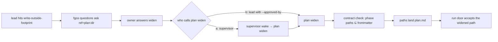

discussion: open

## Seed

Opened by the secretary (Miu) on the owner order relayed by lead:SUPERVISOR, goal set 2026-11-26. Read the source backlog rows first; they hold the evidence. Park owner questions in the question store instead of waiting on them.

- **Outcome:** one door through which a running plan's footprint is widened, with the footprint kept in one place, and a planner able to start for a plan that has no discussion. This is the item that stops every plan from stalling on owner footprint questions (q-myvzcbz3sx and q-vqyxe5oi6j are parked on it today).
- **Priority:** first of the order; every other plan waits on it overlapping footprints.
- **Related:** `ds-izwfo6f267-parallel-decomposition-footprint-avoidance`.

## 1. Trạng thái hiện tại

Round 1 (2026-11-26, shaper). Scouted the doors that read a footprint and the grants that write plan files (§3 rows 1-6). Proposed a shape (§6): a `plan widen` verb that writes the frontmatter list and the phase row in one commit, and a contract-check rule that fails a phase path the frontmatter does not cover. Both are provisional. Nothing is minted as a D-ID yet.

Still open:
- **Who may call the widen door** (§3 row 7): only the supervisor, which keeps PS-24 as it is, or the lead too when it presents an answered owner question for its own plan, which amends PS-24. This changes an owner decision, so it is parked as an owner question: **q-ee2f2g3aoj**.
- Whether "a planner starts for a plan with no discussion" stays in this item or becomes its own row (§3 row 8). Proposed: keep it as a second, independent task.

Operational note, not part of this design: both answers named in the seed (q-myvzcbz3sx, q-vqyxe5oi6j, answered "widen" at 01:44Z) are not on main yet. No commit to either plan.md after 01:03Z. Until the door exists they need a hand edit of **both** copies (frontmatter and phase row) by the supervisor.

## 2. Mục tiêu & đề bài

A running plan is bounded by its footprint: the run door refuses a `--writes` path outside it, and the land door refuses a branch diff outside it. Leads routinely discover mid-phase that one or two files outside the footprint are needed. The owner answers "widen" quickly, but nothing turns that answer into a footprint change. The lead may not edit its own footprint (PS-24, `footprint-change-refused`). A planner cannot start for a plan with no source discussion (`discussion-not-found`). The supervisor ends up hand-editing `plan.md`, and since the footprint is written twice (the frontmatter `footprint:` list and the phase table's footprint column) and only the frontmatter is read by the doors, a half edit still refuses the unit. On 2026-11-25 this parked the owner's bottleneck phase about 40 minutes (p-lfsc4czpgh). Today two more plans sit on answered widen questions. The goal is one door that turns an answered owner question into a correct, landed footprint change. It writes both copies together and is checked so that they cannot drift. The supervisor (and possibly the lead) can call it with no planner in the loop. A second goal is that a planner can start for a plan that has no discussion, for re-planning work beyond a footprint change.

## 3. Vấn đề rõ / chưa rõ

| # | Vấn đề | Trạng thái | Ghi chú |
|---|---|---|---|
| 1 | Which copy do the doors read | **Rõ** | Only frontmatter. `footprintOf` in `src/session-host/head-plan.mjs:110` feeds `run --writes` (`head-request.mjs:384`), branch land and lead paths land (`head-request.mjs:292,304`). Supervision spec: "The commit-time footprint check reads only the frontmatter footprint" (`docs/platform/supervision/spec.md:224`). |
| 2 | Is the phase-table copy checked against the frontmatter | **Rõ: no** | `scripts/plan-contract-check.mjs` checks phase rows only for emptiness, readability and same-wave overlap (lines 146-167), and frontmatter only for presence and readability (288-299). Nothing checks phase paths ⊆ frontmatter. That is exactly the drift that refused the unit on 2026-11-25. |
| 3 | Who may write plan files today | **Rõ** | `packages/session-host/contracts/head-permissions.v1.json`: supervisor and secretary write `plans`; planner writes `plans`; lead writes only `plans/<its dir>`, and the land door refuses a lead paths land that changes its own `footprint` (`footprint-change-refused`, PS-24, `docs/platform/supervision/spec.md:152,221`). So the supervisor can already do the edit by hand. What is missing is a door that does it correctly. |
| 4 | Why a planner cannot start | **Rõ** | `src/session-host/head-plan.mjs:186-203`: planner and shaper resolve only a discussion directory; no fallback to a plan directory → `discussion-not-found`. |
| 5 | Cross-plan overlap when widening a running plan | **Rõ** | Plan contract §5: for a `running` plan, overlap with another active plan is a warning, not an error (`core/skills/_shared/plan-contract.md:131-133`). Both of today's widenings overlap another plan (`bin/fgos.mjs` hot file; `apps/fgos/src/routing.rs` also in 261125-1631). The door should report the overlap, not refuse it. The owner's answer already accepted it. |
| 6 | Owning authority | **Rõ (partly)** | `fgos authority locate` returns `supervision/plan-vocabulary.v1` and `session-host/head-permissions.v1` as the closest rows; no row owns "plan footprint edit" by name. The planner decides whether the verb is placed under supervision (portfolio + land already live there) or needs a `fgos authority declare`. |
| 7 | **Who may call the widen door** | **CHƯA RÕ: owner question q-ee2f2g3aoj** | (a) supervisor only, PS-24 unchanged. Every widening still goes lead → question → supervisor wake → edit. (b) The lead too, but only with `--approved-by <q-id>` naming an answered question whose `ref` is its own plan. The hop disappears; PS-24 is amended (an unapproved self-widening stays refused). |
| 8 | Planner for a plan without discussion: in scope here? | **Provisional: in scope, separate task** | The seed outcome names it. With the widen door it is no longer on the critical path for footprint changes, but re-planning a running plan (new phase, changed acceptance) still needs it. Proposed: `session start planner <plan-dir>` resolves a live plan when no discussion matches. |
| 9 | One source vs. two checked copies | **Provisional: two copies, checked** | Full single source means deriving frontmatter from the phase table in three readers (Node `head-plan.mjs`, Rust `packages/supervision/rust/src/portfolio.rs`, `plan-contract-check.mjs` cross-plan scan). A contract rule "every phase path is covered by the frontmatter" plus a verb that writes both gives the same protection at the land door with no reader change. Hold for one more round before minting. |
| 10 | How the verb proves owner approval | **Provisional** | Requires `--approved-by <q-id>`: the question is `answered` and its `ref` names this plan. The free-text "Scope of the answer" is not parsed; the q-id and the paths go into the commit message so the widening stays traceable. |

## 4. Quyết định đã chốt

| D-ID | Tóm tắt | Nguồn / rationale |
|---|---|---|

(None yet: rows 8-10 of §3 are provisional and wait one more round; row 7 waits on q-ee2f2g3aoj.)

## 5. Q&A log

- 2026-11-26 08:55 +07, shaper: Round 1 scout. Evidence in §3 rows 1-6. Proposed shape in §6. Parked q-ee2f2g3aoj (who may call the widen door) because option (b) amends the owner decision PS-24.

## 6. Thiết kế đã chốt {#design}

*Draft. Provisional until §4 holds D-IDs.*

**Widen door.** A new verb (working name `fgos plan widen <plan-dir> --phase <id> --path 
... --approved-by <q-id>`):

1. Reads `plans/<dir>/plan.md` from the trunk tip; refuses unless the plan is `running` (or `ready`).
2. Checks `--approved-by`: the question exists, is `answered`, and its `ref` is `plan:<dir>` (any `#phase-…` suffix). Otherwise it refuses by name.
3. Adds each path to the named phase's footprint cell **and** to the frontmatter `footprint:` list (no duplicates; a path already covered is a no-op).
4. Runs the plan contract check on the result; reports cross-plan overlaps as warnings (contract §5 for running plans).
5. Lands only `plans/<dir>/plan.md` through the existing paths land, with a message naming the q-id and the paths.

Caller: the supervisor (grant already writes `plans`). The lead too, if q-ee2f2g3aoj answers (b). The land door's `footprint-change-refused` then passes a lead commit only when it comes through this door with a valid approval.

**Drift check.** `plan-contract-check.mjs` gains one rule: every phase-table footprint path must be covered by the frontmatter `footprint:` (same `entryWithin` rule the run door uses). A hand edit of only one copy then fails at land, not at the next unit.

**Planner without discussion.** `resolveDiscussion` for persona `planner` falls back to a live plan directory (unique prefix, same rule as lead) when no discussion matches.

## 7. Danh mục hạng mục / task {#tasks}

### Widen verb {#task-widen-verb}
- Goal: one verb turns an answered owner question into a landed footprint change, both copies written.
- §6: "Widen door".
- D-IDs: none yet (q-ee2f2g3aoj decides the caller set).
- Siblings: independent of the planner task; depends on the drift check only for its own verify.
- Draft verify: one test where a path outside the footprint is refused by the run door, `plan widen` with an answered question runs, and the same `--writes` is accepted. Plus refusals for an unanswered question and for a question whose ref is another plan.

### Drift check {#task-drift-check}
- Goal: a phase path not covered by the frontmatter fails `plan-contract-check`.
- §6: "Drift check".
- Draft verify: `node --test` case in the contract-check suite with a phase row wider than the frontmatter → error. Then `node scripts/plan-contract-check.mjs --all` runs on today's plans (existing drift is reported, not hidden).

### Planner for a plan without discussion {#task-planner-plan-fallback}
- Goal: `session start planner <plan-dir>` starts for a live plan with no discussion.
- §6: "Planner without discussion".
- Draft verify: extend `test/session-host/head-plan.test.mjs`: a plan dir with no discussion resolves for planner; an unknown key still refuses `discussion-not-found`.
