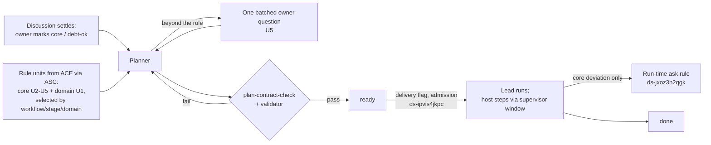

discussion: open

## Seed

Split out of ds-jxoz3h2qgk-when-to-ask on 2026-11-26 at 11:45. The owner had asked whether to split it, and its shaper decided yes. The supervisor asked for this directory in its reply to coordination event 40cb311fe7105ff0. Park owner questions in the question store instead of waiting on them.

- **Owner's pain (chat, 2026-11-26 11:38):** the owner believes every question was settled in the plan and walks away trusting it will be delivered. On return, the plan holds silly questions and sometimes has not even been activated.
- **Outcome:** `ready` means the plan can run to `done` without the owner, not only that it is written and passes the shape check. Every question that could be foreseen is answered when the plan is approved.
- **Scope (candidate parts, none settled):**
  - the footprint is traced to the place where the change really runs, not listed by reading code;
  - every verify step names an executor that can actually run it (a confined head cannot run full suites, activate a release or remove worktrees);
  - the plan states its cleanup at the end (worktrees, branches);
  - the plan's outcome separates the core goal, released first, from the cleanup goal, done later;
  - fallbacks for foreseeable deviations ("if X cannot be done inside the footprint, record it as named debt for the cleanup phase") are approved together with the plan.
- **Evidence:** `../ds-jxoz3h2qgk-when-to-ask/evidence-question-classification.md` and ds-jxoz3h2qgk §5 round 7. About 140 of the 163 owner questions (2026-11-19 to 2026-11-26) were asked after a plan existed. The foreseeable classes:
  - footprint widen: 40 questions (missed files such as `src/cli/command-registry.mjs` and `apps/fgos/src/routing.rs`);
  - confined head lacking hands for a host step: about 45;
  - cleanup: 18;
  - acceptance deviations from an outcome that bundled the core and the cleanup: 8 (component-authority-doors: q-lnjt5zzbfq, q-aanvfxaopa; authority-declare-update: q-trgzaa34ua).

  Three plans account for 66 questions: 261122-0118-heads-stable-and-able (29), 261121-2110-component-authority-doors (22) and 261120-0625-work-data-model (15).
- **Interfaces:**
  - ds-3in4yb5thk-backlog-to-ready-pipeline owns the flow to `ready` (when to plan, in what order, pull timing); this discussion defines what `ready` guarantees.
  - ds-jxoz3h2qgk-when-to-ask owns the execution-time ask rule (four-part model: goal, direction, action, consequence; ask only on a deviation from the goal that no direction avoids). That rule remains the last safety net.
  - ds-mzyircswox-widen-a-running-plan-footprint owns the door that widens a running plan's footprint.
- **Read first:** `core/skills/_shared/plan-contract.md`, `scripts/plan-contract-check.mjs`, the fgos-coding-planning and fgos-coding-validating skills, and the plans named in the evidence.

## 1. Trạng thái hiện tại

Round 1, 2026-11-26 12:20 +07 (shaper head `ready-plan-runs-unattended`). Domain: coding, platform work on the plan contract and the planning and validating skills (`domains/coding/AGENTS.md` only routes to `fgos-routing`; the doctrine read is `core/skills/_shared/plan-contract.md`, `fgos-coding-validating` and the supervisor's admission rule).

What the scout found (§3 has the detail): today `ready` means "the contract check passed": keys, sections, waves and footprint overlap. Nothing in the contract, the check or the validator asks whether the plan can run to `done` with nobody's hands. The validator's feasibility matrix tests risky assumptions, not who runs each step. Every one of the five seed parts is unguarded, and a sixth gap showed up: a plan can say `ready` and never be started, silently. Three legacy plans sit at `status: ready` today with no footprint, so admission drops them as `footprint-empty` and nobody is told.

Leanings L1-L5 (§3 rows 2-6) are proposed; L6 moved to ds-ipvis4jkpc in round 2 (§3 row 7). They are not settled; no D-ID. In one line: the plan gains one section, "Unattended run", that names the executor of every host step, the cleanup, the core-versus-debt split of acceptance, and the deviations pre-approved with it; the contract check makes `ready` refuse a plan without it; and the `delivery` flag of ds-ipvis4jkpc decides whether it starts.

Round 3 (13:42): the owner answered Q1 in chat (§3 row 8): the standing rule becomes process law with no approval; the owner settles only plan-specific matters. The owner said not to hand off to a planner yet; the discussion stays open. Next: draft the standing rule (§6). No owner question open.

Round 4 (13:55): the standing rule's draft U1-U6 is in §6 for the owner to read. Open: one wiring list for U1 (§3 row 10), and whether `release run` is the full-gate door (§3 row 11).

Round 5 (14:05): owner direction, no hardcoding. §6 now places the rule as ACE rule units selected by `workflow`/`stage`/`domain` (core unit for the guarantee, coding unit for footprint tracing), with doors, executors and wiring sets read from data. Open: §3 rows 10, 11, 12.

## 2. Mục tiêu & đề bài

The owner settles a discussion, a planner writes the plan, the plan goes `ready`, and the owner walks away believing every foreseeable question is answered. On return he finds the plan stalled on questions he calls silly, or never started at all. Of 163 owner questions from 2026-11-19 to 2026-11-26, about 140 were asked after a plan existed, and the large classes were foreseeable at planning time: 40 footprint widens, about 45 "hands" requests from confined heads, 18 cleanups, and 8 acceptance deviations from outcomes that bundled the core with the cleanup. Three plans produced 66 of them. The goal is that `ready` means "can run to `done` without the owner": every foreseeable question is answered when the plan is approved, so the only questions left at run time are genuine deviations that the four-part ask rule of ds-jxoz3h2qgk-when-to-ask lets through. This discussion defines what `ready` guarantees and how that is checked. It does not own the flow to `ready` (ds-3in4yb5thk-backlog-to-ready-pipeline), the run-time ask rule (ds-jxoz3h2qgk-when-to-ask), or the door that widens a running plan's footprint (ds-mzyircswox-widen-a-running-plan-footprint).

## 3. Vấn đề rõ / chưa rõ

| # | Vấn đề | Trạng thái | Ghi chú |
|---|---|---|---|
| 1 | What `ready` checks today | **Rõ** | `plan-contract.md` §5: "`ready` is set last, and only after the check passes". `scripts/plan-contract-check.mjs` checks frontmatter keys, body sections, the Authority map, waves and footprint overlap. `fgos-coding-validating` Step 3 (feasibility matrix) checks assumptions the risk map flags; its Gate is usually auto-approved by `fgos gate-check`. Nothing names who runs a step, what is cleaned up, or which acceptance may slip. |
| 2 | **L1, footprint traced to where the change runs** | Leaning | Of the 40 widens, about 15 are the same wiring set for a new verb or route: `src/cli/command-registry.mjs`, `apps/fgos/src/main.rs`, `apps/fgos/src/routing.rs`, `packages/host-runtime/rust/src/catalog.rs`, `packages/host-runtime/contracts/command-manifest.json`, `test/rust-host/vectors/envelope/version.json`, `test/cli/subcommand-flag-drift.test.mjs`, `packages/supervision/rust/observe-kinds.json`, `bin/fgos.mjs`, `apps/fgos/src/wiring/*.rs` (q-6rdolvgvz2, q-sieckdvccb, q-klz3vkxjee, q-75yeaifwzn, q-lnq3nbjssw, q-qzchcwl7ya, q-ep6wknrzop, q-vqyxe5oi6j, q-myvzcbz3sx, q-qki26cwunf, q-d5mrno2mfk). Most of the rest are references to a changed or deleted symbol or file: tests, docs links, callers (q-ms5ifcqex6, q-5roz2uy3sa, q-4aalqblcof, q-pegjald5eu, q-xcuwpxa4kn, q-bioobcr52m, q-swxkda2x5r). Proposed: two tracing rules in the planning skill. (a) A new verb, route or record kind adds its whole wiring set, read from one list the repo keeps, not from memory. (b) A changed or deleted symbol or path adds every reference that `rg` and the impact tool return. Widening stays possible at run time through ds-mzyircswox's door, so a miss costs minutes, not a question. |
| 3 | **L2, every verify step names an executor that can run it** | Leaning | About 45 hands questions asked the owner to run a full suite, activate a release, remove worktrees, patch config or run `fgos git recover`. Plan 261124-0004-heads-operate-without-owner (done 2026-11-25) built the window: a head sends an `fgos` argv, the table `packages/session-host/contracts/head-permissions.v1.json` answers allow, ask or deny, and `fgos can-i <argv>` asks it without running. Hands questions still came after it (q-okdzvolti3, q-bvvdct5edg on 2026-11-25/26). Proposed: the plan lists each host step as an argv with its executor persona; the check (or the validator, where the table needs a live head) resolves each one against the table; an `ask` row is answered by approving the plan, so it never reaches the owner again at run time; a `deny` row means the plan is not `ready`. |
| 4 | **L3, cleanup stated in the plan** | Leaning | 18 cleanup questions (worktrees, branches, duplicate runs). The land door already removes a landed branch's worktree (`docs/platform/supervision/spec.md`, landed-worktree removal, backlog p-6sd4fslxv7). What is left is superseded or failed worktrees and leftover branches. Proposed: one fixed cleanup rule in the contract (the lead removes its superseded worktrees and merged branches through the delivered-to-main door, and lists unmerged ones in its closing report), so no plan has to invent it and no lead has to ask. |
| 5 | **L4, outcome split into core and cleanup** | Leaning | The three acceptance deviations where the owner overrode the recommendation (q-lnjt5zzbfq, q-aanvfxaopa, q-trgzaa34ua) all asked whether a remainder may become named debt or close on focused proof. Each time the owner chose to ship the core and keep the rest as debt. Proposed: each acceptance criterion is marked `core` or `debt-ok`; a `debt-ok` criterion that cannot be met inside the footprint becomes a named backlog row and the plan still reaches `done`; a `core` criterion that cannot be met is the real deviation that ds-jxoz3h2qgk's rule asks about. |
| 6 | **L5, deviations pre-approved with the plan** | Leaning | Rows 3-5 cover the classes seen. Proposed: one table "if X happens, do Y" for anything else the planner foresees, so the run-time rule finds an answered direction instead of asking. Depends on row 8 (who approves it). |
| 7 | **L6, a `ready` plan that is not started says why** | **Moved out (round 2)** | Owned by ds-ipvis4jkpc-release-chain-command, not here. Its D5 splits `ready` (quality: the plan is complete) from the `delivery` flag (the owner wants it delivered); its acceptance (1) admits no `ready` plan without `delivery`, and (3) makes an admission reject name its finding (cycle, dangling `blockedBy`, collision, empty footprint). The three legacy `ready` plans with no footprint are that discussion's evidence, handed over. This discussion owns only the quality half: what `ready` must guarantee. |
| 8 | Who approves the pre-decided answers, and when | **Rõ (owner, chat 13:41), D-ID next round** | Three sources. (1) The owner decides the core / `debt-ok` split of acceptance when the discussion settles. (2) The standing rule for the repeating classes (cleanup through the safe door, host steps run by the supervisor through the permission table, `debt-ok` becoming a named backlog row) is recorded as process law in the plan contract and skills; the owner does not approve it separately. (3) Anything plan-specific a planner wants beyond that rule asks the owner once, batched, before `ready`. Owner: "cái anh phải chốt là những vấn đề riêng của plan thôi". q-ypgj7zverd cancelled with this answer. |
| 9 | Mechanical check or reviewer judgment | Leaning | Structural parts (the section exists, every host step names an argv and executor, every criterion is marked `core` or `debt-ok`) go into `plan-contract-check.mjs`, so `ready` refuses without them. Completeness of the footprint trace stays the validator's judgment, helped by the wiring list of row 2. |
| 10 | Where the wiring set of a new verb or route comes from | **Leaning (round 5)** | Not a list in a rule or a doc (owner: no hardcoding). Read it from the component authority model's door rows, which already own doors; the coding rule unit says "trace through the model". Scout (round 5): door rows (`packages/component-authority/model/doors/*.yaml`) name the paths that own each door job, e.g. `verb-manifest-projection` allows `src/cli/command-registry.mjs` and `scripts/export-command-selectors.mjs`; `parse-cli-arguments` and `decide-the-lane-of-an-invocation` exist too. So the set is derivable as "the doors a new verb passes through, and each door's owning paths", but no row says which doors a new verb passes through. Open: where that "a verb passes these doors" fact lives (a field on the door rows, or the host-runtime spec). |
| 11 | Does `fgos release run` cover the full gate on the integrated tree | **Chưa rõ, scout next** | Supervisor `release run` is `allow`; the recipe's checks were set to the DoD suite (q-dhhezn67em). Need to confirm it runs on the integrated plan tree, not only on main after landing. |
| 12 | **Placement: rule units via ACE/ASC, not hardcoded** | **Leaning (owner direction, round 5)** | Owner 13:50: the orchestrator pushes an item into a workflow, and the workflow must know its own rule set, possibly through ASC and ACE. §6 now splits the rule into a domain-free core unit, a coding domain unit, and data (permission table, release recipe, authority model). Open: the exact `workflow` / `stage` values, which depend on how ds-3in4yb5thk names the planning workflow's stages. |

## 4. Quyết định đã chốt

| D-ID | Tóm tắt | Nguồn / rationale |
|---|---|---|

(None yet. L1-L6 are one round old.)

## 5. Q&A log

- 2026-11-26 12:20 +07, shaper, round 1: Scouted `plan-contract.md`, `plan-contract-check.mjs`, `fgos-coding-validating` (feasibility matrix and Gate), the supervisor's admission rule and `admissible()`, plan 261124-0004-heads-operate-without-owner (the permission window and `fgos can-i`), and the 163-question evidence file of ds-jxoz3h2qgk. Mapped each foreseeable class to a missing guarantee (§3 rows 2-7) and found a sixth gap: a `ready` plan that admission skips gives no reason, and three legacy plans are stuck that way today. Proposed L1-L6. Parked Q1 (row 8): the pre-approval idea needs an approval moment that does not exist per plan today.

- 2026-11-26 13:40 +07, owner (chat), round 2: asked whether this discussion is about the plan's `delivery` field. Shaper: no. `delivery` is the owner's intent to deliver (D5 of ds-ipvis4jkpc-release-chain-command), and the flow to `ready` is ds-3in4yb5thk; this discussion owns only what `ready` guarantees (quality). L6 duplicated ds-ipvis4jkpc acceptance (1) and (3), so it moved there (§3 row 7).

- 2026-11-26 13:41 +07, owner (chat), round 3: agrees with all three sources of pre-decided answers. Source 2 needs no approval: it is recorded and turned into process law. The owner settles only plan-specific matters. Then (13:42): do not hand off to the planner yet. Shaper: discussion stays open; q-ypgj7zverd cancelled with the chat answer; next round drafts the standing rule's text in §6.

- 2026-11-26 13:55 +07, shaper, round 4: owner asked for the standing rule's draft. Wrote U1-U6 in §6. Scout: the supervisor row of `head-permissions.v1.json` already allows `release run`, `git recover`, `worktree remove --delivered-to` and `config patch`, so the routine hands classes have a door; U2 routes them there. Two gaps opened (§3 rows 10, 11).

- 2026-11-26 13:50 +07, owner (chat), round 5: the system must not hardcode; the orchestrator pushes an item to a workflow, and the workflow needs to know its related rule set (may need to work with ASC and ACE). Shaper: read `docs/platform/agent-context-engine/spec.md` (rule units in three roots, `when:` keys incl. `workflow`, `stage`, `domain`, `persona`, `role`; ASC selects per start). Re-placed §6: the guarantee becomes a domain-free core rule unit, footprint tracing a coding domain unit, and the doors, executors and wiring sets stay data (permission table, release recipe, authority model). The check enforces shape only. §3 rows 10 and 12.

## 6. Thiết kế đã chốt {#design}

Draft, round 5 (2026-11-26 14:05 +07), for the owner to read; not settled, no D-ID. It is the standing rule of §3 row 8 source 2: written once as process law, no per-plan approval.

### Nơi luật sống: rule units, không hardcode (owner, round 5)

The orchestrator pushes an item into a workflow; the workflow learns the rules that apply to it from ACE and ASC, never from text copied into a skill or a script. So the standing rule is not written into `plan-contract.md`, a skill or `plan-contract-check.mjs` as fixed prose or fixed lists. It is split by who owns each part (ACE spec §4: rule units in `core/instructions/`, `components/<c>/instructions/`, `domains/<d>/instructions/`, selected by `when:` keys `workflow`, `stage`, `persona`, `role`, `domain`, `project`):

| Part | Owner and place | `when:` | Why there |
|---|---|---|---|
| The guarantee itself (U2-U5 below): host steps name a door and executor, acceptance marked `core` / `debt-ok`, the fixed cleanup, beyond-the-rule asks once | core rule unit, domain-free | `stage`: the planning and validating stages; `persona`/`role`: planner, validator; the run-side half (U3, U4 at close) `role`: lead | Every domain's plan needs it; it names no tool and no file. |
| How a footprint is traced (U1) | domain rule unit, e.g. `domains/coding/instructions/` | `domain: coding`, planning stage | Tracing a verb's wiring is coding knowledge; a marketing plan traces something else. |
| Which file set a new verb or route brings | data, read from the component authority model's door rows, not a list in a rule | (read by the coding unit) | The model already owns doors and their wiring; a second list would drift (design principle 7). Leaning for §3 row 10. |
| Which door runs which host step, and who may call it | data: the head permission table and the project's release recipe in `.fgos/config.yaml` | (read at plan time, e.g. `fgos can-i`) | The rule says "name a door and an executor the table allows"; the table and the recipe say which ones. Another project has other doors. |
| What the check enforces (U6) | the plan contract check, structure only: the section exists, each host step has an argv and executor, each criterion has a mark, each beyond-rule item has an answered `q-` id | n/a | Domain-free shape; it reads no domain list. |

ACE is "Not built (contracts and vectors only)" today. The rule units can land now in the current `core/instructions` / `domains/<d>/instructions` format, which the instruction composition already projects into agent files; ACE takes them over when it lands. `plan-contract.md` then points at the unit instead of restating it (one door).

### Luật chung: plan `ready` chạy được tới `done` không cần chủ

**U1. Footprint traced, not guessed (coding domain unit).** The planner builds the footprint by tracing, not by reading. For coding:
- a new verb, route, flag or record kind brings its whole wiring set (command registry, Rust routing and `main.rs`, host operation catalog, generated command manifest and its vectors, the flag-drift test, observe kinds, the Node entry where a Node payload still serves it);
- a changed, moved or deleted symbol or file brings every reference that `rg` and the impact tool return (callers, tests, doc links);
- a generated file is named as a hot file and regenerated, never hand-edited.
At run time, widening by a file that serves the plan's own acceptance is a direction, not a question; it goes through ds-mzyircswox's widen door. The wiring set is read from the component authority model's door rows (§3 row 10), not listed in the rule.

**U2. Every host step has a named executor.** Every step that needs more than a unit sandbox is written in the plan as an exact `fgos` argv and the persona that runs it. In this project (forgent) the routine host steps resolve, from the permission table `packages/session-host/contracts/head-permissions.v1.json` and the release recipe, to the supervisor's window; the table below is that data read today, not text the rule carries:

| Step | Door | Executor |
|---|---|---|
| full gate on the integrated tree; release stage and activate | `fgos release run` (the project's recipe in `.fgos/config.yaml`) | supervisor |
| stuck land on main | `fgos git recover` | supervisor |
| remove a delivered worktree | `fgos worktree remove --delivered-to <ref>` | supervisor |
| config change already decided | `fgos config patch <file>` (protected paths refused) | supervisor |

A lead asks for these through `supervisor raise --kind coordination-help` naming the plan's listed argv, never through an owner question. A step whose argv the table answers `deny`, or that no door can run, makes the plan not `ready`. Open: whether `release run` covers "npm test and cargo test --workspace green on the integrated tree", or a separate gate door is needed (§3 row 11).

**U3. Cleanup is fixed, not invented.** The land door removes a landed branch's worktree. The lead's closing step removes superseded worktrees whose tip is on main or on the branch that replaced them (through U2's delivered door), deletes merged branches, stops its own duplicate runs, and lists unmerged branches and dirty worktrees in its closing report without deleting them. No plan restates this; a plan states only cleanup that differs.

**U4. Every acceptance criterion is `core` or `debt-ok`.** The mark comes from the settled discussion, where the owner decides it (source 1). A `debt-ok` criterion that cannot be met inside the plan's frame becomes a named backlog row (`fgos identity mint backlog`), cited in the plan, and the plan still reaches `done`. A `core` criterion that cannot be met is a real deviation and goes to the run-time ask rule of ds-jxoz3h2qgk. A criterion the discussion left unmarked counts as `core`.

**U5. Beyond the rule asks once, before `ready`.** A planner that needs any of these puts them in one batched owner question before `ready`, and only the phases they touch wait:
- debt on a `core` criterion, or narrowing a `core` criterion;
- a new or widened trust boundary (a new grant, a sandbox read, a global config change, a `protectedConfigPaths` key);
- a new component or decision kind (`fgos authority declare`), or a change to a locked law;
- an irreversible step;
- a plan-specific fallback ("if X, do Y") the plan wants pre-approved.

Everything else in U1-U4 is decided by the agent and reported, never asked.

**U6. What the check enforces.** For a plan going `ready`, `plan-contract-check.mjs` fails when: the "Unattended run" section is missing; a host step has no argv or no executor; an acceptance criterion has no `core` / `debt-ok` mark; a U5 item is listed with no answered `q-` id. Completeness of the U1 trace stays the validator's judgment.

## 7. Danh mục hạng mục / task {#tasks}

Filled once §3 settles.
