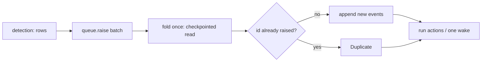

discussion: settled

# A watcher tick takes twenty minutes of CPU

## Hand-off to the planner

- **Outcome:** a full `fgos watcher tick` on this repository finishes in seconds again: the tick reads the
  supervision queue's stream once per tick, not once per answered row, and the cost of that one read follows the
  events added since the last read, not the whole history. The cause is confirmed by a measurement of one live tick,
  and a test keeps the one-read property.
- **Constraints:**
  - Change stays in component `supervision` (the queue and the tick); the Event Store is used only through its
    existing doors (`read`, `read_checkpointed`). No new mechanism, layer or config key (RUL104, D2, D3).
  - One door: the queue's raise takes a batch of events and folds once; the single-event raise used by
    `fgos supervisor raise` (`apps/fgos/src/wiring/supervision.rs:3057`) becomes a batch of one; the per-row path
    is deleted in the same change (L10, D2).
  - Batch semantics equal today's per-row semantics: an id already raised on any machine answers `Duplicate`; an id
    twice in one batch is appended once; the tick's counts (`raised`, `duplicate`), its wake choice (oldest event
    routed to a wake) and the `StartReview` retry on a duplicate are unchanged (D2).
  - First step measures before changing: per-step wall time of one live full tick on fg-server2 (detection, the
    raise loop with its read count, wake) recorded in the plan directory. Pre-approved fallback: if the raise loop
    is not the dominant cost, stop after the measurement and hand the numbers back to shaping (D1).
- **Non-goals:** the `session-no-result` definition's row volume (R3); the `review-source: plans refused` log line
  (R4); caching git-backed observe sources inside one `metrics query` call (R5); pruning or compacting the Event
  Store.
- **Acceptance criteria:**
  1. [core] One live full tick on fg-server2 is measured per step before the change, and the record names which
     step takes the time and how many queue reads it made.
  2. [core] A tick whose definitions answer N rows reads the queue's stream once for the raise step: owned by the
     watcher test in `packages/supervision/rust/tests/watcher.rs` (a counting sink), with the batch-raise semantics
     of D2 owned by `packages/supervision/rust/tests/queue.rs`.
  3. [core] After the change is released and activated on fg-server2, three consecutive full ticks each finish in
     at most 60 s wall time (systemd "Consumed" lines), recorded with the before figures.
  4. [debt-ok] The queue's fold reads through `read_checkpointed`, and the record shows the fold's cost before and
     after on the live store (D3).
- **Open points:** none.
- **Source ids:** p-q3kmkcn2kk, ds-r42bvbzode.

discussion: settled

## 1. Trạng thái hiện tại

Round 1 (2026-11-28, shaper `watcher-tick-cpu`, fg-server2). Domain: coding (`domains/coding/AGENTS.md`).
Authority: the queue belongs to component `supervision`, the read it calls to component `event-store`
(`fgos authority locate`, 2026-11-28).

Scouted and measured, read-only. The 15 watcher definitions together cost about 11 s; the git-backed observe
sources are not the cost. The leading cause is the event queue: the watcher calls `Queue::raise` once per answered
row, and each call re-reads the whole `project` stream of the Event Store from zero. The definitions answer about
328 rows per tick, almost all duplicates, so one tick reads the stream about 328 times. Proposed direction (§3 R1,
R2): fold once per tick, and let the queue read through the Event Store's existing checkpointed read. No owner
question is open; nothing blocks.

Round 2 (2026-11-28): re-checked the wiring: `Queue` is the tick's `EventSink` itself
(`packages/supervision/rust/src/watcher.rs:129-139`), with no cache between the row loop and the stream read, and
the only other production raise is `supervisor raise` (one event). R1 and R2 held without revision; settled as
D1-D4 and handed to the planner. Settled.

## 2. Mục tiêu & đề bài

The watcher timer fires every 60 s, but on fg-server2 a full `fgos watcher tick` has taken 20-32 minutes of wall
time and as much CPU since 2026-11-27, with a 1.1 GB memory peak. Events (a dead lead, a plan that turns ready, a
parked event) reach the supervisor 20-30 minutes late and one core stays busy all day. The tick grew gradually,
not in one step: median about 100 s on 2026-11-24, 160 s on 2026-11-26, then 700-1300 s from 2026-11-27 (systemd
"Consumed" lines, §5). The goal is a tick that finishes in seconds on this repository, the cause named by
measurement, and a guard that keeps it from coming back. This serves mission #1/#2 directly: every project that
runs fgOS supervision runs this tick, and its cost grows with the project's own event history.

## 3. Vấn đề rõ / chưa rõ

| # | Point | State | Evidence / note |
|---|-------|-------|-----------------|
| C1 | Detection (15 definitions through `metrics query`) is not the cost | clear | Each definition timed alone with the watcher's `--since` (now − 1 day): 0.1-2.7 s, about 11 s in total including 15 process starts. The pace definition `watcher-active` (no window) 2.7 s. Raw `git log --all -- plans` over 870 refs: 2 s. |
| C2 | Where the time goes inside a tick | clear (strong lead, confirmed by the plan's first step) | Journal: the `review-source: plans refused` line appears ~20 s after start, then 20-30 min pass before `watcher tick: woke-supervisor`. After detection the tick loops over rows and calls `ports.queue.raise(event)` for each (`packages/supervision/rust/src/watcher.rs:401`). `Queue::raise` calls `self.fold()` (`packages/supervision/rust/src/queue.rs:216-226`), which calls `fgos_event_store::read::read` with `Cursor::default()` and no view (`queue.rs:332-356`): a read from zero of the whole stream, every row. |
| C3 | How many raises per tick | clear | Definition answers on 2026-11-28 ~19:30: 328 rows; `session-no-result` alone 284, `lead-ended` 15, `plan-done` 11. Nearly all are duplicates of events already raised. 22 min / 328 ≈ 4 s per full stream read, consistent with the backlog's 19 GB read through pipes (each read walks the store's git objects through the Git door under `bwrap`). |
| C4 | Why it grew gradually | clear | Cost ≈ rows × stream size; both grow (the `project` stream is never pruned, and `session-no-result` answers one row per subject over its window). |
| C5 | Existing incremental read | clear | The Event Store already has `read_checkpointed` and `read_with_view` (`packages/event-store/rust/src/read.rs:468-530`), used today only by the Node addon (`packages/git/node-addon/src/event_store.rs:448-459`). Prior art: no batch raise ever existed (`git log -S raise_many`, `-S raise_all`: nothing). |
| R1 | Fold once per tick | settled (D2) | The watcher folds the queue once, decides new vs duplicate in memory, and appends only the new events. Turns 328 reads into one. Change stays inside `supervision`: the queue's raise takes a batch, the single-event raise of `supervisor raise` becomes a batch of one (one door, L10). |
| R2 | The queue reads through the checkpointed read | settled (D3) | Makes the one fold cost the events since the last checkpoint, not the whole history, so the tick stops growing with the store. Reuses the existing event-store door; no new mechanism. Kept `debt-ok`: R1 alone may already reach the target. |
| R3 | `session-no-result` answering 284 rows per tick | out of scope | Duplicates cost nothing once R1 lands. Whether the definition is too noisy is its own question; not this topic. |
| R4 | `review-source: plans refused` log line every tick | out of scope | Noise from legacy plans without plan-v1 frontmatter; costs no time. |
| R5 | Other non-cached sources in one `metrics query` call (git-backed sources re-walk per definition; only the record store is read once) | out of scope | Measured cheap (C1). RUL104: no change without a real cost. |

## 4. Quyết định đã chốt

| D-ID | Decision | Rationale | Date |
|------|----------|-----------|------|
| D1 | Measure one live tick per step before changing code; if the raise loop is not the dominant cost, stop and return to shaping. | The per-read cost in C3 is derived, not measured (§5 19:30); the backlog row asks for the cause measured. | 2026-11-28 |
| D2 | The tick folds the queue once and raises its rows as one batch; the queue's raise takes a batch, the single raise is a batch of one, the per-row path is deleted. Semantics unchanged. | C2, C3: ~328 full stream reads per tick, almost all for duplicates. Inside `supervision`, no new mechanism (RUL104, L10). | 2026-11-28 |
| D3 | The queue's fold uses the Event Store's existing `read_checkpointed`; marked `debt-ok`. | C4, C5: one fold still grows with the stream; the incremental read already exists and is reused, not built. D2 alone may meet the target. | 2026-11-28 |
| D4 | Done is measured live: three consecutive full ticks on fg-server2 at most 60 s wall; the guard is one owning test of the one-read property. | The timer interval is 60 s, so a tick within it means no lag; principle 8 (one proof). | 2026-11-28 |

## 5. Q&A log

- 2026-11-28 19:25 (round 1, scout) — Journal of `fgos-watcher-e9756c48.service` on fg-server2, wall time per tick
  by 3-hour window: 2026-11-24 median 93-154 s; 2026-11-25 71-120 s; 2026-11-26 147-371 s; 2026-11-27 704-1241 s
  (one window at 45 s, 18:00-21:00); 2026-11-28 988-1767 s, latest ticks 1913 s and 1767 s.
- 2026-11-28 19:27 (round 1, measure) — Each `core/watcher/definitions/*.query.json` run alone through
  `fgos metrics query --def <d> --since <now−1d> --json` from the main checkout: total ~11 s, largest
  `discussion-settled` 2.7 s; 328 answered rows, 284 of them `session-no-result`.
- 2026-11-28 19:30 (round 1, read) — `Queue::raise` → `fold()` → `read(... Cursor::default() ...)` per row;
  event store offers `read_checkpointed` unused by the queue. Could not time one fold directly: from inside this
  confined head `fgos supervisor queue` and `fgos events status` are refused (request-socket ref and read-only
  `.git/fgos/events/locks`), so the per-read figure in C3 is derived, not measured. The plan's first step measures
  it on the live tick.
- 2026-11-28 19:40 (round 2, re-check) — Production wiring: `impl EventSink for Queue` forwards `raise` straight to
  `Queue::raise`; `Queue::open` callers are the tick, `unhandled_count` and `supervisor raise`. No cache. R1/R2
  unchanged; minted D1-D4; settled.

## 6. Thiết kế đã chốt {#design}

A full watcher tick runs: lock, review settle, questions refresh, portfolio counts, pace, fetch, detection (one
`metrics query` over the definitions, about 11 s today), then the raise step, then at most one wake. Today the raise
step calls `Queue::raise` per answered row, and each call reads the queue's whole Event Store stream from zero, so
the tick costs rows × stream size and grows every day.

After the change the raise step reads the stream once: the tick hands all rows to the queue as one batch; the queue
folds once, marks each event `New` or `Duplicate` exactly as before, and appends only the new ones (an id twice in
the batch once). Everything the tick does with the answers (counts, the wake choice, the review retry) stays as it
is. The fold reads through the Event Store's existing checkpointed read, so its cost follows new events (D3,
`debt-ok`). `fgos supervisor raise` uses the same batch door with one event.

## 7. Danh mục hạng mục / task {#tasks}

### Watcher tick reads the queue once {#task-tick-reads-queue-once}

- Goal: a full tick on this repository in seconds; cause measured; one-read property guarded.
- §6 excerpt: the raise step folds once and appends only new events; the fold uses the checkpointed read.
- D-IDs: D1, D2, D3, D4.
- Siblings: none. Related backlog rows: p-du3gbevrs5 (fallback wake for action-none kinds), p-dgsxugpdgd (event
  store blocked by a dead writer); neither is changed here.
- Draft verify: `cargo test -p fgos-supervision --test watcher --test queue`, then the live check of criterion 3
  (`journalctl --user -u fgos-watcher-e9756c48.service | grep Consumed`, three full ticks after activation).
