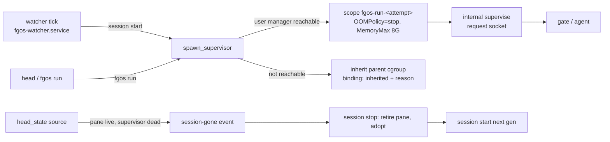

discussion: settled

# A head's run supervisor in its own failure domain

## Hand-off to the planner

- **Outcome:** every run supervisor (`fgos internal supervise`, for a head or for a run) starts in its own
  transient systemd user scope, so the watcher's unit, other heads and other runs are separate cgroups. A kernel
  OOM kill, or the stop of any one unit, ends only that scope. A head whose run supervisor has died while its pane
  lives is reported by the watcher as an event (it is no longer read as `live`), and `fgos session stop` ends such
  a head instead of answering `stop-not-ended`, so the supervisor can start the next generation through the
  existing start door.
- **Constraints:**
  - One door: the scope is made in `spawn_supervisor` (`packages/run-supervisor/rust/src/controller/launch.rs:831`),
    the one place every supervisor is spawned. No second launch path; `placeHead` / `launchSessionInHost` and
    `fgos run` stay as they are (D1, D2).
  - Mechanism: the supervise command is exec-wrapped by `systemd-run --user --scope --collect --unit=<name>
    -p OOMPolicy=stop [-p MemoryMax=<cap>]`, keeping `setsid` and the descriptor handover (locks as fds 3+). If a
    live proof shows the handover does not survive the wrap, the fallback is attaching the spawned pid to a new
    scope (`StartTransientUnit` with `PIDs`), same boundary, same names (D3).
  - Fallback is visible, never silent: where no systemd user manager is reachable (macOS, Windows, no user bus,
    a launch from inside a sandbox whose runtime dir masks `bus` and `systemd/private`), the supervisor starts as
    today and the supervisor binding records `failureDomain: {kind: "inherited", reason}`; otherwise
    `{kind: "systemd-scope", unit}` (D4).
  - One new config key for the scope's memory cap in `core/config-standard` + `core/config-schema` (runner
    section). Default `8G` per scope (owner, `q-gg7if2fal2`, 2026-11-27); a project may set it empty to disable
    the cap (D5).
  - The dead-supervisor signal goes through the existing head-state observe source and the existing
    `session-gone` watcher definition; no new event kind outside that door (D6).
  - Recovery reuses existing doors: pane retire + adopt for the old attempt, `fgos session start` (next
    generation, last handoff) for the new one. No re-attaching a new supervisor to a running agent (D7).
  - `KillMode=process` in `render_systemd` is retired in the same change if the plan's facts phase proves the
    watcher tick leaves nothing else running outside a supervisor; otherwise it stays and the plan names what still
    needs it (D8, L10).
  - Doctor: one row for the new runtime dependency (`systemd-run` / reachable user manager), warn-only, Linux only.
    `CHANGELOG.md` `[Unreleased]` line (user-visible: heads survive each other's OOM).
- **Non-goals:** machine-wide memory pressure beyond the cap (swap, `systemd-oomd`, `oom_score_adj` of
  `user@.service`); scopes on macOS or Windows; capping the watcher's own unit; keeping a head's live conversation
  across a supervisor death; automatic restart of a head without the supervisor's decision; changing run-supervisor
  spec §9 (supervisor dies, agent keeps running).
- **Acceptance criteria:**
  1. Owning proof in the run-supervisor crate: the spawn builds the scope-wrapped command (unit name, `OOMPolicy=stop`,
     `MemoryMax` only when the key is set) when a user manager is reachable, and the plain command with an
     `inherited` failure domain and its reason when not; the binding records which.
  2. Owning proof in the head-state source (`apps/fgos/src/wiring/observe_sources/head_state.rs`): pane live and
     supervisor (identity in `supervisor-binding.json`) dead reads a distinct state, with the placement's instant
     (one incident per placement, as `gone`); `session-gone` matches it. One wiring proof in the watcher definitions
     test.
  3. Owning proof for `stopHeadSession`: with the supervisor dead it retires the pane, settles the attempt through
     adopt and writes `retiredAt`; it never answers `stop-not-ended` for that case.
  4. Live check on fg-server2, recorded in the plan's report: start two heads from the watcher; `systemctl --user
     status` shows each supervisor in its own scope and none in `fgos-watcher-<id>.service`; `kill -9` of one
     supervisor (and, separately, `systemctl --user stop` of the watcher service) leaves the other head's request
     socket answering; the killed one shows up as an event on the next tick and `fgos session stop` ends it.
  5. `npm test` and `cargo test --workspace` green; doctor row and CHANGELOG line present.
- **Open points that block only part:** none; `q-gg7if2fal2` answered (default cap 8G per scope).
- **Source:** backlog `p-6htu2ae64o`; evidence §2; prior art `plans/261118-1045-project-supervisor/reports/spike-timer-head-start.md` (commit
  `a27331b109`).
- authority: component `run-supervisor` (`fgos authority locate`, top match); no new component or decision kind.

## 1. Trạng thái hiện tại

2026-11-27 00:45: **settled** in one round on the owner's order (first in order, owner offline, decide inside the
frame). All four open points of §2 are decided from code and prior evidence (D1-D8).
2026-11-27 01:56: the owner answered `q-gg7if2fal2`: default memory cap 8G per scope (D5). Nothing is open.
Plan `261127-0016-head-run-own-failure-domain` is running; its lead takes the 8G default from D5.

## 2. Mục tiêu & đề bài

Backlog row `p-6htu2ae64o`: a head's run supervisor (the process that serves its request socket) must not share a failure domain with the watcher or with other heads; an OOM kill of one must not remove the others' sockets.

Evidence gathered by lead:SUPERVISOR on fg-server2, 2026-11-26/27:

- The watcher runs as the systemd user service `fgos-watcher-<id>.service` (oneshot tick from `fgos-watcher-<id>.timer`). Every run supervisor (`fgos internal supervise`), every lead worker (`fgos run ...`) and their node children it starts stay in that service's cgroup. At 2026-11-27 00:07 the cgroup held 3.2G with a peak of 17.4G, and one tick had been `activating` for 9 minutes.
- Kernel OOM kills on 2026-11-26 at 17:00-17:03, 18:18 and 19:14-19:37 took down the watcher service, mailbox-sync, `systemd --user` itself and the run supervisors of several heads at once. After 19:37 only two heads kept a request socket. `head:supervisor-forgent`, a shaper and the 2313 lead were left with `request-socket-unavailable` and no event was raised; they had to be stopped by signal and restarted by hand (`fgos session stop` answered `stop-not-ended` because the supervise process was gone).
- Single `fgos` processes reached 1.4G, 529M and 269M RSS before being killed; each `fgos watcher tick` uses about 420M.
- Related backlog rows: `p-cdsvrsfnui` (session type never submits), and the missing event when a head's run supervisor dies.

Open points for the shaper (all decided in §4): the failure-domain boundary (one transient unit or scope per head, per run, or per lead), memory limits per unit, what raises an event when a head's run supervisor dies, and how a head gets its socket back without losing its session.

## 3. Vấn đề rõ / chưa rõ

| Point | State | Where |
|---|---|---|
| Why supervisors sit in the watcher cgroup | Clear: `spawn_supervisor` only `setsid`s (`controller/launch.rs:864`); a cgroup is inherited from the starter. The spike of 2026-11-18 recorded it and chose `KillMode=process` over a scope for simplicity (`plans/261118-1045-project-supervisor/reports/spike-timer-head-start.md` lines 18, 45) | D1 |
| Why one kill took everything | Clear: a systemd service's default `OOMPolicy=stop` stops the whole unit when the kernel OOM-kills one of its processes; every supervisor was in that unit | D3 |
| Boundary | Decided: one scope per supervised attempt | D2 |
| Memory cap default | Decided by owner: 8G per scope (`q-gg7if2fal2`) | D5 |
| Event on supervisor death | Decided: head-state source judges the supervisor too | D6 |
| Socket back | Decided: no re-attach; stop + next generation | D7 |
| `KillMode=process` | Decided conditionally on a facts check | D8 |
| Can a confined head reach the user bus? | Clear: no; the sandbox masks `bus` and `systemd/private` (`docs/platform/agent-confinement/spec.md` §runtimeDir mask). A run started from inside a sandbox inherits its parent's scope | D4 |

## 4. Quyết định đã chốt

All rows decided by analysis in one round under the owner's order to decide from evidence inside the frame.

| D-ID | Decision | Rounds held | Source |
|---|---|---|---|
| D1 | Cause, from code: the supervisor is spawned with `setsid` only (`packages/run-supervisor/rust/src/controller/launch.rs:831-893`), so it and its gate/agent children stay in the starter's cgroup; for heads the starter is the watcher service, kept alive past unit exit only by `KillMode=process` (`packages/distribution/rust/src/timer.rs:429-431`, `leaves_started_processes_running`) | analysis | code; spike report |
| D2 | Boundary = one transient systemd user scope per supervised attempt (per run supervisor), made at the one spawn door. A head has one attempt per generation, so this is per head; a run is per run. A lead's workers launched from inside its sandbox cannot reach the bus and so stay in the lead's scope: per-lead at worst, never shared with the watcher or another head. Rejected: one scope per lead (needs a second door in head start), per head via the watcher (misses heads started by hand) | analysis | design principle 1; agent-confinement spec runtimeDir mask |
| D3 | Each scope carries `OOMPolicy=stop` explicitly: a kernel OOM kill inside a scope ends that scope only, which is the confinement wanted; the old shared-unit failure was exactly this policy applied to one shared unit. Mechanism: exec-wrap with `systemd-run --user --scope --collect`, keeping `setsid` and the fd handover; fallback attach-by-pid if the live proof fails (the spike already showed `systemd-run --user --scope` keeps a head alive past unit exit, trial 7) | analysis | spike report line 43; systemd OOMPolicy |
| D4 | No reachable user manager: launch as today and record `failureDomain: inherited` with a reason in the supervisor binding; never silent | analysis | design principle 5; AGENTS.md install gate (never assume platform) |
| D5 | One config key for the scope's `MemoryMax` in `core/config-standard`/`core/config-schema`; default `8G` per scope, so one runaway head or run is OOM-killed inside its own scope before it pressures the machine; empty disables the cap | analysis (key); owner (value, 2026-11-27) | AGENTS.md install gate; `q-gg7if2fal2` |
| D6 | Event: `head_state.rs` today reads only the pane (`HostHeadFacts::alive`, line 49), so a head with a dead supervisor reads `live` and nothing fires. It also judges the supervisor identity recorded in `supervisor-binding.json` and reports a distinct state (planner names it) with the placement's instant; `core/watcher/definitions/session-gone.query.json` matches it. Reuses the observe source and definition of plan `261124-2143` | analysis | code; L10 |
| D7 | Recovery: no new supervisor is attached to a running agent (run-supervisor spec §9 keeps the agent running and adopt settles it; re-adoption would be a new mechanism). `stopHeadSession` (`src/session-host/head-stop.mjs:127-133`) today waits for a close only the dead supervisor could write; with the supervisor judged dead it retires the pane, settles the attempt through adopt, writes `retiredAt`. The next generation starts through `fgos session start` with the last handoff; the live conversation is not kept (files and handoff are) | analysis | spec §8-§9; code |
| D8 | `KillMode=process` (and nothing else in the unit) exists to keep started heads alive; once supervisors live in their own scopes it is not needed on systemd. Retire it in the same change if the facts phase finds nothing else the tick leaves running; launchd's `AbandonProcessGroup` stays (no scopes there) | analysis | L10; timer.rs |

## 5. Q&A log

- 2026-11-27 00:1x — lead:SUPERVISOR opened the discussion on the owner's order; evidence in §2.
- 2026-11-27 00:2x — lead:SUPERVISOR (owner order): topic first; owner offline; decide from evidence inside the
  frame, park only a genuine product choice, settle and land.
- 2026-11-27 00:4x — shaper: scouted `spawn_supervisor`, `render_systemd`, the 2026-11-18 spike report,
  `head_state.rs`, `head-stop.mjs`, run-supervisor spec §8-§9, agent-confinement runtimeDir mask; decided D1-D8;
  asked `q-gg7if2fal2` (default cap, non-blocking); settled.
- 2026-11-27 01:56 — owner answered `q-gg7if2fal2`: "8G cap per scope". Written into D5 and the hand-off; acked.

## 6. Thiết kế đã chốt {#design}

Today every run supervisor inherits the cgroup of whoever started it. Heads are started by the watcher's oneshot
service, so all head supervisors, their lead workers and node children share `fgos-watcher-<id>.service`; a kernel
OOM kill of any process there makes systemd stop the whole unit (`OOMPolicy=stop`), and every request socket goes
with it. Nothing notices, because head liveness is read from the pane only.

After the change, the one spawn door of the run supervisor asks the user's systemd manager for a transient scope
per attempt and execs the supervisor inside it, with `OOMPolicy=stop` and a `MemoryMax` (8G by default). Each head and
each run is then its own cgroup: an OOM kill or a stop ends only that scope. Where no user manager is reachable the
spawn goes on as today and the binding says so. The head-state source also checks the supervisor recorded in the
binding; a head whose pane lives without its supervisor becomes a `session-gone` event, and `session stop` ends it
by retiring the pane and settling through adopt, after which the supervisor starts the next generation.

## 7. Danh mục hạng mục / task {#tasks}

### Own scope per run supervisor {#task-supervisor-scope}

- Goal: D1-D5, D8. Spawn door, binding field, config key, doctor row, `KillMode=process` retirement check.
- Files (indicative): `packages/run-supervisor/rust/src/controller/launch.rs`, binding writer in
  `packages/run-supervisor/rust/src/supervise.rs`, `packages/distribution/rust/src/timer.rs`,
  `core/config-standard/runner.yaml`, `core/config-schema/`, `packages/distribution/contracts/doctor-registry.v1.json`,
  `docs/platform/run-supervisor/spec.md`, `CHANGELOG.md`.
- Verify draft: `cargo test -p fgos-run-supervisor` + live check (acceptance 4).

### Dead supervisor is seen and stoppable {#task-dead-supervisor}

- Goal: D6, D7. Head-state judges the supervisor; `session-gone` matches; `stopHeadSession` ends it via pane
  retire + adopt.
- Files (indicative): `apps/fgos/src/wiring/observe_sources/head_state.rs`,
  `core/watcher/definitions/session-gone.query.json`, `src/session-host/head-stop.mjs`,
  `test/session-host/head-stop.test.mjs`, `docs/platform/session-host/spec.md`.
- Sibling: independent of the scope task; both are needed for the live check.
- Verify draft: `cargo test -p fgos` (head_state tests), `node --test test/session-host/head-stop.test.mjs`.
