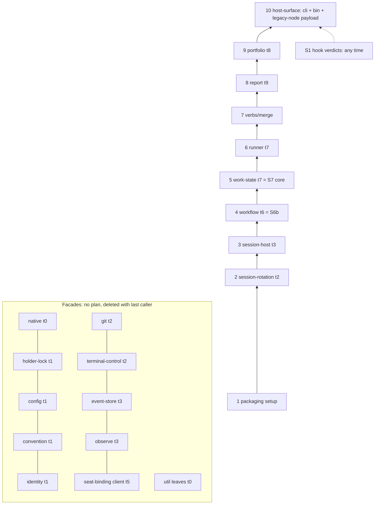

discussion: paused

## Hand-off to the planner (suspended 2026-11-23 16:10, owner order: component-authority first; redo on the post-doors tree)

- **Outcome:** every live Node area in `src/` (and `bin/*.mjs`) is retired into Rust through the ten plans of §7, opened
  one at a time in that order. When plan 10 lands, no `legacy-cli` route and no `legacy-node` payload remain.
- **Constraints:** each plan moves every caller and deletes the Node path and its tests in the same change (L10, design
  principles 1 and 8). It leaves no twin. It starts only once the running plans holding its files have landed (§7 names the collisions). It changes no behaviour, verb or flag (RUL104).
  The owner-approved program order of `261114-2051` stands (D4).
- **Non-goals:** the dead tier-5 closure (`261122-2108` owns it); a plan for any facade row (D1); new Rust features.
- **Acceptance per plan:** `git ls-files <area paths>` prints nothing (or only the rows §6 hands to a later plan),
  every retired test is named with its owning Rust test, the area's `doors` rows have no debt left for it, and `npm test` and
  `cargo test --workspace` are green on the merged tree.
- **Acceptance of the program:** 56 → 0 `legacy-cli` routes in `packages/host-runtime/contracts/command-routes.json`;
  `find src -name '*.mjs'` is empty.
- **Open points that block only some parts:** O1 (Work council must be held before plan 5 starts, owner decision 78);
  O2 (plans 2 and 3 wait for the session-host and session-rotation plans that are running).
- **First plan to open:** §7 task 1 (packaging remainder), once `261121-2110-component-authority-doors` has landed.
- **Sources:** `p-vwpnx4gpow`, `plans/261114-2051-rust-verb-migration-program/plan.md`, D1–D5.

## 1. Trạng thái hiện tại

**Round 3 (2026-11-23 16:02–16:30): paused by owner order.** The owner learned that HARDEN (`261021-1118`, done
2026-11-18) moved decisions into Rust and thinned Node for T0–T5, but deleted no Node. T6 was hardened inside Node
(+44, decision 73), T7 Work was never hardened (option B, 2026-11-18: Work waits until after the packaging release),
T9 added +2,136 lines of Node, and session-host was written in Node afterwards. Of the 160 T0–T5 Node files, 67 have no
upper caller (62 are already owned by `261122-2108`); 93 are still called by T6+ Node, `bin` or scripts.
Owner, 16:10: "component-authority-* phải xong trước để kiểm soát authority rồi mới làm tiếp … tính toán kỹ để đẩy nó
lên trước rồi vá lại." This discussion waits for `261121-2110-component-authority-doors` and is redone on its tree.

What the calculation found (doors plan at `bea353689`, its lead report `reports/lead-261123-0915-wave-1-parked.md`):

- `261121-2109-component-authority` is done. The doors plan has 1 of 22 phases done (phase 1, `locate`).
  All five `blockedBy` plans are done.
- Wave 2 (phases 2e, 4 and 5) ended `infra-exec-failed` with nothing changed. The binding chose deepseek and the
  runner stopped each worker at the 10 MB output limit. The owner's 09:01 order said `--provider claude`.
- **Three doors phases wait on work that would come after doors:**
  - 2f (doctor body map) waits on S6b/S7, the very port this discussion orders.
  - 3b and 3d wait on phase 8 of `261122-2108` (dead closure). That plan is blocked by `261122-0118`, which is running.
  - 2g waits on backlog `p-rypvkc3kai` (proposed).
  - Phase 10 ("no debt") needs all three, and phase 11 needs 10. So doors cannot close whole before the port unless
    2f's row is handed to the port as its one named debt.
- **File collisions:**
  - Phases 1b, 2c, 6 and 11 write `src/cli/command-registry.mjs`, and 3a writes `src/session-host/head-request.mjs`.
    `261122-0118` (running) holds both.
  - `261122-2108` holds `packages/component-authority/model/**` and `src/runner/dispatch/**`, which phases 1b and 3a write.
- Four of phase 3a's five Node files are already dead, with no product importer: `dispatch/config-twin.mjs`,
  `evidence-attribution.mjs`, `settlement.mjs` and `execution/unit.mjs`. Rewiring them would be wasted work; delete them.
  Only `dispatch/write-scope.mjs` is live (workflow, session-host).

Proposed order to put doors first (for the secretary and supervisor; this shaper edits no plan):
1. `261122-0118` lands.
2. Doors 1b (model to YAML) runs.
3. The doors phases with no wait run, on `--provider claude`: 2a–2e, 3a (the four dead files deleted, not rewired),
   3c, 3e, 4, 5 (the Authority-map gate on plans, which is the authority control), 6, 7, 8, 9.
4. `261122-2108` runs, rebased on the YAML model.
5. Doors 3b and 3d run.
6. Doors 10 and 11 run, with 2f's row (and 2g's if `p-rypvkc3kai` is still open) left as named debt, `retiredBy` the port.
7. This discussion is redone: the inventory is recomputed on that tree and each port plan carries an Authority map.

Round 3b (16:24), owner: "heads-stable cũng phải tự điều chỉnh … khi nó quay lại phải tự xử lý sự cố, chứ giờ ngồi
không bắt người khác đợi là không được." Nobody waits on a head that is away: doors does not wait for `261122-0118`,
and heads-stable rebases and resolves its own conflicts when it returns. Checked at `ea4806f03`: heads-stable phases 1–7,
9 and 12 are done. Its open phases 8, 10 and 11 write only `core/skills/fgos-secretary/SKILL.md`, the generated
`.agents/skills/**` and `plugins/fgOS/skills/**`, its own reports, `test/live/head-grant-probe.live.mjs`,
`test/session-host/head-start.test.mjs` and `CHANGELOG.md`. They no longer touch `src/cli/command-registry.mjs` or
`src/session-host/head-request.mjs`; only its frontmatter footprint still lists them. The only real overlap with doors is
the generated skill directories (doors phase 5), and whoever lands second regenerates them with `npm run build:skills`.
`261122-2108`'s `blockedBy: 261122-0118` likewise has no remaining file reason: the head-stop and rotate change it
waited on was in heads-stable's done phases. Question 1 = option (a), confirmed by the owner at 16:3x (D6): phase 10 locks everything except the named debt of 2f (and 2g while `p-rypvkc3kai` is open), with `retiredBy`
the Workflow/Work port. Revised order: (0) a planner re-cuts doors per (a), adds 3a's dead-file deletion, and pins
`--provider claude`; (1) doors 1b and then its no-wait phases start now; (2) `261122-2108` starts with its blockedBy on
heads-stable dropped, rebased on the YAML model; (3) doors 3b, 3d, 10, 11; (4) this discussion is redone.

No open owner point (O6 closed 16:32).

**Round 2 (2026-11-23 15:57–16:20): settled.** Every check left open in round 1 came back without revising P1–P4, so they
are minted as D1–D4. Findings:

- **O1:** "decision 78" is a decision of the harden program (`261021-1118`): the Work council opens after T8 and the
  non-Work arms of T9. Both closed (T8 on 2026-11-09, T9 on 2026-11-14), but no Work council has been held yet. The gate
  stays (D5) and blocks only plan 5 onward.
- **O3:** `src/util/yaml.mjs` is already a facade over the `fgos-yaml-doc` crate. The component-authority-doors plan only
  moves the model's own reads into the crate and does not retire the file. It has 28 product importers, including `bin`, so it dies in plan 10.
- **Facade check, file by file:** the facade areas hold small pieces of Node-side policy. Examples are the Event Store seal coalescing for Node
  CLI processes, the `terminal.*` merge rules "only Node can judge", and twins that run Rust's golden vectors
  (`convention/identifier-rules.mjs`, `util/host-bin-path.mjs`). Each one exists only to serve a Node process, so each one dies with
  its last Node caller. D1 holds. Two leaves are real logic that serves no Node caller and are assigned to plans:
  `util/domain-compile.mjs` (`build:domains` plus a doctor row) goes to plan 1, and `git/main-checkout-delete-guard.mjs` goes to S1.
- `identity/directory-store.mjs` has no product importer, only one test. It is dead and goes into plan 1 as a one-line deletion.

**Round 1** (2026-11-23 14:21–14:50, shaper head). The scout is done and the full inventory table is in §6. Every
`src/` area has a row: 323 `.mjs` files, about 80k lines, mapped to the component model
(`packages/component-authority/model/components.json`).

Findings that shape the design:

1. **Two kinds of rows, not one.** About half the areas (tier 0–3: `native`, `holder-lock`, `git`, `config`,
   `event-store`, `observe`, `identity`, `convention`, `terminal-control`, `seat-binding`, most of `util`) are
   already **thin Node clients or facades over a Rust crate**. Rust owns the policy, and the Node file exists only
   because Node callers above it still exist. There is nothing to port in them. They can only be **deleted**, and
   only after their last Node caller is gone. The other areas hold **real logic with no Rust twin yet**
   (`workflow`, `state`/`intake`/`evolve`, `runner` tier 7, `verbs`, `report`, `session-host`, `session-rotation`,
   most of `setup`, `cli`).
2. **So literal bottom-up runs backwards for deletion.** Porting logic goes bottom-up, but deleting facades goes
   top-down, because a facade dies with its last caller.
3. The remaining rows of the owner-approved program `261114-2051-rust-verb-migration-program` are S1 (hook
   verdicts), S6b (Workflow) and S7 (Work). This inventory sizes those rows; it does not reorder them.

Provisional calls (§3 rows P1–P4) are recorded and not yet minted. The first one needs a second round before it
gets a D-ID. No owner question is open. Next round: re-verify the facade claim against callers file by file, check
whether the Work council (decision 78) has been held, then mint D-IDs and settle.

## 2. Mục tiêu & đề bài

Backlog row `p-vwpnx4gpow` (owner order of 2026-11-23 14:21) asks for one table listing every Node area still live in
`src/` with its tests. Each row gives files and tests, what Rust already owns, live callers, the target Rust
component, and dependencies. The rows are ordered bottom-up per the owner port order of 2026-11-14: packaging-distribution first,
then lower layers before upper. After the table, one plan per area is opened, one at a time, in that order. The dead tier-5 Node
closure has its own plan (`261122-2108-delete-dead-node-execution-closure`) and is excluded. Every plan must be clean
and cause no impact. It moves all callers and deletes the Node path and its tests in the same change (L10, design
principles 1 and 8), never leaves a twin, and is sequenced around the footprints of running plans
(`261121-2110-component-authority-doors`, `261122-0118-heads-stable-and-able`) so nothing collides. The owner port
order of 2026-11-14 is the program plan `plans/261114-2051-rust-verb-migration-program/plan.md`. Its "Order
(owner-approved, do not reorder)" is F0 → S2‖S3 → S4 packaging → S5 → S6a → S6b Workflow → S7 Work, with S1 hooks
allowed to run beside any step. F0 through S6a have landed (S6a ended after its facades on 2026-11-22, D-ADR0083).

## 3. Vấn đề rõ / chưa rõ

| # | Point | State | Evidence / note |
|---|---|---|---|
| C1 | Count: 323 `.mjs` in `src/` | clear | sums per directory in §6 match |
| C2 | Owner order of 2026-11-14 = program plan `261114-2051` | clear | plan.md "Order (owner-approved, do not reorder)" |
| C3 | Dead tier-5 Node excluded | clear | `261122-2108` footprint: `src/runner/dispatch/**`, `src/runner/execution/**`, `src/run-supervisor/**`. 62 of 89 files dead; the 27 live ones stay for Workflow (S6b), setup/session-head (S7) and the frozen mailbox harness |
| P1 | **Facade rows get no plan of their own.** A Node client or facade over a Rust crate is deleted inside the plan that removes its last Node caller. Its row in §6 names that plan. | provisional (round 1) | L10 and design principle 1 (one door) forbid deleting a facade while a caller remains. Porting it would create a second Rust caller path. Headers confirm Rust owns the policy: e.g. `src/git/*.mjs` "Typed transport only; authority and Git policy remain in Rust", `src/holder-lock/hold-transport.mjs` "Node cannot call LockFileEx", `src/config/facade.mjs` |
| P2 | **"Packaging first" = the setup pieces whose layer already lives in Rust or that have no layer.** Those are instruction registry/composition/projections, agent hooks, skill wrappers, agy permissions, bin discovery, shell rc, git hooks and mailbox limits. Doctor rows of a layer still in Node (`seat-binding-checks`, `workflow-case-checks`, `workflow-catalog-reader`, `blind-steps-proven-pools`, and the bridged rows in `registrations.mjs`) stay on `doctor-bridge.mjs` and move with their layer's plan. The bridge is deleted with the last such row. | provisional (round 1) | AGENTS.md install gate: "a row of a layer still in Node is bridged"; S4 plan "Items for the program plan" assigns bridged rows to S5/S6a/S6b/S7 |
| P3 | **One plan per component of the model**, not per `src/` directory. The `work-state` component spans `src/state` + `src/intake` + `src/evolve`, and `host-surface` spans `src/cli` + `src/verbs` + `bin/`. | provisional (round 1) | `components.json` `paths` |
| P4 | This inventory sizes the program's remaining rows (S1, S6b, S7) and splits S7 into its components. It does not reorder the owner-approved order. | provisional (round 1) | program plan: "S1-S7 each get their own detailed plan … when they start" |
| P1–P4 | See D1–D4 | settled round 2 | held without revision |
| O1 | S7 entry gate "Work council (decision 78) held". Decision 78 belongs to `261021-1118` (lessons.md:13, :104, :152): the Work council opens after T8 and the non-Work T9 arms. Both are closed, but no council has been held. | open, blocks only plans 5–7 → D5 | `plans/261021-1118-harden-low-layers-bottom-up/plan.md` closedNote |
| O2 | `session-host` / `session-rotation` are being edited now by `261122-0118` (running) and `261123-0828` (ready) | open, blocks only plans 2–3 starting | footprints read 2026-11-23 |
| O3 | `src/util/yaml.mjs`: a facade over `fgos-yaml-doc` with 28 product importers; `261121-2110` does not retire it (plan.md:219–222) | clear: facade, dies in plan 10 | file header; importer count |
| O6 | Owner, 16:2x: does component authority have a warn-only versus blocking switch? Today: no setting. `debt` entries act as a visible "known, not yet fixed" list (no failure, but a stale entry fails). Doors phase 10 removes `debt`, after which any match outside allowed files turns `npm test` red. The phase 5 plan gate is a reviewer reject, inactive only when a project has no model. A switch would be a new config key (`core/config-standard`, `core/config-schema`) and a change to the doors plan | closed 16:32: owner needs no switch; `debt` already serves as the warn list | `docs/platform/component-authority/spec.md` §4; doors `phase-10-land-checks.md`, `phase-05-*.md` |
| O5 | Logic leaves inside facade areas: `util/domain-compile.mjs` → plan 1; `git/main-checkout-delete-guard.mjs` → S1; `identity/directory-store.mjs` is dead (no product importer) → plan 1 | clear | round 2 file-by-file header read |
| O4 | Test counts in §6 are "test files that import the area", so a test can count under several areas. Backlog says 588 test files in all. | clear (method stated) | scratchpad script, method in §5 |

## 4. Quyết định đã chốt

| D-ID | Decision | Rounds held | Source |
|---|---|---|---|
| D1 | A facade, client, Node-process adapter or golden-vector twin over a Rust crate gets no plan. It is deleted inside the plan that removes its last Node caller, and §6 names that plan. | 2 | L10, design principle 1; round 2 file-by-file check |
| D2 | "Packaging first" means plan 1 takes the `setup` pieces whose layer already lives in Rust or that have no layer (plus `util/domain-compile.mjs` and the dead `identity/directory-store.mjs`). Doctor rows of a layer still in Node stay on `doctor-bridge.mjs` and move with their layer's plan. The bridge is deleted with the last row. | 2 | AGENTS.md install gate; S4 "Items for the program plan" |
| D3 | One plan per component of the model, not per `src/` directory | 2 | `components.json` `paths` |
| D4 | This inventory sizes the program's remaining rows (S1, S6b, S7), splitting S7 into plans 5–7 and adding plans 1–3 and 8–10. It does not reorder the owner-approved order. | 2 | `261114-2051` "S1-S7 each get their own detailed plan … when they start" |
| D5 | Owner decision 78 stands: the Work council is held before plan 5 opens. Plans 1–4 do not wait for it. | 2 | `261021-1118` lessons.md:104, :152 |
| D6 | Owner chose option (a) on 2026-11-23 16:3x: doors phase 10 locks every door except the named debt of 2f (and 2g while `p-rypvkc3kai` is open), `retiredBy` the Workflow/Work port. Doors closes before the port, and this discussion is redone after doors and `261122-2108` land (§1 round 3b, step 4). | owner answer | chat 16:3x "ok, đồng ý phương án a" |

## 5. Q&A log

- **2026-11-23 14:21 — round 1, scout.** Read backlog `p-vwpnx4gpow`, program plan `261114-2051`, the dead-closure plan
  `261122-2108`, the component model, and the footprints of every running or ready plan. Method for §6: one Python pass over
  `src/ bin/ scripts/ test/ .githooks/ packages/ apps/` that resolves every relative `import` and counts, per `src/` area,
  its files, its lines, the test files that import it, and the product files outside the area that import it. The
  dispatch and execution subdirectories of `src/runner` are split out. Each file's header comment was read to classify
  it as facade or logic. Result: the facade-versus-logic split (§1 finding 1) and provisional calls P1–P4. No owner question
  was needed; P1–P4 follow from L10, design principle 1, and the S4 bridge rule.
- **2026-11-23 15:19 — owner:** "chổ này đang chờ câu hỏi gì" (what question is this waiting on?). Answer: no
  owner question is open. The only point worth the owner's eye is how "packaging first" is read (P2).
- **2026-11-23 15:57 — owner:** "em scan xong chưa" (is the scan done yet?). Round 2 ran: the decision 78 lookup, the `yaml.mjs` check, and a file-by-file
  header read of the facade areas. None of P1–P4 was revised, so D1–D5 were minted and the discussion was settled.

- **2026-11-23 16:02 — owner:** "anh nghĩ là mọi thứ đã được … harden … chuyển sang rust hết rồi … giải thích plan này đang làm gì" (I thought HARDEN had already moved everything to Rust; explain what this plan does). Explained: HARDEN thinned Node for T0–T5 and deleted none of it; T6, T7, session-host and T9 still hold Node logic.
- **2026-11-23 16:10 — owner:** component-authority first, then continue; calculate carefully, then patch. Round 3 calculation is recorded in §1; discussion paused.
- **2026-11-23 16:24 — owner:** heads-stable must not make others wait, and handles its own conflicts on return. Recorded as round 3b in §1.
- **2026-11-23 16:32 — owner:** no warn-only switch needed (O6 closed).
- **2026-11-23 16:3x — owner:** "ok, đồng ý phương án a" → D6.
- **2026-11-23 16:2x — owner:** asked whether authority has a warn-or-block setting → O6.

## 6. Thiết kế đã chốt {#design}

*Settled, round 2 (D1–D5).*

### Shape

The remaining Node code retires in **logic plans**, run bottom-up by tier: packaging first, then each logic area from
the lowest tier up. Each logic plan ports its area into its Rust component, moves every caller, and deletes the Node
area, its tests and every **facade** whose last caller it removed. Facade rows have no plan. Each one names the plan
that deletes it, which is the plan of its highest-tier caller. The host surface (`src/cli`, `bin/fgos.mjs`, the
`legacy-node` payload) goes last, once no `legacy-cli` route is left (56 of 86 routes are still `legacy-cli` today, per
`packages/host-runtime/contracts/command-routes.json`).

### Inventory (one row per area)

Legend: **kind** L = logic to port, F = facade/client over Rust, D-rest = what the dead-closure plan leaves.
*tests* = test files importing the area. *Callers* = product files outside the area that import it.

| # | Area (`src/`) | Component (tier) | Kind | Files / lines | Tests | What Rust owns today | Live callers | Target Rust component | Retired by |
|---|---|---|---|---|---|---|---|---|---|
| 1 | `setup` (17 files) | packaging-distribution (9) | L + bridge | 17 / 5150 | 25 | `packages/distribution` (init, doctor, wire-agents, uninstall native since S4); `apps/fgos/src/wiring/doctor` | scripts (5: `build:skills` and friends), verbs (1), Rust host → `doctor-bridge.mjs` | `packages/distribution` | **plan 1** for non-bridge pieces (P2); bridged rows move with plans 4, 5 and 6; `doctor-bridge.mjs` with the last |
| 2 | `util` (23) | platform-foundations (0) | F/leaf | 23 / 1130 | 78 | `durable-file`, `canonical-json`, `yaml-doc`, `identity`, host-bin resolution in `apps/fgos` | almost every area | none (leaves die) | each leaf with its last caller; `yaml.mjs` in plan 10; `domain-compile.mjs` in plan 1 |
| 3 | `native` (8) | process (0) | F | 8 / 1129 | 53 | `packages/process`; the combined addon | workflow 27, dispatch 19, many | none | the last plan (10), since it is the Node→Rust door itself |
| 4 | `config` (1) | config (1) | F | 1 / 127 | 15 | `packages/config/rust` | 11 areas | none | with its last caller |
| 5 | `convention` (4) | convention (1) | F | 4 / 146 | 3 | `packages/convention/rust` | workflow, runner, scripts (3) | none | plan 4 or 6; scripts need a Rust verb or a direct crate call |
| 6 | `identity` (1) | identity (1) | F | 1 / 16 | 0 | `packages/identity/rust` | none (one test only) | none | dead: deleted in plan 1 |
| 7 | `holder-lock` (9) | holder-lock (1) | F | 9 / 1789 | 50 | `packages/holder-lock/rust` (policy, Windows `LockFileEx` via `fgos internal lock-hold`) | git (12), runner, dispatch, workflow, state, `.githooks` | none | with its last caller (plan 6 or 10) |
| 8 | `git` (13) | git (2) | F + one logic file | 13 / 796 | 26 | `packages/git/rust` + node-addon | runner, workflow, state, scripts (11) | `packages/git` | facades with their last caller; `main-checkout-delete-guard.mjs` (505 lines of logic) = **S1** |
| 9 | `terminal-control` (2) | terminal-control (2) | F | 2 / 284 | 3 | `packages/terminal-control/rust` | dispatch (live rest), scripts | none | with dispatch's live rest |
| 10 | `session-rotation` (2) | session-rotation (2) | L | 2 / 811 | 2 | `packages/session-host/rust/src/rotation`, `wiring/session_rotation_hook.rs` | session-host | `packages/session-host` | **plan 2** |
| 11 | `event-store` (6) | event-store (3) | F + seal policy | 6 / 468 | 14 | `packages/event-store/rust` (maintain since F0) | state (4), verbs, runner, scripts | none | with work-state (plan 5) |
| 12 | `observe` (3) | observe (3) | F | 3 / 270 | 3 | `packages/observe/rust` | state, verbs | none | with plan 5 or 7 |
| 13 | `session-host` (7) | session-host (3) | L | 7 / 2127 | 13 | `packages/session-host/rust` (panes, route, host) | session-rotation, dispatch, bin | `packages/session-host` | **plan 3** |
| 14 | `run-supervisor` (12), `runner/dispatch` (54), `runner/execution` (23) | run-supervisor (4), dispatch/exec (5) | D-rest | 89 / 26.8k, of which 27 live after `261122-2108` | 181 | `packages/run-supervisor`, `packages/execution` (S6a) | live rest: workflow, setup, session-host, mailbox harness | `packages/execution` | dead part: `261122-2108`; live rest: plans 3, 4 and 5; mailbox-harness reach: mailbox lane |
| 15 | `seat-binding` (1) | seat-binding (5) | F | 1 / 232 | 6 | `packages/seat-binding/rust` | workflow, setup, dispatch | none | with plan 4 |
| 16 | `workflow` (32) | workflow (6) | L | 32 / 7469 | 54 | none (no crate) | state, setup, runner, bin | new Workflow crate (spec `docs/platform/workflow/`) | **plan 4 = S6b** |
| 17 | `state` (34), `intake` (6), `evolve` (1) | work-state (7) | L | 41 / 12.9k | 134 | `packages/work-state/rust` (event reader, work source only) | verbs (13), runner (13), report, setup, bin | `packages/work-state` | **plan 5 = S7 core**; gate O1 |
| 18 | `runner` top level (34) | runner (7) | L | 34 / 10.6k | 70 | parts in `apps/fgos/src/wiring` (lock, worktree, agents) | verbs (9), setup, workflow, bin, `.githooks` | `packages/execution` / work-state, per file | **plan 6 = S7 runner** |
| 19 | `verbs` (14) | host-surface (9) | L | 14 / 2457 | 16 | events verbs native (S3) | bin | `apps/fgos` wiring | **plan 7 = S7 merge/state verbs** |
| 20 | `report` (10) | learning-docs-registry (9) | L | 10 / 2058 | 10 | none | state, setup, verbs, bin | new crate or `packages/documentation` | **plan 8** |
| 21 | `portfolio` (1) | supervision (8) | L (tiny) | 1 / 19 | 0 | `packages/supervision/rust` (portfolio, queue, land) | scripts (1) | `packages/supervision` | **plan 9** (or folded into 8) |
| 22 | `cli` (5) + `bin/*.mjs` (2) | host-surface (9) | L | 5 / 3316 + bin | 20 | `apps/fgos` routing/help (F0) | bin, scripts | `apps/fgos` | **plan 10**: zero `legacy-cli` routes, `legacy-node` payload removed |

Out of `src/` but in scope because the same plans touch them: `packages/portfolio/*.mjs` (5 Node files, with plan 9),
and `scripts/*.mjs` callers of `src/` (each plan moves its own script callers).

## 7. Danh mục hạng mục / task {#tasks}

*Settled order (D2–D5). Each entry becomes one plan, opened one at a time.*

### 1. Packaging remainder {#task-packaging}
Goal: port the setup pieces in D2 and `util/domain-compile.mjs` into `packages/distribution`, move their script callers (`build:skills` and friends), and
delete them. Collision: `261121-2110-component-authority-doors` holds 6 `src/setup` files, so start after it lands.
Verify draft: `npm test && cargo test --workspace`; `git ls-files src/setup` lists only the bridge files.

### 2. Session rotation {#task-session-rotation}
Goal: `rotate.mjs` and `handoff-store.mjs` into `packages/session-host` rotation. Collision: `261122-0118` and `261123-0828`.
Verify draft: `git ls-files src/session-rotation` is empty.

### 3. Session host {#task-session-host}
Goal: the head request, start, stop, plan and grants logic into `packages/session-host`; also the dispatch live-rest
reached only from heads. Depends on 2. Collision: `261122-0118`, coach-agent draft `261122-2110`.

### 4. Workflow = S6b {#task-workflow}
Goal: `src/workflow/**` into a Workflow crate; delete the seat-binding client and the dispatch/execution live rest
reached from `definition.mjs`; move the Workflow doctor rows off the bridge. Collision: orchestration-skeleton draft
`261122-0056` (6 workflow files).

### 5. Work-state = S7 core {#task-work-state}
Goal: replay first, then writers behind the §11 gates; delete `src/state`, `src/intake`, `src/evolve` and the
event-store/observe facades. Gate: the Work council is held first (D5).

### 6. Runner tier 7 {#task-runner}
Goal: `src/runner/*.mjs` (loop, operation-choice, merge, work-dispatch, ...) and `bin/fgos-runner.mjs`.

### 7. Merge and state verbs {#task-verbs}
### 8. Report / learning-docs registry {#task-report}
### 9. Portfolio leaf {#task-portfolio}
### 10. Host surface: cli, bin, legacy-node payload, native door, last util leaves {#task-host-surface}

S1 (hook verdicts: `main-checkout-delete-guard.mjs`, `state/decision-question.mjs`, `runner/hook.mjs`) may run beside any of
these, as the program allows.
