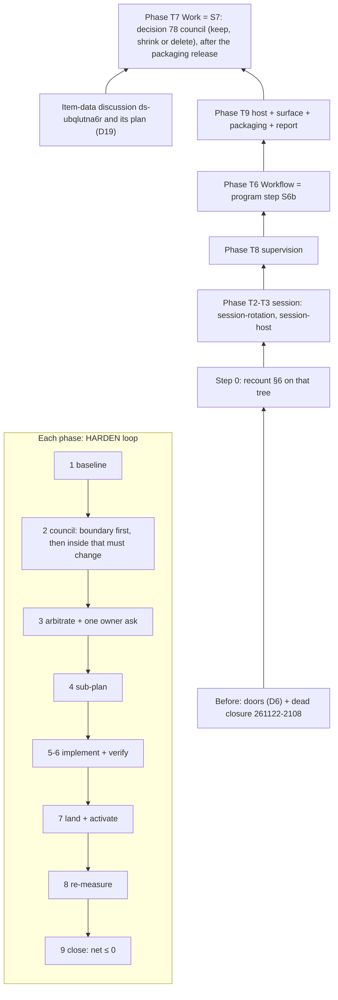

discussion: paused

Builds on discussion ds-wham5txfkv (Appendix A at commit 97a1fba58; §3, §4, §6).

Opened by the secretary for backlog row `plans/backlog/p-2qle2tjflb-harden-next-round-per-layer-loop-for-the-remaining-node-layers.md`.
This file is the source of truth for "HARDEN next round". Its seed was Appendix A of
`plans/discussions/ds-wham5txfkv-node-rust-port-inventory/DISCUSSION.md` (commit `97a1fba58`), which is now history.
This discussion must block neither `261121-2110-component-authority-doors` nor `261122-0118-heads-stable-and-able`. It enters
the supervision queue only once it is settled.

## Hand-off to the planner (draft; released only when the wait below clears)

- **Wait:** `261121-2110-component-authority-doors` and `261122-2108-delete-dead-node-execution-closure` have landed
  (D6, round 3b order). Before the hand-off, the §6 inventory is recomputed on that tree (§7 step 0).
- **Outcome:** one skeleton plan, "HARDEN next round", with one phase per layer in the D8 order. Each phase runs the
  HARDEN per-layer loop (D7) and opens its own sub-plan. When the last phase closes, every layer has a settled target
  shape in its spec, net size ≤ 0 or paid for, and no Node logic is left. No `legacy-cli` route and no `legacy-node`
  payload remain.
- **Constraints:** the loop of `261021-1118` "The per-layer loop", steps 1–9, with council weight set per component by the
  triage scan (N7) and step 7 on this machine only (N5): a council opens only after the
  layer below closes, and the owner is asked once per layer, in a batch. RUL104 (better, not bigger). L10 and design
  principles 1 and 8: a mechanism that moves takes every caller with it, its old path and tests go in the same change,
  and no twin is left. D1 holds inside each layer. Every sub-plan carries an Authority map (doors phase 5). Work (T7)
  goes last (D8), and opens only after discussion `ds-ubqlutna6r` (D19) has settled and its plan has landed.
- **Non-goals:** the domain-agnostic item component (D19, its own discussion `ds-ubqlutna6r`). T0, T1, T4 and T5 are not re-run; HARDEN closed them, and their Node facades go with their last caller
  (D1). The dead tier-5 closure belongs to `261122-2108`. No new feature (RUL104 "proposed additions" go to the owner per layer).
- **Acceptance per phase:** the HARDEN close conditions. Before/after table on the same machine and load class; no
  High-or-above finding left unreproduced; net Δ ≤ 0 or every increase names its paying deletion; doctor and smoke green
  on the activated release on this machine (the owner lands the other machines; mdview and mcp-skill-hub are out, N5); `npm test` and `cargo test --workspace` green.
- **Acceptance of the program:** every door row whose `retiredBy` names S6b or S7 is closed (D21); 56 → 0 `legacy-cli` routes in `packages/host-runtime/contracts/command-routes.json`;
  `git ls-files 'src/*.mjs' 'bin/*.mjs'` is empty; every HARDEN carry-over in §3 is closed or explicitly declined by the owner.
- **Sources:** `p-vwpnx4gpow`, `261021-1118` (plan, lessons, closing report §6–§7), D1, D6, D7–D9.

## 1. Trạng thái hiện tại

**Round 12 (2026-11-24 09:5x).** The owner chose N18 (a), minted as D24: a one-word severity on each door row. The owner then
asked whether repaying debt A1 of plan X means finishing X before moving on, or marking A1 done and moving to the next
debt, so that plans progress in parallel, debt by debt. The answer became N19, put to the owner in chat.

**Round 11 (2026-11-24 09:5x).** The owner asked whether the order of repayment is set by a debt's severity rather than by
its plan. The scout gave N18: no door row records severity today. The direction is put to the owner in chat.

**Round 10 (2026-11-24 09:5x).** The owner accepted N17 as proposed, minted as D23. Debt repayment is coordinated by the
secretary and the supervisor; no plan manages the debt. Still paused on O7. For the secretary, via the owner: (1) cut doors to
close after 12a, 12b and 12d, and move 12c into `261122-2108`; (2) run `261122-2108`; (3) a shaper for `ds-ubqlutna6r`;
(4) a small plan of its own for `p-nwife3i4kc`.

**Round 9 (2026-11-24 09:4x).** The owner asked who manages the debt once doors closes. The answer became N17: the ledger
belongs to the component-authority component (no plan), and each debt belongs to the plan its `retiredBy` names. The only gap
is two backlog rows with no plan. Put to the owner in chat: where those two go.

**Round 8 (2026-11-24 09:5x).** The owner accepted N16, minted as D22, and asked why Node-to-Rust looked so small. It is not.
The 15 named debts cover only jobs that have two doors (a Node twin beside a Rust owner). The whole Node payload is still
322 files and about 83k lines in `src/` and `bin/`, served by 56 `legacy-cli` routes. Most of it is a sole Node owner with no
Rust twin (for example `workflow`, `state`, `runner`, `verbs`, `report`, `setup`, `cli`), so it has no debt row and no debt
signal. The §6 inventory and the phases drive that bulk, measured by the program acceptance of 56 → 0 routes and an empty
`git ls-files 'src/*.mjs' 'bin/*.mjs'`. Still paused on O7.

**Round 7 (2026-11-24 09:4x).** The owner asked what `261122-2108` is, and how plans should be split and managed so that the
rest of doors does not drag on: retiring door debt should also trigger the matching Node-to-Rust move, since the named debt is
its own group yet carries the debt signal of many other plans. The scout gave N16; its direction is put to the owner in chat.

**Round 6 (2026-11-24 09:5x).** The owner accepted N12 and N13, minted as D20 and D21. Still paused on O7 (`261122-2108`
is `draft` and not running). No owner question is open. On resume, step 0 runs as written (§7).

**Round 5 (2026-11-24 09:37–09:4x). The owner moved the item-data topic out of this discussion (D19).** The domain-agnostic
item component becomes its own discussion, `ds-ubqlutna6r` (`plans/discussions/ds-ubqlutna6r-domain-agnostic-item-component/DISCUSSION.md`), and it must come before Work: phase T7 opens only
after that discussion is settled and its plan has landed. At the owner's order (09:4x), the details of N14 and N15 moved there
as its premise. Only pointer rows stay here. A shaper for it, and a backlog row of its own if one is wanted, are the
secretary's to arrange. The mailbox shows no live secretary head, so the owner passes this on to Miu. This discussion is still
paused on O7. No owner question is open here.

**Round 4 (2026-11-24 09:3x).** The owner chose N10 (a), minted D18. On N14 the owner confirmed the reading (split item
storage into its own domain-agnostic item component, apart from Work). The owner also flagged the sensitive part: Work already
had a way to store fields, properties, status and stage, plus a mapping that keeps it domain-agnostic. Scouted
`docs/platform/work-state/spec.md` §3, §5 and §6 and the portfolio vocabulary contract, which gave N15. Open in chat: the N15
direction (the item component starts from the portfolio model; Work's mapping stays with Workflow and the domains, and the item
component stores only a reference to it).

**Round 3 (2026-11-24 09:3x).** The owner accepted N11 (a), minted as D17: the order is T2–T3 → T8 → T6 → T9 → T7, and
§6 and §7 are regenerated to match. On N10 the owner asked two things. First, can Workflow and Work stay separate, with
Work held back until Workflow is complete, since Work might be removed entirely? Second, can Work's item management and
triage be split out into a domain-agnostic item-data component? Scouting gave two answers. First, T6 and T7 are already
separate phases with T7 last, so N10 (a) does not merge Workflow with Work. It only makes S6b the same thing as T6 and S7 the
same thing as T7, and if Work may be deleted, that is one more reason not to port S7 first. Second, most of the split already
exists (D-ADR0082, the `questions` component), but the model has gaps (N14). Open in chat: confirm N10 (a), and the N14 direction.

**Round 2 (2026-11-24 09:2x): the owner set a new portfolio order in the secretary's chat, and this discussion lines up with it.**
Source: `plans/reports/report-261124-0920-miu-phase12-overlap-excerpt.md` (`cb0a01b51`). The owner accepted option A for doors
(the named debt groups stay, each with its owner in `retiredBy`). The owner also set a rule: lower layers first, then the group
that keeps supervisor, orchestrator and day-to-day operation steady ("release con người" means being safe to step away).
Miu's order, which the owner called good: control-group bug rows first → doors 12a/12b/12d → `261122-2108` → S6b, then S7
→ HARDEN next round last. Miu also proposed two speeds: a concrete bug row goes through the normal fix flow plus HARDEN steps 1
and 6–9, and only a layer's structure (T2–T3, T8) gets the full loop. Four findings follow (N10–N13 in §3):
- **N10:** S6b and S7 of `261114-2051` are not separate from this discussion. They are phases T6 and T7 here (D7 made the
  remaining port run as the HARDEN loop). Miu's order lists them twice. Recommendation: one owner. S6b and S7 run as phases T6 and T7 of the
  skeleton, and the program rows point here. Changing `261114-2051` is the secretary's or a planner's job, not this file's.
- **N11 (provisional):** supervision (T8) moves up to just after T2–T3, ahead of T6. Its Node part imports no Workflow code,
  so bottom-up does not block it, and the owner's new rule puts the control group first. This amends D8. The owner can object.
- **N12:** the control-group bug rows land first. Phase T2–T3 takes its baseline after them and treats any row still open as an
  input. Miu's two speeds match N7: those bug rows are not council work.
- **N13:** under option A, 25 door rows name S6b or S7 in `retiredBy`. Closing them becomes part of the acceptance for phases
  T6, T7 and T9.
Still paused: the wait in O7 has not changed. No owner question is parked. N11 is put to the owner in chat, so if the
owner objects, the D8 order stays.

**Resume check 2026-11-24 09:1x: still paused, the wait has not cleared.** `fgos questions` shows no open owner question.
Doors (`261121-2110`) is `running`: phases 1–11 are done or withdrawn, 12a is running, 12b and 12d are ready, and 12c is
`draft`. 12c waits for `261122-2108` phase 8, so doors itself cannot close before the dead-closure plan. `261122-2108` is
still `draft`, and no session runs it. That plan is now the one thing step 0 waits on (O7). Two waits cleared:
`261122-0118` and `261123-0828` are both `done`. So O2 is closed, the T2–T3 sub-plan no longer waits on them (D12), and
`261122-2108`'s own rule against editing files that `261122-0118` still edits no longer holds it back. Nothing new to shape
before step 0. The question of who starts `261122-2108` belongs to the secretary, not to this discussion.

**Paused 2026-11-23 19:5x by owner order ("nếu xong rồi thì báo cáo rồi đóng").** Everything that can be shaped before step 0
is shaped. The owner decided seven points this session, minted as D11–D16 in §4. What is left needs a tree that does not exist
yet, so the discussion pauses instead of settling.

**Resume when** `261121-2110-component-authority-doors` (5 of 22 phases done at pause) and
`261122-2108-delete-dead-node-execution-closure` (`draft` at pause) have both landed (O7). Then this shaper runs step 0
(N1, D13, D15): it recounts the §6 inventory, runs the two H5 tests, fills the council-weight column and builds the system-wide
job → doors map on the component-authority model. It mints N1, N4 and N6 if they hold, marks the discussion settled, and the
hand-off block goes to a planner. No owner question is open.

**Seen in passing, not this discussion's to fix:** the body of `261122-2108` still says its `blockedBy` enforces waiting for
`261122-0118`, but its frontmatter now lists only `261118-1341-s6a-execution-tier-rust` (done). That constraint text is stale
since the owner dropped the heads-stable wait (D6 round 3b).

**Round 1b (2026-11-23 19:23–19:4x): the frame is now Appendix A.** The owner pointed to the seed: Appendix A of ds-wham5txfkv,
landed in `97a1fba58` after round 1 had read that file (315 lines then, 415 now). The draft path named in the backlog row is a
scratchpad on the owner's host that this confined head cannot see (its `/tmp` is a private tmpfs). The draft was never lost.
Per the owner's order, Appendix A is copied in as the frame: the hand-off draft, §2, the §6 shape and §7. §3 carries H1–H7, C5 and
O1–O6 from ds-wham5txfkv, §4 carries D1 and D6–D10, and §6 carries the inventory, which step 0 recounts (D9). From now on this
file is the original.

Round 1's own findings stay as new rows N1–N6 in §3. Two of them differed from the seed; at 19:4x the owner took both proposals,
and they replace the seed on these points:

- **N2 (replaces the seed's phase T2–T3 entry).** Phase T2–T3's read-only steps 1–3 run without waiting for `261122-0118` and
  `261123-0828`; only its sub-plan waits for them to land.
- **N3 (replaces the seed's "H7 hook arm" in T9).** `git/main-checkout-delete-guard.mjs` goes to phase T2–T3. The Rust Git crate
  already judges the main checkout (`main_checkout_root`, `packages/git/rust/src/lib.rs:40`), and the `hook` route already has
  native subcommands, so the move is cheap there. The council of that phase settles which component is the authority for the verdict.

At 19:34 the owner ordered a triage scan that decides which components need a council (N7, in step 0). At 19:4x the owner set the
council's first priority: component authority, contracts and one door. At 19:39 the owner made clear the inside is not skipped:
what the scan finds that must change is changed in the same phase; only optional optimisation may wait (N8). The scan therefore
judges the boundary from the component-authority model, not the size of the code. The one-door check runs once over the whole
system, not per layer (N9).
No owner question is open. The owner answered N5 at 19:3x: step 7 lands and activates on this machine only; the owner lands
the other machines himself, and mdview and mcp-skill-hub leave the list.
The hand-off still waits on doors and `261122-2108` (O7), and `261122-2108` is still `draft`.

**Round 1 (2026-11-23 19:16–19:2x).** Start ritual: no open owner question. Scouted the HARDEN plan (its loop and decision 78),
the root closing report §1 and §5–§7, the component model and the footprints of the running plans. The findings became N1–N6.

## 2. Mục tiêu & đề bài

HARDEN (`261021-1118`, closed 2026-11-18) ran a per-layer closed loop from T0 to T9. It moved each layer's decisions into
Rust and shrank Node to thin clients. It finished T0–T5 and T8 as intended. T6 Workflow was hardened inside Node (Node +44,
tests +695, decision 73). T9 closed with misses (Node +2,136, entry still 211 modules, doctor 15 s against 12 s). Packaging
closed with 14 MUST fails open, each with an owner. T7 Work was never started: decision 78 holds a council first, and the
owner's option B of 2026-11-18 puts Work after the packaging release. Since then, session-host and session-rotation (T2–T3)
were written in Node, and 56 of 86 verbs still run through the Node payload. The owner wants the same loop applied to every
layer that is not finished, bottom-up, Work last. The result should be layers that are settled, smaller and measured, with Node retired along the way,
not a line-by-line translation. Backlog `p-vwpnx4gpow` asked for the Node inventory; that inventory (§6) now becomes the
measured input to each layer's step 1 instead of a list of port plans.

## 3. Vấn đề rõ / chưa rõ

Rows O1–O6, H1–H7 and C5 are copied from ds-wham5txfkv §3 as they stood at `97a1fba58`, with their states as of that file.
This discussion edits them in place from here on. O7, the N rows and F1 are new here.

| # | Point | State | Evidence / note |
|---|---|---|---|
| O1 | S7 entry gate "Work council (decision 78) held". Decision 78 belongs to `261021-1118` (lessons.md:13, :104, :152): the Work council opens after T8 and the non-Work T9 arms. Both are closed, but no council has been held. | open, blocks only plans 5–7 → D5 | `plans/261021-1118-harden-low-layers-bottom-up/plan.md` closedNote |
| O2 | `session-host` / `session-rotation` are being edited now by `261122-0118` (running) and `261123-0828` (ready) | closed 2026-11-24: both plans are `done` | plan frontmatter read 2026-11-24 |
| O3 | `src/util/yaml.mjs`: a facade over `fgos-yaml-doc` with 28 product importers; `261121-2110` does not retire it (plan.md:219–222) | clear: facade, dies in plan 10 | file header; importer count |
| O4 | Test counts in §6 are "test files that import the area", so a test can count under several areas. Backlog says 588 test files in all. | clear (method stated) | scratchpad script, method in §5 |
| O5 | Logic leaves inside facade areas: `util/domain-compile.mjs` → plan 1; `git/main-checkout-delete-guard.mjs` → S1; `identity/directory-store.mjs` is dead (no product importer) → plan 1 | clear | round 2 file-by-file header read |
| O6 | Owner, 16:2x: does component authority have a warn-only versus blocking switch? Today: no setting. `debt` entries act as a visible "known, not yet fixed" list (no failure, but a stale entry fails). Doors phase 10 removes `debt`, after which any match outside allowed files turns `npm test` red. The phase 5 plan gate is a reviewer reject, inactive only when a project has no model. A switch would be a new config key (`core/config-standard`, `core/config-schema`) and a change to the doors plan | closed 16:32: owner needs no switch; `debt` already serves as the warn list | `docs/platform/component-authority/spec.md` §4; doors `phase-10-land-checks.md`, `phase-05-*.md` |
| H1 | **T6 carry-over:** hardened in Node (Node +44, tests +695, decision 73); no Workflow crate; Workflow doctor rows on the bridge (`bridge:S6b`) | input to "HARDEN next round" | `plans/reports/closing-261118-1344-harden-root-closing.md` §1, §6 |
| H2 | **T9 carry-over:** entry loads 211 modules; doctor 15 s vs 12 s; Node +2,136. H9b: echo fixture in the host-runtime crate. H9c: tautological admission gate (`p-ltwb2h3k6s`). Node `version` arm (`command-registry.mjs:140`). First-run text in three places. `findExecutableOnPath` plus four PATH walkers. Did-you-mean third copy (`p-xtawpgzvjy`). Doctor row catalog held twice (`p-pvs4go2qei`). H11: canonical-JSON producer twin, declined in code. | input | closing report §2, §3 |
| H3 | **Packaging carry-over:** 14 MUST fails open at close (each has a closer). `is_store_entry_name` missing. The `setup` pieces of D2. `doctor-bridge.mjs` goes with the last bridged row. | input | closing report §6, §3 |
| H4 | **Ledger rows without receiver closure:** H3, H12 (`forgentx-5f` does not run), H22, H23 (WORK), and H9–H13, H17, H24 (self-recorded) | input | closing report §4 |
| H5 | **Two reds at HARDEN close:** a stale `workflow start --plan` test and stale instruction projections. Not rechecked here. | input | closing report §5 |
| H6 | **New since HARDEN:** session-host (7 files, 2,127 lines) and session-rotation (2 files, 811 lines) are Node and never went through a council | input | §6 rows 10, 13 |
| H7 | **S1 hook verdicts** (`git/main-checkout-delete-guard.mjs`, `state/decision-question.mjs`, `runner/hook.mjs`): which layer phase owns them | input | program `261114-2051` row S1 |
| C5 | The T8 tier name in `layers.json` ("Skill and Domain (no file today)") is stale: the model puts `supervision` at tier 8 and the domains at T7 | input | `layers.json`, `components.json` |
| O7 | `261122-2108` is `draft`, and its own rule waits for `261122-0118` ("no edit to any file `261122-0118` still edits before it lands"). Step 0 and the hand-off therefore hang on two plans that are not this discussion's to move. | open, blocks step 0 and the hand-off. 2026-11-24: `261122-0118` is `done`, so only `261122-2108` itself (still `draft`, not run by anyone) blocks; doors phase 12c also waits for its phase 8 | `plans/261122-2108-delete-dead-node-execution-closure/plan.md` frontmatter and constraints; doors plan.md phase table |
| N1 | Step 0 is one read-only pass. It reruns the ds-wham5txfkv §5 inventory method on the tree after doors and `261122-2108`, runs the two H5 tests alone, and names the owning phase for every §6 row and every H or C carry-over. It writes one report and changes no code. | provisional (round 1) | D9; seed §7 step 0; HARDEN loop step 1 |
| N2 | Phase T2–T3's steps 1–3 (baseline, council, arbitration, owner ask) are read-only, so they may run while `261122-0118` and `261123-0828` still hold session files. Only its sub-plan (step 4) waits for them to land. | minted D12 | owner 2026-11-23 16:24, "nobody waits on a head that is away"; `261122-0118` footprint `src/session-host/head-grants.mjs` and its tests |
| N3 | Which phase owns `git/main-checkout-delete-guard.mjs` (505 lines of logic, tier 2): the seed's T9 "H7 hook arm", or phase T2–T3 as its tier suggests. S1's other two verdicts (`state/decision-question.mjs`, `runner/hook.mjs`) are T7 code and go with phase T7. **Answer: phase T2–T3**, because the Rust Git crate already exports `main_checkout_root` (`packages/git/rust/src/lib.rs:40`) and the `hook` route already serves native subcommands (`dispatch-decide`, `mailbox`, …) in `command-routes.json`. The phase's council settles the verdict's authority component. | minted D12 | seed §7 T9; ds-wham5txfkv O5 and H7; `components.yaml` tier 2 `git`; `packages/git/rust/src/lib.rs:40`; `packages/host-runtime/contracts/command-routes.json` `hook` |
| N4 | "T8" in D8 is the `supervision` component (`src/portfolio`, 1 file of 19 lines, plus `packages/portfolio/*.mjs`). Skill/Domain closed under HARDEN on 2026-11-09 and is not reopened. With so little code, its council is one shared seat round. | provisional (round 1) | `components.yaml` tier 8; closing report §6 row T8 |
| N5 | HARDEN step 7 lands "on the three workspaces on the owner machine (forgentX, mdview, mcp-skill-hub) and on the second machine". That list dates from 2026-10-21. Which machines and workspaces run fgOS today? **Owner answer:** each phase's step 7 lands, activates, runs doctor and smokes on this machine (`~/projects/forgent`) first; the owner lands the other machines himself; mdview and mcp-skill-hub are dropped from the list. | minted D11 | HARDEN plan "The per-layer loop" step 7; owner chat 19:3x |
| N7 | **Triage scan before any council (owner orders 19:34 and 19:4x).** Step 0 adds one column to the recounted inventory: council weight per component, with its reason. Each layer's step 1 rechecks only its own rows. The scan reads the component-authority model (`components.yaml` owns, mustNotOwn, status and exceptions; `contracts.yaml`; `decision-kinds.yaml`; `doors/`) and the source, and judges the boundary, not the size of the code. **Full** (a council on that component): its authority, contracts or door are not sound. Signs: status still `designed`, per-file layer exceptions, a contract whose evidence still points at Node, door debt, a sign of a `mustNotOwn` breach, or the same job done through more than one door (a Node and a Rust twin, several walkers or copies, as in H2). T7 Work is always full (decision 78). **Light** (no council, an ordinary sub-plan): the boundary is sound and only inside work remains (deleting, thinning). **Skip**: a facade or thin client over a Rust owner, or dead code, deleted with its last caller (D1). The scan decides by these rules without asking; its table rides in the layer's one batched owner ask, where the owner can override a row. Example: `session-host` has status `designed` and four per-file layer exceptions (`head-start`, `head-request`, `head-stop` at tier 5, `head-grants` kernel), so it is full. | provisional minted D13 | owner chat 19:34 "cần có 1 bước quét để quyết định chổ nào cần council, không thì phí", 19:4x (N8); `packages/component-authority/model/components.yaml` session-host row |
| N8 | **The council's first priority is the boundary: authority, contracts and one door.** Per component it decides what it is the authority for (and must not own), its contracts and ports, its Rust/Node boundary, that each job has exactly one door, and the delete list that follows. The settled shape is written into the component's spec and the model. The boundary is settled before anything else. The inside is still done, not skipped: when the scan or the council finds something inside that must change (a bug, a High finding, a correctness or stability problem, dead code, a twin), it goes into the same phase's sub-plan and is changed. What the boundary-first rule lets wait is only optional inside optimisation, which can happen freely later once the boundary is right. The close conditions (net Δ ≤ 0, no High left unreproduced) still hold. | provisional minted D14 | owner chat 19:4x "council chủ yếu với anh sẽ ưu tiên về component-authority và contracts … tối ưu bên trong kiểu gì cũng được", "à thêm là 1 cửa"; design principle 1 |
| N9 | **The one-door check is system-wide, never per layer.** HARDEN's earlier one-door search looked only inside the layer being worked, so two doors for one job in different layers slipped through (a Rust crate at T2 and a Node PATH walker at T9, as in H2). Step 0 runs one scan over the whole repo, Node and Rust (`src`, `bin`, `scripts`, `apps`, `packages`, hooks), and writes one map: job → every door that does it. For each job with more than one door, the door kept is the one in the lowest layer that needs it (design principle 2), and each extra door is assigned to the phase holding it for deletion. Every layer's council reads this map instead of searching its own layer; each layer's close refreshes the map so a door added meanwhile is caught. **The map is built on the component-authority model**, which is why doors goes first (D6, D9): the jobs come from the model (`owns`, `mustNotOwn`, `decision-kinds.yaml`, `contracts.yaml`, `doors/`, looked up with `fgos locate`); a source search only finds extra doors outside it. A job the model lacks is not added here; it goes to the model's owner first, and councils use it once it is in the model. | minted D15 | owner chat 19:4x "lần dò 1 cửa trước đây là dò cục bộ trong tầng đang làm, trong khi một cửa là xuyên suốt hệ thống"; design principles 1 and 2 |
| N6 | H5's first red looks resolved: `test/cli/fgos-workflow.test.mjs` no longer names `--plan` (commit `0a3f46ac5`, 2026-11-18). The instruction-projections red was not rechecked. Step 0 confirms both. | first likely resolved; second not rechecked | `git log` on both test files |
| N10 | **S6b and S7 = phases T6 and T7** (minted D18). Program `261114-2051` still lists S6b (Workflow) and S7 (Work) as its own steps. D7 made the remaining port of those layers run as the HARDEN loop, and ds-wham5txfkv D4 had already mapped them (inventory rows 16–19 "= S6b", "= S7"). Miu's order, "S6b → S7, then HARDEN next round", counts the same work twice. If S6b and S7 ran first as plain ports, that would undo D7 and run T7 ahead of T8 and T9 against D8. **Answer:** one owner. The skeleton's phases T6 and T7 are S6b and S7, with S1's T7 verdicts in T7. The program rows should point to this skeleton; that edit goes to the secretary or a planner. | follows from D7 and D8; tell the secretary | `plans/261114-2051-rust-verb-migration-program/plan.md:64,83-84`; ds-wham5txfkv §6 rows 16–19; excerpt 01:56, 01:58 |
| N11 | **T8 supervision moves up to just after T2–T3** (new order: T2–T3 → T8 → T6 → T9 → T7). The owner's rule of 2026-11-24 01:57 puts the control group (supervisor, orchestrator, operations) right after the lower layers. The Node part of supervision (`src/portfolio/plan-sections.mjs`, `packages/portfolio/*.mjs`) imports only `util` leaves, never Workflow, so nothing below it in T6 has to close first. Its council is small (N4). This amends D8. | provisional (round 2); owner may object in chat | `components.yaml` supervision row (tier 8, owns orchestration and plan lane pool); imports of `src/portfolio`, `packages/portfolio`; excerpt 01:57, 01:59 |
| N12 | **Control-group bug rows go first, on the fast track** (`p-fel4zoytbn`, `p-kghvlvmj6s`, `p-auypprszfz`, `p-kqs6fjalvh`, `p-vwaujnak4j`, `p-gfdhojihyf`, `p-uqanurjt42`, `p-btxvtb34u3`, `p-kihregmfxm`, `p-g3btj3bpqc`, per Miu's list; minted D20). They are not this skeleton's work. Phase T2–T3 takes its baseline (step 1) after they land; a row still open then is an input to its tables (D14). Miu's two speeds (a bug row runs the fix flow plus steps 1 and 6–9; a layer's structure runs the full loop) agree with N7 and need no change here. | minted D20 | excerpt 01:58, 02:00; Miu's row list is unverified |
| N13 | **Option A's named debt is an acceptance input.** 25 door rows in `packages/component-authority/model/doors/` name S6b or S7 in `retiredBy` (for example `doctor-readiness-registry`, `node-rows-bridge`, `resolve-invocation-root`, `parse-cli-arguments`, `global-fgos-directory`). Step 0 assigns each one to phase T6, T7 or T9, and the program's acceptance adds "every door row whose `retiredBy` names S6b or S7 is closed". | minted D21 | `grep -lE '^retiredBy:.*\b(S7\|S6b)\b' packages/component-authority/model/doors/*.yaml` = 25; excerpt 01:50 |
| N14 | A domain-agnostic item-data component, apart from Work. | moved out (D19) | details and evidence now in `plans/discussions/ds-ubqlutna6r-domain-agnostic-item-component/DISCUSSION.md` §3 row I1 |
| N15 | The sensitive part: two item models and Work's mapping layer. | moved out (D19) | details and evidence now in `plans/discussions/ds-ubqlutna6r-domain-agnostic-item-component/DISCUSSION.md` §3 row I2 |
| N16 | **Debt as the signal that drives the Node-to-Rust plans.** Today `NAMED_DOOR_DEBT` (`test/architecture.test.mjs`) holds 15 jobs, and each door row's `retiredBy` names who retires it, as free text. By retirer: `261122-2108` (`p-24xw2cwdvo`) holds 5 (decide a dispatch, derive executor facts, list run directories, `/proc` process facts, tool lookup by capability), and doors 12c's write-scope rule sits inside its footprint (`src/runner/dispatch/**`). S7 holds 3 (doctor readiness registry, global fgOS directory, resolve invocation root). Two have their own backlog rows (`p-rypvkc3kai` herdr shim, `p-nwife3i4kc` checkout crate). Doors 12 holds 2 (kernel lock in 12a, bounded child in 12b). Three name no plan, only a condition (no Node from the native packaging verbs, process-control signal, the write-scope rule). **Proposed shape:** (1) doors closes after 12a, 12b and 12d (the internal Rust debt; option A keeps the rest named with an owner). (2) 12c moves into `261122-2108`, which already deletes the files 12c needs gone, so that plan carries its own debt; it is tier 5 (a low layer) and the next plan to run. (3) Each named debt's `retiredBy` names exactly one plan, phase or backlog id, so one query lists which plan holds which debt. The three conditions get an owner: the packaging row → phase T9, process-control signal → each phase that moves a spawner, the write-scope rule → `261122-2108`. (4) The owning plan's acceptance includes closing its rows (D21 extended to every retirer), and the debt count per plan is the signal for which Node-to-Rust plan to pick next, under the order rule (lower layers, then the control group). The edits to doors and `261122-2108` belong to the secretary and a planner. | minted D22 | `test/architecture.test.mjs` `NAMED_DOOR_DEBT`; `packages/component-authority/model/doors/*.yaml` `retiredBy`; doors plan.md phases 12a–12d; `261122-2108` plan.md acceptance 4 |
| N17 | **Who manages the debt after doors closes.** The ledger itself (`NAMED_DOOR_DEBT`, the door rows, the guard in `test/architecture.test.mjs`) needs no plan. It is owned for good by the `component-authority` component (its spec and model): the guard stays red when a new twin appears and when a listed debt goes stale. After 12a (kernel lock) and 12b (bounded child), 13 debts remain, each owned through `retiredBy` (D22). `261122-2108` holds 6 (its 5, plus the write-scope rule from 12c). This skeleton holds 5: the 3 S7 rows go to phase T7 or T9 (D21), the packaging row to phase T9, and the process-control signal to each phase that moves a spawner. Two backlog rows have **no plan**: `p-nwife3i4kc` (checkout crate, P1, git, tier 2) and `p-rypvkc3kai` (herdr shim, P3, terminal-control/installation, tier 2). **Options:** (a) fold both into phase T2–T3, whose tier they share (it already took the git delete guard, D12), so the skeleton is the one owner of every debt outside `261122-2108`; the cost is that the P1 checkout row waits for step 0. (b) Keep them as standalone rows with small plans of their own, run when the secretary orders them; the cost is two more owners. Recommendation: (b) for `p-nwife3i4kc` (P1, Rust-only, does not need step 0) and (a) for `p-rypvkc3kai`. Who watches the count: the secretary and the supervisor read it when choosing the next plan; no new verb (RUL104). | minted D23 | `NAMED_DOOR_DEBT`; door rows `retiredBy`; `plans/backlog/p-nwife3i4kc-*.md`, `plans/backlog/p-rypvkc3kai-*.md` frontmatter |
| N18 | **Repayment order by severity.** Door rows carry `job, kind, patterns, allowed, reason`, often `debt` and `retiredBy`, and a few `names`; none records severity, and the component-authority spec has no such term. Severity can be judged from facts a row already states: **high**, a live twin that decides a live answer which can disagree (for example `checkout-make-provision-remove`, four live Node copies of worktree make and remove; `resolve-invocation-root`, which project and `.fgos` a call acts on); **medium**, a live Node side that only asks the Rust owner (for example `global-fgos-directory`, a facade over the addon); **low**, a twin reached only by dead code (the 5 rows of `261122-2108`). A debt is repaid by its owning plan's work, so severity picks which plan or row to pull forward, and a high debt may get a targeted fix ahead of its layer phase (as `p-nwife3i4kc`, D23). **Proposed order:** severity first, then the owner's order rule (lower layers, then the control group). One exception: a plan that unblocks other work may jump (`261122-2108` has low-severity debt but blocks doors 12c and step 0). **Open:** record severity as a one-word field on each door row, set once by the component-authority model's owner and readable by query; or let the secretary and the supervisor judge it from `reason` each time they choose. | minted D24 | `packages/component-authority/model/doors/*.yaml` field census (83 rows: no severity); door rows named |
| N19 | **Debt by debt, or plan by plan.** Facts: progress is already counted per debt, since the guard drops one entry from `NAMED_DOOR_DEBT` and the row's `allowed` list when that twin goes. But a debt is rarely repaid alone. Removing a twin moves the mechanism with every caller and deletes the old path in the same change (L10, design principle 1). Inside a HARDEN layer, the council settles the boundary first (D14), so a debt repaid before its layer's council may be moved into a shape the council then changes. That is rework, the same reason as D18. Plan by plan delays a high debt in plan Y behind every low debt in plan X. Debt by debt across plans leaves many half-open plans, overlapping files and baselines no one can close (net Δ is measured at a layer's close). **Proposed rule:** the unit of work is a phase, not a debt and not a whole plan. (1) A debt whose surviving door already exists and is settled (Rust owner live, no boundary question) may be repaid alone, ahead of its plan, in a small phase or row of its own. It is picked by severity, and it runs beside other work when files do not overlap. Example: `p-nwife3i4kc`. (2) A debt whose fix depends on a boundary not yet settled waits for its layer phase. Inside that phase, the sub-plan orders its own debts by severity. (3) Layer phases still go one at a time (D8, D17); a phase, once started, closes before the next layer opens. (4) Each debt is marked done when its guard entry goes, whichever phase repaid it. | proposed (round 12), put to the owner | `test/architecture.test.mjs` guard; L10; D14; D17; D18; D23 |
| F1 | Model tiers today: T2 `git`, `terminal-control`, `session-rotation`; T3 `session-host`; T5 `seat-binding`, `execution-core`, `dispatch-transport`; T6 `workflow`, `work-driver`; T7 `work-state`, `runner`; T8 `supervision`; T9 `packaging-distribution`, `host-surface`, `learning-docs-registry`. The model is YAML now (doors 1b has landed). | clear | `packages/component-authority/model/components.yaml`, `layers.yaml` |

## 4. Quyết định đã chốt

Copied from ds-wham5txfkv §4. They are owner decisions made there and are not reopened here. A D-ID new to this discussion starts after D10.

| D-ID | Decision | Rounds held | Source |
|---|---|---|---|
| D1 | A facade, client, Node-process adapter or golden-vector twin over a Rust crate gets no plan. It is deleted inside the plan that removes its last Node caller, and §6 names that plan. | 2 | L10, design principle 1; round 2 file-by-file check |
| D6 | Owner chose option (a) on 2026-11-23 16:3x: doors phase 10 locks every door except the named debt of 2f (and 2g while `p-rypvkc3kai` is open), `retiredBy` the Workflow/Work port. Doors closes before the port, and this discussion is redone after doors and `261122-2108` land (§1 round 3b, step 4). | owner answer | chat 16:3x "ok, đồng ý phương án a" |
| D7 | The remaining work is not a plain port. Each unfinished layer runs the HARDEN per-layer loop of `261021-1118` (steps 1–9). Those steps are: baseline; a two-part council producing the migration table, delete list, doctor table and tests table; arbitration; one batched owner ask; a sub-plan with a delete list and tests to retire; independent verify; land and activate; re-measure; close at net Δ ≤ 0. Moving Node to Rust is one column of the migration table. **Supersedes D3 and D4.** | owner answer | chat 16:38 "nó không phải là một porting đơn thuần"; 16:44 "ok đồng ý" |
| D8 | Layer order, bottom-up, with a council opening only after the layer below closes: T2–T3 session → T6 Workflow → T8 supervision → T9 host, surface, packaging and report → T7 Work last (decision 78 council, after the packaging release per option B). **Supersedes D2's "packaging first" (packaging folds into T9) and D5's plan numbering.** Decision 78 stands. | owner answer | chat 16:38 "anh vẫn muốn delay Work lại sau cùng"; 16:44 "ok đồng ý" |
| D9 | The §6 inventory is the input to each layer's baseline (step 1), not a list of plans. It is recounted after doors and `261122-2108` land. | follows from D7 | round 4 |
| D10 | This discussion closes as the inventory. "HARDEN next round" is a new discussion with its own backlog row. T7 Work gets its own discussion when it opens. No other layer gets a separate discussion, because its council is its design round, as in HARDEN. | owner answer | chat 16:5x "anh đồng ý" |
| D11 | Each phase's step 7 lands, activates, runs doctor and smokes on this machine; the owner lands the other machines; mdview and mcp-skill-hub are out. | owner answer | N5; chat 19:3x |
| D12 | Phase T2–T3's read-only steps 1–3 run without waiting for `261122-0118` and `261123-0828`; only its sub-plan waits for them to land. The main-checkout delete guard (`src/git/main-checkout-delete-guard.mjs`) belongs to phase T2–T3. | owner answer | N2, N3; chat 19:4x "N2, N3 theo đề nghị" |
| D13 | A triage scan in step 0 sets each component's council weight (full, light, skip) by the soundness of its boundary in the component-authority model, not by code size; each layer's step 1 rechecks its own rows; the owner can override a row in the layer's batched ask. Amends D7's "loop unchanged". | owner answer | N7; chat 19:34 |
| D14 | The council's first priority is the boundary: authority, contracts and one door. Inside changes the scan or council finds necessary are made in the same phase; only optional optimisation may wait. Amends D7's council step. | owner answer | N8; chat 19:4x, 19:39 |
| D15 | The one-door check is system-wide: step 0 builds one job → doors map over the whole repo on the component-authority model, every council reads it, each layer close refreshes it; a job the model lacks goes to the model's owner first. This is why doors goes first. | owner answer | N9; chat 19:4x, 19:5x |
| D17 | Order of phases: T2–T3 → T8 supervision → T6 Workflow → T9 → T7 Work last. Supervision has no code dependency on Workflow, and the owner's rule of 2026-11-24 puts the control group right after the lower layers. Amends D8. | owner answer | N11; chat 09:2x "N11 đồng ý (a)" |
| D18 | Program steps S6b and S7 of `261114-2051` are phases T6 and T7 of this skeleton, with one owner. Workflow and Work stay separate phases, and Work stays last; phase T7 opens with keep, shrink or delete Work. The secretary or a planner points the program rows here. | owner answer | N10; chat 09:31 "N10 chọn (a)" |
| D19 | The domain-agnostic item component (items, fields, statuses, a step reference, triage; split from Work) is shaped in its own discussion, `ds-ubqlutna6r`, not here. It must come before Work: phase T7 opens only after that discussion is settled and its plan has landed. N14 and N15 moved there as its premise. | owner answer | chat 09:37 "thôi tách việc này thành 1 discussion riêng phải làm trước Work"; 09:4x "move các chi tiết liên quan làm tiền đề cho thảo luận đó" |
| D20 | The control-group bug rows (N12's list) go first, on the fast track (the fix flow plus HARDEN steps 1 and 6–9), outside this skeleton. Phase T2–T3 takes its baseline after they land; a row still open then becomes an input to its tables. | owner answer | N12; chat 09:5x "đồng ý N12 và N13" |
| D21 | The 25 door rows whose `retiredBy` names S6b or S7 are part of the acceptance. Step 0 assigns each to phase T6, T7 or T9, and the program closes only when all of them are closed. | owner answer | N13; chat 09:5x |
| D22 | Debt drives the twin part of Node-to-Rust: doors closes after 12a, 12b and 12d; 12c moves into `261122-2108`; every named debt's `retiredBy` names one plan, phase or backlog id (packaging → T9, process-control signal → the phase that moves each spawner, write-scope rule → `261122-2108`); each owning plan's acceptance closes its rows, and the debt count per plan helps choose the next plan under the order rule. The debt signal covers only twins. The bulk of the Node payload (sole Node owners, no Rust twin) is driven by the §6 inventory and the phases, measured by 56 → 0 `legacy-cli` routes. The doors and `261122-2108` edits go to the secretary and a planner. | owner answer | N16; chat 09:5x "đồng ý N16" |
| D23 | After doors closes, no plan manages the debt. The ledger and guard belong to the `component-authority` component; each debt belongs to the plan its `retiredBy` names; the secretary and the supervisor coordinate repayment by reading the debt per plan, with no new verb. `p-nwife3i4kc` (checkout crate, P1) gets a small plan of its own and does not wait for step 0; `p-rypvkc3kai` (herdr shim, P3) folds into phase T2–T3. | owner answer | N17; chat 09:5x "đồng ý N17 theo đề nghị của em … điều phối trả nợ là miu và supervisor, không cần plan quản" |
| D24 | Each door row records a one-word severity (high: a live twin deciding a live answer that can disagree; medium: a live Node side that only asks the Rust owner; low: a twin reached only by dead code). The model's owner sets it once, and anyone can read it by query. Repayment order: severity first, then the owner's order rule; a plan that unblocks other work may jump. The field is a small change to the component-authority model contract, owned by that component. | owner answer | N18; chat 09:52 "đồng ý N18 chọn (a)" |
| D16 | Appendix A of ds-wham5txfkv (`97a1fba58`) is history; this discussion is the source of truth for "HARDEN next round". | owner answer | chat 19:23 |

## 5. Q&A log

- **2026-11-23 19:16 — round 1, start ritual.** `fgos questions` showed none open. Read backlog row `p-2qle2tjflb`.
- **2026-11-23 19:1x — owner:** "em có đọc được bản nháp phiên trước để lại không". Answer: not at the scratchpad path. It was first
  reported as lost, then corrected: this head's `/tmp` is a private tmpfs, so the host scratchpad is out of view, not gone.
- **2026-11-23 19:2x — round 1, scout.** Read the HARDEN plan (goal, scope, phases, loop, decision 78), the root closing report §1
  and §5–§7, `components.yaml`, `layers.yaml`, and the frontmatter of doors, heads-stable, `261122-2108` and `261123-0828`. Result:
  N1–N6. The round 1 file was written, but its land (ticket `c-2902-1795436317115`) produced no commit.
- **2026-11-23 19:23 — owner:** the draft is Appendix A of ds-wham5txfkv (line 317 on, `97a1fba58`). Copy it in as the frame, and
  take §3 (H1–H7, C5, O1–O6), §4 (D1, D6–D10) and §6 from that file. From then on this discussion is the original. Done in round 1b.
- **2026-11-23 19:3x — round 1b land.** Three `fgos land --paths` tries (tickets `c-2902-…`, `c-5233-…`, `c-5842-…`) failed
  `merge-slot-busy`; this head's grant has no `fgos slots`, so the holder was not seen.
- **2026-11-23 19:3x — owner (N5):** "em cứ land máy này trước đi, anh sẽ tự land các máy khác, loại mdview và mcp-skill ra".
  Step 7 lands on this machine; the owner lands the others; mdview and mcp-skill-hub are dropped.
- **2026-11-23 19:3x — owner:** "vòng lặp 9 bước này có quá nặng nề không?" Answer: HARDEN's layers took 1 to 5 days each, with
  one owner ask per layer. The weight comes from four-seat councils on small layers (T8) and multi-machine landing (gone with N5).
  Keep the outputs; scale the council to the layer's size.
- **2026-11-23 19:34 — owner:** "cần có 1 bước quét để quyết định chổ nào cần council, không thì phí". Recorded as N7 with three
  weights (skip, light, full), decided by rule in step 0, overridable in the layer's batched ask.
- **2026-11-23 19:4x — owner:** "council chủ yếu với anh sẽ ưu tiên về component-authority và contracts. với anh tốt chổ này thì
  sau này tối ưu bên trong kiểu gì cũng được", then "à thêm là 1 cửa". Recorded as N8. N7's weights now judge authority, contracts
  and one door from the model instead of code size.
- **2026-11-23 19:4x — owner:** "lưu ý: lần dò 1 cửa trước đây là dò cục bộ trong tầng đang làm, trong khi một cửa là xuyên suốt hệ
  thống". Recorded as N9: one system-wide job → doors map built in step 0, read by every council, refreshed at each layer close.
- **2026-11-23 19:5x — owner:** "một cửa là thứ quan trọng nên đó là lý do anh muốn component-authority phải xong trước". N9 now
  builds the map on the component-authority model (jobs from the model, `fgos locate`); a job the model lacks goes to its owner first.
- **2026-11-23 19:39 — owner:** "cần làm rõ N8 là ưu tiên: chốt ranh giới: authority, contract và một cửa. bên trong không phải là
  không làm, nếu lúc quét phát hiện phải đổi thì nên đổi chứ." N8 reworded: the boundary is the first priority, not the only
  scope; inside changes the scan or council finds necessary are made in the same phase; only optional optimisation may wait.
- **2026-11-23 19:4x — owner:** "N2, N3 theo đề nghị. O7 là gì". N2 accepted. N3: the condition set in chat was checked (the Rust
  Git crate exports `main_checkout_root`; the `hook` route already has native subcommands), so the delete guard goes to phase
  T2–T3. O7 explained in chat.
- **2026-11-23 19:56 — owner:** "nếu xong rồi thì báo cáo rồi đóng". Step 0 cannot run before doors and `261122-2108` land, so the
  discussion pauses rather than settles. The owner's decisions N2, N3, N5, N7, N8, N9 and the Appendix A hand-over were minted D11–D16.
- **2026-11-24 09:1x — resume check.** No open owner question. Doors is running (12a), its 12c waits for `261122-2108` phase 8;
  `261122-2108` is still `draft`. `261122-0118` and `261123-0828` are `done`, so O2 closed and O7 narrowed to `261122-2108`
  alone. Still paused.
- **2026-11-24 09:18 — owner:** "đây là thảo luận đang dang dở, em đọc trước: plans/reports/report-261124-0920-miu-phase12-overlap-excerpt.md (cb0a01b51)".
  Read it, then checked it against `261114-2051` (S6b and S7 rows), `components.yaml` (supervision) and the door model (25 rows
  retired by S6b or S7). Result: N10–N13. N11 (T8 ahead of T6) put to the owner in chat; still paused on O7.
- **2026-11-24 09:23 — owner:** "đúng rồi dựa vào tín hiệu ở phase 12 để xử lý các plan liên quan node-to-rust, ưu tiên là tầng
  thấp hoặc các tầng thuộc nhóm điều khiển/release con người. thứ tự đang đề nghị là tạm ổn. Nói rõ hơn N11 và N10 có tác động gì
  để anh quyết." The order is accepted as provisional. N10 and N11 were explained with their effects in chat. Checked: the
  supervision crate (`packages/supervision/rust/src`, 4,383 lines) never names workflow, so N11 has no code dependency on T6.
- **2026-11-24 09:2x — owner:** "N11 đồng ý (a). N10: liệu có thể tách Workflow và Work riêng không, anh vẫn muốn delay work cho đến
  khi workflow hoàn chỉnh, vì biết đâu có thể loại bỏ luôn work. hiện work có phần quản lý item, triage, có thể cô lập nó ra thành
  1 bộ component độc lập khỏi work không, kiểu lớp quản lý item data mà domain agnostic." N11 minted D17; §6 and §7 regenerated.
  Scouted ds-an5r4pyyto (D-ADR0082), the model rows and `fgos authority locate`, giving N14.
- **2026-11-24 09:31 — owner:** "N10 chọn (a); cần làm rõ N14 hiểu như vậy đúng không: nó phải là tách phần lưu item data ra thành
  một component quản lý item riêng, domain agnostic và tách khỏi Work ? trước đây cụm dữ liệu này có một chổ khác nhạy cảm là nó
  đã tổ chức lưu trứ field/properties/status/stage và phương pháp mapping gì đó để domain agnostic." N10 minted D18. Scouted the
  work-state spec (§3, §5, §6) and the portfolio vocabulary contract, giving N15.
- **2026-11-24 09:37 — owner:** "thôi tách việc này thành 1 discussion riêng phải làm trước Work." Minted D19; phase T7 waits for it.
- **2026-11-24 09:4x — owner:** "move các chi tiết liên quan làm tiền đề cho thảo luận đó". Opened `plans/discussions/ds-ubqlutna6r-domain-agnostic-item-component/DISCUSSION.md` with N14 and N15
  (now its I1 and I2) as its premise; pointer rows stay here. The mailbox showed no live secretary head, so the hand-over goes
  through the owner.
- **2026-11-24 09:5x — owner:** "đồng ý N12 và N13." Minted D20 and D21. Still paused on O7.
- **2026-11-24 09:42 — owner:** "1) 261122-2108 là việc gì? 2) vấn đề lớn bấy giờ sẽ là tách và quản lý plan như thế nào? anh muốn
  move các phần còn lại của component-authtority phải kéo dây dưa 2 nhóm việc: vừa bỏ nợ authority debt đồng thời kích hoạt việc
  move node-rust tương ứng. hiện này debt là nhóm riêng nhưng nó chứa tín hiệu debt của một loạt plan khác." Read the
  `261122-2108` plan and mapped the 15 named debts to their retirers, giving N16.
- **2026-11-24 09:5x — owner:** "đồng ý N16. Tuy nhiên anh nhớ phần node-to-rust nhiều lắm, đâu chỉ 5 items ít ỏi em đang làm?"
  Minted D22. Measured on HEAD: 322 Node files and 82,953 lines in `src/` and `bin/`, plus 56 `legacy-cli` routes in
  `command-routes.json`. Files per area: runner 111 (about 62 of them dead, removed by `261122-2108`), state 34, workflow 32,
  util 23, verbs 14, setup 14, git 13, run-supervisor 12, report 10, the rest under 10. The debt is only the twin slice.
- **2026-11-24 09:47 — owner:** "sau phẩn 1, đóng doors thì nợ sẽ do plan nào quản lý?" Mapped the 13 debts left after 12a and
  12b to their owners, giving N17. Two backlog rows have no plan.
- **2026-11-24 09:5x — owner:** "đồng ý N17 theo đề nghị của em. như vậy điều phối trả nợ là miu và supervisor, không cần plan quản".
  Minted D23; phase T2–T3 in §7 takes `p-rypvkc3kai`.
- **2026-11-24 09:5x — owner:** "và thứ tự ưu tiên trả nợ là do mức nghiệm trọng của nợ quyết định, ko phải plan quyết định?"
  Counted the door row fields (no severity) and read the reasons of the live debts, giving N18.
- **2026-11-24 09:52 — owner:** "đồng ý N18 chọn (a). tuy nhiên vd: nếu trả nợ A1 thì trong plan X có nhiều nợ khác nên sẽ hoàn tất
  plan X xong rồi mới qua plan khác hay chỉ cần markdone A1 trong X rồi move qua nợ khác (tức các plan sẽ progress song song từ từ,
  step by step theo nợ)?" Minted D24. Proposed N19.

## 6. Thiết kế đã chốt {#design}

*Frame from Appendix A (D1, D6–D9). Those decisions settle the shape; step 0 recomputes the numbers. N2 and N3 may still adjust
the T2–T3 entry and the phase of the delete guard.*

### Shape

"HARDEN, next round" is one skeleton plan with one phase per unfinished layer. It reuses the loop and close rules of
`261021-1118`, except that a triage scan sets each component's council weight first (skip, light or full; N7). Each phase opens with its own baseline, runs its council, and asks the owner once. It then lands its own
sub-plan, re-measures and closes. Only then does the next phase's council open. Inside a phase, each component gets a
target shape (authority, contract and ports, Rust/Node boundary and Node budget, delete list, doctor rows kept, size
target), written into its spec. Node facades of T0–T5 have no phase; each is deleted by the phase whose migration table
removes its last Node caller (D1). Work comes last and starts from its decision 78 council, under the owner's frame:
a flexible storage core, plus the human touch points of lifecycle, gate and question, and artifact.

### Per-layer loop (HARDEN `261021-1118`, steps 1–9; council weight from the triage scan, N7)

| Step | Output |
|---|---|
| 1 Baseline | owned routes p50/p95 cold and warm, tests and wall time, LOC Node/Rust/test, open backlog rows, doctor rows and setup steps; main SHA |
| 2 Council | only for components the triage marks full (N7). It settles the boundary: authority and mustNotOwn, contracts and ports, one door per job, the Rust/Node boundary and the delete list, written into the spec and the model (N8), first. Then whatever inside must change (bugs, High findings, correctness or stability, dead code, twins) joins the same tables. Migration, delete, doctor and tests tables. Optional inside optimisation may wait |
| 3 Arbitration and owner ask | one batched ask: Part A shapes, Critical items, proposed additions, landing slot |
| 4 Sub-plan | `ak-plan --hard`; Create / Modify / Delete / Tests to retire; a net-size line per phase; an Authority map |
| 5–6 | one lead per worktree; independent verify |
| 7 Land | release, activation, doctor and smoke on this machine; the owner lands the other machines; mdview and mcp-skill-hub are out (N5) |
| 8 Re-measure | same machine and load class as step 1 |
| 9 Close | no High left unreproduced; net Δ ≤ 0, or each increase names the deletion that pays for it |

### Inventory (input to step 0; copied from ds-wham5txfkv §6 at `97a1fba58`, recount per D9)

Legend: **kind** L = logic to port, F = facade/client over Rust, D-rest = what the dead-closure plan leaves.
*tests* = test files importing the area. *Callers* = product files outside the area that import it.

| # | Area (`src/`) | Component (tier) | Kind | Files / lines | Tests | What Rust owns today | Live callers | Target Rust component | Retired by |
|---|---|---|---|---|---|---|---|---|---|
| 1 | `setup` (17 files) | packaging-distribution (9) | L + bridge | 17 / 5150 | 25 | `packages/distribution` (init, doctor, wire-agents, uninstall native since S4); `apps/fgos/src/wiring/doctor` | scripts (5: `build:skills` and friends), verbs (1), Rust host → `doctor-bridge.mjs` | `packages/distribution` | **plan 1** for non-bridge pieces (P2); bridged rows move with plans 4, 5 and 6; `doctor-bridge.mjs` with the last |
| 2 | `util` (23) | platform-foundations (0) | F/leaf | 23 / 1130 | 78 | `durable-file`, `canonical-json`, `yaml-doc`, `identity`, host-bin resolution in `apps/fgos` | almost every area | none (leaves die) | each leaf with its last caller; `yaml.mjs` in plan 10; `domain-compile.mjs` in plan 1 |
| 3 | `native` (8) | process (0) | F | 8 / 1129 | 53 | `packages/process`; the combined addon | workflow 27, dispatch 19, many | none | the last plan (10), since it is the Node→Rust door itself |
| 4 | `config` (1) | config (1) | F | 1 / 127 | 15 | `packages/config/rust` | 11 areas | none | with its last caller |
| 5 | `convention` (4) | convention (1) | F | 4 / 146 | 3 | `packages/convention/rust` | workflow, runner, scripts (3) | none | plan 4 or 6; scripts need a Rust verb or a direct crate call |
| 6 | `identity` (1) | identity (1) | F | 1 / 16 | 0 | `packages/identity/rust` | none (one test only) | none | dead: deleted in plan 1 |
| 7 | `holder-lock` (9) | holder-lock (1) | F | 9 / 1789 | 50 | `packages/holder-lock/rust` (policy, Windows `LockFileEx` via `fgos internal lock-hold`) | git (12), runner, dispatch, workflow, state, `.githooks` | none | with its last caller (plan 6 or 10) |
| 8 | `git` (13) | git (2) | F + one logic file | 13 / 796 | 26 | `packages/git/rust` + node-addon | runner, workflow, state, scripts (11) | `packages/git` | facades with their last caller; `main-checkout-delete-guard.mjs` (505 lines of logic) = **S1** |
| 9 | `terminal-control` (2) | terminal-control (2) | F | 2 / 284 | 3 | `packages/terminal-control/rust` | dispatch (live rest), scripts | none | with dispatch's live rest |
| 10 | `session-rotation` (2) | session-rotation (2) | L | 2 / 811 | 2 | `packages/session-host/rust/src/rotation`, `wiring/session_rotation_hook.rs` | session-host | `packages/session-host` | **plan 2** |
| 11 | `event-store` (6) | event-store (3) | F + seal policy | 6 / 468 | 14 | `packages/event-store/rust` (maintain since F0) | state (4), verbs, runner, scripts | none | with work-state (plan 5) |
| 12 | `observe` (3) | observe (3) | F | 3 / 270 | 3 | `packages/observe/rust` | state, verbs | none | with plan 5 or 7 |
| 13 | `session-host` (7) | session-host (3) | L | 7 / 2127 | 13 | `packages/session-host/rust` (panes, route, host) | session-rotation, dispatch, bin | `packages/session-host` | **plan 3** |
| 14 | `run-supervisor` (12), `runner/dispatch` (54), `runner/execution` (23) | run-supervisor (4), dispatch/exec (5) | D-rest | 89 / 26.8k, of which 27 live after `261122-2108` | 181 | `packages/run-supervisor`, `packages/execution` (S6a) | live rest: workflow, setup, session-host, mailbox harness | `packages/execution` | dead part: `261122-2108`; live rest: plans 3, 4 and 5; mailbox-harness reach: mailbox lane |
| 15 | `seat-binding` (1) | seat-binding (5) | F | 1 / 232 | 6 | `packages/seat-binding/rust` | workflow, setup, dispatch | none | with plan 4 |
| 16 | `workflow` (32) | workflow (6) | L | 32 / 7469 | 54 | none (no crate) | state, setup, runner, bin | new Workflow crate (spec `docs/platform/workflow/`) | **plan 4 = S6b** |
| 17 | `state` (34), `intake` (6), `evolve` (1) | work-state (7) | L | 41 / 12.9k | 134 | `packages/work-state/rust` (event reader, work source only) | verbs (13), runner (13), report, setup, bin | `packages/work-state` | **plan 5 = S7 core**; gate O1 |
| 18 | `runner` top level (34) | runner (7) | L | 34 / 10.6k | 70 | parts in `apps/fgos/src/wiring` (lock, worktree, agents) | verbs (9), setup, workflow, bin, `.githooks` | `packages/execution` / work-state, per file | **plan 6 = S7 runner** |
| 19 | `verbs` (14) | host-surface (9) | L | 14 / 2457 | 16 | events verbs native (S3) | bin | `apps/fgos` wiring | **plan 7 = S7 merge/state verbs** |
| 20 | `report` (10) | learning-docs-registry (9) | L | 10 / 2058 | 10 | none | state, setup, verbs, bin | new crate or `packages/documentation` | **plan 8** |
| 21 | `portfolio` (1) | supervision (8) | L (tiny) | 1 / 19 | 0 | `packages/supervision/rust` (portfolio, queue, land) | scripts (1) | `packages/supervision` | **plan 9** (or folded into 8) |
| 22 | `cli` (5) + `bin/*.mjs` (2) | host-surface (9) | L | 5 / 3316 + bin | 20 | `apps/fgos` routing/help (F0) | bin, scripts | `apps/fgos` | **plan 10**: zero `legacy-cli` routes, `legacy-node` payload removed |

Out of `src/` but in scope because the same plans touch them: `packages/portfolio/*.mjs` (5 Node files, with plan 9),
and `scripts/*.mjs` callers of `src/` (each plan moves its own script callers).

## 7. Danh mục hạng mục / task {#tasks}

*One skeleton plan, phases in D8 order. Each phase opens its own sub-plan from its council, as HARDEN's layer phases did.*

### Step 0 — recount before hand-off {#task-step-0}
After doors and `261122-2108` land: rerun the §5 inventory method, check H5 (the two reds), update §6, and fill the triage
column (skip / light / full council, with its reason, N7) for every component, and build the system-wide job → doors map (N9).
Then mark this
discussion settled and hand the skeleton to a planner. Owner: this shaper.

### Phase T2–T3 — session {#task-t2-t3-session}
Components: session-rotation, session-host (and the dispatch live rest reached only from heads). Inputs: §6 rows 10, 13
and 14; H6; the main-checkout delete guard (`src/git/main-checkout-delete-guard.mjs`, H7, N3); the herdr shim debt `p-rypvkc3kai` (D23); the control-group bug rows still open at baseline (D20). Steps 1–3 open after step 0
without waiting; the sub-plan waits for `261122-0118` and `261123-0828` to land (N2, O2).

### Phase T8 — supervision {#task-t8-supervision}
Components: supervision (`src/portfolio`, `packages/portfolio/*.mjs`). Inputs: §6 row 21; C5 (stale tier name). Placed second by D17.

### Phase T6 — Workflow {#task-t6-workflow}
Components: workflow, work-driver; the seat-binding client and the dispatch/execution live rest reached from
`definition.mjs`. Inputs: §6 rows 15, 16; H1; the Workflow doctor rows on the bridge. Note the draft
`261122-0056-orchestration-skeleton` (6 workflow files).

### Phase T9 — host, surface, packaging, report {#task-t9}
Components: host-surface (non-Work arms), packaging-distribution, learning-docs-registry, fgos-gateway. Inputs: §6 rows
1, 19 (non-Work), 20, 22; H2; H3; D2's `setup` pieces; the `hook` route's remaining Node arms (the delete guard itself moved to T2–T3, N3). The `legacy-node` payload and `native` door can go
only after T7.

### Phase T7 — Work, last {#task-t7-work}
Components: work-state, runner (tier 7), the domain components, the Work arms of host-surface. It opens only after discussion `ds-ubqlutna6r` (D19) has settled and its plan has landed, then
starts with the decision 78 council, after the packaging release (option B), under the owner's frame. Inputs: §6 rows 11, 12, 17, 18, 19 (Work
arms); H4 WORK ledger rows; the doctor debt 2f handed over by doors (D6). Closing this phase removes the last `legacy-cli`
route and the `legacy-node` payload.
