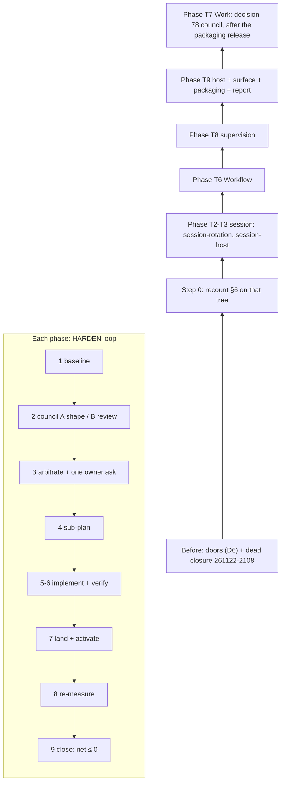

discussion: open

Opened by the secretary for backlog row `plans/backlog/p-2qle2tjflb-harden-next-round-per-layer-loop-for-the-remaining-node-layers.md`.
This file is the source of truth for "HARDEN next round". Its seed was Appendix A of
`plans/discussions/ds-wham5txfkv-node-rust-port-inventory/DISCUSSION.md` (commit `97a1fba58`), which is now history.
This discussion must block neither `261121-2110-component-authority-doors` nor `261122-0118-heads-stable-and-able`. It enters
the supervision queue only once it is settled.

## Hand-off to the planner (draft; released only when the wait below clears)

- **Wait:** `261121-2110-component-authority-doors` and `261122-2108-delete-dead-node-execution-closure` have landed
  (D6, round 3b order). Before the hand-off, the §6 inventory is recomputed on that tree (§7 step 0).
- **Outcome:** one skeleton plan, "HARDEN next round", with one phase per layer in the D8 order. Each phase runs the
  HARDEN per-layer loop (D7) and opens its own sub-plan. When the last phase closes, every layer has a settled target
  shape in its spec, net size ≤ 0 or paid for, and no Node logic is left. No `legacy-cli` route and no `legacy-node`
  payload remain.
- **Constraints:** the loop of `261021-1118` "The per-layer loop", steps 1–9, with council weight set per component by the
  triage scan (N7) and step 7 on this machine only (N5): a council opens only after the
  layer below closes, and the owner is asked once per layer, in a batch. RUL104 (better, not bigger). L10 and design
  principles 1 and 8: a mechanism that moves takes every caller with it, its old path and tests go in the same change,
  and no twin is left. D1 holds inside each layer. Every sub-plan carries an Authority map (doors phase 5). Work (T7)
  goes last (D8).
- **Non-goals:** T0, T1, T4 and T5 are not re-run; HARDEN closed them, and their Node facades go with their last caller
  (D1). The dead tier-5 closure belongs to `261122-2108`. No new feature (RUL104 "proposed additions" go to the owner per layer).
- **Acceptance per phase:** the HARDEN close conditions. Before/after table on the same machine and load class; no
  High-or-above finding left unreproduced; net Δ ≤ 0 or every increase names its paying deletion; doctor and smoke green
  on the activated release on this machine (the owner lands the other machines; mdview and mcp-skill-hub are out, N5); `npm test` and `cargo test --workspace` green.
- **Acceptance of the program:** 56 → 0 `legacy-cli` routes in `packages/host-runtime/contracts/command-routes.json`;
  `git ls-files 'src/*.mjs' 'bin/*.mjs'` is empty; every HARDEN carry-over in §3 is closed or explicitly declined by the owner.
- **Sources:** `p-vwpnx4gpow`, `261021-1118` (plan, lessons, closing report §6–§7), D1, D6, D7–D9.

## 1. Trạng thái hiện tại

**Round 1b (2026-11-23 19:23–19:4x): the frame is now Appendix A.** The owner pointed to the seed: Appendix A of ds-wham5txfkv,
landed in `97a1fba58` after round 1 had read that file (315 lines then, 415 now). The draft path named in the backlog row is a
scratchpad on the owner's host that this confined head cannot see (its `/tmp` is a private tmpfs). The draft was never lost.
Per the owner's order, Appendix A is copied in as the frame: the hand-off draft, §2, the §6 shape and §7. §3 carries H1–H7, C5 and
O1–O6 from ds-wham5txfkv, §4 carries D1 and D6–D10, and §6 carries the inventory, which step 0 recounts (D9). From now on this
file is the original.

Round 1's own findings stay as new rows N1–N6 in §3. Where they differ from the seed, the seed is the frame and the row stays
open for round 2:

- **N2 against the seed's phase T2–T3 entry.** The seed opens that phase only once `261122-0118` and `261123-0828` have landed
  or rebased. Round 1 proposes that its read-only steps 1–3 run earlier, with only the sub-plan waiting.
- **N3 against the seed's phase T9.** The seed puts the "H7 hook arm" in T9. ds-wham5txfkv O5 had sent
  `git/main-checkout-delete-guard.mjs` to S1. Round 1 suggested phase T2–T3 for it, since it is T2 logic.

At 19:34 the owner ordered a triage scan that decides which components need a council (N7, in step 0). At 19:4x the owner set the
council's focus: component authority, contracts and one door; the inside can be optimised freely later (N8). The scan therefore
judges the boundary from the component-authority model, not the size of the code.
No owner question is open. The owner answered N5 at 19:3x: step 7 lands and activates on this machine only; the owner lands
the other machines himself, and mdview and mcp-skill-hub leave the list.
The hand-off still waits on doors and `261122-2108` (O7), and `261122-2108` is still `draft`.

**Round 1 (2026-11-23 19:16–19:2x).** Start ritual: no open owner question. Scouted the HARDEN plan (its loop and decision 78),
the root closing report §1 and §5–§7, the component model and the footprints of the running plans. The findings became N1–N6.

## 2. Mục tiêu & đề bài

HARDEN (`261021-1118`, closed 2026-11-18) ran a per-layer closed loop from T0 to T9. It moved each layer's decisions into
Rust and shrank Node to thin clients. It finished T0–T5 and T8 as intended. T6 Workflow was hardened inside Node (Node +44,
tests +695, decision 73). T9 closed with misses (Node +2,136, entry still 211 modules, doctor 15 s against 12 s). Packaging
closed with 14 MUST fails open, each with an owner. T7 Work was never started: decision 78 holds a council first, and the
owner's option B of 2026-11-18 puts Work after the packaging release. Since then, session-host and session-rotation (T2–T3)
were written in Node, and 56 of 86 verbs still run through the Node payload. The owner wants the same loop applied to every
layer that is not finished, bottom-up, Work last. The result should be layers that are settled, smaller and measured, with Node retired along the way,
not a line-by-line translation. Backlog `p-vwpnx4gpow` asked for the Node inventory; that inventory (§6) now becomes the
measured input to each layer's step 1 instead of a list of port plans.

## 3. Vấn đề rõ / chưa rõ

Rows O1–O6, H1–H7 and C5 are copied from ds-wham5txfkv §3 as they stood at `97a1fba58`, with their states as of that file.
This discussion edits them in place from here on. O7, the N rows and F1 are new here.

| # | Point | State | Evidence / note |
|---|---|---|---|
| O1 | S7 entry gate "Work council (decision 78) held". Decision 78 belongs to `261021-1118` (lessons.md:13, :104, :152): the Work council opens after T8 and the non-Work T9 arms. Both are closed, but no council has been held. | open, blocks only plans 5–7 → D5 | `plans/261021-1118-harden-low-layers-bottom-up/plan.md` closedNote |
| O2 | `session-host` / `session-rotation` are being edited now by `261122-0118` (running) and `261123-0828` (ready) | open, blocks only plans 2–3 starting | footprints read 2026-11-23 |
| O3 | `src/util/yaml.mjs`: a facade over `fgos-yaml-doc` with 28 product importers; `261121-2110` does not retire it (plan.md:219–222) | clear: facade, dies in plan 10 | file header; importer count |
| O4 | Test counts in §6 are "test files that import the area", so a test can count under several areas. Backlog says 588 test files in all. | clear (method stated) | scratchpad script, method in §5 |
| O5 | Logic leaves inside facade areas: `util/domain-compile.mjs` → plan 1; `git/main-checkout-delete-guard.mjs` → S1; `identity/directory-store.mjs` is dead (no product importer) → plan 1 | clear | round 2 file-by-file header read |
| O6 | Owner, 16:2x: does component authority have a warn-only versus blocking switch? Today: no setting. `debt` entries act as a visible "known, not yet fixed" list (no failure, but a stale entry fails). Doors phase 10 removes `debt`, after which any match outside allowed files turns `npm test` red. The phase 5 plan gate is a reviewer reject, inactive only when a project has no model. A switch would be a new config key (`core/config-standard`, `core/config-schema`) and a change to the doors plan | closed 16:32: owner needs no switch; `debt` already serves as the warn list | `docs/platform/component-authority/spec.md` §4; doors `phase-10-land-checks.md`, `phase-05-*.md` |
| H1 | **T6 carry-over:** hardened in Node (Node +44, tests +695, decision 73); no Workflow crate; Workflow doctor rows on the bridge (`bridge:S6b`) | input to "HARDEN next round" | `plans/reports/closing-261118-1344-harden-root-closing.md` §1, §6 |
| H2 | **T9 carry-over:** entry loads 211 modules; doctor 15 s vs 12 s; Node +2,136. H9b: echo fixture in the host-runtime crate. H9c: tautological admission gate (`p-ltwb2h3k6s`). Node `version` arm (`command-registry.mjs:140`). First-run text in three places. `findExecutableOnPath` plus four PATH walkers. Did-you-mean third copy (`p-xtawpgzvjy`). Doctor row catalog held twice (`p-pvs4go2qei`). H11: canonical-JSON producer twin, declined in code. | input | closing report §2, §3 |
| H3 | **Packaging carry-over:** 14 MUST fails open at close (each has a closer). `is_store_entry_name` missing. The `setup` pieces of D2. `doctor-bridge.mjs` goes with the last bridged row. | input | closing report §6, §3 |
| H4 | **Ledger rows without receiver closure:** H3, H12 (`forgentx-5f` does not run), H22, H23 (WORK), and H9–H13, H17, H24 (self-recorded) | input | closing report §4 |
| H5 | **Two reds at HARDEN close:** a stale `workflow start --plan` test and stale instruction projections. Not rechecked here. | input | closing report §5 |
| H6 | **New since HARDEN:** session-host (7 files, 2,127 lines) and session-rotation (2 files, 811 lines) are Node and never went through a council | input | §6 rows 10, 13 |
| H7 | **S1 hook verdicts** (`git/main-checkout-delete-guard.mjs`, `state/decision-question.mjs`, `runner/hook.mjs`): which layer phase owns them | input | program `261114-2051` row S1 |
| C5 | The T8 tier name in `layers.json` ("Skill and Domain (no file today)") is stale: the model puts `supervision` at tier 8 and the domains at T7 | input | `layers.json`, `components.json` |
| O7 | `261122-2108` is `draft`, and its own rule waits for `261122-0118` ("no edit to any file `261122-0118` still edits before it lands"). Step 0 and the hand-off therefore hang on two plans that are not this discussion's to move. | open, blocks step 0 and the hand-off | `plans/261122-2108-delete-dead-node-execution-closure/plan.md` frontmatter and constraints |
| N1 | Step 0 is one read-only pass. It reruns the ds-wham5txfkv §5 inventory method on the tree after doors and `261122-2108`, runs the two H5 tests alone, and names the owning phase for every §6 row and every H or C carry-over. It writes one report and changes no code. | provisional (round 1) | D9; seed §7 step 0; HARDEN loop step 1 |
| N2 | Phase T2–T3's steps 1–3 (baseline, council, arbitration, owner ask) are read-only, so they may run while `261122-0118` and `261123-0828` still hold session files. Only its sub-plan (step 4) waits for them to land. | provisional (round 1); the seed waits for "landed or rebased" | owner 2026-11-23 16:24, "nobody waits on a head that is away"; `261122-0118` footprint `src/session-host/head-grants.mjs` and its tests |
| N3 | Which phase owns `git/main-checkout-delete-guard.mjs` (505 lines of logic, tier 2): the seed's T9 "H7 hook arm", or phase T2–T3 as its tier suggests. S1's other two verdicts (`state/decision-question.mjs`, `runner/hook.mjs`) are T7 code. | open | seed §7 T9; ds-wham5txfkv O5 and H7; `components.yaml` tier 2 `git` |
| N4 | "T8" in D8 is the `supervision` component (`src/portfolio`, 1 file of 19 lines, plus `packages/portfolio/*.mjs`). Skill/Domain closed under HARDEN on 2026-11-09 and is not reopened. With so little code, its council is one shared seat round. | provisional (round 1) | `components.yaml` tier 8; closing report §6 row T8 |
| N5 | HARDEN step 7 lands "on the three workspaces on the owner machine (forgentX, mdview, mcp-skill-hub) and on the second machine". That list dates from 2026-10-21. Which machines and workspaces run fgOS today? **Owner answer:** each phase's step 7 lands, activates, runs doctor and smokes on this machine (`~/projects/forgent`) first; the owner lands the other machines himself; mdview and mcp-skill-hub are dropped from the list. | clear (owner answer 19:3x); minted next round if it holds | HARDEN plan "The per-layer loop" step 7; owner chat 19:3x |
| N7 | **Triage scan before any council (owner orders 19:34 and 19:4x).** Step 0 adds one column to the recounted inventory: council weight per component, with its reason. Each layer's step 1 rechecks only its own rows. The scan reads the component-authority model (`components.yaml` owns, mustNotOwn, status and exceptions; `contracts.yaml`; `decision-kinds.yaml`; `doors/`) and the source, and judges the boundary, not the size of the code. **Full** (a council on that component): its authority, contracts or door are not sound. Signs: status still `designed`, per-file layer exceptions, a contract whose evidence still points at Node, door debt, a sign of a `mustNotOwn` breach, or the same job done through more than one door (a Node and a Rust twin, several walkers or copies, as in H2). T7 Work is always full (decision 78). **Light** (no council, an ordinary sub-plan): the boundary is sound and only inside work remains (deleting, thinning). **Skip**: a facade or thin client over a Rust owner, or dead code, deleted with its last caller (D1). The scan decides by these rules without asking; its table rides in the layer's one batched owner ask, where the owner can override a row. Example: `session-host` has status `designed` and four per-file layer exceptions (`head-start`, `head-request`, `head-stop` at tier 5, `head-grants` kernel), so it is full. | provisional (owner direction, round 1b); amends D7's "loop unchanged"; mint next round if it holds | owner chat 19:34 "cần có 1 bước quét để quyết định chổ nào cần council, không thì phí", 19:4x (N8); `packages/component-authority/model/components.yaml` session-host row |
| N8 | **The council settles the boundary only: authority, contracts and one door.** Per component it decides what it is the authority for (and must not own), its contracts and ports, its Rust/Node boundary, that each job has exactly one door, and the delete list that follows. The settled shape is written into the component's spec and the model. HARDEN's Part B (inside review on axes A–G) is no longer required: once the boundary is right, the inside may be optimised freely later. The close conditions (net Δ ≤ 0, no High left unreproduced) still hold. | provisional (owner direction, round 1b); amends D7's council step; mint next round if it holds | owner chat 19:4x "council chủ yếu với anh sẽ ưu tiên về component-authority và contracts … tối ưu bên trong kiểu gì cũng được", "à thêm là 1 cửa"; design principle 1 |
| N6 | H5's first red looks resolved: `test/cli/fgos-workflow.test.mjs` no longer names `--plan` (commit `0a3f46ac5`, 2026-11-18). The instruction-projections red was not rechecked. Step 0 confirms both. | first likely resolved; second not rechecked | `git log` on both test files |
| F1 | Model tiers today: T2 `git`, `terminal-control`, `session-rotation`; T3 `session-host`; T5 `seat-binding`, `execution-core`, `dispatch-transport`; T6 `workflow`, `work-driver`; T7 `work-state`, `runner`; T8 `supervision`; T9 `packaging-distribution`, `host-surface`, `learning-docs-registry`. The model is YAML now (doors 1b has landed). | clear | `packages/component-authority/model/components.yaml`, `layers.yaml` |

## 4. Quyết định đã chốt

Copied from ds-wham5txfkv §4. They are owner decisions made there and are not reopened here. A D-ID new to this discussion starts after D10.

| D-ID | Decision | Rounds held | Source |
|---|---|---|---|
| D1 | A facade, client, Node-process adapter or golden-vector twin over a Rust crate gets no plan. It is deleted inside the plan that removes its last Node caller, and §6 names that plan. | 2 | L10, design principle 1; round 2 file-by-file check |
| D6 | Owner chose option (a) on 2026-11-23 16:3x: doors phase 10 locks every door except the named debt of 2f (and 2g while `p-rypvkc3kai` is open), `retiredBy` the Workflow/Work port. Doors closes before the port, and this discussion is redone after doors and `261122-2108` land (§1 round 3b, step 4). | owner answer | chat 16:3x "ok, đồng ý phương án a" |
| D7 | The remaining work is not a plain port. Each unfinished layer runs the HARDEN per-layer loop of `261021-1118` (steps 1–9). Those steps are: baseline; a two-part council producing the migration table, delete list, doctor table and tests table; arbitration; one batched owner ask; a sub-plan with a delete list and tests to retire; independent verify; land and activate; re-measure; close at net Δ ≤ 0. Moving Node to Rust is one column of the migration table. **Supersedes D3 and D4.** | owner answer | chat 16:38 "nó không phải là một porting đơn thuần"; 16:44 "ok đồng ý" |
| D8 | Layer order, bottom-up, with a council opening only after the layer below closes: T2–T3 session → T6 Workflow → T8 supervision → T9 host, surface, packaging and report → T7 Work last (decision 78 council, after the packaging release per option B). **Supersedes D2's "packaging first" (packaging folds into T9) and D5's plan numbering.** Decision 78 stands. | owner answer | chat 16:38 "anh vẫn muốn delay Work lại sau cùng"; 16:44 "ok đồng ý" |
| D9 | The §6 inventory is the input to each layer's baseline (step 1), not a list of plans. It is recounted after doors and `261122-2108` land. | follows from D7 | round 4 |
| D10 | This discussion closes as the inventory. "HARDEN next round" is a new discussion with its own backlog row. T7 Work gets its own discussion when it opens. No other layer gets a separate discussion, because its council is its design round, as in HARDEN. | owner answer | chat 16:5x "anh đồng ý" |

## 5. Q&A log

- **2026-11-23 19:16 — round 1, start ritual.** `fgos questions` showed none open. Read backlog row `p-2qle2tjflb`.
- **2026-11-23 19:1x — owner:** "em có đọc được bản nháp phiên trước để lại không". Answer: not at the scratchpad path. It was first
  reported as lost, then corrected: this head's `/tmp` is a private tmpfs, so the host scratchpad is out of view, not gone.
- **2026-11-23 19:2x — round 1, scout.** Read the HARDEN plan (goal, scope, phases, loop, decision 78), the root closing report §1
  and §5–§7, `components.yaml`, `layers.yaml`, and the frontmatter of doors, heads-stable, `261122-2108` and `261123-0828`. Result:
  N1–N6. The round 1 file was written, but its land (ticket `c-2902-1795436317115`) produced no commit.
- **2026-11-23 19:23 — owner:** the draft is Appendix A of ds-wham5txfkv (line 317 on, `97a1fba58`). Copy it in as the frame, and
  take §3 (H1–H7, C5, O1–O6), §4 (D1, D6–D10) and §6 from that file. From then on this discussion is the original. Done in round 1b.
- **2026-11-23 19:3x — round 1b land.** Three `fgos land --paths` tries (tickets `c-2902-…`, `c-5233-…`, `c-5842-…`) failed
  `merge-slot-busy`; this head's grant has no `fgos slots`, so the holder was not seen.
- **2026-11-23 19:3x — owner (N5):** "em cứ land máy này trước đi, anh sẽ tự land các máy khác, loại mdview và mcp-skill ra".
  Step 7 lands on this machine; the owner lands the others; mdview and mcp-skill-hub are dropped.
- **2026-11-23 19:3x — owner:** "vòng lặp 9 bước này có quá nặng nề không?" Answer: HARDEN's layers took 1 to 5 days each, with
  one owner ask per layer. The weight comes from four-seat councils on small layers (T8) and multi-machine landing (gone with N5).
  Keep the outputs; scale the council to the layer's size.
- **2026-11-23 19:34 — owner:** "cần có 1 bước quét để quyết định chổ nào cần council, không thì phí". Recorded as N7 with three
  weights (skip, light, full), decided by rule in step 0, overridable in the layer's batched ask.
- **2026-11-23 19:4x — owner:** "council chủ yếu với anh sẽ ưu tiên về component-authority và contracts. với anh tốt chổ này thì
  sau này tối ưu bên trong kiểu gì cũng được", then "à thêm là 1 cửa". Recorded as N8. N7's weights now judge authority, contracts
  and one door from the model instead of code size.

## 6. Thiết kế đã chốt {#design}

*Frame from Appendix A (D1, D6–D9). Those decisions settle the shape; step 0 recomputes the numbers. N2 and N3 may still adjust
the T2–T3 entry and the phase of the delete guard.*

### Shape

"HARDEN, next round" is one skeleton plan with one phase per unfinished layer. It reuses the loop and close rules of
`261021-1118`, except that a triage scan sets each component's council weight first (skip, light or full; N7). Each phase opens with its own baseline, runs its council, and asks the owner once. It then lands its own
sub-plan, re-measures and closes. Only then does the next phase's council open. Inside a phase, each component gets a
target shape (authority, contract and ports, Rust/Node boundary and Node budget, delete list, doctor rows kept, size
target), written into its spec. Node facades of T0–T5 have no phase; each is deleted by the phase whose migration table
removes its last Node caller (D1). Work comes last and starts from its decision 78 council, under the owner's frame:
a flexible storage core, plus the human touch points of lifecycle, gate and question, and artifact.

### Per-layer loop (HARDEN `261021-1118`, steps 1–9; council weight from the triage scan, N7)

| Step | Output |
|---|---|
| 1 Baseline | owned routes p50/p95 cold and warm, tests and wall time, LOC Node/Rust/test, open backlog rows, doctor rows and setup steps; main SHA |
| 2 Council | only for components the triage marks full (N7). It settles the boundary: authority and mustNotOwn, contracts and ports, one door per job, the Rust/Node boundary and the delete list, written into the spec and the model (N8). Migration, delete, doctor and tests tables. No inside review is required |
| 3 Arbitration and owner ask | one batched ask: Part A shapes, Critical items, proposed additions, landing slot |
| 4 Sub-plan | `ak-plan --hard`; Create / Modify / Delete / Tests to retire; a net-size line per phase; an Authority map |
| 5–6 | one lead per worktree; independent verify |
| 7 Land | release, activation, doctor and smoke on this machine; the owner lands the other machines; mdview and mcp-skill-hub are out (N5) |
| 8 Re-measure | same machine and load class as step 1 |
| 9 Close | no High left unreproduced; net Δ ≤ 0, or each increase names the deletion that pays for it |

### Inventory (input to step 0; copied from ds-wham5txfkv §6 at `97a1fba58`, recount per D9)

Legend: **kind** L = logic to port, F = facade/client over Rust, D-rest = what the dead-closure plan leaves.
*tests* = test files importing the area. *Callers* = product files outside the area that import it.

| # | Area (`src/`) | Component (tier) | Kind | Files / lines | Tests | What Rust owns today | Live callers | Target Rust component | Retired by |
|---|---|---|---|---|---|---|---|---|---|
| 1 | `setup` (17 files) | packaging-distribution (9) | L + bridge | 17 / 5150 | 25 | `packages/distribution` (init, doctor, wire-agents, uninstall native since S4); `apps/fgos/src/wiring/doctor` | scripts (5: `build:skills` and friends), verbs (1), Rust host → `doctor-bridge.mjs` | `packages/distribution` | **plan 1** for non-bridge pieces (P2); bridged rows move with plans 4, 5 and 6; `doctor-bridge.mjs` with the last |
| 2 | `util` (23) | platform-foundations (0) | F/leaf | 23 / 1130 | 78 | `durable-file`, `canonical-json`, `yaml-doc`, `identity`, host-bin resolution in `apps/fgos` | almost every area | none (leaves die) | each leaf with its last caller; `yaml.mjs` in plan 10; `domain-compile.mjs` in plan 1 |
| 3 | `native` (8) | process (0) | F | 8 / 1129 | 53 | `packages/process`; the combined addon | workflow 27, dispatch 19, many | none | the last plan (10), since it is the Node→Rust door itself |
| 4 | `config` (1) | config (1) | F | 1 / 127 | 15 | `packages/config/rust` | 11 areas | none | with its last caller |
| 5 | `convention` (4) | convention (1) | F | 4 / 146 | 3 | `packages/convention/rust` | workflow, runner, scripts (3) | none | plan 4 or 6; scripts need a Rust verb or a direct crate call |
| 6 | `identity` (1) | identity (1) | F | 1 / 16 | 0 | `packages/identity/rust` | none (one test only) | none | dead: deleted in plan 1 |
| 7 | `holder-lock` (9) | holder-lock (1) | F | 9 / 1789 | 50 | `packages/holder-lock/rust` (policy, Windows `LockFileEx` via `fgos internal lock-hold`) | git (12), runner, dispatch, workflow, state, `.githooks` | none | with its last caller (plan 6 or 10) |
| 8 | `git` (13) | git (2) | F + one logic file | 13 / 796 | 26 | `packages/git/rust` + node-addon | runner, workflow, state, scripts (11) | `packages/git` | facades with their last caller; `main-checkout-delete-guard.mjs` (505 lines of logic) = **S1** |
| 9 | `terminal-control` (2) | terminal-control (2) | F | 2 / 284 | 3 | `packages/terminal-control/rust` | dispatch (live rest), scripts | none | with dispatch's live rest |
| 10 | `session-rotation` (2) | session-rotation (2) | L | 2 / 811 | 2 | `packages/session-host/rust/src/rotation`, `wiring/session_rotation_hook.rs` | session-host | `packages/session-host` | **plan 2** |
| 11 | `event-store` (6) | event-store (3) | F + seal policy | 6 / 468 | 14 | `packages/event-store/rust` (maintain since F0) | state (4), verbs, runner, scripts | none | with work-state (plan 5) |
| 12 | `observe` (3) | observe (3) | F | 3 / 270 | 3 | `packages/observe/rust` | state, verbs | none | with plan 5 or 7 |
| 13 | `session-host` (7) | session-host (3) | L | 7 / 2127 | 13 | `packages/session-host/rust` (panes, route, host) | session-rotation, dispatch, bin | `packages/session-host` | **plan 3** |
| 14 | `run-supervisor` (12), `runner/dispatch` (54), `runner/execution` (23) | run-supervisor (4), dispatch/exec (5) | D-rest | 89 / 26.8k, of which 27 live after `261122-2108` | 181 | `packages/run-supervisor`, `packages/execution` (S6a) | live rest: workflow, setup, session-host, mailbox harness | `packages/execution` | dead part: `261122-2108`; live rest: plans 3, 4 and 5; mailbox-harness reach: mailbox lane |
| 15 | `seat-binding` (1) | seat-binding (5) | F | 1 / 232 | 6 | `packages/seat-binding/rust` | workflow, setup, dispatch | none | with plan 4 |
| 16 | `workflow` (32) | workflow (6) | L | 32 / 7469 | 54 | none (no crate) | state, setup, runner, bin | new Workflow crate (spec `docs/platform/workflow/`) | **plan 4 = S6b** |
| 17 | `state` (34), `intake` (6), `evolve` (1) | work-state (7) | L | 41 / 12.9k | 134 | `packages/work-state/rust` (event reader, work source only) | verbs (13), runner (13), report, setup, bin | `packages/work-state` | **plan 5 = S7 core**; gate O1 |
| 18 | `runner` top level (34) | runner (7) | L | 34 / 10.6k | 70 | parts in `apps/fgos/src/wiring` (lock, worktree, agents) | verbs (9), setup, workflow, bin, `.githooks` | `packages/execution` / work-state, per file | **plan 6 = S7 runner** |
| 19 | `verbs` (14) | host-surface (9) | L | 14 / 2457 | 16 | events verbs native (S3) | bin | `apps/fgos` wiring | **plan 7 = S7 merge/state verbs** |
| 20 | `report` (10) | learning-docs-registry (9) | L | 10 / 2058 | 10 | none | state, setup, verbs, bin | new crate or `packages/documentation` | **plan 8** |
| 21 | `portfolio` (1) | supervision (8) | L (tiny) | 1 / 19 | 0 | `packages/supervision/rust` (portfolio, queue, land) | scripts (1) | `packages/supervision` | **plan 9** (or folded into 8) |
| 22 | `cli` (5) + `bin/*.mjs` (2) | host-surface (9) | L | 5 / 3316 + bin | 20 | `apps/fgos` routing/help (F0) | bin, scripts | `apps/fgos` | **plan 10**: zero `legacy-cli` routes, `legacy-node` payload removed |

Out of `src/` but in scope because the same plans touch them: `packages/portfolio/*.mjs` (5 Node files, with plan 9),
and `scripts/*.mjs` callers of `src/` (each plan moves its own script callers).

## 7. Danh mục hạng mục / task {#tasks}

*One skeleton plan, phases in D8 order. Each phase opens its own sub-plan from its council, as HARDEN's layer phases did.*

*One skeleton plan, phases in D8 order. Each phase opens its own sub-plan from its council, as HARDEN's layer phases did.*

### Step 0 — recount before hand-off {#task-step-0}
After doors and `261122-2108` land: rerun the §5 inventory method, check H5 (the two reds), update §6, and fill the triage
column (skip / light / full council, with its reason, N7) for every component. Then mark this
discussion settled and hand the skeleton to a planner. Owner: this shaper.

### Phase T2–T3 — session {#task-t2-t3-session}
Components: session-rotation, session-host (and the dispatch live rest reached only from heads). Inputs: §6 rows 10, 13
and 14; H6. Opens once `261122-0118` and `261123-0828` have landed or rebased (O2).

### Phase T6 — Workflow {#task-t6-workflow}
Components: workflow, work-driver; the seat-binding client and the dispatch/execution live rest reached from
`definition.mjs`. Inputs: §6 rows 15, 16; H1; the Workflow doctor rows on the bridge. Note the draft
`261122-0056-orchestration-skeleton` (6 workflow files).

### Phase T8 — supervision {#task-t8-supervision}
Components: supervision (`src/portfolio`, `packages/portfolio/*.mjs`). Inputs: §6 row 21; C5 (stale tier name).

### Phase T9 — host, surface, packaging, report {#task-t9}
Components: host-surface (non-Work arms), packaging-distribution, learning-docs-registry, fgos-gateway. Inputs: §6 rows
1, 19 (non-Work), 20, 22; H2; H3; D2's `setup` pieces; H7 hook arm. The `legacy-node` payload and `native` door can go
only after T7.

### Phase T7 — Work, last {#task-t7-work}
Components: work-state, runner (tier 7), the domain components, the Work arms of host-surface. It opens with the decision 78
council, after the packaging release (option B), under the owner's frame. Inputs: §6 rows 11, 12, 17, 18, 19 (Work
arms); H4 WORK ledger rows; the doctor debt 2f handed over by doors (D6). Closing this phase removes the last `legacy-cli`
route and the `legacy-node` payload.
