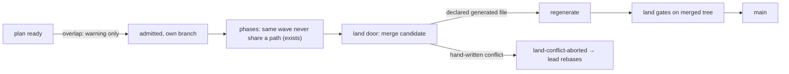

discussion: open

## Seed (from the secretary, 2026-11-26)

### Why this is open

The plan contract refuses `ready` while another `ready` or `running` plan shares a path, comparing whole-plan
footprints (`scripts/plan-contract-check.mjs`, commit `ab8ebdfd54`, 2026-11-17). On 2026-11-26 this blocked plan
`261126-0853-session-type-submits-enter`, whose phase 1 touches only `pane_io.rs` and `typed_wake.rs`, because the
Keeper plan and the rule-gathering plan hold files that only a later phase writes (`CHANGELOG.md`, the command
manifest, generated skill surfaces, `core/skills/**`). The owner also had to take `CHANGELOG.md` and
`command-manifest.json` out of the Keeper footprint and back by hand, twice in one day.

### The owner's view (2026-11-26 22:5x and 23:0x, not yet settled)

Every plan works on its own branch and worktree, so two plans cannot step on each other while they work. A shared
path costs something only at land. The only real reason to wait is inside one plan: two phases that share a path must
not run in parallel. `CHANGELOG.md`, written last, should not block anyone from the first day.

### Miu's counter-points (reasoning only, to be tested)

1. A conflict at land is found after the work is done, so it can cost rework (`p-avjhx3gxas`; main took about 21
   commits an hour on 2026-11-25 and lands starved).
2. A conflict can be semantic and merge cleanly (two plans changing one wiring file).
3. A phase runs on a fixed `base` and does not see what another plan landed meanwhile.
4. Yet most of today's blocking was on generated or append-only files, where a land conflict is harmless.

### Constraints from the owner

- The result must not depend on `p-lfsc4czpgh` (the widening door, paused).
- Work on plans `261125-2041` and `261125-1631` happens only on the fg-server machine; this discussion neither
  starts nor changes them.
- Plan `261126-0853-session-type-submits-enter` waits for this outcome, or for the owner's choice to narrow it to
  phase 1.

## 1. Trạng thái hiện tại

Round 1 (2026-11-26 23:xx, shaper): scouting is done (§3). The measurement backs the owner's view. Over 353 merges on
main since the contract began (2026-11-17), 38 had a conflict. 37 of those were on the generated mutation census,
19 were on plan files, 2 on `CHANGELOG.md`, and only 3 on hand-written source, all on 2026-11-18/19. Two blocks
exist, not one: the contract check at `ready`, and the supervisor's admission hold `held-footprint-overlap`, which
landed today (`5d01f9a79f`). The rule that phases of one plan sharing a path must not share a wave already exists.
The land door regenerates three declared generated files, but not `CHANGELOG.md` or the generated skill surfaces.
Round 2 (23:05-23:11): the owner asked whether this reinvents something and what standard multi-branch git practice is. Standard practice is optimistic: work in parallel, meet the conflict in a merge queue (our land door), lock only files that cannot merge, and reorganise hot shared files so they cannot conflict. The owner agreed in chat to option A with one small changelog file per change instead of a union merge. q-o6qqdubbue is superseded by **q-gk3bt22wng**, which records that choice; once it is answered, D1 is minted and the discussion settles.

## 2. Mục tiêu & đề bài

Two plans whose footprints overlap should both be admitted and run on their own branches. Each plan already works
in its own worktree, and a phase's worktree starts from the trunk tip and can `--sync` with it. So a shared path
costs something only when the plans land, and only when git cannot merge it or the merged tree fails the land gates.
Today two doors turn a shared path into a wait for the whole life of the other plan: `ready` is refused, and
admission holds the plan. A file written once at the end, such as `CHANGELOG.md`, then blocks every other plan from
the first day. The owner has to narrow footprints by hand, and planners have to order whole plans with `blockedBy`
(the Keeper plan was put behind `261124-2143` as a whole to avoid a deadlock). The open question is what replaces
those two blocks. It could be advice only, or advice plus closing the land door's gaps on the hot shared files, or a
narrower block. Whatever replaces them must keep a footprint as the bound on what a unit may write, and must keep
two phases of one plan that share a path out of the same wave.

## 3. Vấn đề rõ / chưa rõ

| # | Vấn đề | Trạng thái | Ghi chú |
|---|---|---|---|
| 1 | Where did the hard block come from | **Clear** | Footprint overlap began as non-blocking advice between work items (`footprintConflicts`/`footprintOverlap`, `src/state/graph-metrics.mjs`; `ds-izwfo6f267` §3 row 1, "PHI-CHẶN"). `ab8ebdfd54` (2026-11-17) added a plan-level check: "two ready or running plans whose footprints overlap are flagged; resolve by `blockedBy` or narrowing". `d39e3b6a0a` (2026-11-22) made the land door run the check and split it: an error for `ready`, a warning for `running`. No commit, spec or discussion gives a reason beyond avoiding collisions; no incident is cited. |
| 2 | Is there a second block | **Clear: yes** | The supervisor admission hold `held-footprint-overlap` (`packages/supervision/rust/src/portfolio.rs:282-296`), planned in Keeper (`2877e95c1b`, 2026-11-22) and landed 2026-11-26 (`5d01f9a79f`). It holds a `ready` plan whose footprint overlaps any `running` plan. Any change must cover both doors (L10). |
| 3 | How often do land conflicts hit hand-written source | **Clear (measured)** | Every two-parent merge on main since 2026-11-17 was replayed with `git merge-tree`: 353 merges, 38 with a conflict. By file: mutation census 37, plan files 19 (all 2026-11-19, one plan's status edits), `CHANGELOG.md` 2, hand-written source 3 (`catalog.rs`, `git/rust/src/land.rs`, `session-host/spec.md`, all on 2026-11-18/19 sync merges). Caveat: after 2026-11-22 the block may itself have kept overlapping plans apart, so the low count after that date is not proof alone. Even so, before the block was enforced the rate was 3 conflicts in about 70 merges, each resolved in one sync merge. |
| 4 | Does the land door resolve the hot generated files | **Partly** | `land.regenerate` declares `mutation-census.v1.json`, `command-routes.json` and `command-manifest.json`, and the land door regenerates a conflict on them and prepares the merge again (supervision spec, "Lead to land"). It does **not** cover `CHANGELOG.md`: there is no merge driver in `.gitattributes`, so a conflict ends as `land-conflict-aborted`. It does not cover the generated skill surfaces (`.agents/skills/**`, `plugins/fgOS/skills/**`, built by `npm run build:skills`) either. A lead's refresh merge of main into its branch still conflicts on the census and is resolved by hand (three times on 2026-11-26 in `agent-context-engine/p03`); that is the rest of `p-avjhx3gxas`. |
| 5 | Same-plan phases that share a path | **Clear: already enforced** | `plan-contract-check.mjs:157-167` errors when two unfinished phases share a wave and their footprints overlap. Nothing to build. |
| 6 | Counter-point 3 (fixed base) | **Clear: mostly moot** | `plan.base` records the commit the plan was written against. A phase worktree is created fresh per phase and can `fgos run --sync <trunk>` (`fgos-lead` SKILL step 1), and the lead's answer to `land-conflict-aborted` is to rebase onto the trunk tip and land again. |
| 7 | Counter-point 2 (semantic conflict that merges cleanly) | **Clear: covered at land** | The land door runs `land.gates` on the merged candidate tree, not on the branch alone. A plan's last phase re-runs the full gate on the combined tree (plan contract §4, "Integration"). A clean merge that breaks behaviour fails there. |
| 8 | Which option replaces the blocks | **Agreed in chat, awaiting the store answer → q-gk3bt22wng** | Owner chat 2026-11-26 23:11: A, warn instead of block. q-o6qqdubbue superseded. |
| 9 | CHANGELOG: union merge or one file per change | **Agreed in chat → q-gk3bt22wng** | Union merges silently: a line can land under an already released version (rc.9 to rc.12 in four days), an edited line is kept twice, entries drift between sub-sections. Fragments (`changelog.d/<id>.md`, assembled at release; changesets, towncrier, reno) cannot conflict by construction. 91 commits touched CHANGELOG.md since 2026-11-17. No prior art in the repo (`git log -S'changelog.d'` empty). |

## 4. Quyết định đã chốt

| D-ID | Tóm tắt | Nguồn / rationale |
|---|---|---|

None yet. Row 8 waits on the owner.

## 5. Q&A log

- 2026-11-26 23:xx, shaper: Round 1 scout. I read `ds-izwfo6f267` and reused its principle that footprint overlap
  between items is advice and that the merge is guarded by a staged verify on the merged tree. I read
  `ds-mzyircswox` and reused its root-cause finding that a footprint mixes collision avoidance (mechanical) with
  scope (what the owner approves). From `ds-mzyircswox` D2, "order two overlapping plans automatically" stays out of
  scope. I measured the land history (§3 row 3), found the second block (row 2) and the land door's gaps (row 4).
  Then I asked q-o6qqdubbue with four options.
- 2026-11-26 23:05 +07, owner: "ủa có phải chúng ta đang chế không và thế giới họ tạo ra worktree làm gì? best practice
  của git development nhiều luồng là sao?"
- 2026-11-26 23:07 +07, shaper: yes, the cross-plan block is a home-made pessimistic lock. Standard practice is
  trunk-based work with short branches, a merge queue that tests the merged tree (our land door is one), locks only
  for files that cannot merge (binary assets), and hot shared files reorganised so they cannot conflict (changelog
  fragments, generated files regenerated after merge). Proposed: A, with changelog fragments instead of union.
- 2026-11-26 23:09 +07, owner: "với changelog cách nào đúng hơn". Shaper: fragments; union hides errors (§3 row 9).
- 2026-11-26 23:11 +07, owner: "đồng ý A, dùng file nhỏ, hỏi lại đi". q-o6qqdubbue superseded by q-gk3bt22wng.

## 6. Thiết kế đã chốt {#design}

Agreed by the owner in chat, to be recorded through q-gk3bt22wng (option A):

- **Admission and `ready`:** an overlap between plans never refuses. The contract check reports it as a warning
  naming the other plan and the shared paths. The admission hold `held-footprint-overlap` is removed; the supervisor's
  admission view lists the overlap as advice (which plan is running, which paths both hold). `blockedBy` stays for a
  real ordering the planner or owner wants, never as a workaround for a shared file.
- **Inside one plan:** unchanged. Two unfinished phases that share a path cannot share a wave.
- **Footprint as a write bound:** unchanged (`write-outside-footprint`, `land-outside-footprint`, PS-24).
- **Changelog:** a change no longer edits `CHANGELOG.md`. It adds one file under `changelog.d/` (name from the change,
  one entry with its Keep a Changelog sub-section). The release step assembles the files into the new version section
  and deletes them, so which release holds an entry is decided at release, never by a merge. The existing
  `## [Unreleased]` lines stay and are released with the next version. The `AGENTS.md` rule changes with it.
- **At land:** the generated skill surfaces join `land.regenerate` (rebuilt
  from `core/skills`), so a conflict on them is regenerated, as the census is today. A conflict on hand-written source
  is still `land-conflict-aborted`; the lead rebases and lands again, as it does today.
- **Out of scope:** regenerating declared files during a lead's refresh merge (`p-avjhx3gxas`), the widening door
  (`p-lfsc4czpgh`), automatic ordering of overlapping plans (`ds-mzyircswox` D2).

## 7. Danh mục hạng mục / task {#tasks}

Filled once q-gk3bt22wng is answered. Under option A it is a single entry, because the two doors and the land-door
gaps must change together (L10).
