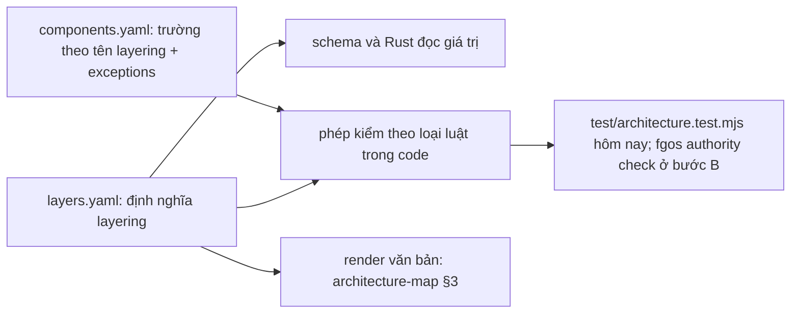

discussion: settled

```txt
HAND-OFF (planner)
discussion: settled
source: p-adv35azsca; ds-zfqskcns7j §4 CAS-D1..CAS-D26, §6 #design, §7 #task-layerings-in-model
outcome: component-authority khai bốn layering (hexagon, stack, orchestration-ring, domain-scope) như dữ liệu có định nghĩa trong mô hình; giá trị nằm trên hàng component (tên trường = id layering, ngoại lệ qua `exceptions`); luật chạy theo ba loại cố định trong code (order-downward, isolation, port-wiring); hết danh sách hạng viết cứng ở layers.yaml, contracts/model.v1.json, rust/src/declare.rs.
constraints: RUL104 (không bộ thông dịch luật tổng quát, không cơ chế không ai dùng; source chỉ declared và fromPaths, CAS-D12); L10 (gom guard layering viết tay vào layering, xoá tierExceptions, đổi trường layer/tier thì chuyển mọi caller cùng đợt); CAS-D4 năm luật hexagon, callback qua port được phép; design principle 7 (văn bản layering render từ mô hình); spec docs/platform/component-authority/spec.md cập nhật trước code.
non-goals: bước B (`fgos authority check`) (Q2 đã chốt trong CAS-D20..CAS-D22 và thuộc bước A); `paths: []` của ba component Domain; tách hết mọi component trộn vai trò (áp dần, phần chưa tách ghi nợ có tên, CAS-D10).
acceptance: (1) layers.yaml khai bốn layering đủ trường CAS-D8, mỗi giá trị có meaning; (2) mọi component khai hexagon, stack, orchestration-ring; schema và Rust đọc giá trị từ mô hình (rg LAYER_NAMES|TIER_RANGE không còn danh sách viết cứng); (3) mỗi loại luật có một fixture vi phạm bị bắt; guard A4 Work-layer và 'tầng thấp không import Dispatch' chạy qua layering của chúng; (4) runner khai ngoại lệ hexagon theo path; port khai qua chỉ mục contract; (5) npm test và cargo test --workspace xanh; (6) component-boundary.md §4, architecture-map.md §3, vision.md §6 Known gaps sửa theo từ vựng mới.
open (chặn phần sau, không chặn task này): bước B (hình dạng chốt ở CAS-D24; còn mở: ngôn ngữ đọc tiếp theo sau Node và Rust, chờ project thật cần); `paths: []` của domain-components, coding-domain, group-thinking (§3 hàng 22).
also in A: CAS-D13 đổi chỗ T7/T8 (acceptance (7): Work ở T8, Domain ở T7, supervision ở T8, vision.md §6 Known gaps đóng); CAS-D14 nhìn mọi lát cắt (acceptance (8): declare thiếu một layering declared bị từ chối; declare tạo lệch giữa orchestration-ring và stack bị từ chối với thông báo nêu hai lát và cặp component; locate trả đủ bốn lát); CAS-D15 (acceptance (9): `sameAs` khai trên các giá trị trùng chữ và cửa khai từ chối khi hai bên lệch; `orchestration-ring` suy từ `stack` qua `fromLayering`, không thêm trường trên component; T8 tên `T8-delivery`; ngoại lệ path của `work-driver` cho phần chọn việc). CAS-D16 (acceptance (10): `orchestration-ring` khai trên mọi component với giá trị surface, orchestrator, launcher, router, driver, dispatcher, none; cửa khai từ chối một phụ thuộc đi lên giữa các vai). CAS-D17 (acceptance (11): trường `source` không còn trong schema, model và Rust; mọi file dưới `coverage.roots` thuộc đúng một component, 20 thư mục code vô chủ hôm nay có chủ; phép kiểm `stack` bắt một phụ thuộc crate đi lên, `hexagon` bắt một `use` Rust sai hạng, mỗi cái một fixture). Bảng quét nháp §7 `#scan-layerings` là đầu vào cho bước xếp; 11 hàng ⚠ đã được chủ dự án xếp (CAS-D19); hàng còn vướng khi xếp thật gom thành một bộ câu hỏi owner. CAS-D18, CAS-D19 (acceptance (12): `orchestrator` mang nghĩa chọn và trông việc; T4 tên `T4-agent-runtime`; component `retired` không mang giá trị layering; trạng thái live/designed kiểm bằng code; tám hàng theo CAS-D19). For secretary: một backlog row riêng cho `MODEL_DIR` viết cứng (component-authority ở project khác luôn inactive). CAS-D20 (acceptance (13): cửa khai từ chối một hàng không sở hữu gì; 8 hàng `h-*` không còn, file spec của chúng thuộc `runner` qua `paths`, bảng governance vẫn liệt kê đủ; họ `documentation` trỏ tới plan hoặc bị bỏ). CAS-D21 (acceptance (14): không còn hàng `retired` trong mô hình; mọi contract `live` có provider `live`/`designed`; `locate` tra id cũ ra kế nhiệm; `host-runtime` khai qua `fgos authority declare`, sở hữu `packages/host-runtime/` và 11 contract). CAS-D22 (acceptance (15): không còn hàng `team-cognition-engine`, `work-driver`; `locate work-driver` ra `runner`; các file runner chọn/định tuyến mang vai ring orchestrator/router qua ngoại lệ path; backlog row `MODEL_DIR` tồn tại). CAS-D23 (acceptance (16): phase đầu đo vi phạm từng luật mới ở chế độ báo cáo; mỗi vi phạm sửa mô hình hoặc có ngoại lệ có tên; luật chỉ chặn khi sạch). Bước B theo CAS-D24 là việc sau A, không thuộc task này. CAS-D25 (acceptance (17): `decision-kinds.yaml` không còn; mỗi hàng live có chỗ narrative (mặc định `spec`); bảng holder của `governance.md` và `fgos decision-index` đọc scope từ hàng component, scope cũ tra ra kế nhiệm; nguyên tắc 7 mang câu chữ mới; không còn hàng `enduser-docs-authoring`, `enduser-docs-index`). CAS-D26 (acceptance (18): `architecture-map.md` render các layering từ `layers.yaml` theo bố cục CAS-D26 (2); mọi hàng component có `summary`; `fgos authority declare` nhận `summary`). For secretary: backlog row dọn `architecture-map.md` và `component-boundary.md` theo CAS-D26 (3), (6), (7) (bố cục thẻ, gom bảng trùng, chuyển nội dung riêng, viết lại câu chữ ~70 hàng); backlog row chia `src/util/` về component chủ (CAS-D19); backlog row tách `runner` theo vai khi đáng làm (CAS-D22). Quyết định sau thắng quyết định trước: CAS-D16 thay phần ring của CAS-D11 và CAS-D15; CAS-D15 thay `T8-work` và CAS-D12.
authority: component-authority (row sở hữu mô hình); một declare mới: `host-runtime` (CAS-D21).
```

# Component authority: phạm vi, module và các góc nhìn tầng

```txt
discussion: open
topic: backlog row p-adv35azsca; nối tiếp ds-at6x3xj2ng (component-authority, settled 2026-11-21)
shaper: head:shaper-component-authority
opened: 2026-11-25 (chủ dự án qua thư ký); round 1 ghi 2026-11-25 14:15
domain: platform (cross-area); không có domains/<domain>/AGENTS.md áp dụng
open owner questions: chưa đặt vào question store (đang thảo luận trực tiếp với chủ dự án)
```

## 1. Trạng thái hiện tại

2026-11-27 16:05 bổ sung CAS-D18 (orchestrator chọn và trông việc; `T4-agent-runtime`) và CAS-D19 (xếp 11 hàng vướng; layering chỉ cho live/designed; trạng thái kiểm bằng code). 2026-11-27 16:15 bổ sung CAS-D20 (component phải sở hữu ít nhất một thứ; bỏ 8 hàng `h-*`). 2026-11-27 16:52 bổ sung CAS-D21 (xoá hàng retired, id cũ thành alias; component mới `host-runtime`). 2026-11-27 21:12 bổ sung CAS-D22 (retire `team-cognition-engine`; gộp `work-driver` vào `runner`; `MODEL_DIR` thành backlog row riêng). Q2 đóng; không còn câu mở. 2026-11-27 22:00 bổ sung CAS-D23 (A đo trước khi bật) và CAS-D24 (hình dạng bước B; chạy ở cửa land theo diff). 2026-11-28 12:10 bổ sung CAS-D25 (bốn chủ: cấu trúc, luật, lịch sử quyết định, tài liệu; bỏ `decision-kinds.yaml`). Plan `261127-1247-component-authority-layerings` bám tới CAS-D24; planner cần bổ sung CAS-D25. 2026-11-28 14:32 bổ sung CAS-D26 (hai tài liệu kiến trúc là bản render; câu chữ viết một lần lúc declare; retire 6 vai cũ); planner cần bổ sung CAS-D26.

2026-11-27 14:55 bổ sung CAS-D17 (gộp `source` vào `paths`; phủ theo `coverage.roots` khai trong mô hình; layering đọc cạnh Rust) và bảng quét nháp 73 component (§7). Còn hỏi: `orchestrator` = chọn việc + trông việc đang chạy; đổi `T4-supervisor` thành `T4-agent-runtime`; 11 hàng ⚠ của bảng quét; component chỉ có tài liệu có nên là component.

2026-11-27 14:05 bổ sung CAS-D16 (`orchestration-ring` dùng tên vai gốc: surface, orchestrator, launcher, router, driver, dispatcher, none); vẫn `settled`. Còn hỏi: đổi `T4-supervisor` thành `T4-run-supervisor`.

2026-11-27 13:18 bổ sung CAS-D15 (định nghĩa layering là các góc nhìn lên cùng một hệ thống; `T8-delivery`; luật `sameAs`; ring suy từ `stack`); vẫn `settled`, chưa planner nào nhận.

2026-11-27 12:55 bổ sung CAS-D14 (declare và locate nhìn mọi lát cắt).

2026-11-27 12:45 bổ sung CAS-D13 (đổi chỗ T7/T8 trong bước A, `supervision` ở T8) trước khi planner nhận; vẫn `settled`.

2026-11-27 12:30 **settled.** Chủ dự án bỏ `fromLayering` (CAS-D12). Bước A giao planner theo hand-off ở đầu file; Q2, bước B, `paths: []` của component Domain và T7/T8 là việc sau.

2026-11-27 12:25 round 31: chốt CAS-D5 đến CAS-D11 trong phiên này (layering khai trong mô hình; tên `hexagon`, `stack`, `domain-scope`, `orchestration-ring`; giá trị `T<N>-<name>`; trường định nghĩa; `source`; độ mịn `hexagon`). §6 viết lại, §7 nháp một task. Đang hỏi chủ dự án: bỏ `fromLayering` vì không còn layering nào dùng, và cho settle. Mở nhưng không chặn A: Q2 và B; `paths: []` của ba component Domain (§3 hàng 22); đổi chỗ T7/T8 đi cùng coding cutover.

2026-11-27 11:10 **tiếp tục** (head:shaper-component-authority-scope). Không có câu hỏi nào trong question store. Chủ dự án xác nhận lại hướng Q4 (layering = lát cắt đồng thời, độc lập, luật riêng; A rồi B). Shaper đánh giá lại, đề xuất ba chỉnh sửa (§3 hàng 16); chủ dự án đồng ý 11:19, chốt CAS-D5. Round 17-18: đặt lại tên layering; chủ dự án chốt `domain-scope`, đang hỏi `hexagon` cho `import` và giá trị `T<N>-<name>` cho `stack` (§3 hàng 17). Còn mở sau đó: tên và nguồn của `product` (đề xuất `band`, suy từ tier; §3 hàng 12), ring (§3 hàng 15), Q2.

2026-11-25 15:40 **tạm dừng** (chủ dự án mệt). Đã chốt: CAS-D1 module, CAS-D2 bốn layering, CAS-D3 giữ `domain`, CAS-D4 luật `import` + hai loại port. Tạm chốt: Q4 A trước, B sau (§3 hàng 14). Khi tiếp tục, hỏi theo thứ tự: (1) `product` suy từ `tier` hay trường riêng, và tên mới thay `product` vì mơ hồ (đề xuất `band` nếu suy từ tier, `ring` nếu gộp với decision ring) (§3 hàng 12); (2) ring có phải layering thứ năm hay là cách cắt khác của `product` (§3 hàng 15); (3) Q2 ranh giới sở hữu (gắn với B).

2026-11-25 15:32 round 14 (checkpoint, land): chốt CAS-D2 (bốn layering, tên chung `layering`), CAS-D3 (giữ chữ `domain`), CAS-D4 (năm luật `import` + hai loại port). Tạm chốt: component-authority chưa quản được nhiều layering (§3 hàng 13); chủ dự án chọn A trước (mô hình khai `layerings`, test đọc luật từ mô hình), B sau (`fgos authority check` giữ phép kiểm) (§3 hàng 14). Còn mở: `product` là dải tên trên tier (§3 hàng 12); Q2 ranh giới sở hữu (gắn với B).

2026-11-25 14:30 round 4: Q1 chốt thành CAS-D1 (module = đóng gói, component = sở hữu). Q3: chủ dự án chọn nhiều layering có tên riêng, tên chung `layering`, bốn thành viên `import`, `stack`, `product`, `scope` (§3 hàng 9, tạm chốt). Phát hiện: ba luật sẵn có của mô hình khớp đúng ba layering, chỉ `product` chưa có luật (§3 hàng 9a). Đang hỏi: tên mới cho hạng `domain` của `import` (§3 hàng 10). Q2 chưa bàn.
Round 5 (14:40, chưa land): giải thích lại §3 hàng 10 bằng ví dụ; rút đề xuất `pure` (sai); câu hỏi giờ là đổi tên (ứng viên `rules`) hay giữ. Lần land kế: checkpoint theo luật mới của chủ dự án.
Round 6 (14:50, chưa land): chủ dự án chỉ ra thứ tự `import` sai; shaper xác nhận bằng số đếm (§3 hàng 11), câu hỏi hàng 10 hoãn vì phụ thuộc hàng 11.
Round 7-12 (15:00-15:20, chưa land): định nghĩa gốc của kernel và infra (§3 hàng 11a); hình của chủ dự án kernel trên infra (11b); debate ai khai port (11c); đối chiếu quy chuẩn Cockburn, Martin, Vernon (11d); chủ dự án đồng ý năm luật `import`, hai loại port driving/driven, cho phép callback nội bộ (11e, tạm chốt); giữ chữ `domain` (hàng 10). Đang hỏi: `product` là dải tên trên tier của `stack` (hàng 12). Q2 chưa bàn.

2026-11-25 14:20 round 2: chủ dự án chọn A cho Q1 (component = sở hữu, module = đóng gói vật lý, không thêm hàng module; §3 hàng 7), tạm chốt, chưa mint D-ID. Đang bàn Q3 (các trục tầng). Q2 chưa bàn.

2026-11-25 14:15 round 1: chủ dự án hỏi mô hình đang quản những gì, rồi mở thêm hai hướng: (a) module có phải là cách đóng gói component, (b) "tầng" có nhiều góc nhìn chứ không chỉ một lát cắt, có lần từng bàn tầng chỉ có 3 lớp. Shaper đã dò mô hình và tài liệu (§3 hàng 1-6). Chưa chốt gì. Đề xuất đang chờ chủ dự án phản hồi: tách nghĩa chữ "module" khỏi "component" nhưng chưa thêm hàng module (§3 hàng 3); đặt tên riêng cho từng trục tầng (§3 hàng 9). Mở: Q1 module, Q2 ranh giới sở hữu, Q3 các trục tầng.

## 2. Mục tiêu & đề bài

Mô hình `packages/component-authority/model/` là nơi duy nhất trả lời "ai sở hữu gì" (ds-at6x3xj2ng). Chủ dự án muốn xem lại ba điểm: mô hình có cần biết cấp module (và submodule) không; những gì component-authority sở hữu hiện đã đúng chưa; và "tầng" nên được hiểu là nhiều trục nhìn khác nhau chứ không phải một lát cắt duy nhất. Mục tiêu là mô hình có từ vựng không trùng nghĩa (cùng chữ phải cùng nghĩa, bài học 3b của ds-at6x3xj2ng), và mỗi trục tầng mà hệ thống thật sự dùng để quyết chỗ đặt code đều có tên, có chủ và nếu cần thì có phép kiểm.

## 3. Vấn đề rõ / chưa rõ

| # | Điểm | Bằng chứng | Trạng thái |
|---|---|---|---|
| 1 | **Mô hình đang quản những gì.** Component: 71 hàng (`owns`, `mustNotOwn`, `layer`, `tier`, `paths`, `spec`). Subcomponent: 16 hàng có `parent`, chỉ một cấp, không hàng nào có cháu. Tầng: `layers.yaml` 5 tầng + 3 luật xếp tầng + tier 0-9. Contract: chỉ mục 159 hàng (provider, consumers, path), không giữ nội dung. Loại quyết định: 9 hàng (owner + nơi để narrative), không giữ từng quyết định (D-ADR, D-ID). Cửa: 83 file `model/doors/`. Không có hàng module hay submodule. | `packages/component-authority/model/*.yaml`; spec `docs/platform/component-authority/spec.md` §2.2 và dòng 203 | Rõ |
| 2 | **Lệch nhỏ phát hiện khi dò.** (a) 8 subcomponent của `runner` mang id dạng băm (`h-02842f76ffd2` …), không phải tên có nghĩa. (b) Chỉ 9 loại quyết định cho 71 component: phần lớn component chưa khai mình quyết loại việc gì. (c) Hàng `component-authority` vẫn ghi `status: designed`, đúng ra là `live` (ghi ở ds-at6x3xj2ng §1, việc sửa giao thư ký). | `components.yaml` (parent = runner); `decision-kinds.yaml` | Rõ là lệch; (a), (b) thuộc Q2 |
| 3 | **Module là gì.** Repo dùng chữ "module" theo hai nghĩa. Nghĩa 1: `docs/platform/component-boundary.md` §4 viết "component/module" là một khái niệm, đơn vị đóng gói ("Use components to decide packaging"), tách khỏi bounded context và authority boundary. Nghĩa 2: `core/instructions/design-principles.md` dùng "function, module, helper", "shared leaf module", tức một file `.mjs` hay module Rust. Thực tế mô hình: 6 component trải nhiều thư mục (vd. `work-state` = `src/state/`, `src/intake/`, `src/evolve/`; `host-surface` = `bin/`, `src/cli/`, `src/verbs/`); 0 package/crate thuộc hai component. Tức là: component = đơn vị sở hữu; package/crate/thư mục/file = đơn vị đóng gói; một component có một hay nhiều đơn vị đóng gói, mỗi đơn vị thuộc đúng một component. | `component-boundary.md:274-309`; `design-principles.md:18,27-28`; đếm từ `components.yaml` | Rõ (sự thật); **đề xuất shaper, chưa chốt:** tách nghĩa (component = sở hữu, module = đóng gói vật lý) nhưng chưa thêm hàng module, vì `paths` + luật "mỗi đơn vị đóng gói thuộc đúng một component" đã giữ quan hệ mà không sinh sổ thứ hai |
| 4 | **Lớp "3 tầng" chủ dự án nhớ.** Là hướng của chủ dự án 2026-11-14, ghi ở `docs/platform/vision.md` §6: **Execution** (chạy chắc một Unit), **Workflow** (điều phối nhiều Unit, chỉ cơ chế chung), **Domain** (doctrine + nghiệp vụ từng lĩnh vực); Work không phải tầng nền, nằm trên Domain; kèm phép thử đặt chỗ (mang tên nghiệp vụ thì thuộc Domain). Trạng thái: hướng, chưa phải luật khóa. | `docs/platform/vision.md:83-186`; program board log 2026-11-14 15:08 | Rõ |
| 5 | **Các trục tầng đang cùng tồn tại.** (i) Hướng phụ thuộc code: 5 tầng `entry`, `use-case`, `infra`, `domain`, `kernel`, mỗi file một hạng, test kiểm. (ii) Tier 0-9: component đứng trên/dưới component nào, test kiểm. (iii) Execution / Workflow / Domain (+ Work bên trên): tầng sản phẩm, mô hình chưa biết, không gì kiểm. (iv) Core vs `domains/<name>/`: dùng chung hay riêng một domain; đã thực hiện (tsk-397), mô hình chỉ giữ danh sách `domains`. Ngoài ra có các cách chia 3 lớp **bên trong** một component (pure core / fs store / git shim ở ds-rgiiiu46gz; contract / integration / storage ở ops-metrics OM-D4; dispatch / routing / driving), không phải trục của toàn hệ. | `layers.yaml`; `vision.md` §6; `docs/explanation/core-foundation-domain-boundary.md`; `plans/261118-0936-ops-metrics/plan.md:41` | Rõ (sự thật) |
| 6 | **Xung đột giữa các trục (đã ghi sẵn ở vision.md "Known gaps").** (a) Tier đặt Work ở 7, Domain ở 8, tức Domain trên Work; trục (iii) đặt Work trên Domain. Vision ghi đây là khoảng trống, sửa cùng coding cutover. (b) Chữ `domain` ở trục (i) không cùng nghĩa với tầng Domain ở trục (iii): ca "cùng chữ, khác nghĩa". | `vision.md` §6 Known gaps | Rõ là xung đột; cách xử lý thuộc Q3 |
| 7 | **Q1 — cấp module.** Có cần (a) tách nghĩa chữ, (b) hàng riêng cho đơn vị đóng gói (crate, package) hay `paths` đủ? Ba hướng: A tách nghĩa, không thêm hàng; B thêm hàng module; C giữ nguyên. | hàng 3 | **Chủ dự án chọn A (round 2, 14:15).** Component = đơn vị sở hữu; module = đơn vị đóng gói vật lý (crate, package, thư mục); luật "mỗi module thuộc đúng một component" vào spec và kiểm bằng test qua `paths`; sửa chỗ gộp "component/module" ở `component-boundary.md` §4; không thêm hàng module. Mở lại sang B chỉ khi có câu hỏi thật mà `paths` không trả lời được (vd. một crate cần chủ khác thư mục chứa nó). Tạm chốt; mint D-ID khi giữ nguyên qua round sau. Chưa quyết: nghĩa "module = một file code" ở design principles đổi chữ thế nào (vd. "file" hay "source module"). |
| 8 | **Q2 — ranh giới sở hữu của component-authority.** Hiện tại có đúng không; có cần xử lý hàng 2 (a), (b) không. | hàng 1-2 | Mở, chưa bàn |
| 9 | **Q3 — nhiều trục tầng.** Mô hình nên giữ nhiều trục có tên riêng (vd. trục phụ thuộc code, trục tier, trục tầng sản phẩm, trục core/domain), mỗi component khai vị trí trên từng trục; hay giữ một trục và ánh xạ các trục kia sang? Trục (iii) có nên vào mô hình để có phép kiểm đặt chỗ không? | hàng 4-6 | **Chủ dự án chọn A (round 3, 14:22) với tên chung `layering` (round 4, 14:28).** Bốn layering: `import` (file được import file nào: entry, use-case, infra, `domain`→cần tên mới, kernel), `stack` (component trên/dưới: tier 0-9), `product` (tầng sản phẩm: Execution, Workflow, Domain, Work), `scope` (core hay `domains/<name>`). Chữ "layer" không đứng một mình, luôn kèm tên layering. Tránh `view` (đã nghĩa bản chiếu), `lens` (đã nghĩa mối quan tâm của ghế panel). Phép kiểm đặt chỗ của `product` chờ coding cutover; `scope` suy từ `paths`. Tạm chốt; mint D-ID khi giữ qua round sau. Còn mở: tên mới cho hạng `domain` của `import` (hàng 10). |
| 9a | **Ba luật sẵn có khớp đúng ba layering (round 4).** `layers.yaml` `rules`: `one-directional-layer` = luật của `import`; `tier-downward` = luật của `stack`; `domain-siloing` (core không import domain cụ thể, domain không import domain khác; `test/architecture.test.mjs:384`) cùng danh sách `domains` = luật của `scope`. Tức là mô hình đã ngầm có ba layering, chỉ thiếu tên; `product` là layering duy nhất chưa có luật nào. | `packages/component-authority/model/layers.yaml:8-15`; `test/architecture.test.mjs:10,384,409` | Rõ |
| 10 | **Hạng `domain` của layering `import`: đổi tên hay giữ.** Luật `import`: file chỉ import cùng hạng hoặc hạng sâu hơn theo thứ tự entry → use-case → infra → domain → kernel, nên file hạng `domain` không import `infra` (adapter I/O); đây là "domain" kiểu hexagonal, quy tắc nghiệp vụ của một component. **Không phải "không I/O":** `work-state` (`src/state/`, hạng `domain`) vẫn ghi JSONL, qua `kernel`; đề xuất `pure` của round 4 sai, đã rút (round 5). **Lẫn nghĩa ngay trong dữ liệu:** 15 hàng ghi `layer: domain`, trong đó `coding-domain` (`domains/coding/`), `domain-components` (`domains/`) và `group-thinking` ghi vậy vì chúng là Domain của layering `product`, không phải vì hạng import. Hai hướng: đổi tên (ứng viên `rules`; tránh `core` vì là thành viên của `scope`, tránh `model` vì đã nghĩa mô hình authority và model LLM) để `domain` chỉ còn nghĩa `product`; hoặc giữ tên và dựa vào tên layering để phân biệt. Shaper nghiêng đổi tên: tên layering giúp người viết, nhưng giá trị trơn `domain` trong trường dữ liệu vẫn bị đọc nhầm (ca `coding-domain`). | `layers.yaml:6`; `test/architecture.test.mjs:5-6,129`; `components.yaml` (đếm round 5: 15 hàng, không phải 23 như round 4 ghi) | **Chủ dự án: giữ chữ `domain` (round 10, 15:06).** Không đổi tên. Tạm chốt. |
| 11 | **Thứ tự của layering `import` sai (chủ dự án nêu, round 6).** Thứ tự hiện tại entry → use-case → infra → domain → kernel trộn hai kiểu kiến trúc: đặt infra **trên** domain là kiểu hexagonal (adapter phụ thuộc vào lõi), nhưng đặt kernel ở **đáy** là kiểu phân tầng cổ điển (mọi thứ phụ thuộc vào nền I/O). Bằng chứng: (a) kernel chứa nền I/O thật (`durable-file`, `yaml-document`, `canonical-json`, tier 0) trong khi infra chứa nền còn sâu hơn (`process` tier 0, `containment-port` tier 0, `holder-lock` tier 1), tức infra và kernel cùng là nền, chiều giữa chúng không có lý do; (b) kernel còn chứa `supervision` tier 8 và `config`, không phải nền; (c) domain chứa `documentation` tier 9 và `convention` tier 1; (d) đếm cặp component: 1240 cặp mà `import` đặt A trên B, thì 458 cặp (37%) `stack` lại đặt A dưới B. Tức là `import` đang cố làm hai việc: vai trò kiểu hexagonal và độ sâu, mà độ sâu đã là việc của `stack` (design principle 2 'strict bottom-up layering', shared primitive ở tầng thấp nhất). Ba hướng: A sửa thứ tự theo phân tầng cổ điển (entry → use-case → domain → infra+kernel gộp làm nền); B `import` chỉ còn vai trò hexagonal (driver/adapter, use-case, lõi nghiệp vụ, port), luật 'phụ thuộc chỉ chỉ vào trong', còn độ sâu và shared primitive giao hẳn cho `stack`; C bỏ `import`, chỉ giữ `stack`. Shaper nghiêng B (design principle 2 = `stack`, design principle 3 'hexagonal and pluggable' = `import`, mỗi layering một luật). Hàng 10 (tên `domain`) phụ thuộc hàng này. | `components.yaml` (đếm round 6); `layers.yaml`; `core/instructions/design-principles.md:24-33` | Mở, chờ chủ dự án |
| 11a | **Định nghĩa gốc của các hạng `import` (round 7).** Đặt ở `docs/platform/architecture-map.md` §3 (v0.2, commit 7349a52bc 2026-07-16), khi mô hình chỉ có 13 file, đo trên import thật, theo hình 'functional core, imperative shell': **Entry** cửa vào mỏng (`bin/fgos.mjs`); **Use-case** dàn trình tự nghiệp vụ, không đụng đĩa (`src/runner/loop.mjs`); **Infra** cổng side-effect, mỗi loại một cửa (`store.mjs` đĩa, `worktree.mjs` git, `dispatch.mjs` spawn); **Domain** lõi thuần (`fsm`, `frontier`, `replay`, `recovery`, `anti-loop`); **Kernel** = 'State Kernel', chất liệu truth: schema + event log + views (`events.mjs`, `work.mjs`), không biết ai. Theo nghĩa gốc thì chiều đúng: vỏ I/O bọc lõi thuần, lõi chỉ phụ thuộc schema. **Nghĩa đã trôi** khi mô hình lên 71 component: `kernel` thành 'primitive dùng chung tầng thấp' (`durable-file`, `yaml-document`, `canonical-json` là cổng I/O, tức infra theo nghĩa gốc; thêm `supervision`, `config`), `infra` thành 'component lớn có I/O' (`runner`, `workflow`, `execution-core`), `domain` gồm cả Domain sản phẩm (`coding-domain`). Chiều sai mà chủ dự án thấy đến từ nghĩa trôi, không từ thiết kế gốc. Bản vẽ gốc vẫn còn ở `architecture-map.md:245-260`. | `git show 7349a52bc`; `docs/platform/architecture-map.md:245-260` | Rõ (sự thật) |
| 11b | **Hình của chủ dự án (round 8, 14:58).** Kernel là foundation, phần thấp nhất **của chính fgOS**; infra là **bên ngoài** fgOS, các adapter để tương tác với hạ tầng phục vụ fgOS (OS, đĩa, git, herdr, agent CLI), nằm **thấp hơn** kernel. Thứ tự theo vị trí: entry → use-case → domain → kernel → infra. Khớp design principle 3 ('the CLI, herdr, tmux and each agent CLI are thin, replaceable drivers behind a port'). Điểm cần chốt: **chiều mũi tên import** giữa kernel và infra. (a) Kernel import thẳng adapter (phân tầng cổ điển; đơn giản, nhưng kernel biết git, đĩa cụ thể, thay adapter phải sửa kernel). (b) Kernel khai port, infra cài port, entry ghép hai bên lúc chạy (dependency inversion; vị trí infra vẫn ở đáy khi chạy, nhưng mũi tên import đi từ infra lên port của kernel; kernel không biết adapter nào). Shaper nghiêng (b) vì design principle 3 đòi driver thay được sau port. Nếu (b) thì 'vị trí' và 'chiều import' là hai câu trả lời khác nhau, đúng ý nhiều layering. | `core/instructions/design-principles.md:31-33` | Tạm hiểu, chờ chủ dự án xác nhận chiều import |
| 11c | **Ai khai port (round 9, debate theo yêu cầu chủ dự án).** Chủ dự án: infra cài port ra ngoài (db, network…) là đúng; khai port không phải đặc quyền của kernel, 'lớp trên thường khai port để lớp thấp hơn triển khai'; hạng domain thường gọi là domainService. Shaper phản biện bằng code thật: port trong fgOS đi **cả hai chiều**. (1) Ra ngoài: `packages/execution/rust/src/ports.rs` trait `Machine` do crate execution khai, host cài trên máy thật (khớp ý chủ dự án). (2) Ngược lại: `src/workflow/case-admission-port.mjs`, Execution Core (tier 5, **dưới**) khai interface, Workflow (tier 6, **trên**) cài, entry tiêm vào, để core không bao giờ import Workflow. Tức là luật đúng không phải 'trên khai, dưới cài' mà **'bên cần năng lực khai port, bên cung cấp cài, mũi tên import luôn chỉ về bên khai'**. Thêm: theo DIP, 'high-level' là lõi chính sách (domain), không phải lớp nằm trên trong hình vẽ dọc; áp 'trên khai, dưới cài' giữa use-case và domain-service sẽ bắt domain phụ thuộc hình dạng của use-case, ngược DDD. Giữa các tầng nội bộ fgOS (use-case → domain-service → kernel) import xuống thẳng là đủ; port chỉ cần ở mép ra infra và ở chỗ cắm (driver, callback) — thêm port nội bộ không có bản cài thay thế là làm to ra (RUL104). Về tên: domain service trong DDD là **một loại** trong tầng domain (cùng entity, value object); `kernel` gốc ('State Kernel', schema) chính là entity; gọi cả hạng là `domain-service` hẹp hơn nội dung. Và theo định nghĩa của chủ dự án (infra = adapter ra hạ tầng), một phần 'kernel' hiện nay là infra: `durable-file` (đĩa), `process` (/proc), `holder-lock` (khoá file); kernel đúng nghĩa chỉ còn phần thuần dùng chung (`canonical-json`, `yaml-document` parse, `graph`, `write-scope`). | `src/workflow/case-admission-port.mjs:1-7`; `packages/execution/rust/src/ports.rs:1-3`; `packages/git/contracts/ports.v1.json` | Đang debate, chưa chốt |
| 11d | **Đối chiếu quy chuẩn về port và adapter (round 10, chủ dự án hỏi có nên research lại).** (1) Cockburn, Hexagonal Architecture: port thuộc phía ứng dụng ('the protocol for a port is given by the purpose of the conversation'); adapter cài port cho một công nghệ; hai loại: **primary/driving** (GUI, test harness, batch gọi vào ứng dụng) và **secondary/driven** (db, notification, ứng dụng gọi ra); 'Details should depend on abstractions'. (2) Martin, Clean Architecture: 'source code dependencies can only point inwards'; ở mỗi ranh giới **vòng trong khai interface, vòng ngoài cài**, nên chiều phụ thuộc có thể ngược chiều luồng điều khiển. (3) Vernon, IDDD: chồng tầng UI, Application, Domain, Infrastructure (Infrastructure ở đáy, đúng hình của chủ dự án), cộng DIP: Infrastructure phụ thuộc interface do tầng cao (Application, Domain) khai; Seemann: áp DIP vào layered thì thành Ports and Adapters. **Kết luận:** hình của chủ dự án (infra ở đáy) là layered kiểu Evans/Vernon; luật port là của Cockburn/Martin; hai cái khớp nhau qua DIP. Quy chuẩn trả lời 'ai khai port' bằng **trong/ngoài** (bên lõi cần năng lực khai), không bằng trên/dưới của hình vẽ — khớp §3 hàng 11c. Ca `case-admission-port` là một driven port mà Execution Core khai và Workflow cài, đúng quy chuẩn. | https://alistair.cockburn.us/hexagonal-architecture/ ; https://blog.cleancoder.com/uncle-bob/2012/08/13/the-clean-architecture.html ; https://blog.ploeh.dk/2013/12/03/layers-onions-ports-adapters-its-all-the-same/ ; https://matthiasnoback.nl/2017/08/layers-ports-adapters-part-2-layers | Rõ (sự thật từ nguồn) |
| 11e | **Hình dạng layering `import` (round 11, chủ dự án đồng ý 15:15).** Năm luật: (1) vị trí entry → use-case → domain → kernel → infra; (2) tầng nội bộ fgOS chỉ import xuống; (3) code không phải infra không import infra, gọi qua port do phía mình khai; (4) infra chỉ import port nó cài; (5) entry là nơi duy nhất ghép port với adapter. Hai loại port: **driving** (bên ngoài gọi vào fgOS; port là API của lõi, lõi cài; adapter driving ở entry dịch giao thức ngoài thành lời gọi port: CLI `host-surface`, gateway HTTP/MCP) và **driven** (fgOS gọi ra; lõi khai port theo nhu cầu của mình; adapter driven cài port, dịch sang công nghệ: git, `process`, `herdr-transport`, `durable-file`). Ở cả hai loại, port do lõi fgOS khai; khác nhau ở bên cài. Chủ dự án hỏi 'driven port là bên gọi vào phải tự triển khai adapter?' Shaper: không; bên gọi vào là phía driving; adapter driven do fgOS viết (thường ở infra), hệ bên ngoài (git, OS) không viết gì. Chủ dự án đồng ý (15:18): adapter của driven port có thể là infra (ra ngoài fgOS) hoặc một component nội bộ khác (callback, ca `case-admission-port`: Execution Core khai, Workflow cài); entry vẫn là nơi ghép. | §3 hàng 11c, 11d | Tạm chốt năm luật và hai loại port; mint D-ID khi giữ qua round sau |
| 12 | **Layering `product` gắn vào `stack` thế nào (round 12).** Sự thật: tier thật của dữ liệu: Execution (`execution-core`, `dispatch-transport`, `seat-binding`) t5; `workflow` t6, `work-driver` t6; `work-state`, `runner` t7; Domain (`domain-components`, `coding-domain`) cũng **t7**; `tierNames` ghi t8 'Skill and Domain (no file today)' nhưng không component nào ở t8 ngoài `supervision`. Tức là xung đột Work/Domain (§3 hàng 6a) chỉ có trên giấy `tierNames`; trong dữ liệu Work và Domain cùng t7, chưa phân trên dưới. Đề xuất shaper: `product` **không thêm trường** cho component mà là các **dải tên đặt trên tier của `stack`** (nền t0-4, Execution t5, Workflow t6, Domain, Work, mặt tiền t9); luật của `product` là luật `tier-downward` sẵn có, cộng một kiểm nhất quán: dải Domain phải nằm dưới dải Work. Tách Domain và Work thành hai tier khác nhau đi cùng coding cutover như vision.md đã ghi. Phép thử 'Workflow không mang tên nghiệp vụ' không thành guard chữ (bài học quyết định 0031); phần import đã có `domain-siloing` chặn. Lợi: một nguồn độ sâu (`stack`), `product` chỉ là tên đọc cho người. | `components.yaml` (tier từng hàng); `layers.yaml` `tierNames`; `docs/platform/vision.md` §6 Known gaps | Mở, chờ chủ dự án. **Tên `product` mơ hồ (chủ dự án, 15:39).** Đếm chữ trong repo: `band` 35 lần, nghĩa chung ("out of band", "capacity band"), không đụng khái niệm nào của fgOS; `ring` 46 lần, gần như toàn là bốn decision ring cũ; `plane` 230 lần ("control plane"); `level` 2910, `concern` 418, `purpose` 1982 quá chung; `role`, `capability`, `tier` đã có nghĩa. Đề xuất shaper: `band` nếu layering này suy từ tier (đúng nghĩa đen: một dải tier có tên, vd. band Execution = tier 5); nếu sau này gộp với bốn decision ring thì tên `ring`. |
| 13 | **Component-authority có quản được nhiều layering chưa? (chủ dự án nêu là câu quan trọng nhất, round 13, 15:24).** Trả lời: **chưa.** (1) Mỗi hàng component có đúng **một** trường `layer` và **một** trường `tier`; số layering bị đóng cứng ở hai. (2) Danh sách hạng `layer` viết cứng ở **ba nơi**: `layers.yaml` `layers`, enum của `contracts/model.v1.json` (dòng 72, 89) và hằng `LAYER_NAMES` trong `rust/src/declare.rs:28`; dải tier cứng ở `TIER_RANGE` (`declare.rs:32`). Thêm hay đổi một hạng phải sửa cả ba. (3) `rules` trong `layers.yaml` chỉ là **danh sách tên**: Rust không đọc để kiểm, và `test/architecture.test.mjs` không đọc `manifest.rules` (0 lần); phép kiểm của từng luật viết tay trong test Node. Tức là component-authority **giữ dữ liệu, không giữ luật**; thứ thực thi luật nằm ngoài component. (4) `scope` suy từ `paths` ngay trong test; `product` không có; port và adapter không có khái niệm. Hệ quả: mọi quyết định §3 hàng 9-12 hiện chỉ ghi được bằng sửa code ở ba chỗ cộng test, không phải bằng khai báo. | `packages/component-authority/contracts/model.v1.json`; `rust/src/declare.rs:28,32,581-595`; `rust/src/model.rs:160-171`; `test/architecture.test.mjs:71-129` | Rõ (sự thật); hướng xử lý thuộc Q4 |
| 14 | **Q4 — component-authority quản layering đến đâu (round 14).** A: mô hình khai `layerings` (tên, câu hỏi, hạng theo thứ tự, nguồn dữ liệu: trường riêng, suy từ `tier`, suy từ `paths`, tên luật); schema và Rust đọc hạng từ đó, hết viết cứng ba nơi; phép kiểm vẫn ở `test/architecture.test.mjs` nhưng đọc luật từ mô hình. B: như A, cộng `fgos authority check` giữ mọi phép kiểm trong component, test và land gate gọi nó. C: giữ nguyên. **Chủ dự án (15:30): A trước, B làm bước sau.** B gắn với Q2 (component-authority sở hữu những gì). | §3 hàng 13 | Tạm chốt |
| 15 | **Trục 'ring' chủ dự án nhớ (round 15).** Bốn decision ring, đặt ở `orchestration-vocabulary-map` 2026-08-27 §4 (nay là bản lịch sử): **Strategic** = Orchestrator (chọn việc nào chạy trong N việc), **Activation** = Launcher (kích hoạt một việc), **Flow** = Router + Driver (định tuyến domain/workflow, lái một việc qua các stage), **Execution** = Dispatcher (môi giới thực thi một lần chạy). 2026-09-02 chủ dự án lo bốn ring chỉ là từ vựng thì code sẽ trôi (`docs/platform/proposals/step-10-coding-domain-adoption.md:750-757`). Trạng thái hiện tại (`docs/platform/agent-coordination/vocabulary/concept-relationships.md:95-112`, Accepted): chủ dự án **chấp nhận ring là mô hình trách nhiệm**, không phải thực thể; không cần class Orchestrator, Launcher, Router, Driver, Dispatcher; chủ cụ thể là Workflow runner (trình tự), Execution Core binding và patterns (chạy Unit), dispatch adapters (lần chạy), Work verbs (vòng đời giao việc). Nhận xét shaper (chưa bàn): ring trả lời 'quyết định này ở phạm vi nào' (N việc, một việc, một luồng, một lần chạy), khác với bốn layering đã có; nó gần `product` (Execution, Workflow, Work) nhưng cắt theo phạm vi quyết định. Ứng viên layering thứ năm hoặc một cách đặt tên khác cho `product`; chưa quyết. **Round 26 (2026-11-27):** chủ dự án: ring chưa ổn, nó như là orchestration-ring. Shaper đối chiếu: ring chỉ phủ phần điều phối, khớp gần như một-một với `stack` T5-T7 (Execution ring = Execution Core + dispatch, T5; Flow = Workflow runner, T6; Strategic/Activation = Work verbs, T7), không phủ T0-T4, Domain, T9; không có luật, không có dữ liệu trên component; chủ dự án đã chấp nhận là mô hình trách nhiệm, không phải thực thể. Đề xuất: không làm layering; giữ tên `orchestration-ring` trong `meaning` của giá trị `stack` T5-T7 và tài liệu vocabulary. | `docs/platform/agent-coordination/history/implementation-records/orchestration-vocabulary-map-2026-08-27.md:524-560`; `concept-relationships.md:95-112` | Mở |
| 16 | **Đánh giá lại Q4 A và B (round 16, 2026-11-27, chủ dự án yêu cầu).** Chủ dự án: layering là các lát cắt đồng thời, độc lập, mỗi lát có luật riêng chi phối bên trong; nên A và B hợp lý. Shaper đồng ý hướng, chỉ ra năm chỗ cần chỉnh. (1) **Luật không cùng một hình.** `stack` và vị trí của `import` là luật thứ tự ('chỉ phụ thuộc xuống'); `scope` là luật cô lập ('không chạm domain khác'); luật 3-5 của CAS-D4 là luật **quan hệ** (file nào là port, adapter nào cài port nào, chỉ entry ghép), không phải vị trí. Một lược đồ 'hạng theo thứ tự + tên luật' cho mọi layering sẽ không chứa được `import`. (2) **Nguy cơ thành công cụ luật tổng quát** (RUL104): nếu mô hình mô tả luật bằng dữ liệu tự do thì phải viết một bộ thông dịch luật. Đề xuất: **loại luật cố định trong code** (thứ tự xuống, cô lập, nối port), mô hình chỉ khai layering nào dùng loại luật nào; thêm loại luật là một thay đổi code có chủ ý. (3) **Độ mịn khác nhau.** `tier` thực ra gán cho từng file (`manifest.tiers` theo path + `tierExceptions` từng file, `test/architecture.test.mjs:325-344`), hạng `import` gán theo component, `scope` suy từ path. Mỗi layering phải khai độ mịn và dạng ngoại lệ của mình. (4) **Độc lập không tuyệt đối.** Nếu `product` suy từ `tier` (§3 hàng 12) thì nó phụ thuộc `stack`; một layering suy ra phải ghi rõ nguồn. (5) **Đã có luật layering viết tay nằm ngoài ba luật được khai.** Guard A4 (`test/architecture.test.mjs:979-1047`, danh sách regex `WORK_LAYER_MODULES`): Dispatch, Execution, Workflow không chạm tầng Work, tức chính là luật của `product`; guard 'tầng thấp không import Dispatch' (dòng 275) là luật của `stack`. A phải gom chúng vào layering đúng, không để hai cửa (L10, RUL11). Về B: test dài 2692 dòng, phần lớn là guard điểm không thuộc layering (run-door call site, R8 executor adapters, custody, `isReadOnlyMode`); B chỉ nên nhận luật layering. Bộ phân tích import đang ở Node (`scripts/lib/js-source-lexer.mjs`, `rust-source.mjs`); B viết bằng Rust thì phải có bộ đọc import JS phía Rust, đó là chi phí chính của B. | `layers.yaml`; `test/architecture.test.mjs:225-410,979-1047`; `rust/src/declare.rs` | Chốt thành CAS-D5 (11:19) |
| 17 | **Tên các layering (round 17-18, 2026-11-27).** Chủ dự án: các tên hiện tại đều khó hiểu. Shaper đếm chữ: tên một chữ trùng nhiều (`depth` 1077, `role` 12875, `reach` 822, `dependency` 1373); đề xuất nguyên tắc 'đối tượng + điều được đo' (`code-role`, `component-depth`, `product-band`, `domain-scope`, `decision-ring`, đều 0 lần trùng trừ `domain-scope` 39 lần cùng nghĩa 'domain-scoped capability'). Chủ dự án (11:27): **chốt `domain-scope`** thay `scope`; `import` dễ hiểu hơn `code-role`, gợi ý `hexagon`; với `stack`, tập giá trị đặt dạng `T<N>-<name>`. Nhận xét shaper: ba layering `import`, `stack`, `domain-scope` đều được kiểm qua cạnh import, nên tên `import` không phân biệt được layering này với hai cái kia; luật CAS-D4 là ports & adapters, `hexagon` gọi đúng tên mô hình. Với `T<N>-<name>`: tên tier lộ xung đột §3 hàng 6a (`tierNames` T7 Work, T8 Domain đặt Domain trên Work, ngược `product-band`). | `layers.yaml` `tierNames`; đếm chữ round 17 | Chốt CAS-D6, CAS-D7 |
| 18 | **`hexagon` và `stack` vuông góc, không lồng nhau (round 19-20, 2026-11-27).** Chủ dự án hỏi `stack` có phải bản chia mịn hơn của `hexagon`. Shaper đếm tier × hạng trên 71 component: T7 có use-case 1, infra 10, domain 6; T9 có entry 6, infra 2, domain 6; kernel ở T0, T1, T8; cộng 37% cặp xếp ngược chiều (hàng 11). Kết luận: `stack` = năng lực nào xây trên năng lực nào (giữa các component); `hexagon` = một đoạn code đứng ở đâu so với thế giới bên ngoài (bên trong mỗi component). Hệ quả đang hỏi: độ mịn của `hexagon` là file hoặc thư mục bên trong component, không phải cả component (vd. `runner` T7 hiện gán nguyên khối infra). | đếm từ `components.yaml` round 19 | Rõ (sự thật); độ mịn `hexagon` đang hỏi |
| 19 | **Mô hình phải lưu định nghĩa của từng layering (chủ dự án, round 21).** Chủ dự án muốn component-authority có chỗ lưu định nghĩa cụ thể như vừa nói cho mỗi layering. Bằng chứng vì sao cần: định nghĩa gốc của các hạng `hexagon` nằm trong văn bản (`architecture-map.md` §3) chứ không trong mô hình, và nghĩa đã trôi khi mô hình lên 71 component (hàng 11a). Mẫu sẵn có để dùng lại: component và decision kind đã có `meaning` + `aliases`, `fgos authority locate` tìm theo đó; `tierNames` đã là nghĩa từng giá trị của `stack`. Đề xuất shaper: mỗi layering một hàng gồm `id`, `aliases`, `question`, `meaning`, `compares` (giữa component hay bên trong component), `granularity`, `distinctFrom` (khác layering nào ở điểm gì), `values` (mỗi giá trị có `meaning`), `ruleKind`, `source`; lý do và lịch sử không ở mô hình mà ở decision history của spec; văn bản như `architecture-map.md` §3 render từ mô hình (design principle 7). | `components.yaml` (`meaning`, `aliases`); `decision-kinds.yaml`; `layers.yaml` `tierNames`; hàng 11a | Chốt CAS-D8. Round 24 (11:42): `question` → `questions` (nhiều câu); chủ dự án chưa hiểu `compares`, `ruleKind`, `source`. Chủ dự án đồng ý (11:51) bỏ `compares`, `ruleKind` → `rules`; `source` giải thích thêm (hàng 21). Shaper trước đó: bỏ `compares` (trùng với `granularity` + `distinctFrom`); đổi `ruleKind` → `rules` (danh sách, vì `hexagon` có hai loại luật); `source` có ba dạng: trường khai trên component + ngoại lệ path, suy từ `paths`, suy từ layering khác. Đang hỏi |
| 20 | **Độ mịn `hexagon` (round 22-23).** Vì sao hỏi: `runner` gán nguyên khối `infra` nhưng `src/runner/` có `loop.mjs` (use-case gốc), `anti-loop.mjs`, `recovery.mjs` (lõi gốc), `claim-port.mjs` (port), `github-adapter.mjs`, `worktree.mjs` (adapter); test so hạng file nguồn với file đích, cùng component thì cùng hạng nên import bên trong component luôn qua; luật 3-5 CAS-D4 cần biết file nào là port, adapter. Các hướng: (a) hạng cho từng file (chính xác, nhưng hàng nghìn dòng viết tay, dễ trôi); (b) hạng mặc định theo component + ngoại lệ theo path, ưu tiên thư mục, file khi cần (cùng dạng `tierExceptions`); (c) suy từ tên file (`*-port`, `*-adapter`: guard chữ, bài học quyết định 0031); (d) xếp lại thư mục theo vai trò trước (refactor lớn). **Shaper khuyên (b)**, cộng: port khai tường minh qua chỉ mục contract (một cửa, không đoán từ tên; chỉ mục hiện chỉ có provider/consumers giữa component, planner xem cách thêm loại port và bên cài); áp dần: gán lại hạng mặc định theo CAS-D4, khai ngoại lệ trước cho component trộn vai trò như `runner`; component chưa tách ghi thành nợ có tên. | `src/runner/`; `components.yaml` (`runner`: infra, t7); `contracts.yaml` (169 hàng, provider/consumers); `test/architecture.test.mjs:241-270` | Chốt CAS-D10 (11:42) |
| 21 | **`source` gắn với hàng component (round 25, chủ dự án nghi có liên đới component).** Đúng. Sự thật: hàng component đã có trường `exceptions` (84 dòng trên 14 component), mỗi dòng `path` + `layer` + tùy chọn `tier` + `reason` (vd. `host-surface`: `src/cli/exit-codes.mjs` layer kernel, tier 0); test đọc ở `test/architecture.test.mjs:82,103`. Tức là cách (b) của hàng 20 **đã có sẵn**, chỉ chưa dùng cho `runner` (shaper đính chính: 'luật mù bên trong component' chỉ đúng với component chưa khai ngoại lệ). `layers.yaml` `tierExceptions` có trong schema nhưng 0 dòng: một cửa thứ hai bỏ không. Đề xuất: giá trị của layering khai thì nằm trên hàng component, tên trường = id layering (`layer` → `hexagon`, `tier` → `stack`); ngoại lệ dùng chung `exceptions` của component, một dòng mang giá trị cho nhiều layering; xoá `tierExceptions` (L10). `source` chỉ còn ba giá trị: `declared` (trên hàng component + `exceptions`), `fromPaths`, `fromLayering`. | `components.yaml` `exceptions`; `contracts/model.v1.json:29,79`; `layers.yaml` | Chốt CAS-D9 (12:03) |
| 22 | **Đặt cạnh nhau `stack`, `domain-scope`, orchestration-ring (round 27).** Đếm: mọi component có `tier` đều có `paths` ngoài `domains/`; ba component Domain (`domain-components`, `coding-domain`, `group-thinking`) ở T7 và có `paths: []`, tức file dưới `domains/` không thuộc component nào trong mô hình; `domain-scope` vì vậy suy theo path của file, không theo component. Ring chỉ phủ T5-T7. | `components.yaml` (đếm round 27) | Rõ (sự thật); lỗ `paths: []` của component Domain thuộc Q2 |
| 23 | **Gộp orchestration-ring với `product-band` (round 28-29).** Chủ dự án: ring 1 gọi 2, 2 gọi 3, 3 gọi 4, không đảo chiều; có vẻ gộp được với `product-band`. Sự thật: chiều **phụ thuộc** đúng một chiều; chiều **gọi lúc chạy** có đảo qua port: Execution Core khai `admission-peer`, Workflow cài (`src/workflow/case-admission-port.mjs`), entry tiêm vào (`src/runner/work-dispatch.mjs:136`), core gọi `admit`/`settle` ngược lên Workflow (`src/native/execution-door.mjs:297`). Đây là callback CAS-D4 cho phép. Nên luật đúng là 'tầng trên không bị tầng dưới phụ thuộc', không phải 'không gọi ngược', và đó chính là luật của `stack` trên T5-T7. Đề xuất: một layering `orchestration-ring`, giá trị strategic, activation, flow, execution (tên tầng sản phẩm Work, Workflow, Execution ở `meaning`), `source: fromLayering stack` (T7 → strategic/activation, T6 → flow, T5 → execution), `rules: []` vì `stack` đã kiểm; Domain không thuộc ring (là nội dung, `domain-scope` giữ). Bỏ tên `product-band`. **Round 30 (12:16):** chủ dự án: gộp thì thiếu values. Shaper dò lại, đính chính hai điểm: (1) thiếu giá trị: Domain (dưới activation, trên flow theo chiều phụ thuộc, vision.md §6), nền T0-T4 và mặt tiền T9 nếu layering phải xếp được mọi component; (2) **suy từ `stack` sai**: `work-driver` (T6) làm 'ready-work selection' (strategic) và 'cross-flow routing' (flow); `supervision` (T8) 'coordinates the plans of a project' (strategic, trên Work). Tức tier không ánh xạ sạch sang ring; `source` phải là `declared` trên component, có luật thứ tự riêng. Đề xuất bảy giá trị: surface, strategic, activation, domain, flow, execution, foundation. **Chủ dự án đồng ý bảy giá trị (12:22)**, hỏi đổi 4 → `domain-usecase`, 5 → `workflow`. Shaper: 5 `workflow` hợp (khớp vision.md §6 và component `workflow`, cùng nghĩa); 4 `domain-usecase` ghép hai chữ đã là giá trị của `hexagon` (`domain`, `use-case`), lặp lỗi 'cùng chữ khác nghĩa'; đề xuất `business-case` (chữ vision.md §6 dùng: 'Business cases live in Domain', 16 lần, 0 lần dạng gạch nối). | file đã dẫn; `components.yaml` `meaning` của `work-driver`, `supervision`; `docs/platform/vision.md` §6 | Chốt CAS-D11 (12:22: giá trị 4 `domain`, 5 `workflow`, tên `orchestration-ring`) |
| 24 | **Quét xếp nháp 73 component (round 2026-11-27 14:30).** Bảng ở §7 `#scan-layerings`. Phân bố ring: surface 6, orchestrator 1, launcher 2, router 1, driver 1, dispatcher 5, none 57. 11 hàng luật không tự quyết (supervision, runner, work-driver, event-store, identity, platform-foundations, distillery, agent-coordination-engine, team-cognition-engine, run-supervisor, agent-mailbox). 35/73 không có path code trong `paths`. Điểm 1: `paths` (sở hữu, được kiểm; từ manifest Node 2026-07) và `source` (con trỏ cho người đọc, thêm 2026-11-23 commit 9661f3a116) đã thành một nghĩa (`render.rs:88` cộng cả hai khi đếm door); 34 component để crate Rust ở `source` ngoài `paths`; phép kiểm phủ chỉ quét `.mjs` dưới `src/`, `bin/` (`test/architecture.test.mjs:225`); 20/63 thư mục code gốc vô chủ (vd. `apps/fgos`, `packages/host-runtime`, `packages/work-state`); phụ thuộc crate Rust không layering nào kiểm. Lộ thêm: `MODEL_DIR` viết cứng `packages/component-authority/model` (`rust/src/model.rs:15`), project khác luôn `authority: inactive`. | `components.yaml`; `contracts/model.v1.json:53-108`; `rust/src/render.rs:88,147`; `rust/src/declare.rs:604` | Chốt CAS-D17; `MODEL_DIR` là backlog row riêng (mission #1) |
| 25 | **Đo phụ thuộc crate Rust theo tier hiện tại (2026-11-27 21:58).** 46 crate; 96 cạnh đi xuống, 12 cùng tầng, 7 đi lên. 5/7 từ `fgos-node-addon` (đang gán `git` T2; là lớp nối Node với mọi crate, phụ thuộc T3-T5): gán chủ sai, sửa mô hình. 2/7 thật: `fgos-config` (T1) và `fgos-identity` (T1) → `fgos-git` (T2). 9 crate vô chủ: `apps/fgos`, `apps/fgctl`, `packages/host-runtime/rust`, `packages/session-host/rust`, `packages/work-state/rust`, `packages/execution/checkout`, `herdr-dashboard`, `tools/platform-probe`, `tools/terminal-gate-probe`. Luật `hexagon` (Node và Rust) chưa đo được: chưa từng kiểm, rủi ro lớn nhất. | `Cargo.toml` (git ls-files); `components.yaml` paths+source | Chốt CAS-D23 |
| 26 | **Kiểm kê các chỗ giữ luật và kiến trúc (2026-11-28 11:30, chủ dự án yêu cầu trước khi chốt).** (1) component-authority: ai sở hữu gì; spec tự ghi không dùng cho RUL, L1-L10, nguyên tắc, hồ sơ quyết định. (2) ACE (`core/instructions/*.md`, `packages/agent-context-engine/`): nơi duy nhất giữ mọi luật (ACE-D1); unit có `owner`, `scope`, `when:` (áp cho ai), kiểm trùng và xung đột; chưa có code. (3) Hồ sơ D-ADR: sự kiện → `docs/decisions/index.md` (`fgos decision-index`), trường `valid_from`/`replaces` sinh từ sự kiện. (4) `decision-kinds.yaml` (9 mục, trong mô hình (1), trái spec của (1)). (5) `platform-foundations.md`: văn bản L1-L10 và narrative ADR nền; hàng cùng tên lại sở hữu `src/util/`. (6) `governance.md`: quản tài liệu, bảng scope → holder sinh từ (4). (7) `architecture-map.md`: §3 hình 6 tầng viết tay, ~1000 dòng mang theo cũ. (8) `component-boundary.md`: §4 sinh từ (1), ~1000 dòng bản đồ advisory cũ. (9) `system-overview/spec.md`: phần lớn sinh từ (1). (10) `test/architecture.test.mjs`: phép kiểm. Chồng lấn: O1 trường 'áp cho ai' đề xuất cho (1) trùng `when:` của ACE (rút lại); O2 (4) nằm trong (1); O3 (7) §3 trùng layering; O4 (8) phần advisory trùng `owns`. Hệ quả của bỏ (4): `enduser-docs-authoring`, `enduser-docs-index` chỉ còn giữ được nhờ decision kind (0 code, 0 contract; code chỉ mục `src/report/enduser-index-generate.mjs` thuộc `learning-docs-registry`). | `docs/platform/component-authority/spec.md` header; `docs/platform/agent-context-engine/spec.md` §1; `core/instructions/rul104-better-not-bigger.md`; `platform-foundations.md:920`; `components.yaml` | Chốt CAS-D25 |
| 27 | **Hai tài liệu kiến trúc và các bảng sinh (2026-11-28 14:10).** `component-boundary.md` 1249 dòng, 79 chỗ trỏ tới: §4 bảng sinh 10 cột; ~1000 dòng 'Advisory' 21 mục, phần lớn đã có chủ (sổ component §5 và contract §7 → `components.yaml`, `contracts.yaml`; chuỗi trách nhiệm §3 → `orchestration-ring`; hexagonal §9 → `hexagon`; quyết định phải giữ §6 → D-ADR), phần còn lại là đề xuất cũ (§19-21); mục còn sống chưa có chủ: Coding Domain §10, Run Result Evaluator §15. `architecture-map.md` 1083 dòng, 45 chỗ trỏ tới: bản v0.2 'ba câu hỏi, ba bản vẽ cho cùng một ngôi nhà' là tiền thân của CAS-D15: kết cấu 5 tầng (= `hexagon`), điện nước (`store`, `event`, `state`, `signal`, `run` là từ dành riêng; truth và view: luật dữ liệu L1, L3), nội quy 6 vai `control`, `execution`, `tool`, `gateway`, `memory`, `governance` (chồng lên `orchestration-ring`, `hexagon`, ACE); kèm sổ component và contract, luồng vòng đời §8, sổ hệ id (ADR0017), narrative ADR 0010, 0015, 0017. Mô hình sinh 7 bảng vào 5 file, 4 bảng cùng liệt kê component (`component-boundary` §4, `architecture-map` components, `system-overview` area map, `platform/README.md` owner table); `fgos authority render --check` đã có (`render.rs:3`). | `docs/platform/component-boundary.md`; `docs/platform/architecture-map.md`; `grep generated:component-authority docs/platform` | Chốt CAS-D26 |

## 4. Quyết định đã chốt

| D-ID | Quyết định | Ngày | Nguồn |
|---|---|---|---|
| CAS-D1 | **Module là đơn vị đóng gói, component là đơn vị sở hữu.** Module = đơn vị đóng gói vật lý (crate, package, thư mục); mỗi module thuộc đúng một component, ghi vào spec và kiểm bằng test qua `paths`; không thêm hàng module vào mô hình; sửa chỗ gộp "component/module" ở `docs/platform/component-boundary.md` §4. Mở lại chỉ khi có câu hỏi thật mà `paths` không trả lời được. | 2026-11-25 | Chủ dự án chọn A round 2, giữ nguyên qua round 3-4; §3 hàng 7 |
| CAS-D2 | **Bốn layering có tên, tên chung `layering`.** `import`, `stack`, `product`, `scope`; chữ "layer" không đứng một mình mà luôn kèm tên layering. | 2026-11-25 | Chủ dự án round 3-4, giữ qua round 5-14; §3 hàng 9 |
| CAS-D3 | **Giữ chữ `domain`** cho hạng của layering `import`; không đổi tên. | 2026-11-25 | Chủ dự án round 10, giữ qua round 11-14; §3 hàng 10 |
| CAS-D4 | **Hình dạng layering `import`.** Năm luật: (1) vị trí entry → use-case → domain → kernel → infra; (2) tầng nội bộ fgOS chỉ import xuống; (3) code không phải infra không import infra, gọi qua port do phía mình khai; (4) infra chỉ import port nó cài; (5) entry là nơi duy nhất ghép port với adapter. Hai loại port: driving (adapter ở entry) và driven (adapter ở infra, hoặc một component nội bộ khác qua callback). Port luôn do bên cần năng lực khai. Theo Cockburn, Martin, Vernon (§3 hàng 11d). | 2026-11-25 | Chủ dự án round 11-12, giữ qua round 13-14; §3 hàng 11e |
| CAS-D5 | **Component-authority quản layering: A trước, B sau.** Layering là các lát cắt đồng thời, mỗi cái một luật riêng. A: mô hình khai `layerings` (tên, câu hỏi, hạng, độ mịn file/component/path, dạng ngoại lệ, nguồn dữ liệu kể cả suy từ layering khác, loại luật); schema và Rust đọc hạng từ mô hình, hết viết cứng ba nơi. Loại luật cố định trong code (thứ tự xuống, cô lập, nối port); mô hình chỉ khai layering nào dùng loại nào, không có bộ thông dịch luật tổng quát. A gom các guard layering đang viết tay (A4 Work-layer, 'tầng thấp không import Dispatch') vào đúng layering. B (sau): `fgos authority check` giữ phép kiểm, chỉ nhận luật layering, các guard điểm khác ở lại test. | 2026-11-27 | Chủ dự án 2026-11-25 15:30 (A rồi B), xác nhận lại và đồng ý ba chỉnh sửa 2026-11-27 11:19; §3 hàng 14, 16 |
| CAS-D6 | **Tên layering và trường dữ liệu.** `import` → `hexagon`; `scope` → `domain-scope`; giữ `stack`; `product` không còn (gộp vào CAS-D11). Trên hàng component, tên trường = id layering (`layer` → `hexagon`, `tier` → `stack`); chữ "layer" không đứng một mình (CAS-D2). | 2026-11-27 | Chủ dự án 11:27 (`domain-scope`, gợi ý `hexagon`), giữ qua round 18-30; §3 hàng 17, 21 |
| CAS-D7 | **Giá trị của `stack` dạng `T<N>-<name>`:** `T0-native`, `T1-identity`, `T2-workspace`, `T3-event`, `T4-supervisor`, `T5-execution`, `T6-workflow`, `T7-work`, `T8-domain`, `T9-surface`; nội dung `tierNames` hiện tại thành `meaning` của từng giá trị. | 2026-11-27 | Chủ dự án 11:27, giữ qua round 18-30; §3 hàng 17 |
| CAS-D8 | **Mỗi layering lưu định nghĩa trong mô hình.** Trường: `id`, `aliases`, `questions` (nhiều câu), `meaning`, `granularity`, `distinctFrom`, `values` (mỗi giá trị có `meaning`), `rules` (danh sách loại luật cố định trong code: `order-downward`, `isolation`, `port-wiring`), `source`. Không có `compares`. Lý do và lịch sử ở decision history của spec; văn bản như `architecture-map.md` §3 render từ mô hình. | 2026-11-27 | Chủ dự án 11:40 (hướng), 11:42 và 11:51 (trường); §3 hàng 19 |
| CAS-D9 | **`source` gắn với hàng component.** `declared`: giá trị đọc từ trường cùng tên layering trên hàng component, ngoại lệ dùng chung trường `exceptions` sẵn có của component (một dòng mang giá trị cho nhiều layering); `fromPaths`: suy từ đường dẫn file; `fromLayering`: suy từ layering khác qua bảng ánh xạ. Xoá `layers.yaml` `tierExceptions` (0 dòng, cửa thứ hai). | 2026-11-27 | Chủ dự án 12:03; §3 hàng 21 |
| CAS-D10 | **Độ mịn của `hexagon`: mặc định theo component + ngoại lệ theo path** (ưu tiên thư mục, file khi cần), qua `exceptions` của CAS-D9. Port khai tường minh qua chỉ mục contract, không đoán từ tên file. Áp dần: gán lại hạng mặc định theo CAS-D4, khai ngoại lệ trước cho component trộn vai trò (vd. `runner`); component chưa tách ghi thành nợ có tên. | 2026-11-27 | Chủ dự án 11:42; §3 hàng 20 |
| CAS-D11 | **Layering `orchestration-ring`** gộp `product-band` và bốn decision ring. Giá trị, từ trên xuống theo chiều phụ thuộc: `surface`, `strategic`, `activation`, `domain`, `workflow`, `execution`, `foundation`. `source: declared` (tier không ánh xạ sạch: `work-driver` T6 làm cả strategic và workflow, `supervision` T8 là strategic). Luật `order-downward` trên chiều phụ thuộc; gọi ngược qua port (callback) được phép (CAS-D4). Kiểm chéo với `stack`. Chữ `domain` dùng được vì tên trường phân biệt (`hexagon: domain` khác `orchestration-ring: domain`). | 2026-11-27 | Chủ dự án 12:08 (gộp), 12:16-12:22 (giá trị, `workflow`, `domain`), 12:22 (tên); §3 hàng 15, 23 |
| CAS-D12 | **Bỏ `fromLayering` khỏi `source`.** Sau CAS-D11 không layering nào suy từ layering khác; `source` chỉ còn `declared` và `fromPaths`; thêm lại khi có layering thật cần (RUL104). Sửa CAS-D9 ở phần này. | 2026-11-27 | Chủ dự án 12:30 ('ok'), hệ quả của CAS-D11 |
| CAS-D13 | **Đổi chỗ T7 và T8, làm trong bước A.** `T7-domain`: ba component Domain và các hàng Domain-like (`domain-components`, `coding-domain`, `group-thinking`, `domain-registry-loader`, `enduser-docs-*`) giữ tier 7; `T8-work`: `work-state`, `runner` và 8 subcomponent của nó lên tier 8; `supervision` ở lại T8 (xếp qua cả bốn layering: chỉ phụ thuộc T0-T3, `orchestration-ring` là strategic nên phải ở trên activation, kiểm chéo đòi `stack` không đặt nó dưới Work; T8 thỏa cả hai). Ngoại lệ `src/report/knowledge-resolver.mjs` tier 7 → 8 (nó import `src/state/`). Không code nào viết cứng tier 7/8; tài liệu chỉ `vision.md` §6 Known gaps; bảng render sinh lại. Bổ sung sau khi settle, trước khi planner nhận. | 2026-11-27 | Chủ dự án 12:45 ('đồng ý gộp T7 và T8 vào bước A') |
| CAS-D14 | **Xếp component phải nhìn mọi lát cắt cùng lúc.** (1) `fgos authority declare` khai hay đổi một component phải nêu giá trị cho mọi layering `declared` (`hexagon`, `stack`, `orchestration-ring`; `domain-scope` tự suy); thiếu một lát thì từ chối. (2) Cửa khai kiểm chéo ngay lúc khai: `orchestration-ring` đặt A trên B mà `stack` đặt A dưới B thì từ chối, nói rõ hai lát và cặp component lệch. (3) `fgos authority locate` khi gợi ý chỗ đặt code trả lời đủ bốn lát. | 2026-11-27 | Chủ dự án 12:50 ('khi phân một component vào layering, cần nhìn nhiều lát cắt, đừng nhìn 1'), đồng ý cách làm 12:55 |
| CAS-D15 | **Layering là các góc nhìn lên cùng một hệ thống; `T8-delivery`; luật `sameAs`; ring suy từ `stack`.** (1) Định nghĩa: một layering là một góc nhìn, bằng ngôn ngữ riêng, lên cùng một hệ thống; mọi layering nhìn cùng một tập component (mỗi layering xếp được mọi component); các góc có thể trùng nhau; nhìn một component qua mọi góc cùng lúc cho thấy vai trò của nó và việc nó có được tổ chức hợp lý hay không (component cần nhiều ngoại lệ hoặc trải nhiều giá trị của một layering là dấu hiệu làm nhiều vai). (2) `stack` T8 tên `T8-delivery` (đưa việc từ lúc được chọn tới lúc giao xong và bền trên main; 'delivery lifecycle' trong repo), thay `T8-work` của CAS-D13. (3) Cùng chữ ở hai layering phải khớp nghĩa tuyệt đối, khai bằng `sameAs` trên giá trị và kiểm ở cửa khai; ngoại lệ duy nhất có khai báo: hạng `domain` của `hexagon` (giữ theo CAS-D3) mang `distinctFrom` tới `stack.T7-domain`, `orchestration-ring.domain`, `domain-scope.domain`. (4) `orchestration-ring` giữ là một góc nhìn bằng ngôn ngữ điều phối; giá trị `surface`, `delivery`, `domain`, `workflow`, `execution` (mỗi cái `sameAs` giá trị `stack` cùng tên) và `foundation` (T0-T4); `source: fromLayering stack`, `rules: []` (stack đã kiểm). Supersede phần giá trị và nguồn của CAS-D11. (5) Thêm lại `fromLayering` vào `source`; supersede CAS-D12. (6) Phần chọn việc của `work-driver` khai ngoại lệ path lên `T8-delivery`. | 2026-11-27 | Chủ dự án 13:00-13:18 ('ok chốt T8-delivery'; 'layering cung cấp một góc nhìn … các góc nhìn khác có thể có cùng việc nhìn'; 'xoay nó để có các góc nhìn khác nhau'; 'nhìn rõ hơn vai trò và sự tổ chức hợp lý của một component'; giữ `domain` 13:03; 'đồng ý, ghi CAS-D15 đi') |
| CAS-D16 | **`orchestration-ring` quay về ngôn ngữ gốc, dùng tên vai.** Giá trị, trên xuống: `surface` (lớp duy nhất giao tiếp với bên ngoài), `orchestrator` (chọn việc nào chạy tiếp), `launcher` (kích hoạt một việc đã được chọn; được gọi bởi `orchestrator` hoặc `surface`), `router` (chọn domain/workflow theo việc và stage/status của việc), `driver` (workflow lái việc qua các bước để thực thi), `dispatcher` (môi giới một lần chạy), `none` (không mang vai điều phối: nền, doctrine domain, tài liệu). Tên ring gốc (`strategic`, `activation`, `flow`, `execution`) vào `aliases`/`meaning`. `source: declared` (tên khác `stack`, không ánh xạ một-một; không `sameAs`). Luật: phụ thuộc chỉ đi xuống; gọi tắt xuống được phép (`surface → launcher`, `orchestrator` tham vấn thẳng `dispatcher` như bản gốc); kết quả chảy ngược là giá trị trả về hoặc callback qua port, không phải phụ thuộc. Giá trị không có class hay thực thể tương ứng (giữ quyết định 'không cần class Orchestrator…', `concept-relationships.md:95-112`). Supersede phần ring của CAS-D11 và CAS-D15 (giữ phần (1) định nghĩa layering, (2) `T8-delivery`, (3) luật `sameAs` của CAS-D15). Lộ ra: component `work-driver` làm vai orchestrator (ready-work selection) và router, không phải driver; tên lệch vai, ghi vào Q2. | 2026-11-27 | Chủ dự án 13:24 ('cảm giác bị biến đổi rồi'), 13:30 (thứ tự và nghĩa từng vai, Surface), 14:04 ('ok' bộ tên vai) |
| CAS-D17 | **Một trường sở hữu, phủ cấu hình được, đọc cả cạnh Rust.** (1) Gộp `source` vào `paths`, xoá trường `source` (L10); render 'Source links' đọc từ `paths`; các cặp trỏ cùng crate (`execution-core`/`executor-model`, `process`/`containment-port`, `run-supervisor`/`launch-gate`) tách: cha giữ crate, subcomponent giữ thư mục con sâu hơn. (2) Phép kiểm phủ: mọi file dưới `coverage.roots` trừ `coverage.ignore` thuộc đúng một component (longest prefix), mọi loại file; `coverage.roots`/`ignore` khai trong mô hình (sự thật cấu trúc của project, cạnh `paths`), không ở config runtime; giá trị repo fgOS `[src/, bin/, packages/, apps/, domains/]`. (3) `stack` đọc phụ thuộc crate trong `Cargo.toml`; `hexagon` đọc `use crate::…`/`mod` bằng `lexRust` sẵn có (`scripts/lib/rust-source.mjs`); bộ đọc cạnh theo ngôn ngữ là driver sau một port, bước A làm Node và Rust, ngôn ngữ khác khi có project cần (RUL104). | 2026-11-27 | Chủ dự án 14:40 ('đồng ý gộp paths/source'; roots 'cho phép thay đổi và cấu hình được tùy structure của project'), 14:53 ('ok'); §3 hàng 24 |
| CAS-D18 | **`orchestrator` chọn việc và trông việc đang chạy; T4 tên `T4-agent-runtime`.** `orchestrator` = chọn việc nào chạy tiếp và trông việc đang chạy tới khi xong (theo dõi, phát hiện kẹt, phục hồi, báo người), như `supervision` làm (`watcher`, `queue`, wake, thay head kẹt); khác với trông một process của `run-supervisor` (deadline, kill, adopt), là thực thi luật chứ không quyết định điều phối. `T4-supervisor` → `T4-agent-runtime` (môi trường chạy một agent: `run-supervisor`, `launch-gate`, `agent-mailbox`); vị trí giữ nguyên vì `execution` (T5) phụ thuộc `run-supervisor`, còn `run-supervisor` chỉ phụ thuộc T0-T3. | 2026-11-27 | Chủ dự án 14:25 ('orchestrator … còn mang tính chất babysit chăm việc'; 'T4 nằm hơi không đúng chỗ'), đồng ý 15:00 |
| CAS-D19 | **Xếp 11 hàng vướng của bảng quét.** Luật: layering chỉ áp cho component `live` hoặc `designed`; component `retired` không mang giá trị layering (`distillery`, `agent-coordination-engine`). Trạng thái phải kiểm bằng code thật, không tin trường `status` (`agent-mailbox` ghi `designed` nhưng có crate `packages/mailbox/rust/core` và `store` đang chạy: sửa thành `live`). Tám hàng: `supervision` (hexagon use-case; `watcher`, `notify` infra; `queue`, `portfolio` domain; T8-delivery; orchestrator; `paths` sang `packages/supervision/`, `packages/portfolio/`); `runner` (use-case; `anti-loop`, `recovery`, `rigor` domain; `github-adapter`, `worktree` infra; T8-delivery; launcher); `work-driver` (use-case; T6-workflow, phần chọn việc T8-delivery qua ngoại lệ path; router, phần chọn việc orchestrator; tìm file thật trong bảng xếp); `event-store` (kernel; `fsio`, `refs`, `publish`, `sync`, `locks` infra; T3-event; none); `identity` (kernel; `proc_tree`, `machine`, `cli_dirs` infra; T1-identity; none); `platform-foundations` (xếp từng file trong `src/util/`; T0-native; none; ghi một item chia `src/util/` về component chủ, RUL11); `run-supervisor` (infra; T4-agent-runtime; none); `agent-mailbox` (crate `core` domain, `store` adapters/hook/record infra; T4-agent-runtime; none). `team-cognition-engine` không xếp: không có code nào (chỉ có trong mô hình, là consumer của ba contract live); retire hay gộp vào `group-thinking`/`collaboration-patterns` là câu Q2. | 2026-11-27 | Chủ dự án 15:00-16:02 (bàn từng hàng; sửa `agent-mailbox`; 'đồng ý 8 hàng') |
| CAS-D20 | **Component phải sở hữu ít nhất một thứ.** Một hàng component (kể cả subcomponent) phải sở hữu ít nhất một trong: code dưới `coverage.roots`, một decision kind, một contract mà nó là provider, một door; hoặc đang `designed`/`planned` và trỏ tới plan hay backlog row sẽ làm ra nó. Hàng không sở hữu gì là một đoạn tài liệu của component khác, không phải component. Áp: xoá 8 subcomponent `h-*` của runner (0 decision kind, 0 contract, 0 door; sinh 2026-11-23 commit 30aea9d428 chỉ để bảng governance liệt kê file spec qua hàng con, `governance.md:558`), thêm `docs/platform/runner/` vào `paths` của `runner`, bảng governance liệt kê file spec từ `paths`; giữ `agent-confinement`, `enduser-docs-authoring`, `enduser-docs-index` (decision kind), `group-thinking` (contract); họ `documentation` (`designed`) giữ nếu trỏ được tới plan, không thì bỏ. Lỗi id băm (§3 hàng 2a) biến mất cùng các hàng `h-*`. | 2026-11-27 | Chủ dự án 16:08 (đặt câu), 16:15 ('đồng ý') |
| CAS-D21 | **Hàng `retired` không sở hữu gì và bị xoá; component mới `host-runtime`.** Luật: provider của mọi contract `live` là component `live` hoặc `designed`; hàng `retired` không giữ contract, consumer, decision kind hay path. Dọn: xoá 9 hàng retired (`agent-coordination`, `agent-coordination-engine`, `claude-plugin`, `collaboration-patterns`, `decision-citation-drift`, `distillery`, `herdr-web-dashboard`, `host-invocation-routing`, `ui-spec`); id cũ vào `aliases` của kế nhiệm để `locate` tra tên cũ vẫn ra chủ mới; lịch sử ở git và decision history. Kế nhiệm: `herdr-web-dashboard`, `ui-spec` → `fgos-gateway` (4 contract); `agent-coordination` → CTR012 cho `workflow`, CTR013 cho `run-result`; dòng consumer của `agent-coordination-engine` (8 contract) và `herdr-web-dashboard` bỏ. Component mới `host-runtime` (chủ dự án chọn, cửa khai cần câu trả lời của chủ dự án: đã có ở đây) sở hữu `packages/host-runtime/` (đang vô chủ) và 11 contract của `host-invocation-routing` (gồm `command-routes.json`, `command-manifest.json`, `command-route-annotations.json`). Lưu ý cho bảng xếp: crate `host-runtime` được `observe` (T3) và `execution` (T5) phụ thuộc, nên tier của nó phải thấp (≤ T3), dù nó chứa cả routing lệnh: có thể phải tách phần chung thấp (`exit_codes`, `contracts`, `civil_time`) khỏi phần routing (`operation_provider_router`, `invocation_service`, `providers`). | 2026-11-27 | Chủ dự án 16:52 ('b') |
| CAS-D22 | **Đóng Q2: `team-cognition-engine` retire, `work-driver` gộp vào `runner`, `MODEL_DIR` thành backlog row riêng.** (1) `team-cognition-engine` không có code nào, chỉ là consumer của 3 contract live: retire, nghĩa là xoá theo CAS-D21 (bỏ dòng consumer của nó ở 3 contract; id cũ không cần alias vì không có kế nhiệm). (2) `work-driver` (`planned`, không path, không plan nào làm ra nó, trượt CAS-D20) nhận sở hữu đúng các việc mà code `runner` đang làm (`src/runner/loop.mjs` chọn việc, park/halt; `operation-choice.mjs` chọn Stage Operation, định tuyến theo workflow; `anti-loop.mjs`, `recovery.mjs`; `work-dispatch.mjs`): xoá hàng, gộp phần `owns` và 12 contract consumer của nó vào `runner`, id `work-driver` vào `aliases` của `runner`. Vai ring của các file runner khai bằng ngoại lệ path (CAS-D10): `loop.mjs` orchestrator, `operation-choice.mjs` router, `work-dispatch.mjs` launcher; mặc định của `runner` vẫn launcher. Thay phần `work-driver` của CAS-D19 và CAS-D15(6). `runner` gánh ba vai ring là tín hiệu nên tách sau, nhưng tách là item riêng khi đáng làm, không thuộc discussion này. (3) `MODEL_DIR` viết cứng (`rust/src/model.rs:15`): backlog row riêng, ghi 'For secretary' ở hand-off (shaper không sửa backlog). | 2026-11-27 | Chủ dự án 21:05 ('2. retire; 5. đồng ý'), 21:12 ('(a)') |
| CAS-D23 | **Bước A đo trước khi bật; không refactor code.** A không đổi hành vi chạy, chỉ đổi dữ liệu mô hình và phép kiểm; cái có thể đỏ là `npm test` và cửa land. Phase đầu của plan A chạy mọi luật mới (phủ theo `coverage.roots`, `stack` trên crate, `hexagon` trên Node và Rust) ở chế độ chỉ báo cáo, đếm vi phạm theo layering. Mỗi vi phạm: sai dữ liệu (gán chủ, tầng; vd. `fgos-node-addon`, 9 crate vô chủ) thì sửa mô hình; vi phạm thật (vd. `fgos-config`, `fgos-identity` → `fgos-git`) thì ghi ngoại lệ có tên và lý do (CAS-D9, CAS-D10). Luật chỉ thành phép kiểm chặn khi đã sạch; test xanh từ lần land đầu. Số vi phạm `hexagon` quá lớn để ghi tên từng cái thì plan dừng và hỏi chủ dự án, không tự nới luật. | 2026-11-27 | Chủ dự án 21:55 hỏi 'triển khai A thì có làm hệ thống bị nhiều lỗi vì kiểm tra không đạt?'; shaper quyết trong khung đã duyệt; §3 hàng 25 |
| CAS-D24 | **Hình dạng bước B: `fgos authority check`.** (1) Lệnh viết bằng Rust trong crate `component-authority`; bộ đọc cạnh import JS và `use`/`Cargo.toml` Rust viết lại bằng Rust sau port của CAS-D17 (hôm nay là Node: `extractImports` trong test, `lexRust` trong `scripts/lib/rust-source.mjs`). (2) Một chỗ kiểm (L10, nguyên tắc 8): test gọi lệnh, các test import đi lên và tier (`test/architecture.test.mjs:241,325,339`) xoá cùng đợt. (3) Lệnh chỉ nhận luật cạnh phụ thuộc; guard soi nội dung file ở lại test (literal Workflow step `:1047`, input dạng Work `:1171`, config một cửa); bộ đọc cạnh phải bắt `import()` động, `require`, re-export một bước như guard A4 hôm nay. (4) File dưới `coverage.roots` thuộc ngôn ngữ chưa có bộ đọc được báo `unchecked` kèm số file, không báo xanh. (5) Vi phạm sẵn có ghi bằng `exceptions` (CAS-D9), không thêm baseline; ngoại lệ thừa bị báo. (6) Chỗ gọi: cửa `fgos land` chạy lệnh trên các file trong diff của lần land; quét cả repo chạy bằng tay hoặc trong CI. Cần `MODEL_DIR` sửa trước (backlog row riêng) để chạy được ở project khác. | 2026-11-27 | Chủ dự án 21:52 ('thử bàn xem có vấn đề gì'), 22:00 ('b' cho (6)); (1)-(5) shaper quyết trong khung đã duyệt |
| CAS-D25 | **Bốn chủ, mỗi việc một chủ; bỏ `decision-kinds.yaml`.** (1) Cấu trúc (ai sở hữu code, contract, door; các layering): component-authority. (2) Luật (văn bản, ai giữ, áp cho ai qua `when:`, trùng và xung đột): ACE; một ADR sinh luật thì luật là một unit ACE ghi `Source: D-ADR####`, supersede ADR thì sửa unit cùng đợt; luật máy kiểm có câu chữ ở ACE, dữ liệu và phép kiểm ở component-authority, ACE trỏ tới component-authority, không chiều ngược. (3) Lịch sử quyết định (vì sao, khi nào, cái nào thay cái nào): hồ sơ D-ADR; scope của ADR là id component giữ chủ đề; narrative mặc định ở mục 'Lịch sử quyết định' trong `spec` của hàng, hàng ghi chỗ khác thì khai trường `decisions` trên hàng; `decision-kinds.yaml` bỏ, bảng holder của `governance.md` và cột scope của index đọc từ hàng component; scope cũ không phải component (`architecture-map`) thành alias của kế nhiệm. (4) Tài liệu (`architecture-map`, `component-boundary`, `system-overview`, bảng của `governance`): chỉ là bản sinh và lối đọc, không giữ thẩm quyền viết tay. Nguyên tắc 7 sửa câu chữ: 'mỗi component đảm nhiệm một việc; không component thứ hai làm việc tương tự' (bỏ chữ decision). CAS-D20 bỏ vế 'một decision kind'. Hệ quả: `enduser-docs-authoring`, `enduser-docs-index` không còn sở hữu gì: xoá hàng, id cũ thành alias của `learning-docs-registry` (chủ code chỉ mục), phần spec ở `knowledge-registry.md` giữ nguyên, phần thực hành soạn tài liệu là luật thì thành unit ACE. Không thêm trường 'áp cho ai' vào component-authority (O1). | 2026-11-28 | Chủ dự án 2026-11-27 22:45 (đồng ý câu chữ nguyên tắc 7), 2026-11-28 11:11 ('một quyết định kỹ thuật thì sẽ tạo ra một luật, đâu nhất thiết gắn chặt vào một component'), 11:30 (yêu cầu kiểm kê), 12:06 ('đồng ý … mỗi việc một chủ'); §3 hàng 26 |
| CAS-D26 | **`architecture-map.md` và `component-boundary.md` là bản render từ mô hình; câu chữ viết một lần lúc declare.** (1) Mỗi file giữ một phần đầu ngắn viết tay (trả lời câu gì, đọc thế nào, luật sửa: sửa mô hình rồi `fgos authority render`); phần còn lại sinh giữa marker, `render --check` bắt lệch. (2) `architecture-map.md` = bức tranh toàn hệ thống: các layering đặt cạnh nhau từ `layers.yaml` (mỗi layering một mục: tiêu đề là câu hỏi nó trả lời, một đoạn nghĩa, sơ đồ Mermaid sinh từ thứ tự giá trị, giá trị kèm nghĩa và 2-3 component tiêu biểu, dòng 'khác với', luật viết thành câu). (3) `component-boundary.md` = sổ component và contract: component nhóm theo `stack`, mỗi component một thẻ (câu `summary`, owns, must-not-own, giá trị layering, link spec); sổ contract chuyển từ `architecture-map` sang đây. Bảng component trùng ở `architecture-map` và `platform/README.md` thay bằng link; area map của `system-overview` giữ nếu nhóm theo khu vực, trùng thì thay bằng link; shared entities và holder table của `governance.md` giữ. (4) Đường đọc: `reading-map.md` → `architecture-map.md` → `component-boundary.md` → spec component; `fgos authority locate` cho câu hỏi về một file. (5) Câu chữ: trường mới `summary` trên hàng component; `owns`, `mustNotOwn`, `meaning`, `questions`, `distinctFrom` viết thành câu đầy đủ theo `governance.md` §10. Agent đang khai hay đổi component viết câu chữ một lần trong `fgos authority declare` (lúc đăng ký, và lại khi trách nhiệm đổi); review của plan duyệt như duyệt code; component hay layering mới đã cần chủ dự án trả lời ở cửa declare. Render không viết văn, không dùng LLM lúc render. Không thêm bộ kiểm văn tự động. Lần đầu: một task viết `summary` và viết lại `owns`/`mustNotOwn` cho ~70 hàng, review soát từng hàng, chủ dự án đọc thử hai trang render. (6) Nội dung riêng chuyển về chủ: 'điện nước' về `platform-foundations` (cạnh L1, L3); luồng vòng đời về `system-overview`; narrative ADR 0010, 0015, 0017 và sổ hệ id về spec `component-authority`; mục Advisory còn sống (Coding Domain, Run Result Evaluator) về spec component chủ; phần còn lại git giữ. (7) Retire 6 vai 'nội quy' cũ (`control`, `execution`, `tool`, `gateway`, `memory`, `governance`); không thêm layering thứ năm: vai nào cũng đã có chủ (`orchestration-ring`, `hexagon`, điện nước, ACE). Phần render các layering vào `architecture-map.md` và trường `summary` đi cùng bước A; phần dọn còn lại là backlog row riêng. | 2026-11-28 | Chủ dự án 14:09 ('số phận của architecture-map.md và component-boundary.md'), 14:21 ('không còn component-boundary.md thì người làm sao đọc?'), 14:25 (bản render), 14:27 (văn phong), 14:30 ('ok, lúc đăng ký component thì viết luôn 1 lần'); §3 hàng 27 |

## 5. Q&A log

- 2026-11-25 13:40 — Chủ dự án: "hiện component này đang quản lý cả component, subcomponent, module, submodules, architect-layer và cả contract đúng không?" Shaper: component, subcomponent (một cấp), tầng, chỉ mục contract: có; module, submodule: không; thêm loại quyết định và cửa (§3 hàng 1).
- 2026-11-25 13:42 — Chủ dự án: "loại quyết định hay quyết định?" Shaper: chỉ loại quyết định (owner + nơi để narrative); từng quyết định nằm ở spec từng khu vực.
- 2026-11-25 14:00 — Chủ dự án: "với khái niệm layer, có thể có các góc nhìn khác nhau về layer chứ không phải chỉ có 1 lát layer … anh nhớ có lần từng thảo luận về layer chỉ có 3 lớp." Shaper: tìm thấy `vision.md` §6 (Execution / Workflow / Domain) và bốn trục tầng đang cùng tồn tại (§3 hàng 4-6).
- 2026-11-25 14:10 — Chủ dự án: "module có phải là cách đóng gói component?" Shaper: theo `component-boundary.md` §4 thì đúng, nhưng repo còn dùng "module" nghĩa một file code; thực tế component = sở hữu, package/crate/thư mục = đóng gói (§3 hàng 3).
- 2026-11-25 14:15 — Chủ dự án: "ok, ghi vào ds-zfqskcns7j đi em."
- 2026-11-25 14:15 — Shaper đặt Q1 với ba hướng A (tách nghĩa, không thêm hàng), B (thêm hàng module), C (giữ nguyên), nghiêng A. Chủ dự án: "A".
- 2026-11-25 14:20 — Shaper đặt Q3 với ba hướng A (nhiều trục có tên riêng trong mô hình), B (một trục chính, các trục kia ánh xạ sang), C (chỉ đặt tên lại), nghiêng A. Chủ dự án: "nghiêng về A, nhưng cần một tên chung cho các trục không thì sẽ không nhớ nổi trục này". Shaper dò chữ: `view` đã dùng 2579 lần (nghĩa bản chiếu, L3 "db là view"), `lens` đã là một mối quan tâm của ghế panel, `axis` 519 lần nghĩa chung chung; đề xuất tên chung (§3 hàng 9).
- 2026-11-25 14:25 — Shaper đề xuất tên chung `layering` (hoặc giữ `layer` kèm tên bắt buộc), nghiêng `layering`. Chủ dự án: "ok layering".
- 2026-11-25 14:30 — Shaper hỏi tên mới cho hạng `domain` của `import` (`logic` hay `pure`, nghiêng `pure`). Chủ dự án: "chưa hình dung ra vấn đề".
- 2026-11-25 14:36 — Shaper giải thích lại bằng ví dụ thật (`work-state` vs `coding-domain` cùng ghi `layer: domain`), rút đề xuất `pure` vì sai (hạng `domain` vẫn có I/O qua `kernel`), hỏi lại: đổi tên (ứng viên `rules`) hay giữ tên; nghiêng đổi tên (§3 hàng 10).
- 2026-11-25 14:40 — Chủ dự án đặt luật: land DISCUSSION.md chỉ ở checkpoint (settled hoặc paused, một quyết định của chủ dự án có thể mất, hoặc khoảng 30 phút sau lần land trước), không land mỗi round.
- 2026-11-25 14:50 — Chủ dự án: "nhìn lại chỗ layering: import, trình tự này có vẻ sai sai rồi: entry → use-case → infra → domain → kernel … chữ domain nằm giữa infra và kernel có vẻ không ổn, và bản chất trong một hệ như fgos infra với kernel thậm chí sai chiều." Shaper dò và đếm (§3 hàng 11), đặt ba hướng A, B, C, nghiêng B.
- 2026-11-25 14:50 — AGENTS.md có luật mới "Writes to main": không land một round discussion, không để file tracked bẩn trong main checkout. Shaper chuyển bản làm việc sang scratchpad, trả file tracked về HEAD; land ở checkpoint (settled hoặc paused).
- 2026-11-25 15:00 — Chủ dự án: "kernel là gì và infra là gì". Shaper tìm định nghĩa gốc (§3 hàng 11a).
- 2026-11-25 15:05 — Chủ dự án: "như em nói thì kernel phải trên infra. nó là phần foundation của hệ thống, thấp nhất của fgos. infra là một thứ thuộc bên ngoài fgos, nó thậm chí còn thấp hơn kernel, nó thường là các adapter dùng để tương tác với hạ tầng phục vụ cho fgos" (§3 hàng 11b).
- 2026-11-25 15:10 — Chủ dự án: "domain thường hay gọi là domainService. infra cài port là đúng, thường là port ra ngoài infra (db, network, ...). tuy nhiên việc khai port không là đặc quyền duy nhất của kernel đâu. lớp trên thường khai port để lớp thấp hơn triển khai." rồi "chổ này em phải debate nha". Shaper phản biện (§3 hàng 11c).
- 2026-11-25 15:06 — Chủ dự án: "ok vậy giữ chữ domain. còn việc port và adapter, có nên research lại cho đúng quy chuẩn theo chiều không?" Shaper đối chiếu Cockburn, Martin, Vernon/Seemann (§3 hàng 11d).
- 2026-11-25 15:15 — Chủ dự án: "đồng ý 5 luật và chấp nhận 2 loại port. vậy driven port là bên gọi vào phải tự triển khai adapter?" Shaper giải thích (§3 hàng 11e).
- 2026-11-25 15:18 — Shaper hỏi có cho adapter driven là component nội bộ (callback) không, nghiêng cho phép. Chủ dự án: "ok". Shaper chuyển sang layering `product` (§3 hàng 12).
- 2026-11-25 15:22 — Chủ dự án: "như vậy chiều này hình dạng cuối cùng sẽ làm gì". Shaper tóm tắt, viết nháp §6.
- 2026-11-25 15:24 — Chủ dự án: "thật ra quan trọng nhất cần thảo luận trước khi quay lại các chiều là component-authority có thể quản lý được layering theo nhiều chiều hay chưa?" Shaper dò (§3 hàng 13): chưa.
- 2026-11-25 15:30 — Shaper đặt Q4 với ba hướng A, B, C, nghiêng A trước. Chủ dự án: "A trước, B làm bước sau".
- 2026-11-25 15:34 — Chủ dự án: "hơi mệt, chưa trả lời được chỗ này [product]. riêng về chiều, anh nhớ còn một chiều đã từng chốt nó là cái gì mà gọi là ring, liên quan đến router và driver." Shaper tìm thấy bốn decision ring (§3 hàng 15). Discussion tạm dừng.
- 2026-11-25 15:37 — Chủ dự án: "em nói về product lại cho anh". Shaper giải thích lại các tầng và hai cách (suy từ tier, trường riêng).
- 2026-11-25 15:39 — Chủ dự án: "chữ product nghe ambiguous quá". Shaper đếm chữ ứng viên, đề xuất `band` (§3 hàng 12).
- 2026-11-27 11:03 — Chủ dự án: "Q4 là gì". Shaper nhắc lại §3 hàng 13-14.
- 2026-11-27 11:08 — Chủ dự án: "việc chia layering chắc chắn sẽ có nhiều góc nhìn (lát cắt đồng thời), các layer độc lập nhau và luật chi phối bên trong layer đó. nên A và B là hợp lý, em đánh giá lại xem có bất ổn gì chổ này". Shaper dò `test/architecture.test.mjs` và `layers.yaml`, đánh giá (§3 hàng 16).
- 2026-11-27 11:19 — Chủ dự án: "đồng ý. như vậy thì bộ này vẫn còn phải bàn tiếp?" Shaper mint CAS-D5; đề xuất chỉ `product` chặn A, ring và Q2 không chặn.
- 2026-11-27 11:22 — Chủ dự án: "em liệt kê lại các layering giúp anh". Shaper liệt kê bốn layering và ứng viên ring.
- 2026-11-27 11:24 — Chủ dự án: "thật ra tên của các layering hiện tại đều khó hiểu". Shaper đề xuất nguyên tắc đặt tên (§3 hàng 17).
- 2026-11-27 11:27 — Chủ dự án: "chốt domain-scope. import còn dễ hiểu hơn code-role, có nên dùng hexagon-layering, chổ stack nên đặt tập giá trị là TN-name".
- 2026-11-27 11:35 — Chủ dự án: "như vậy vô tình stack là một thứ gom nhóm chi tiết hơn là hexagon nhỉ. hexagon là generic architecture layer, stack thì more specific hơn?" Shaper đếm, trả lời không: vuông góc (§3 hàng 18).
- 2026-11-27 11:40 — Chủ dự án: "định nghĩa hexagon và stack hay quá, anh muốn component-authority khi quản lý các layering phải có chổ để lưu các định nghĩa rất cụ thể như vậy." Shaper đề xuất các trường (§3 hàng 19).
- 2026-11-27 11:35 — Chủ dự án: "tại sao có câu hỏi độ mịn của hexagon". Shaper giải thích bằng `runner` (§3 hàng 20).
- 2026-11-27 11:38 — Chủ dự án: "à hiểu rồi vì mới có field granularity. vậy em advise cái gì là tốt nhất". Shaper khuyên (b) (§3 hàng 20).
- 2026-11-27 11:42 — Chủ dự án: "chốt b, các trường định nghĩa của layering: question -> questions (không chỉ 1 câu hỏi). chưa hiểu ứng dụng của compare. chưa hiểu cách khai báo giá trị cho ruleKind và source." Shaper giải thích bằng ví dụ YAML (§3 hàng 19).
- 2026-11-27 11:51 — Chủ dự án: "đồng ý trừ source, giải thích thêm source, có vẻ nó có liên đới đến component không được trình bày ở kết quả trên?. riêng product-band bàn thêm, cho anh xem lại giá trị của layer này". Shaper dò `exceptions` (§3 hàng 21), trình bày giá trị `product-band` (§3 hàng 12).
- 2026-11-27 11:58 — Chủ dự án: "tầng ring của chưa ổn, nó như là orchestration-ring". Shaper đối chiếu ring với `stack` (§3 hàng 15).
- 2026-11-27 12:03 — Chủ dự án: "chốt source theo giải thích trên. trình bày lại: domain-scope, stack và orchestration-ring đặt cạnh nhau" (§3 hàng 21, 22).
- 2026-11-27 12:05 — Chủ dự án: "mô hình trách nhiệm là gì nè". Shaper giải thích.
- 2026-11-27 12:08 — Chủ dự án: "à thật ra 1 gọi 2, 2 gọi 3, 3 gọi 4 đó, không có đảo chiều đâu. có vẻ combine được với product-band" (§3 hàng 23).
- 2026-11-27 12:16 — Chủ dự án: "nếu gộp thì có vẻ thiếu values" (§3 hàng 23).
- 2026-11-27 12:22 — Chủ dự án: "đồng ý, 4 có nên đổi lại là domain-usecase và 5 thành workflow?" (§3 hàng 23).
- 2026-11-27 12:20 — Chủ dự án: "dùng domain thì sao". Shaper: dùng được vì tên trường = tên layering gỡ gốc lỗi (3 component Domain đang ghi nhầm `layer: domain`).
- 2026-11-27 12:22 — Chủ dự án: "chổ đặt tên ring thì anh nói là orchestration-ring hoặc là responsibility-ring. anh nghiêng orchestrate". Shaper đồng ý; mint CAS-D6 đến CAS-D11, viết lại §6, nháp §7.
- 2026-11-27 12:30 — Chủ dự án: "ok" (bỏ `fromLayering`, settle). Shaper mint CAS-D12, settle, giao planner.
- 2026-11-27 12:45 — Chủ dự án: "supervision em nghĩ để đâu?", "đổi chỗ T7 và T8 việc này gây xáo trộn nhiều không hay chỉ tài liệu?", "thật ra khi phân một component vào layering, cần nhìn nhiều lát cắt, đừng nhìn 1", "đồng ý gộp T7 và T8 vào bước A". Shaper thêm CAS-D13, cập nhật hand-off; discussion giữ `settled`.
- 2026-11-27 12:55 — Chủ dự án: "ủa, sao không thảo luận ở đây luôn cho xong?", rồi "đồng ý, ghi CAS-D14 đi". Shaper thêm CAS-D14; discussion giữ `settled`.
- 2026-11-27 13:00-13:18 — Bàn tên T8 (`orchestration` hay `delivery`), luật cùng chữ cùng nghĩa, tên hạng `domain` của hexagon (giữ `domain`), có gộp ring vào `stack` không. Chủ dự án: layering là các góc nhìn lên cùng một hệ thống, không cần giá trị riêng; nhiều góc nhìn cho thấy vai trò và sự tổ chức hợp lý của component. "đồng ý, ghi CAS-D15 đi". Shaper ghi CAS-D14 (chưa land được lần trước) và CAS-D15.
- 2026-11-27 13:24-14:04 — Chủ dự án: "show lại values của orchestration gốc, cảm giác bị biến đổi rồi"; "quay về ngôn ngữ gốc, xếp tên lại … Surface là lớp duy nhất giao tiếp bên ngoài. Orchestrator là strategic (chọn 1 việc), Launcher là kích hoạt 1 việc đã được chọn. Launcher có thể được kích bởi orches hoặc bởi surface. Router là chọn domain/workflow dựa vào việc và stage/status của việc, driver là workflow lái việc để thực thi"; hỏi giá trị và vai khác gì; "ok" bộ tên vai. Shaper ghi CAS-D16.
- 2026-11-27 14:25-14:53 — Chủ dự án: orchestrator còn có tính chất babysit chăm việc; T4 nằm không đúng chỗ; hỏi bảng xếp bước A; "quét để có thông tin … rồi thảo luận sau"; "bàn điểm 1 trước"; hỏi hexagon cho Rust tính sau là sao, source và paths trước đây khác nhau sao; "đồng ý gộp paths/source … bộ [src/, bin/, packages/, apps/, domains/] nên cho phép thay đổi và cấu hình được tùy structure của project"; "ok". Shaper quét (§3 hàng 24, §7 `#scan-layerings`), ghi CAS-D17.
- 2026-11-27 15:00-16:02 — Chủ dự án: "đồng ý câu 1 và 2; câu 3 sao bỏ qua không bàn?"; "ủa sao agent-mailbox chưa có, chứ mailbox hiện tại là gì"; "số 7 cũng vậy, team-cognition có giống mailbox không"; "đồng ý 8 hàng". Shaper ghi CAS-D18, CAS-D19.
- 2026-11-27 16:08-16:15 — Chủ dự án: "giải quyết câu hỏi này đi: component chỉ có tài liệu, không có code … có nên là component không?"; "đồng ý". Shaper ghi CAS-D20.
- 2026-11-27 16:20-16:52 — Shaper trình bày câu 3 (hàng retired còn giữ contract live; `host-invocation-routing` provider của 11 contract, `packages/host-runtime/` vô chủ). Chủ dự án: "b" (component mới `host-runtime`). Shaper ghi CAS-D21.
- 2026-11-27 21:05-21:12 — Chủ dự án: "2. retire; 5. đồng ý; 4. làm gì với nó?". Shaper dò `work-driver` (planned, không path; việc nó nhận thật ra ở `src/runner/`), đưa ba hướng. Chủ dự án: "(a)". Shaper ghi CAS-D22; Q2 đóng.
- 2026-11-27 21:52-22:00 — Chủ dự án: "bước B là gì"; "thử bàn xem có vấn đề gì"; "mà triển khai A thì có làm hệ thống bị nhiều lỗi vì kiểm tra không đạt?"; "b". Shaper đo phụ thuộc crate (§3 hàng 25), ghi CAS-D23, CAS-D24.
- 2026-11-27 22:35-2026-11-28 12:06 — Chủ dự án: "còn gì chưa bàn"; "chưa hiểu 73 vs 9"; "component-authority thì liên quan gì quyết định … mỗi component sẽ đảm nhiệm việc nào đó và không được có component thứ 2 làm việc tương tự"; "1 đồng ý; về decision này có phải là ADR không"; "một quyết định kỹ thuật thì sẽ tạo ra một luật, đâu nhất thiết nó bị gắn chặt vào một component"; "cần nhìn lại tổng quát toàn hệ thống … không khéo lại thêm chồng lấn"; "đồng ý 1,3,4. giải thích rõ hơn 2"; "đồng ý cách chia việc … mỗi việc một chủ". Shaper kiểm kê (§3 hàng 26), ghi CAS-D25.
- 2026-11-28 14:09-14:30 — Chủ dự án: "số phận của architecture-map.md và component-boundary.md sẽ ra sao"; "không còn component-boundary.md thì người làm sao đọc?"; "như vậy … sẽ là bản rendering từ model?"; "render bằng cách nào để cách viết và văn phong viết hay dễ đọc cho người"; "về a thì người nào viết?"; "ok, tức là lúc đăng ký component thì viết luôn 1 lần cho component đó?". Shaper dò hai file (§3 hàng 27), ghi CAS-D26.

## 6. Thiết kế đã chốt {#design}

Viết lại 2026-11-27 12:25 sau CAS-D6 đến CAS-D11.

**Layering là gì (CAS-D15).** Chỉ có một hệ thống: tập component và file. Một layering là một góc nhìn, bằng ngôn ngữ riêng, lên cùng hệ thống đó; mọi layering nhìn cùng một tập component, các góc có thể trùng nhau (cùng chữ thì `sameAs`, suy được thì `fromLayering`). Nhìn một component qua mọi góc cùng lúc cho thấy vai trò của nó và việc nó có được tổ chức hợp lý hay không. Các bảng dưới viết trước CAS-D15 và CAS-D16; chỗ khác nhau theo quyết định sau: tên T8 là `T8-delivery`; `orchestration-ring` có giá trị surface, orchestrator, launcher, router, driver, dispatcher, none, nguồn `declared` (CAS-D16).

**Từ vựng.** Component là đơn vị sở hữu; module là đơn vị đóng gói vật lý (crate, package, thư mục), mỗi module thuộc đúng một component (CAS-D1). Một **layering** là một lát cắt của toàn hệ trả lời một nhóm câu hỏi, có các giá trị theo thứ tự và luật riêng; các layering đồng thời, độc lập. Chữ "layer" không đứng một mình (CAS-D2).

**Component-authority giữ layering như dữ liệu, luật như code (CAS-D5, CAS-D8).** Mô hình khai mỗi layering một hàng: `id`, `aliases`, `questions`, `meaning`, `granularity`, `distinctFrom`, `values` (mỗi giá trị có `meaning`), `rules`, `source`. Schema và Rust đọc giá trị từ mô hình, không viết cứng. `rules` chọn từ ba loại luật cố định trong code: `order-downward` (chỉ phụ thuộc về giá trị đứng sau), `isolation` (giá trị cùng mức không chạm nhau), `port-wiring` (luật 3-5 của CAS-D4). Văn bản mô tả layering render từ mô hình.

**Giá trị nằm trên hàng component (CAS-D9).** Tên trường = id layering. Ngoại lệ dùng chung trường `exceptions` sẵn có của component.

```yaml
- id: runner
  paths: [src/runner/]
  hexagon: use-case
  stack: T7-work
  orchestration-ring: activation
  exceptions:
    - { path: src/runner/github-adapter.mjs, hexagon: infra, reason: "adapter ra GitHub" }
    - { path: src/runner/anti-loop.mjs, hexagon: domain, reason: "lõi quy tắc" }
```

**Bốn layering.**

| Layering | Câu hỏi | Giá trị (trên → dưới) | Độ mịn | Luật | Nguồn |
|---|---|---|---|---|---|
| `hexagon` | Một đoạn code đứng ở đâu so với thế giới bên ngoài fgOS? Ai khai port, ai cài, ai ghép? | entry, use-case, domain, kernel, infra | path trong component (mặc định theo component + ngoại lệ, CAS-D10) | `order-downward`, `port-wiring` (CAS-D4) | declared |
| `stack` | Năng lực nào xây trên năng lực nào? | `T9-surface` đến `T0-native` (CAS-D7) | component (+ ngoại lệ) | `order-downward` | declared |
| `orchestration-ring` | Quyết định điều phối ở phạm vi nào? Năng lực thuộc tầng sản phẩm nào? | surface, strategic, activation, domain, workflow, execution, foundation (CAS-D11) | component (+ ngoại lệ) | `order-downward` trên chiều phụ thuộc; callback qua port được phép | declared |
| `domain-scope` | Code dùng chung hay riêng một lĩnh vực? | core, domain (`domains/<name>/`) | path | `isolation` (`domain-siloing` sẵn có) | fromPaths |

**Quan hệ giữa các layering.** `hexagon` vuông góc với `stack` (tầng nào cũng có đủ các hạng hexagon; §3 hàng 18). `orchestration-ring` gần `stack` nhưng không suy được từ tier; hai layering kiểm chéo, xếp ngược chiều nhau là khai sai. Ba chữ `domain` phân biệt bằng tên trường: `hexagon: domain` (lõi quy tắc trong component) khác `orchestration-ring: domain` và `domain-scope: domain` (Domain nghiệp vụ, hai cái sau cùng nghĩa).



**Hệ quả khi thực hiện (cho planner).** (1) Gán lại hạng `hexagon` theo CAS-D4: phần chạm ra ngoài (`durable-file`, `process`, `holder-lock`, `git`, `herdr-transport`) là infra; kernel chỉ còn phần thuần dùng chung; sửa ba component Domain ghi nhầm `layer: domain`. (2) Khai `orchestration-ring` cho mọi component. (3) Gom guard viết tay vào layering: A4 Work-layer và 'tầng thấp không import Dispatch' (`test/architecture.test.mjs:275, 979-1047`). (4) Hết viết cứng ở `layers.yaml`, `contracts/model.v1.json:72,89`, `rust/src/declare.rs:28,32`. (5) Port khai qua chỉ mục contract. (6) Sửa văn bản dùng nghĩa cũ: `component-boundary.md` §4, `architecture-map.md` §3, `vision.md` §6 Known gaps.

## 7. Danh mục hạng mục / task {#tasks}

### Layering khai trong mô hình {#task-layerings-in-model}

- **Mục tiêu:** component-authority khai bốn layering có định nghĩa, giá trị trên hàng component, luật chạy theo loại cố định trong code (bước A của CAS-D5).
- **§6:** toàn bộ.
- **D-ID:** CAS-D1 đến CAS-D26 (CAS-D15 supersede một phần CAS-D11, CAS-D12, CAS-D13; CAS-D16 supersede phần ring của CAS-D11 và CAS-D15).
- **Quan hệ:** bước B (`fgos authority check`) và Q2 là việc sau, không thuộc task này; đổi chỗ T7/T8 nằm trong task này (CAS-D13).
- **Verify nháp:** `node --test test/architecture.test.mjs` và `cargo test -p component-authority` xanh; một fixture vi phạm cho mỗi loại luật bị bắt; `rg -n "LAYER_NAMES|TIER_RANGE" packages/component-authority/rust/src` không còn danh sách viết cứng.

### Bảng quét xếp nháp {#scan-layerings}

Quét 2026-11-27 14:30 từ `components.yaml` (73 hàng). `hexagon` gán theo CAS-D4, `orchestration-ring` theo CAS-D16, `stack` đã đổi chỗ T7/T8 và dùng tên đề xuất `T4-agent-runtime` (chưa chốt). `—` = component không có path code trong `paths`. Đây là nháp làm đầu vào cho bước xếp của bước A, không phải dữ liệu.

| Component | parent | hexagon | stack | orchestration-ring | cần xem |
|---|---|---|---|---|---|
| `admission` | documentation | — | T9-surface | none |  |
| `claude-plugin` |  | — | T9-surface | surface |  |
| `decision-citation-drift` |  | — | T9-surface | none |  |
| `doc-checks` | documentation | — | T9-surface | none |  |
| `document-identity` | documentation | — | T9-surface | none |  |
| `documentation` |  | — | T9-surface | none |  |
| `fgos-gateway` |  | — | T9-surface | surface |  |
| `herdr-web-dashboard` |  | — | T9-surface | surface |  |
| `host-invocation-routing` |  | — | T9-surface | surface |  |
| `host-surface` |  | entry | T9-surface | surface |  |
| `learning-docs-registry` |  | use-case | T9-surface | none |  |
| `packaging-distribution` |  | use-case | T9-surface | none |  |
| `ui-spec` |  | — | T9-surface | surface |  |
| `write-door` | documentation | — | T9-surface | none |  |
| `supervision` |  | use-case | T8-delivery | orchestrator | paths map src/portfolio/ only; the crates packages/supervision/ and packages/portfolio/ belong to no component |
| `coding-domain` |  | — | T7-domain | none |  |
| `distillery` |  | — | T7-domain? | none | porting lifecycle: T7-domain or T8-delivery, launcher or none |
| `domain-components` |  | — | T7-domain | none |  |
| `domain-registry-loader` |  | — | T7-domain | none |  |
| `enduser-docs-authoring` |  | — | T7-domain | none |  |
| `enduser-docs-index` |  | — | T7-domain | none |  |
| `group-thinking` |  | — | T7-domain | none |  |
| `h-02842f76ffd2` | runner | — | T8-delivery | none |  |
| `h-2e032393add1` | runner | — | T8-delivery | none |  |
| `h-37aced3896a8` | runner | — | T8-delivery | none |  |
| `h-6979005beaf7` | runner | — | T8-delivery | none |  |
| `h-6df5686d0d54` | runner | — | T8-delivery | none |  |
| `h-ce5b9771a26a` | runner | — | T8-delivery | none |  |
| `h-d3b49ef7edf5` | runner | — | T8-delivery | none |  |
| `h-f34e0d170d89` | runner | — | T8-delivery | none |  |
| `runner` |  | use-case | T8-delivery | launcher | one directory mixes use-case, domain, port and adapter files; ring launcher or dispatcher unclear |
| `work-state` |  | domain | T8-delivery | launcher |  |
| `work-driver` |  | — | T6-workflow | router | two roles (orchestrator: ready-work selection; router: cross-flow routing); named driver but is not the driver; owns no code path |
| `workflow` |  | use-case | T6-workflow | driver |  |
| `agent-confinement` |  | — | T5-execution | none |  |
| `agent-coordination` |  | — | T5-execution | none |  |
| `agent-coordination-engine` |  | — | T5-execution | none | meaning says coordination sessions; area portal says the engine retired |
| `collaboration-patterns` | execution-core | — | T5-execution | dispatcher |  |
| `dispatch-transport` |  | infra | T5-execution | dispatcher |  |
| `execution-core` |  | use-case | T5-execution | dispatcher |  |
| `executor-model` | execution-core | — | T5-execution | dispatcher |  |
| `run-result` |  | domain | T5-execution | none |  |
| `seat-binding` |  | domain | T5-execution | dispatcher |  |
| `team-cognition-engine` |  | — | T5-execution | none | deliberation aggregation inside a Unit: dispatcher or none |
| `agent-mailbox` |  | infra | T4-agent-runtime | none | use-case or infra |
| `launch-gate` | run-supervisor | infra | T4-agent-runtime | none |  |
| `run-supervisor` |  | infra | T4-agent-runtime | none | babysits one attempt process: none, or part of dispatcher |
| `agent-context-engine` |  | domain | T3-event | none |  |
| `agent-protocol` |  | infra | T3-event | none |  |
| `agent-start-context` |  | use-case | T3-event | none |  |
| `event-store` |  | kernel | T3-event | none | kernel (fgOS truth, L3) but its git and file drivers are infra: needs path exceptions |
| `observe` |  | domain | T3-event | none |  |
| `questions` |  | domain | T3-event | none |  |
| `session-host` |  | use-case | T3-event | none |  |
| `git` |  | infra | T2-workspace | none |  |
| `session-rotation` |  | use-case | T2-workspace | none |  |
| `terminal-control` |  | infra | T2-workspace | none |  |
| `component-authority` |  | kernel | T1-identity | none |  |
| `config` |  | kernel | T1-identity | none |  |
| `convention` |  | kernel | T1-identity | none |  |
| `herdr-transport` |  | — | T1-identity | none |  |
| `holder-lock` |  | infra | T1-identity | none |  |
| `identity` |  | kernel | T1-identity | none | reads env, /proc and files: kernel or infra |
| `secrets` |  | infra | T1-identity | none |  |
| `canonical-json` |  | kernel | T0-native | none |  |
| `containment-port` | process | — | T0-native | none |  |
| `durable-file` |  | infra | T0-native | none |  |
| `graph` |  | kernel | T0-native | none |  |
| `platform-foundations` |  | kernel | T0-native | none | src/util/ is a grab bag of helpers: rank per file |
| `process` |  | infra | T0-native | none |  |
| `resource-referee` |  | kernel | T0-native | none |  |
| `write-scope` |  | kernel | T0-native | none |  |
| `yaml-document` |  | kernel | T0-native | none |  |
