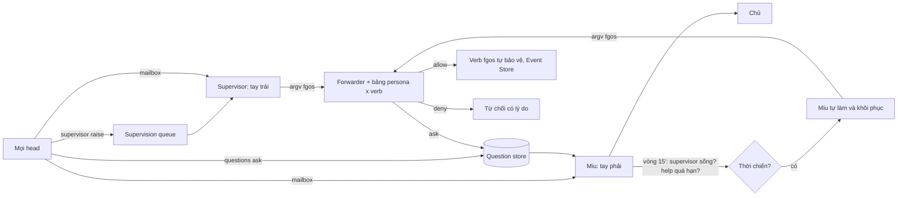

# Heads that keep work moving without the owner: motivation and capability — DISCUSSION

discussion: settled

## Hand-off cho planner (2026-11-23 23:55)

**Outcome.** Miu và supervisor có đủ năng lực vận hành mà không cần chủ chạy tay, và mọi head có một kênh xin trợ giúp:
- Supervisor (tay trái) trông mọi agent không có lead.
- Miu (tay phải) để năng lực ngủ, chỉ dùng khi không còn supervisor, và khi đó khôi phục bộ máy.
- Việc chạm vào thứ dùng chung đi qua một ô cửa: bộ chuyển tiếp argv `fgos` cộng một bảng quyền dạng dữ liệu.
- Việc riêng của vai thì nới lồng.

**Constraints.**
- RUL104 và L10: đổi contract thì chuyển mọi caller và xoá đường cũ trong cùng đợt.
- Không ghi gì vào `.fgos` qua grant (`validateWorkspacePaths`).
- Shell thô chạy ngoài lồng không bao giờ là `allow`; nó thành câu hỏi gửi chủ, kèm đúng argv.
- Bám footprint của plan đang chạy 261121-2110-component-authority-doors và của draft 261122-0056. Cả hai đều chạm `src/session-host/head-request.mjs` và routing.

**Non-goals** (mỗi mục đã có chủ riêng):
- Nhịp và keeper: plan 0056.
- Wake-on-mail: plan 261030-0323.
- Gate door `decide`: plan 261030-1029. Khi gate door xong, nó chuyển `ask` thành tự chạy nếu việc nằm trong khung.
- Luật theo mẫu shell.
- maxLeads theo năng lực máy: `p-tyowvhthul`.
- `session type` không submit: `p-lfwmzs6zsr`.

**Acceptance criteria.**
1. Mỗi task ở §7 qua lệnh verify của nó.
2. `npm test` và `cargo test --workspace` xanh.
3. Bản sửa đã vào release đang chạy, và probe sống `node test/live/head-grant-probe.live.mjs` chứng minh từng verb hoặc grant đã đổi. Chủ build và activate vào sáng 2026-11-24, rồi chạy probe.

**R1 đã chốt (PC-D9):** supervisor release theo quy trình cố định, xem T6. Lần build và activate đầu tiên (sáng 2026-11-24) vẫn do chủ làm tay.

**Nguồn:** `p-g5ktat4kej`, `p-v6xinnjoxh`, `p-dw3h5wscns`, `p-ndortdckid`, `p-ia2v33b54u`, `p-btxvtb34u3`, `p-oqs75qwyco`, cùng các quyết định PC-D1 đến PC-D8.

## 1. Trạng thái hiện tại

**Settled 2026-11-23 23:55**, giao cho planner. Chủ đi ngủ và muốn đội làm xong phần implement trong đêm; sáng 2026-11-24 chủ build và activate.

**Đã chốt:**
- PC-D1, PC-D2: vai trò của Miu và supervisor.
- PC-D3: hàng rào cộng ô cửa.
- PC-D4: bật lại supervisor manual tạm thời. Hiện chưa có phiên manual nào chạy.
- PC-D5: kênh xin trợ giúp.
- PC-D6, PC-D7, PC-D8: shaper chốt theo yêu cầu "làm trước" của chủ, dựa trên hội đồng và bảng kiểm đếm. Chủ có thể phủ quyết sáng mai.

**Đã rút lại:** tick riêng cho supervisor (giao cho keeper của 0056) và luật theo mẫu shell.

**Còn mở:** không. R1 đã chốt thành PC-D9 lúc 23:58.

## 2. Mục tiêu & đề bài

Khi chủ vắng mặt, công việc vẫn phải chạy như thời còn phiên lead:SUPERVISOR thủ công. Head có quyền vận hành thì phải có năng lực vận hành. Head nào cũng phải tự có động lực đúng với vai của mình:
- Miu thức khi có tin mới dành cho chủ: chủ gõ, có thư, có câu hỏi cần trình, có kết quả cần báo.
- Supervisor thức theo nhịp đồng hồ, vì công việc vẫn tiến hoặc chết dù không ai lên tiếng.

Năng lực được giới hạn bằng hàng rào quanh những thứ cần bảo vệ, không bằng danh sách việc được làm. Có đúng một cửa nâng quyền, dựng trên các cửa có sẵn. Chủ chỉ bị hỏi về lựa chọn ngoài khung đã duyệt, không bao giờ bị nhờ chạy lệnh. Không quay đầu: tận dụng watcher, wake, plan khung điều phối 261122-0056 và plan gate door 261030-1029. Theo RUL104, kết quả phải nhỏ đi chứ không to ra: 28 verb viết tay và mớ tinh chỉnh sự kiện phải co lại.

## 3. Vấn đề rõ / chưa rõ

| # | Điểm | Trạng thái | Ghi chú |
|---|------|-----------|---------|
| Q1 | Bảng verb dạng dữ liệu | **huỷ** 20:30 | Vẫn là liệt kê. |
| N1 | Nhịp của supervisor: thức theo mức (trạng thái) thay vì theo cạnh (sự kiện) | đề xuất, chờ chủ | §6.1. Không trái PS-9 và OS-D8, vì sự kiện được khoá theo trạng thái nên còn lệch thì còn raise lại. |
| N2 | Nhịp của Miu | phần lớn đã có | Miu đã có vòng `/loop` 15 phút (plan 0118 phase 10, phương án C). Còn phải kiểm danh sách Miu nhìn mỗi vòng. |
| C1 | Hàng rào | rõ | Confinement chỉ cam kết "không ghi ra ngoài grant". `.fgos`, `.git` và main checkout chỉ đọc. Các cửa có sẵn đã tự bảo vệ: `worktree remove --delivered-to`, `git recover`, khoá main checkout, cấm `.fgos` trong grant. |
| Q2 | Cửa nâng quyền quản lý lệnh thế nào | **mở, hội đồng 23:20 khuyến nghị hướng lai** | Đề xuất 23:05: mọi lệnh, luật theo vai dạng dữ liệu (allow, ask, deny), mặc định ask. Bản cũ "chỉ fgos" bị chủ bác. |
| Q3 | Làm sớm phần tick khoá theo trạng thái và cửa nâng quyền trước khi plan 0056 hết bị chặn, hay chờ | **mở**, sẽ hỏi | Plan 0056 đang draft và bị chặn bởi 4 plan. Chủ đang làm tay mỗi ngày. |
| Q4 | Điều kiện cho supervisor manual nghỉ hưu chưa đạt mà đã tắt | **đã quyết PC-D4** (20:43): bật lại tạm | `docs/platform/supervision/spec.md:223`: supervisor head phải tự chạy trọn một plan. Chưa có bằng chứng điều này đã xảy ra. |
| P2 | Lead xong hoặc rảnh mà không phát sự kiện | được N1 hấp thụ | `p-iatzcg2gee`, `p-4uqiyjwrtd`, `p-xuazywhh56`, `p-g6heszkdc7`, `p-xpeg4jshiu` trở thành các điều kiện lệch của tick. |
| P3 | `session type` không submit | ngoài phạm vi | `p-lfwmzs6zsr` |
| P4 | maxLeads theo năng lực máy | giữ dòng riêng | `p-tyowvhthul`. Đặt maxLeads thì đi qua cửa nâng quyền với `config patch`. |
| C2 | Xem lại cỡ lồng của Miu và supervisor theo nguyên tắc riêng-nới-lồng, chung-qua-ô-cửa | **đề xuất 23:35, chờ chủ** | Xem §5 23:28. |
| M1 | Mọi head gửi thư được cho Miu và supervisor; thư đánh thức người nhận đang rảnh | **đề xuất 23:40** | §5 23:40. Lead và planner hiện có `mailbox: false`. |
| H1 | Kênh xin trợ giúp: mọi head raise lên supervisor; tự chuyển sang Miu khi không có supervisor | **đã chốt PC-D5** | §5 23:50 |
| R1 | Bản sửa head chỉ xong khi đã vào release đang chạy và có probe sống chứng minh; ai đưa release lên | **đã chốt PC-D9** | §5 23:45. `e900a7e10` chưa vào release `edf91f57`. |
| P5 | Gom 28 verb vào một bộ chuyển tiếp | theo Q2 | Theo L10 và RUL104, phải làm cùng đợt hoặc mở item riêng có tên. |

## 4. Quyết định đã chốt

| D-ID | Quyết định | Ngày | Nguồn |
|------|-----------|------|-------|
| PC-D1 | **Miu là tay phải, luôn thức cạnh chủ, và là người khôi phục bộ máy.** Quyền của Miu cao nhất sau chủ; việc gì supervisor làm được thì Miu cũng có quyền làm. Năng lực đó để ngủ và chỉ dùng khi không còn ai làm được. Thời bình, Miu trao đổi với chủ, làm rõ và sắp xếp mục tiêu, giảm tải cho chủ, không nhúng tay vào vận hành. Khi supervisor chết hoặc bất lực, Miu tự làm việc vận hành và đánh thức mọi thứ cho tới khi bộ máy chạy lại. Mỗi vòng soát, Miu xem bộ máy còn sống không. Mở rộng SP-D1 (ds-nmk2mz6vkk, 2026-11-19). | Chủ 20:35, xác nhận 20:38 sau hai lần phát biểu lại | 2026-11-23 |
| PC-D2 | **Supervisor là tay trái, trông coi mọi agent đang hoạt động không có lead trông.** Phạm vi gồm lead, shaper, planner, và bất kỳ pane hay agent nào được bật lên mà không có lead. Worker thuộc một lead thì do lead đó lo. Supervisor có đủ tay chân vận hành qua một cửa nâng quyền có hàng rào. Nhịp theo đồng hồ: mỗi nhịp đối chiếu những gì đang sống với những gì phải có, không phụ thuộc có ai báo. | Chủ 20:35, xác nhận 20:38 | 2026-11-23 |
| PC-D4 | **Bật lại phiên lead:SUPERVISOR thủ công, không confine, như một biện pháp tạm.** Phiên này chạy cho tới khi điều kiện nghỉ hưu ở `docs/platform/supervision/spec.md:223` đạt: supervisor head tự chạy trọn một plan, không lệnh nào do lead:SUPERVISOR gõ. Đây là quyết định vận hành của chủ, không phải thiết kế, và không làm điều kiện nghỉ hưu nhẹ đi. | Chủ 20:43, trả lời trực tiếp câu shaper nêu | 2026-11-23 |
| PC-D5 | **Một kênh xin trợ giúp cho mọi head.** Mọi persona được `supervisor raise` (loại coordination-help). Yêu cầu vào hàng đợi và đánh thức supervisor. Thời bình, head không nói chuyện thẳng với Miu; việc cần chủ quyết đi qua question store, và Miu trình lên chủ. Khi không có supervisor, hoặc yêu cầu trợ giúp nằm chưa xử lý quá ngưỡng, vòng soát của Miu nhận việc và khôi phục bộ máy (PC-D1). Mailbox chỉ dùng để trao đổi. | Chủ "đồng ý", 23:40, cho đề xuất H1 | 2026-11-23 |
| PC-D6 | Ô cửa theo hướng lai. Đơn vị quyền là argv `fgos`, chạy không qua shell. Quyết định nằm trong một bảng dữ liệu `persona × tiền tố verb fgos → allow, ask hoặc deny`, có kế thừa (head < supervisor < Miu), có `can-i`, và mỗi luật có test. Các nhánh chỉ chuyển tiếp thì xoá. Các nhánh có chính sách thật giữ code riêng: `land`, `run`, `session start/stop/write`, `questions`. `SUCCESSOR_READ_VERBS` gộp vào bảng. Ba thứ luôn bị từ chối: khoá grant và confinement (chống tự nâng quyền), đối số đổi cwd, root hoặc env, và activate release. Verb chưa tự bảo vệ giữ ở `ask`. | Hội đồng ba góc nhìn đồng thuận (23:20); kiểm đếm cho thấy khoảng 14 trên 18 việc đặc quyền đã có verb `fgos`; chủ dặn "làm trước" (23:50) | 2026-11-23 |
| PC-D7 | Xem lại lồng của Miu và supervisor trong đợt này. Nới cho việc riêng: friction, gửi thư, `fgos answer`, và chẩn đoán vì sao full test không chạy được trong lồng. Siết chỗ đang quá rộng: peers giữ pid namespace của host. Đo trước và sau bằng probe sống. | Đề xuất 23:35; chủ không phản đối và dặn "làm trước" | 2026-11-23 |
| PC-D8 | Mọi head gửi được thư cho Miu và supervisor: lead và planner được bật mailbox, nhưng chỉ gửi tới hai tay. Đánh thức bằng thư thuộc plan 0323. | Đề xuất 23:40; chủ không phản đối | 2026-11-23 |
| PC-D9 | **Release của coding domain (không phải quy trình của fgOS).** Repo forgent phát triển fgOS bằng coding domain, nên công thức release của nó là công thức của coding domain. Công thức: main có bản sửa mới đã land, các lệnh verify mà project khai báo đều xanh, và không lead nào đang land; khi đó chạy `fgctl upgrade`, rồi chạy probe sống; nếu probe hỏng thì tự quay về release trước (`previousArtifactDigest`); cuối cùng gửi báo cáo, không hỏi. Release này đảo ngược được, nên theo PC-D10 supervisor tự làm. Nếu bản mới làm hỏng chính supervisor, Miu quay về. Công thức nằm phía coding domain hoặc trong dữ liệu của project, không nằm trong skill supervisor. Supervisor dùng nó qua quy tắc chung của PC-D10. | Chủ "đồng ý A" 23:58; chủ yêu cầu ghi rõ là của coding domain lúc 00:10 | 2026-11-23 |
| PC-D10 | Miu và supervisor giữ nguyên tính domain-free (SP-D1). Không đưa coding domain, hay riêng repo fgOS (mission #3), vào phần điều phối cấp cao. Quy trình release của PC-D9 có hai phần. Phần chung nằm trong skill supervisor: điều kiện, áp dụng, probe, rollback, báo cáo. Công thức cụ thể là dữ liệu do project khai báo: kiểm gì, chạy lệnh nào, probe gì, quay về bằng gì. Với repo forgent, công thức đó là `land.gates` xanh, rồi `fgctl upgrade`, rồi `test/live/head-grant-probe.live.mjs`, rồi `previousArtifactDigest`. Một project hay workflow khác khai báo công thức của riêng nó, hoặc không khai báo thì không có bước rollout. Theo cùng cách đó, "lồng chạy được full test" (T4) có nghĩa là lồng chạy được các lệnh verify mà project khai báo, và "lead land code" có nghĩa là lead land sản phẩm của plan. | Chủ nhắc 00:00 "coi chừng lại đưa coding domain vào high-level orchestration"; shaper rà lại và sửa | 2026-11-24 |
| PC-D3 | **Năng lực được giới hạn bằng hàng rào quanh thứ cần bảo vệ, cộng một cửa nâng quyền chung, không bằng danh sách verb.** | Chủ 20:30 ("2 là đúng"), giữ nguyên qua 20:35 | 2026-11-23 |

## 5. Q&A log

### 2026-11-23 20:40 — vòng 1: scout và nghiên cứu thế giới

**Scout repo.**
- `src/session-host/head-grants.mjs:42-77`: bảng `GRANTS` theo persona. Supervisor đã có `config patch`.
- `src/session-host/head-request.mjs:770-850`: 28 nhánh `case` viết tay, mỗi nhánh gọi `hostCall` ra host. Về bản chất đây đã là một broker nâng quyền, nhưng chính sách nằm trong code.
- Phiên supervisor `head-supervisor-forgent-526` lúc 20:01 không gọi `config patch` vì không có cách tự hỏi quyền. Kết quả là `q-ptcieh72p6` rơi về chủ.

**Thế giới làm gì.** polkit ([polkit(8)](https://www.freedesktop.org/software/polkit/docs/0.112/polkit.8.html)), Kubernetes RBAC và operator ([memcached-operator RBAC](https://c5c3.github.io/memcached-operator/reference/backend/operator-rbac-least-privilege.html), [Unit42](https://unit42.paloaltonetworks.com/agentic-ai-kubernetes-operator-risks/)), Atlantis ([runatlantis](https://www.runatlantis.io/blog/2018/terraform-and-the-dangers-of-applying-locally)), Codex sandbox cộng auto-review ([sandboxing](https://developers.openai.com/codex/concepts/sandboxing), [auto-review](https://developers.openai.com/codex/auto-review)), Claude Code permissions ([docs](https://code.claude.com/docs/en/permissions)), và Erlang/OTP monitor ([links and monitors](https://cloudstreet-dev.github.io/Let-Erlang-Crash/chapters/13-links-and-monitors.html)). Điểm chung: một broker, chính sách là dữ liệu hoặc phán đoán, chủ thể tự tra được quyền, việc lặp lại giao cho một controller, và controller đối chiếu theo nhịp.

### 2026-11-23 20:18–20:30 — trao đổi với chủ

- Chủ hỏi em có biết vấn đề đang bàn là gì không, rồi bảo em nói lại vai trò của supervisor và Miu. Hai bên thống nhất: hai head *không tự có động lực*, và supervisor *có quyền mà không có năng lực*.
- Chủ (20:24): "giải quyết tổng quát và thông minh, không lắt nhắt… tắt supervisor manual đi là chết hết, kiểu như chưa hề có cải tiến nào".
- Shaper chẩn đoán: thay phán đoán sống bằng danh sách liệt kê trước. Shaper đề xuất ba điểm: (1) supervisor đối chiếu theo nhịp, (2) rào quanh thứ cần bảo vệ cộng một cửa nâng quyền, (3) phán đoán để lại cho LLM.
- Chủ (20:30): "2 là đúng; 3 phải quét lại code, kế hoạch, backlog hiện tại, không thể quay đầu 180 như vậy." Q1 bị huỷ.
- Chủ hỏi xu hướng, cách và chu kỳ hành động của Miu và supervisor khác nhau ra sao. Shaper trả lời: Miu hướng ra ngoài và theo nhịp của chủ, thức theo tin dành cho chủ. Supervisor hướng vào trong và theo nhịp công việc, thức theo đồng hồ. Thiết kế hiện tại đánh thức cả hai theo sự kiện, và kiểu đó sai bản chất với supervisor.

### 2026-11-23 20:40 — vòng 2: quét hiện trạng (ba bản quét chỉ đọc)

**Động lực.**
- Watcher đã tick theo systemd timer mỗi 60 giây, chạy bằng code, không gọi LLM (`packages/distribution/rust/src/timer.rs:157-166`; `packages/supervision/rust/src/watcher.rs:198-384`).
- Supervisor, khi đã thức, đã đối chiếu toàn bộ portfolio: `supervisor plans` và skill bảo "kiểm cả khi queue rỗng" (`.agents/skills/fgos-supervisor/SKILL.md:29,60-69`).
- **Chỗ gãy duy nhất** nằm ở hai điều:
  1. Id của sự kiện được băm theo `kind|subject|ts` (`watcher.rs:192`), và hàng đợi khử trùng lặp ngay cả sau khi sự kiện đã xử lý. Hệ quả: trạng thái lệch kéo dài không bao giờ raise lại. `lead-ended` chỉ bắt trạng thái `retired`. `session-idle` đếm bản ghi chứ không đo thời gian im (spec §6.1).
  2. `wake.rs:231` trả `NothingUnhandled` khi queue rỗng.
- Tick riêng cho supervisor từng được thiết kế, rồi bị bỏ trước khi viết code. Ngày 2026-11-18 nó được thay bằng watcher tick cộng wake theo sự kiện (PS-13, commit ca060ba79 và fe8db5304).
- Plan 0056 (keeper mọc từ `wake.rs`, OS-D7; bản ghi lịch tính lại mỗi tick) là chủ sở hữu tự nhiên của hướng này. Plan này đang draft và bị chặn.
- Miu đã có `/loop` 15 phút (`core/skills/fgos-secretary/SKILL.md:24-31`).

**Năng lực.**
- Confinement chỉ cam kết: không ghi file host ngoài grant, không thấy login hay socket điều khiển của bên khác (`docs/platform/agent-confinement/spec.md:117-172`).
- Repo, `.git` và `.fgos` chỉ đọc chứ không bị giấu (`bwrap.mjs:597-605`).
- Chưa từng có cửa nâng quyền chung. Supervisor manual chính là cửa nâng quyền trên thực tế.
- Gate door 261030-1029 (trạng thái ready, chưa build) đã thiết kế `decide → auto|ask|deny` từ dữ kiện, cấp theo khung, và ghi vào Event Store. Đó chính là bộ quyết định mà một cửa nâng quyền cần.
- Các cửa tự bảo vệ đã có sẵn:
  - `worktree remove --delivered-to` (từ chối khi chưa land);
  - `git recover`;
  - khoá main checkout;
  - `config patch --project-only`.
- Lỗ hổng đã biết: cổng land chạy `sh -c` không confine (`p-nqftk5hypy`). Đây là lý do không nên cho shell thô đi qua cửa nâng quyền.

**Thống kê commit 3 ngày.** 39 commit trên session-host và run-supervisor. Khoảng một nửa là verb, grant và đường ghi. Không commit nào đụng tới mô hình kích hoạt: mọi lần thức vẫn là một sự kiện mà head phải tự để ý.

### 2026-11-23 20:35–20:40 — vai trò Miu và supervisor; đối chiếu độ phủ

Chủ (20:35): bản khớp đúng 90%. "Anh tưởng là watcher giữ được nhịp rồi, ai dè." Miu là tay phải, supervisor là tay trái. Miu làm được như supervisor nhưng chỉ khi cần. Miu luôn thức cạnh chủ; nếu không còn ai làm được việc thì Miu phải làm, và nếu không còn supervisor thì Miu khôi phục bộ máy. Thời bình Miu chỉ trao đổi với chủ, sắp xếp và làm rõ mục tiêu. Supervisor trông mọi agent đang hoạt động, trừ worker có lead theo dõi: shaper, planner, và mọi pane hay agent bật lên mà không có lead. Chủ xác nhận lời phát biểu lại (20:38), dẫn tới PC-D1 và PC-D2. Chủ hỏi có cần ghi rõ vai trò không, và bảo xem plan và backlog hiện tại đã phủ chưa.

**Đối chiếu độ phủ (20:40):**

| Việc | Đang được phủ bởi | Khoảng trống |
|---|---|---|
| Ghi rõ vai trò của hai head | SP-D1 (ds-nmk2mz6vkk, 2026-11-19) mới nói phần thời bình của Miu | Bảng grant và skill nói ngược PC-D1. Skill secretary dòng 18 nói "watcher… là của supervisor". Dòng 85 liệt kê `session read`, `session type`, `supervisor handled`… là "not in your grant". Chưa có điều lệ vai trò ở spec. |
| Supervisor thức theo trạng thái | Watcher timer đã cài và bật trên máy này (`~/.config/systemd/user/timers.target.wants/fgos-watcher-e9756c48.timer`). Keeper của 0056 đang draft và bị chặn. Bảy dòng vá từng cạnh: `p-iatzcg2gee`, `p-4uqiyjwrtd`, `p-xuazywhh56`, `p-g6heszkdc7`, `p-xpeg4jshiu`, `p-du3gbevrs5`, `p-ogziciqtrb`. | Chưa dòng nào nhắm gốc rễ là sự kiện khoá theo thời điểm (`watcher.rs:192`). Watcher có nhịp, nhưng tình trạng lệch kéo dài không được báo lại. |
| Cửa nâng quyền | `decide` của gate door 261030-1029 (ready, chưa build) | Chưa có plan cho cửa nâng quyền. Chưa tính tới Miu. "Done when" của `p-g5ktat4kej` còn ghi "fixed verb list". |
| Miu canh supervisor và khôi phục bộ máy | Watcher tự xử `supervisor-stuck` và `supervisor-wake-failed` bằng code (`docs/platform/supervision/spec.md:141`) | **Hoàn toàn chưa phủ.** Không có gì bắt Miu soát supervisor, và không có đường để Miu tự vận hành hay khôi phục. Cũng chưa có ai canh chính watcher. |
| Supervisor trông mọi agent không có lead | `p-v6xinnjoxh` (proposed, P1) cho shaper và planner; `p-6hqvgokerb` đóng planner/lead đã xong; `p-5gczifzh7h` kiểm thứ lead đang chờ | Chưa có plan nào. "Pane hay agent bất kỳ không có lead" chưa có trong `p-v6xinnjoxh`, dòng đó chỉ nói tới head. |
| Vòng soát của Miu | 0118 phase 10 (`/loop` 15 phút, đang chạy) | Danh sách soát chưa có mục "supervisor còn sống không". |
| Điều kiện nghỉ hưu của supervisor manual | `docs/platform/supervision/spec.md:223` | Chưa có bằng chứng điều kiện đã đạt. |

### 2026-11-23 20:50 — đối chiếu với plan khung điều phối 261122-0056

Chủ hỏi plan orchestration-skeleton có liên quan gì không. Shaper đọc `plans/261122-0056-orchestration-skeleton/plan.md`.

**Plan 0056 chính là nửa động lực.**
- Outcome của nó: "fgOS keeps its own rhythm without a person watching" (OS-D3).
- Keeper viết bằng code, mọc từ `wake.rs`. Mỗi tick nó đọc lại các scheduling record, rồi tự nhận plan và áp `maxLeads` bằng code (phase 1). Nó start hoặc wake player mà record đang `needs` (phase 4, 5, 6), và chỉ gọi LLM khi "needs judgement".
- Phase 16 cho một view mọi agent đang sống hoặc đang ngủ (`fgos session list`).
- Đề xuất "sự kiện khoá theo trạng thái" ở §6.1 vì vậy sẽ trùng keeper (L10), và được **rút lại**.

**Plan 0056 gần chạy được.** Trong `blockedBy`, s6a, work-data-model và component-authority đều đã `done`. Chỉ còn component-authority-doors đang `running`. Phase 1 và 16 ở wave 1, sẵn sàng.

**Plan 0056 không phủ các việc sau:**
1. Miu làm người canh và khôi phục bộ máy, kể cả keeper và watcher (PC-D1).
2. Cửa nâng quyền. Plan đặt "Merging Questions with the Workflow gate" vào non-goal.
3. Agent không có scheduling record, như pane hay agent bật tay (PC-D2). Keeper chỉ lo những thứ có record.
4. Điều lệ vai trò ở spec, skill và grant.

**Điểm cần planner kiểm:** "an `until` that passes raises exactly one event across repeated ticks" vẫn là kiểu báo một lần. Planner cần xác nhận rằng keeper tự tính lại record mỗi tick, để judgement bị bỏ lỡ không làm việc treo mãi.

### 2026-11-23 23:05 — chủ bác "chỉ nhận lệnh fgos"; cách thế giới bật tắt lệnh theo vai

Chủ hỏi: tư tưởng nào lại bỏ hết lệnh shell? Làm sao bật tắt lệnh cho từng loại agent mà không rối? Thế giới quản lý kiểu gì? "Anh tưởng sandbox nhốt thì có phá cũng chỉ phá trong sandbox, giờ cắt chân tay luôn thì còn làm gì được."

Shaper nhận lỗi: đề xuất "chỉ nhận verb fgos" là quá tay, và đã trộn hai chuyện khác nhau.

**(1) Trong sandbox, Miu và supervisor đã có toàn bộ shell.** Phá thì chỉ phá trong sandbox. Không có gì bị cắt, và điều đó giữ nguyên.

**(2) Cửa nâng quyền chỉ dành cho việc có tác dụng ra ngoài sandbox,** như `.git` của main, `.fgos`, config, hay worktree. Với loại việc này, thế giới quản lý bằng luật theo vai, không cấm hẳn shell:
- Codex `prefix_rule`: mỗi luật gồm một mẫu lệnh và một quyết định `allow`, `prompt` hoặc `forbidden`. Khi nhiều luật cùng khớp, luật chặt nhất thắng. Luật có ví dụ `match` và `not_match` được kiểm ngay lúc nạp, và `codex execpolicy check` cho biết một lệnh sẽ được quyết thế nào. Lệnh ghép được xét từng phần ([Codex rules](https://developers.openai.com/codex/rules)).
- Claude Code: luật deny, ask, allow theo mẫu `Bash(prefix:*)`, xét theo thứ tự deny, rồi ask, rồi allow ([permissions](https://code.claude.com/docs/en/permissions)).
- sudoers dùng nhóm người và alias lệnh. Kubernetes dùng Role, RoleBinding và `kubectl auth can-i`.

**Hình dạng đề xuất mới:**
- Một file luật duy nhất, dạng dữ liệu, gồm các dòng `vai × mẫu lệnh → allow | ask | deny`.
- Vai kế thừa nhau: luật chung cho mọi head, rồi phần thêm cho supervisor, rồi phần thêm cho Miu.
- Lệnh không khớp luật nào thì mặc định là `ask`, tức là thành câu hỏi gửi chủ, không bị cấm câm.
- `deny` dành cho thứ cần bảo vệ (hàng rào, PC-D3).
- Có lệnh `can-i` để tra, có test cho từng luật, và mọi lần gọi đều ghi log.
- Bật hay tắt một lệnh cho một vai là sửa một dòng.

Câu hỏi cũ "chỉ nhận lệnh fgos hay mọi lệnh" được thay bằng câu hỏi này.

### 2026-11-23 23:20 — hội đồng ba góc nhìn và kiểm đếm

Chủ (23:12): "sao lại đổi 180 rồi, có gì không ổn không, mở hội đồng thảo luận đi." Shaper nhận mình tự mâu thuẫn: lúc 20:30 đã bác "bảng dữ liệu" vì cho là vẫn liệt kê, đến 23:05 lại đề xuất một bảng khác. Shaper mở ba agent council, mỗi bên một góc nhìn: giả định, vòng phản hồi, ship và bảo trì. Ba bên chạy độc lập, chung một brief trung lập (dữ kiện và bốn phương án A, B, C, D), brief không ghi phương án shaper nghiêng về.

**Kết quả: cả ba cùng một hướng.** "A hay B" là câu hỏi sai. Thực ra có hai lựa chọn riêng:
1. Đơn vị quyền là gì: verb `fgos` tự bảo vệ, hay chuỗi shell?
2. Quyết định ghi ở đâu: code viết tay, hay dữ liệu?

Cả ba chọn **verb `fgos` làm đơn vị quyền, và dữ liệu làm nơi ghi quyết định.** Cụ thể:
- Có một bộ chuyển tiếp argv `fgos`, không qua shell.
- Có một bảng `vai × tiền tố verb fgos → allow | ask | deny`, vai kế thừa (head < supervisor < Miu), kèm `can-i`.
- 28 nhánh viết tay và `SUCCESSOR_READ_VERBS` gộp về bảng đó.
- Shell thô chạy ngoài sandbox không bị cấm, mà thành `ask` kèm đúng lệnh.
- Shell trong sandbox giữ nguyên.
- Khi gate door được xây, nó chuyển `ask` thành tự chạy nếu việc nằm trong khung đã duyệt.

**Vì sao không chọn B (luật theo mẫu shell):**
- Head chạy ngoài lồng có cùng user với `.git`, `.fgos` và release. Tiền tố lệnh không nói được lệnh sẽ tác động tới đâu: `-C`, `sh -c`, chuyển hướng output và biến môi trường đều đi vòng qua được.
- Danh sách deny phải kể hết mọi cách gây hại, nên không bao giờ xong.
- Bảng tự nới dần ra mỗi khi chủ chán trả lời lại cùng một câu hỏi.
- Cùng loại lỗ hổng đã có ở `p-nqftk5hypy`.

**Ba lỗ phải đóng trong cùng đợt:**
1. Tự nâng quyền: các khoá grant và confinement phải là `deny` với mọi head, vì `config patch` có thể tự mở rộng grant.
2. Verb chưa tự bảo vệ (`run` không có `--writes`, cổng land) giữ ở mức `ask`.
3. Forwarder từ chối đối số đổi project root, cwd hoặc env.

**Kiểm đếm (bằng chứng cả ba bên cùng đòi):** `fgos questions --all`, các câu Miu và supervisor hỏi chủ từ 2026-11-20 tới 23:20 ngày 2026-11-23. Có 21 câu:

| Nhóm | Số câu | Ví dụ | Đã có verb `fgos` |
|---|---|---|---|
| Ghi config (pin planner, maxLeads, ngưỡng xoay vòng) | 6 | q-o3omqvtsuc, q-ptcieh72p6, q-p5p5q5jlvy | có, `config patch` hoặc `config set` |
| `git recover` | 3 | q-wjecldhcmr, q-7t27x2qfk2, q-hlbqhlyrct | có |
| Gỡ worktree hoặc land candidate cũ | 3 | q-luhbwwvlpc, q-dcbq73d2rr, q-ptcieh72p6 | có, `worktree remove --delivered-to` |
| Activate release, probe account | 2 | q-dcbq73d2rr, q-rfxqncjrax | có. Activate phải là `deny` hoặc `ask` vì nó đổi bộ máy. |
| Ghi file ngoài grant (backlog index, CHANGELOG) | 3 | q-nudu6zlusf, q-ec5bdhkwoz, q-q6peavqy7b | có `session write`; thiếu grant (`p-dw3h5wscns`) |
| Chạy full `npm test` hoặc `cargo test` trên host | 3 | q-zcileomdpa, q-br5rlczzav, q-pcwf3slkfp | **không.** Đây không phải việc đặc quyền mà là sandbox không chạy được node hoặc cargo. Là bài toán khác: năng lực bên trong lồng. |
| Git thô (unstage board log) | 1 | q-gelkp64lo4 | không |
| Lựa chọn thật hoặc chuyển tin | 3 | q-yoxcjqa46z, q-7wfzidusod, q-4lmw3q6la7 | đúng là việc phải hỏi chủ |

Phân bố: khoảng 14 trên 18 việc đặc quyền đã có verb `fgos`. Chỉ 1 là lệnh shell thô. Nhóm thiếu lớn còn lại là 3 lần chạy test trên host, và đó là lỗ năng lực *trong* sandbox, không phải lỗ quyền. Kết quả kiểm đếm ủng hộ hướng lai của hội đồng.

### 2026-11-23 23:28–23:35 — lồng lớn, lồng nhỏ

Chủ hỏi: đã nhốt trong lồng thì sao còn làm ngoài lồng; có lồng lớn lồng nhỏ không? Shaper trả lời: có, mỗi vai một cỡ lồng (`head-grants.mjs`). Thứ dùng chung (`.git` của main, `.fgos`, release) được cố ý đặt ngoài mọi lồng. Lý do không phải vì agent không đáng tin, mà vì mọi phiên cùng sửa chúng, nên chỉ chương trình `fgos` được sửa, có khoá và có ghi sổ. Nguyên tắc đề xuất: **thứ riêng của vai thì nới lồng; thứ dùng chung thì đi qua ô cửa.** Mỗi vai có hai cái núm: cỡ lồng, và bảng ô cửa.

Chủ hỏi có xem lại lồng của Miu và supervisor trong đợt này không. Shaper đề nghị **có**, theo cả hai chiều:
- **Lồng đang quá chật với việc riêng:**
  - `p-ndortdckid`: không ghi được friction.
  - `p-ia2v33b54u`: Miu không gửi được thư.
  - `p-btxvtb34u3`: `fgos answer` gặp EROFS.
  - `/tmp` riêng nên supervisor không thấy scratch `par` trên host.
  - Ba lần chủ phải chạy full test hộ (q-zcileomdpa, q-br5rlczzav, q-pcwf3slkfp). Nguyên nhân sandbox không chạy được chưa được chẩn đoán.
- **Lồng đang quá rộng:**
  - `p-oqs75qwyco`: head có grant peers giữ pid namespace của host, nên gửi được signal tới mọi process cùng user.
  - `p-fimvrao5qk`: dấu hiệu confine chỉ là một biến môi trường, xoá được.
  - `p-x4qeqdvfl5`: vẫn tới được abstract socket và dịch vụ localhost.
- **Dùng lại:** probe grant sống của 0118 phase 11 (`test/live/head-grant-probe.live.mjs`) để đo từng điểm trước và sau.

### 2026-11-23 23:40 — head có gửi thư được cho Miu và supervisor không

Chủ thấy các head không gửi thư được cho Miu, và không rõ có gửi được cho supervisor không. Shaper kiểm:

**Grant.** `src/session-host/head-grants.mjs`: chỉ secretary, shaper và supervisor có `mailbox: true`. **Lead và planner có `mailbox: false`**, tức là không gửi thư được cho ai. Lead chỉ có `supervisor raise` để báo supervisor. Planner không có đường nào khác ngoài `questions ask`.

**Thử thật từ head shaper (23:40).** Gửi `fgos mailbox send --to head:secretary-miu` và `--to head:supervisor-forgent` đều được ghi và "delivered to the current holder" (claude-5vp4, claude-s2vh). Nội dung chỉ là một dòng báo kiểm tra.

**Nhưng "delivered" chưa có nghĩa là đã đọc.** Bên nhận chỉ thấy thư ở lần gọi tool tiếp theo, nên head đang rảnh không thấy cho tới khi bị đánh thức. `fgos mailbox status`:
- thời gian từ ghi tới khi được đưa: p50 khoảng 2 phút, p95 khoảng 1 giờ, max khoảng 6 giờ;
- 27 trên 53 thư đã đưa nhưng không ai trả lời;
- 92 lần bị từ chối `unknown-name`;
- danh sách có 161 head, phần lớn là `forgent-claude-*` cũ.

Plan wake-on-mail `261030-0323-mailbox-v9-wake-on-mail` chưa được làm.

**Cách khớp vào hướng của đợt này:**
- Mọi head phải với tới được hai tay. Theo PC-D1 và PC-D2, đó là đường báo cáo duy nhất của các head còn lại. Cách làm là một dòng grant.
- Thư phải đánh thức được người nhận đang rảnh. Phần này dùng lại 261030-0323. Trong lúc chờ, vòng 15 phút của Miu và nhịp của supervisor sẽ vớt thư.
- Các dòng liên quan: `p-ia2v33b54u` (Miu không gửi được thư lúc 2026-11-22, cần kiểm lại), `p-bifjfd5rix`, `p-whvn2fgyep`, `p-5igcekysul`.

### 2026-11-23 23:50 — kênh xin trợ giúp của head

Chủ: các head gần như không có kênh xin trợ giúp. Supervisor quản head là chắc chắn, nên head phải nói chuyện được với supervisor. Chưa rõ head có được nói chuyện với Miu không.

**Scout (`head-grants.mjs`):** `supervisor raise` là cách duy nhất vừa nằm trên hàng đợi vừa đánh thức được supervisor qua watcher. Hiện chỉ secretary, supervisor và lead có verb này. **Shaper và planner không có.** Planner còn không có cả mailbox (§5 23:40).

**Đề xuất của shaper:**
- **Một kênh xin trợ giúp cho mọi head, gửi tới vai "supervisor".** Đó là `supervisor raise` (loại `coordination-help`), mở cho mọi persona. Nó vào hàng đợi, đánh thức supervisor, và không bị lọt như thư. Mailbox chỉ dùng để trao đổi qua lại, không dùng để xin cứu.
- **Head không nói chuyện thẳng với Miu trong thời bình.** Như vậy Miu giữ đúng vai PC-D1: ở cạnh chủ và giảm tải cho chủ. Việc cần chủ quyết đã có sẵn kênh câu hỏi (question store), và Miu chuyển những câu đó lên chủ.
- **Tự chuyển sang Miu khi không có supervisor.** Head không phải tự chọn người nhận. Nếu một yêu cầu trợ giúp nằm chưa xử lý quá ngưỡng, hoặc watcher báo `supervisor-wake-failed` hay không có supervisor sống, thì vòng soát của Miu thấy và Miu khôi phục bộ máy (PC-D1). Đây đúng là "thời chiến" mà chủ mô tả.

### 2026-11-23 23:45 — supervisor có ghi được backlog không; bản sửa chưa vào release

Chủ hỏi supervisor có được ghi backlog không. Shaper kiểm:
- **Source:** commit `e900a7e10` (2026-11-23 17:46) thêm `plans/backlog.md` vào grant của secretary và supervisor, theo `p-dw3h5wscns` và quyết định `q-nudu6zlusf`.
- **Release đang chạy:** `~/.local/state/fgos/releases/sha256:edf91f57…/libexec/legacy-node/src/session-host/head-grants.mjs`, activate lúc 23:11, dòng 61 và 73 chỉ có `['plans', 'plans/backlog/*']`. Bản sửa **chưa vào release**, nên `session write plans/backlog.md` vẫn bị từ chối. `q-q6peavqy7b` (21:23) vẫn phải nhờ chủ thêm dòng index.

**Ý nghĩa với bài toán.** Head chạy bằng code của release đã activate, không chạy bằng source. Bản sửa nào chưa build, stage và activate thì head chưa nhận được. Supervisor manual chạy ngoài lồng nên che khoảng trễ này đi. Đây là một phần lý do khiến chủ thấy "tắt supervisor manual là chết hết, như chưa có cải tiến nào". Shaper chưa kiểm các bản sửa head khác trong ba ngày qua đã vào release hay chưa.

**Chủ (23:47):** chủ tự build và activate release bằng tay. **Hiện không có phiên supervisor manual nào đang chạy.** PC-D4 đã được chốt nhưng chưa thực hiện.

**Điểm mở R1:** bản sửa head chỉ được tính là xong khi đã vào release đang chạy và có probe sống chứng minh (dùng lại probe của 0118 phase 11). Ai đưa release lên khi source của head đổi, để chủ không phải làm tay mỗi lần? Activate là thao tác đổi bộ máy. Theo hướng ô cửa, mặc định nó là `ask`, và việc này cần chủ quyết.

### 2026-11-24 00:05 — land và release với các domain khác

Chủ nhắc: cái bẫy này từng xảy ra khi bàn orchestration-skeleton. Chủ hỏi land và release nghĩa là gì với các domain khác.

**Định nghĩa domain-free, khớp L9 (run ≠ merge ≠ durable):**
- **Land:** kết quả của một việc được ghi vào nguồn sự thật chung của project (main), qua một cửa có kiểm. Đây là cơ chế chung của fgOS. Mọi domain đều có sản phẩm là file: plan, tài liệu, bản copy, hồ sơ quyết định.
- **Release:** kết quả đã land bắt đầu *có hiệu lực ở nơi người dùng hoặc hệ thống ngoài nhìn thấy*. Release thuộc riêng từng domain, và chỉ domain đó biết release là gì.

**Mỗi domain hiểu release như sau:**
- Coding (repo forgent): `fgctl upgrade` để head dùng code mới. Release đảo ngược được qua `previousArtifactDigest`.
- Marketing: `domains/marketing/workflows/content-publish.yaml` coi publish là release. Gate `consent-before-publish` bắt người duyệt đúng bản copy đó. Thư đã gửi hay bài đã đăng thì **không đảo ngược được**.
- Business workflow (mission #2): gửi hoá đơn, cập nhật CRM. Phần lớn không đảo ngược được.
- Council: land là ghi hồ sơ quyết định. Release là áp dụng quyết định đó.

**Hệ quả cho PC-D9 và PC-D10:**
- Công thức release mà project khai báo phải nói rõ release đó **có đảo ngược được không**.
- Đảo ngược được, có probe và có rollback (như coding): supervisor tự làm rồi báo cáo.
- Không đảo ngược được (như marketing hay business): release luôn qua bước duyệt của người, đúng như `consent-before-publish` của marketing.
- Phần chung trong skill supervisor chỉ biết "đảo ngược được hay không". Nó không biết `fgctl`, `npm` hay `cargo`.

## 6. Thiết kế đã chốt {#design}

**Vai trò (PC-D1, PC-D2, PC-D5).**
- Supervisor là tay trái. Nó trông mọi agent đang chạy mà không có lead: lead, shaper, planner và pane bật tay. Nhịp của nó đến từ keeper của 0056, không thuộc đợt này. Nó nhận yêu cầu trợ giúp qua hàng đợi.
- Miu là tay phải. Thời bình, Miu chỉ trao đổi với chủ. Vòng soát 15 phút của Miu thêm hai câu hỏi:
  - Supervisor còn sống không?
  - Có yêu cầu trợ giúp nào nằm quá ngưỡng không?
- Nếu có chuyện ở một trong hai câu đó, Miu dùng năng lực đang ngủ (cùng bảng quyền với supervisor, cộng thêm phần riêng) để tự làm và đánh thức lại bộ máy.

**Lồng và ô cửa (PC-D3, PC-D6, PC-D7).**
- Mỗi persona có hai núm:
  - **Cỡ lồng:** các thư mục được ghi, dành cho việc riêng. Không bao giờ gồm `.fgos`, `.git` hay release.
  - **Bảng ô cửa:** những verb `fgos` được nhờ chạy ngoài lồng, mỗi verb gắn `allow`, `ask` hoặc `deny`.
- Luồng một yêu cầu qua ô cửa:
  1. Head gửi argv `fgos` qua request socket.
  2. Forwarder kiểm argv: không có cờ đổi cwd, root hay env. Sau đó tra bảng theo persona.
  3. `allow`: host chạy bằng execFile dưới identity của head. Verb tự giữ khoá và tự ghi Event Store.
  4. `ask`: gửi chủ một câu hỏi năm phần qua `questions ask`, kèm đúng argv.
  5. `deny`: từ chối, kèm lý do.
- `can-i <argv>` cho head biết kết quả trước khi làm.
- Khi gate door (1029) được build, `ask` đổi thành `decide` theo khung đã duyệt.

**Kênh liên lạc (PC-D5, PC-D8).**
- Xin trợ giúp: `supervisor raise`. Mọi head đều có.
- Trao đổi: mailbox. Mọi head gửi được tới hai tay.
- Việc cần chủ quyết: question store.

**Land.**
- Land là cửa duy nhất đưa thay đổi lên main, chạy dưới merge slot, với gate và kiểm footprint.
- Có hai dạng:
  - **Branch land:** đưa một nhánh lên main bằng fast-forward hoặc squash.
  - **Paths land:** commit đúng các đường dẫn được kê ra.
- Sau cải tổ, supervisor vẫn chỉ được paths land trên file portfolio thuộc grant của nó (plans, backlog, reports). Supervisor không land sản phẩm của plan (với coding thì đó là code); sản phẩm do lead land (PS-6, PS-14). Mọi câu chữ về vai đều domain-free (PC-D10).
- `land` giữ code riêng trong forwarder vì có chính sách thật (footprint, grant).

## 7. Danh mục hạng mục / task {#tasks}

Cả năm task nằm trong `src/session-host/`, skill và spec của nó. T3 chạm `head-request.mjs` nên va footprint của doors (đang chạy) và 0056 (draft). Planner quyết thứ tự, hoặc chờ doors xong.

### T1 — Điều lệ vai trò {#task-role-charter}
- **Mục tiêu:** ghi PC-D1, PC-D2 và PC-D5 vào:
  - `docs/platform/supervision/spec.md`
  - `docs/platform/session-host/spec.md`
  - `core/skills/fgos-secretary/SKILL.md`
  - `core/skills/fgos-supervisor/SKILL.md`

  Sửa các câu đang nói ngược lại (skill secretary dòng 18 và 85, chú thích về Miu trong `head-grants.mjs`).
- **Verify:** `npm run build:skills`, rồi kiểm bằng rg rằng không còn câu nào bảo Miu không được dùng năng lực khôi phục.

### T2 — Kênh xin trợ giúp và Miu tiếp quản {#task-help-channel}
- **Mục tiêu:**
  - Mọi persona có `supervisor raise` (loại `coordination-help`).
  - Vòng soát của Miu thêm hai câu hỏi ở §6. Ngưỡng nằm trong `core/config-standard`, kèm schema.
  - Skill nói rõ Miu tiếp quản thế nào.
- **Verify:** `node --test test/session-host/head-grants.test.mjs test/session-host/head-request.test.mjs`, cộng probe sống trong đó shaper và planner gọi raise.

### T3 — Ô cửa: forwarder argv fgos và bảng quyền {#task-window}
- **Mục tiêu:** làm theo PC-D6.
  - Thay `GRANTS.verbs` và các nhánh chỉ chuyển tiếp trong `runHeadRequest` bằng forwarder cộng bảng.
  - Thêm verb `can-i`.
  - Gộp `SUCCESSOR_READ_VERBS` (`packages/run-supervisor/rust/src/head_request.rs`).
  - Cập nhật contract `head-request.v1.json` và xoá đường cũ.
  - Mở cho supervisor, và cho Miu trong cùng bảng: `config patch`, `worktree remove --delivered-to`, `git recover`, `dispatch probe-account`, và `session write plans/backlog.md`.
- **Verify:**
  - `node --test test/session-host/head-request.test.mjs test/session-host/head-grants.test.mjs`
  - `cargo test -p fgos-run-supervisor`
  - Mỗi luật deny một test: khoá grant, cờ cwd, activate.
  - Probe sống từng verb.

### T4 — Xem lại lồng {#task-cage}
- **Mục tiêu:** làm theo PC-D7.
  - Chẩn đoán vì sao các lệnh verify do project khai báo (ở forgent là full `npm test` và `cargo test`) không chạy được trong lồng (q-zcileomdpa, q-br5rlczzav, q-pcwf3slkfp), rồi nới đúng chỗ đó mà không mở `.fgos`.
  - Đóng `p-ndortdckid`, `p-ia2v33b54u` (kiểm lại trước khi sửa) và `p-btxvtb34u3`.
  - Siết `p-oqs75qwyco`.
- **Verify:** probe sống trước và sau, ghi vào report của plan; cộng test của confinement driver.

### T5 — Mailbox cho lead và planner {#task-mail}
- **Mục tiêu:** làm theo PC-D8. Lead và planner có `mailbox: true`, nhưng chỉ gửi được tới vai secretary và supervisor.
- **Verify:** `node --test test/session-host/head-grants.test.mjs`, cộng probe sống gửi thư từ một lead.

### T6 — Quy tắc release chung, và công thức release của coding domain {#task-release}
- **Mục tiêu:** tách T6 thành hai phần.
  - **Phần fgOS (domain-free, PC-D10):** skill supervisor đọc công thức release mà project khai báo, rồi áp quy tắc: release đảo ngược được thì tự làm và báo cáo; release không đảo ngược được thì chờ người duyệt.
  - **Phần coding domain (PC-D9):** công thức `fgctl upgrade` cộng probe cộng rollback, khai báo phía coding domain hoặc trong dữ liệu project của forgent.

  Phần còn lại của mục tiêu theo PC-D9 và PC-D10. Công thức release phải khai báo nó có đảo ngược được hay không. Release đảo ngược được thì supervisor tự làm rồi báo cáo. Release không đảo ngược được thì luôn chờ người duyệt (§5 00:05). Skill supervisor chỉ mang phần chung: điều kiện, áp dụng, probe, rollback, báo cáo. Công thức là dữ liệu của project, chẳng hạn một khoá config hoặc doctrine của domain, không phải câu chữ trong skill. Công thức của forgent ghi ở phía project. Thêm một nhánh có chính sách riêng trong ô cửa, gồm:
  - kiểm điều kiện trước khi release: main có bản sửa head mới đã land, full test xanh, không lead nào đang land;
  - chạy `fgctl upgrade`;
  - chạy probe sống;
  - tự rollback nếu probe hỏng;
  - gửi chủ một báo cáo.

  Skill supervisor ghi lúc nào thì release. Skill Miu ghi cách quay về khi supervisor không lên lại được. Thay luật deny activate trong T3 bằng nhánh này.
- **Verify:** `node --test test/session-host/head-request.test.mjs`, gồm ba ca: từ chối khi test chưa xanh, từ chối khi đang có land, và rollback khi probe hỏng (dùng fixture `fgctl`). Cộng một lần chạy thật vào sáng 2026-11-24, sau khi chủ đã activate tay lần đầu.
