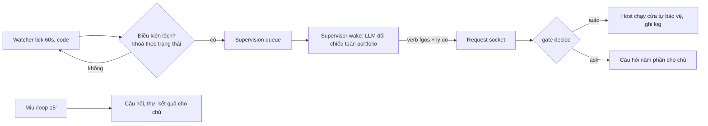

# Heads that keep work moving without the owner: motivation and capability — DISCUSSION

discussion: open

## 1. Trạng thái hiện tại

**Vòng 2 xong 2026-11-23 20:40.** Chủ và shaper đã thống nhất cách gọi tên vấn đề (§2). Shaper đã quét code, plan và backlog (§5, vòng 2) để khớp hướng mới vào những gì đang có, không quay đầu 180 độ (chủ dặn lúc 20:30).

**Đã thống nhất trong cuộc trao đổi (chưa thành D-ID, cần thêm một vòng):**
- Vấn đề không nằm ở việc thiếu một vài cửa. Cả Miu lẫn supervisor đều không tự có động lực, và bên có quyền vận hành (supervisor) lại thiếu năng lực. Vì vậy chủ đang phải làm thay cả hai thứ đó.
- Gốc rễ là thay phán đoán sống bằng danh sách liệt kê trước: danh sách sự kiện đáng thức dậy và danh sách verb được làm. Danh sách loại này không bao giờ đủ, nên ba ngày qua chỉ là vá từng lỗ.
- Năng lực (chủ xác nhận "2 đúng"): rào quanh thứ cần bảo vệ, cộng một cửa nâng quyền chung, thay cho việc liệt kê từng verb.
- Nhịp: Miu thức theo tin dành cho chủ, supervisor thức theo đồng hồ. Đã trình bày, chủ chưa xác nhận riêng.

**Đã huỷ:** Q1 `q-werrxi4i7i` (bảng verb dạng dữ liệu). Bảng đó vẫn là liệt kê.

**Đang chờ chủ:** xác nhận cách khớp vào hiện trạng (§6), sau đó gửi bộ câu hỏi Q2 và Q3 (§3).

## 2. Mục tiêu & đề bài

Khi chủ vắng mặt, công việc vẫn phải chạy như thời còn phiên lead:SUPERVISOR thủ công. Head có quyền vận hành thì phải có năng lực vận hành. Head nào cũng phải tự có động lực đúng với vai của mình:
- Miu thức khi có tin mới dành cho chủ: chủ gõ, có thư, có câu hỏi cần trình, có kết quả cần báo.
- Supervisor thức theo nhịp đồng hồ, vì công việc vẫn tiến hoặc chết dù không ai lên tiếng.

Năng lực được giới hạn bằng hàng rào quanh những thứ cần bảo vệ, không bằng danh sách việc được làm. Có đúng một cửa nâng quyền, dựng trên các cửa có sẵn. Chủ chỉ bị hỏi về lựa chọn ngoài khung đã duyệt, không bao giờ bị nhờ chạy lệnh. Không quay đầu: tận dụng watcher, wake, plan khung điều phối 261122-0056 và plan gate door 261030-1029. Theo RUL104, kết quả phải nhỏ đi chứ không to ra: 28 verb viết tay và mớ tinh chỉnh sự kiện phải co lại.

## 3. Vấn đề rõ / chưa rõ

| # | Điểm | Trạng thái | Ghi chú |
|---|------|-----------|---------|
| Q1 | Bảng verb dạng dữ liệu | **huỷ** 20:30 | Vẫn là liệt kê. |
| N1 | Nhịp của supervisor: thức theo mức (trạng thái) thay vì theo cạnh (sự kiện) | đề xuất, chờ chủ | §6.1. Không trái PS-9 và OS-D8, vì sự kiện được khoá theo trạng thái nên còn lệch thì còn raise lại. |
| N2 | Nhịp của Miu | phần lớn đã có | Miu đã có vòng `/loop` 15 phút (plan 0118 phase 10, phương án C). Còn phải kiểm danh sách Miu nhìn mỗi vòng. |
| C1 | Hàng rào | rõ | Confinement chỉ cam kết "không ghi ra ngoài grant". `.fgos`, `.git` và main checkout chỉ đọc. Các cửa có sẵn đã tự bảo vệ: `worktree remove --delivered-to`, `git recover`, khoá main checkout, cấm `.fgos` trong grant. |
| Q2 | Cửa nâng quyền quản lý lệnh thế nào | **mở, hội đồng 23:20 khuyến nghị hướng lai** | Đề xuất 23:05: mọi lệnh, luật theo vai dạng dữ liệu (allow, ask, deny), mặc định ask. Bản cũ "chỉ fgos" bị chủ bác. |
| Q3 | Làm sớm phần tick khoá theo trạng thái và cửa nâng quyền trước khi plan 0056 hết bị chặn, hay chờ | **mở**, sẽ hỏi | Plan 0056 đang draft và bị chặn bởi 4 plan. Chủ đang làm tay mỗi ngày. |
| Q4 | Điều kiện cho supervisor manual nghỉ hưu chưa đạt mà đã tắt | **đã quyết PC-D4** (20:43): bật lại tạm | `docs/platform/supervision/spec.md:223`: supervisor head phải tự chạy trọn một plan. Chưa có bằng chứng điều này đã xảy ra. |
| P2 | Lead xong hoặc rảnh mà không phát sự kiện | được N1 hấp thụ | `p-iatzcg2gee`, `p-4uqiyjwrtd`, `p-xuazywhh56`, `p-g6heszkdc7`, `p-xpeg4jshiu` trở thành các điều kiện lệch của tick. |
| P3 | `session type` không submit | ngoài phạm vi | `p-lfwmzs6zsr` |
| P4 | maxLeads theo năng lực máy | giữ dòng riêng | `p-tyowvhthul`. Đặt maxLeads thì đi qua cửa nâng quyền với `config patch`. |
| C2 | Xem lại cỡ lồng của Miu và supervisor theo nguyên tắc riêng-nới-lồng, chung-qua-ô-cửa | **đề xuất 23:35, chờ chủ** | Xem §5 23:28. |
| P5 | Gom 28 verb vào một bộ chuyển tiếp | theo Q2 | Theo L10 và RUL104, phải làm cùng đợt hoặc mở item riêng có tên. |

## 4. Quyết định đã chốt

| D-ID | Quyết định | Ngày | Nguồn |
|------|-----------|------|-------|
| PC-D1 | **Miu là tay phải, luôn thức cạnh chủ, và là người khôi phục bộ máy.** Quyền của Miu cao nhất sau chủ; việc gì supervisor làm được thì Miu cũng có quyền làm. Năng lực đó để ngủ và chỉ dùng khi không còn ai làm được. Thời bình, Miu trao đổi với chủ, làm rõ và sắp xếp mục tiêu, giảm tải cho chủ, không nhúng tay vào vận hành. Khi supervisor chết hoặc bất lực, Miu tự làm việc vận hành và đánh thức mọi thứ cho tới khi bộ máy chạy lại. Mỗi vòng soát, Miu xem bộ máy còn sống không. Mở rộng SP-D1 (ds-nmk2mz6vkk, 2026-11-19). | Chủ 20:35, xác nhận 20:38 sau hai lần phát biểu lại | 2026-11-23 |
| PC-D2 | **Supervisor là tay trái, trông coi mọi agent đang hoạt động không có lead trông.** Phạm vi gồm lead, shaper, planner, và bất kỳ pane hay agent nào được bật lên mà không có lead. Worker thuộc một lead thì do lead đó lo. Supervisor có đủ tay chân vận hành qua một cửa nâng quyền có hàng rào. Nhịp theo đồng hồ: mỗi nhịp đối chiếu những gì đang sống với những gì phải có, không phụ thuộc có ai báo. | Chủ 20:35, xác nhận 20:38 | 2026-11-23 |
| PC-D4 | **Bật lại phiên lead:SUPERVISOR thủ công, không confine, như một biện pháp tạm.** Phiên này chạy cho tới khi điều kiện nghỉ hưu ở `docs/platform/supervision/spec.md:223` đạt: supervisor head tự chạy trọn một plan, không lệnh nào do lead:SUPERVISOR gõ. Đây là quyết định vận hành của chủ, không phải thiết kế, và không làm điều kiện nghỉ hưu nhẹ đi. | Chủ 20:43, trả lời trực tiếp câu shaper nêu | 2026-11-23 |
| PC-D3 | **Năng lực được giới hạn bằng hàng rào quanh thứ cần bảo vệ, cộng một cửa nâng quyền chung, không bằng danh sách verb.** | Chủ 20:30 ("2 là đúng"), giữ nguyên qua 20:35 | 2026-11-23 |

## 5. Q&A log

### 2026-11-23 20:40 — vòng 1: scout và nghiên cứu thế giới

**Scout repo.**
- `src/session-host/head-grants.mjs:42-77`: bảng `GRANTS` theo persona. Supervisor đã có `config patch`.
- `src/session-host/head-request.mjs:770-850`: 28 nhánh `case` viết tay, mỗi nhánh gọi `hostCall` ra host. Về bản chất đây đã là một broker nâng quyền, nhưng chính sách nằm trong code.
- Phiên supervisor `head-supervisor-forgent-526` lúc 20:01 không gọi `config patch` vì không có cách tự hỏi quyền. Kết quả là `q-ptcieh72p6` rơi về chủ.

**Thế giới làm gì.** polkit ([polkit(8)](https://www.freedesktop.org/software/polkit/docs/0.112/polkit.8.html)), Kubernetes RBAC và operator ([memcached-operator RBAC](https://c5c3.github.io/memcached-operator/reference/backend/operator-rbac-least-privilege.html), [Unit42](https://unit42.paloaltonetworks.com/agentic-ai-kubernetes-operator-risks/)), Atlantis ([runatlantis](https://www.runatlantis.io/blog/2018/terraform-and-the-dangers-of-applying-locally)), Codex sandbox cộng auto-review ([sandboxing](https://developers.openai.com/codex/concepts/sandboxing), [auto-review](https://developers.openai.com/codex/auto-review)), Claude Code permissions ([docs](https://code.claude.com/docs/en/permissions)), và Erlang/OTP monitor ([links and monitors](https://cloudstreet-dev.github.io/Let-Erlang-Crash/chapters/13-links-and-monitors.html)). Điểm chung: một broker, chính sách là dữ liệu hoặc phán đoán, chủ thể tự tra được quyền, việc lặp lại giao cho một controller, và controller đối chiếu theo nhịp.

### 2026-11-23 20:18–20:30 — trao đổi với chủ

- Chủ hỏi em có biết vấn đề đang bàn là gì không, rồi bảo em nói lại vai trò của supervisor và Miu. Hai bên thống nhất: hai head *không tự có động lực*, và supervisor *có quyền mà không có năng lực*.
- Chủ (20:24): "giải quyết tổng quát và thông minh, không lắt nhắt… tắt supervisor manual đi là chết hết, kiểu như chưa hề có cải tiến nào".
- Shaper chẩn đoán: thay phán đoán sống bằng danh sách liệt kê trước. Shaper đề xuất ba điểm: (1) supervisor đối chiếu theo nhịp, (2) rào quanh thứ cần bảo vệ cộng một cửa nâng quyền, (3) phán đoán để lại cho LLM.
- Chủ (20:30): "2 là đúng; 3 phải quét lại code, kế hoạch, backlog hiện tại, không thể quay đầu 180 như vậy." Q1 bị huỷ.
- Chủ hỏi xu hướng, cách và chu kỳ hành động của Miu và supervisor khác nhau ra sao. Shaper trả lời: Miu hướng ra ngoài và theo nhịp của chủ, thức theo tin dành cho chủ. Supervisor hướng vào trong và theo nhịp công việc, thức theo đồng hồ. Thiết kế hiện tại đánh thức cả hai theo sự kiện, và kiểu đó sai bản chất với supervisor.

### 2026-11-23 20:40 — vòng 2: quét hiện trạng (ba bản quét chỉ đọc)

**Động lực.**
- Watcher đã tick theo systemd timer mỗi 60 giây, chạy bằng code, không gọi LLM (`packages/distribution/rust/src/timer.rs:157-166`; `packages/supervision/rust/src/watcher.rs:198-384`).
- Supervisor, khi đã thức, đã đối chiếu toàn bộ portfolio: `supervisor plans` và skill bảo "kiểm cả khi queue rỗng" (`.agents/skills/fgos-supervisor/SKILL.md:29,60-69`).
- **Chỗ gãy duy nhất** nằm ở hai điều:
  1. Id của sự kiện được băm theo `kind|subject|ts` (`watcher.rs:192`), và hàng đợi khử trùng lặp ngay cả sau khi sự kiện đã xử lý. Hệ quả: trạng thái lệch kéo dài không bao giờ raise lại. `lead-ended` chỉ bắt trạng thái `retired`. `session-idle` đếm bản ghi chứ không đo thời gian im (spec §6.1).
  2. `wake.rs:231` trả `NothingUnhandled` khi queue rỗng.
- Tick riêng cho supervisor từng được thiết kế, rồi bị bỏ trước khi viết code. Ngày 2026-11-18 nó được thay bằng watcher tick cộng wake theo sự kiện (PS-13, commit ca060ba79 và fe8db5304).
- Plan 0056 (keeper mọc từ `wake.rs`, OS-D7; bản ghi lịch tính lại mỗi tick) là chủ sở hữu tự nhiên của hướng này. Plan này đang draft và bị chặn.
- Miu đã có `/loop` 15 phút (`core/skills/fgos-secretary/SKILL.md:24-31`).

**Năng lực.**
- Confinement chỉ cam kết: không ghi file host ngoài grant, không thấy login hay socket điều khiển của bên khác (`docs/platform/agent-confinement/spec.md:117-172`).
- Repo, `.git` và `.fgos` chỉ đọc chứ không bị giấu (`bwrap.mjs:597-605`).
- Chưa từng có cửa nâng quyền chung. Supervisor manual chính là cửa nâng quyền trên thực tế.
- Gate door 261030-1029 (trạng thái ready, chưa build) đã thiết kế `decide → auto|ask|deny` từ dữ kiện, cấp theo khung, và ghi vào Event Store. Đó chính là bộ quyết định mà một cửa nâng quyền cần.
- Các cửa tự bảo vệ đã có sẵn:
  - `worktree remove --delivered-to` (từ chối khi chưa land);
  - `git recover`;
  - khoá main checkout;
  - `config patch --project-only`.
- Lỗ hổng đã biết: cổng land chạy `sh -c` không confine (`p-nqftk5hypy`). Đây là lý do không nên cho shell thô đi qua cửa nâng quyền.

**Thống kê commit 3 ngày.** 39 commit trên session-host và run-supervisor. Khoảng một nửa là verb, grant và đường ghi. Không commit nào đụng tới mô hình kích hoạt: mọi lần thức vẫn là một sự kiện mà head phải tự để ý.

### 2026-11-23 20:35–20:40 — vai trò Miu và supervisor; đối chiếu độ phủ

Chủ (20:35): bản khớp đúng 90%. "Anh tưởng là watcher giữ được nhịp rồi, ai dè." Miu là tay phải, supervisor là tay trái. Miu làm được như supervisor nhưng chỉ khi cần. Miu luôn thức cạnh chủ; nếu không còn ai làm được việc thì Miu phải làm, và nếu không còn supervisor thì Miu khôi phục bộ máy. Thời bình Miu chỉ trao đổi với chủ, sắp xếp và làm rõ mục tiêu. Supervisor trông mọi agent đang hoạt động, trừ worker có lead theo dõi: shaper, planner, và mọi pane hay agent bật lên mà không có lead. Chủ xác nhận lời phát biểu lại (20:38), dẫn tới PC-D1 và PC-D2. Chủ hỏi có cần ghi rõ vai trò không, và bảo xem plan và backlog hiện tại đã phủ chưa.

**Đối chiếu độ phủ (20:40):**

| Việc | Đang được phủ bởi | Khoảng trống |
|---|---|---|
| Ghi rõ vai trò của hai head | SP-D1 (ds-nmk2mz6vkk, 2026-11-19) mới nói phần thời bình của Miu | Bảng grant và skill nói ngược PC-D1. Skill secretary dòng 18 nói "watcher… là của supervisor". Dòng 85 liệt kê `session read`, `session type`, `supervisor handled`… là "not in your grant". Chưa có điều lệ vai trò ở spec. |
| Supervisor thức theo trạng thái | Watcher timer đã cài và bật trên máy này (`~/.config/systemd/user/timers.target.wants/fgos-watcher-e9756c48.timer`). Keeper của 0056 đang draft và bị chặn. Bảy dòng vá từng cạnh: `p-iatzcg2gee`, `p-4uqiyjwrtd`, `p-xuazywhh56`, `p-g6heszkdc7`, `p-xpeg4jshiu`, `p-du3gbevrs5`, `p-ogziciqtrb`. | Chưa dòng nào nhắm gốc rễ là sự kiện khoá theo thời điểm (`watcher.rs:192`). Watcher có nhịp, nhưng tình trạng lệch kéo dài không được báo lại. |
| Cửa nâng quyền | `decide` của gate door 261030-1029 (ready, chưa build) | Chưa có plan cho cửa nâng quyền. Chưa tính tới Miu. "Done when" của `p-g5ktat4kej` còn ghi "fixed verb list". |
| Miu canh supervisor và khôi phục bộ máy | Watcher tự xử `supervisor-stuck` và `supervisor-wake-failed` bằng code (`docs/platform/supervision/spec.md:141`) | **Hoàn toàn chưa phủ.** Không có gì bắt Miu soát supervisor, và không có đường để Miu tự vận hành hay khôi phục. Cũng chưa có ai canh chính watcher. |
| Supervisor trông mọi agent không có lead | `p-v6xinnjoxh` (proposed, P1) cho shaper và planner; `p-6hqvgokerb` đóng planner/lead đã xong; `p-5gczifzh7h` kiểm thứ lead đang chờ | Chưa có plan nào. "Pane hay agent bất kỳ không có lead" chưa có trong `p-v6xinnjoxh`, dòng đó chỉ nói tới head. |
| Vòng soát của Miu | 0118 phase 10 (`/loop` 15 phút, đang chạy) | Danh sách soát chưa có mục "supervisor còn sống không". |
| Điều kiện nghỉ hưu của supervisor manual | `docs/platform/supervision/spec.md:223` | Chưa có bằng chứng điều kiện đã đạt. |

### 2026-11-23 20:50 — đối chiếu với plan khung điều phối 261122-0056

Chủ hỏi plan orchestration-skeleton có liên quan gì không. Shaper đọc `plans/261122-0056-orchestration-skeleton/plan.md`.

**Plan 0056 chính là nửa động lực.**
- Outcome của nó: "fgOS keeps its own rhythm without a person watching" (OS-D3).
- Keeper viết bằng code, mọc từ `wake.rs`. Mỗi tick nó đọc lại các scheduling record, rồi tự nhận plan và áp `maxLeads` bằng code (phase 1). Nó start hoặc wake player mà record đang `needs` (phase 4, 5, 6), và chỉ gọi LLM khi "needs judgement".
- Phase 16 cho một view mọi agent đang sống hoặc đang ngủ (`fgos session list`).
- Đề xuất "sự kiện khoá theo trạng thái" ở §6.1 vì vậy sẽ trùng keeper (L10), và được **rút lại**.

**Plan 0056 gần chạy được.** Trong `blockedBy`, s6a, work-data-model và component-authority đều đã `done`. Chỉ còn component-authority-doors đang `running`. Phase 1 và 16 ở wave 1, sẵn sàng.

**Plan 0056 không phủ các việc sau:**
1. Miu làm người canh và khôi phục bộ máy, kể cả keeper và watcher (PC-D1).
2. Cửa nâng quyền. Plan đặt "Merging Questions with the Workflow gate" vào non-goal.
3. Agent không có scheduling record, như pane hay agent bật tay (PC-D2). Keeper chỉ lo những thứ có record.
4. Điều lệ vai trò ở spec, skill và grant.

**Điểm cần planner kiểm:** "an `until` that passes raises exactly one event across repeated ticks" vẫn là kiểu báo một lần. Planner cần xác nhận rằng keeper tự tính lại record mỗi tick, để judgement bị bỏ lỡ không làm việc treo mãi.

### 2026-11-23 23:05 — chủ bác "chỉ nhận lệnh fgos"; cách thế giới bật tắt lệnh theo vai

Chủ hỏi: tư tưởng nào lại bỏ hết lệnh shell? Làm sao bật tắt lệnh cho từng loại agent mà không rối? Thế giới quản lý kiểu gì? "Anh tưởng sandbox nhốt thì có phá cũng chỉ phá trong sandbox, giờ cắt chân tay luôn thì còn làm gì được."

Shaper nhận lỗi: đề xuất "chỉ nhận verb fgos" là quá tay, và đã trộn hai chuyện khác nhau.

**(1) Trong sandbox, Miu và supervisor đã có toàn bộ shell.** Phá thì chỉ phá trong sandbox. Không có gì bị cắt, và điều đó giữ nguyên.

**(2) Cửa nâng quyền chỉ dành cho việc có tác dụng ra ngoài sandbox,** như `.git` của main, `.fgos`, config, hay worktree. Với loại việc này, thế giới quản lý bằng luật theo vai, không cấm hẳn shell:
- Codex `prefix_rule`: mỗi luật gồm một mẫu lệnh và một quyết định `allow`, `prompt` hoặc `forbidden`. Khi nhiều luật cùng khớp, luật chặt nhất thắng. Luật có ví dụ `match` và `not_match` được kiểm ngay lúc nạp, và `codex execpolicy check` cho biết một lệnh sẽ được quyết thế nào. Lệnh ghép được xét từng phần ([Codex rules](https://developers.openai.com/codex/rules)).
- Claude Code: luật deny, ask, allow theo mẫu `Bash(prefix:*)`, xét theo thứ tự deny, rồi ask, rồi allow ([permissions](https://code.claude.com/docs/en/permissions)).
- sudoers dùng nhóm người và alias lệnh. Kubernetes dùng Role, RoleBinding và `kubectl auth can-i`.

**Hình dạng đề xuất mới:**
- Một file luật duy nhất, dạng dữ liệu, gồm các dòng `vai × mẫu lệnh → allow | ask | deny`.
- Vai kế thừa nhau: luật chung cho mọi head, rồi phần thêm cho supervisor, rồi phần thêm cho Miu.
- Lệnh không khớp luật nào thì mặc định là `ask`, tức là thành câu hỏi gửi chủ, không bị cấm câm.
- `deny` dành cho thứ cần bảo vệ (hàng rào, PC-D3).
- Có lệnh `can-i` để tra, có test cho từng luật, và mọi lần gọi đều ghi log.
- Bật hay tắt một lệnh cho một vai là sửa một dòng.

Câu hỏi cũ "chỉ nhận lệnh fgos hay mọi lệnh" được thay bằng câu hỏi này.

### 2026-11-23 23:20 — hội đồng ba góc nhìn và kiểm đếm

Chủ (23:12): "sao lại đổi 180 rồi, có gì không ổn không, mở hội đồng thảo luận đi." Shaper nhận mình tự mâu thuẫn: lúc 20:30 đã bác "bảng dữ liệu" vì cho là vẫn liệt kê, đến 23:05 lại đề xuất một bảng khác. Shaper mở ba agent council, mỗi bên một góc nhìn: giả định, vòng phản hồi, ship và bảo trì. Ba bên chạy độc lập, chung một brief trung lập (dữ kiện và bốn phương án A, B, C, D), brief không ghi phương án shaper nghiêng về.

**Kết quả: cả ba cùng một hướng.** "A hay B" là câu hỏi sai. Thực ra có hai lựa chọn riêng:
1. Đơn vị quyền là gì: verb `fgos` tự bảo vệ, hay chuỗi shell?
2. Quyết định ghi ở đâu: code viết tay, hay dữ liệu?

Cả ba chọn **verb `fgos` làm đơn vị quyền, và dữ liệu làm nơi ghi quyết định.** Cụ thể:
- Có một bộ chuyển tiếp argv `fgos`, không qua shell.
- Có một bảng `vai × tiền tố verb fgos → allow | ask | deny`, vai kế thừa (head < supervisor < Miu), kèm `can-i`.
- 28 nhánh viết tay và `SUCCESSOR_READ_VERBS` gộp về bảng đó.
- Shell thô chạy ngoài sandbox không bị cấm, mà thành `ask` kèm đúng lệnh.
- Shell trong sandbox giữ nguyên.
- Khi gate door được xây, nó chuyển `ask` thành tự chạy nếu việc nằm trong khung đã duyệt.

**Vì sao không chọn B (luật theo mẫu shell):**
- Head chạy ngoài lồng có cùng user với `.git`, `.fgos` và release. Tiền tố lệnh không nói được lệnh sẽ tác động tới đâu: `-C`, `sh -c`, chuyển hướng output và biến môi trường đều đi vòng qua được.
- Danh sách deny phải kể hết mọi cách gây hại, nên không bao giờ xong.
- Bảng tự nới dần ra mỗi khi chủ chán trả lời lại cùng một câu hỏi.
- Cùng loại lỗ hổng đã có ở `p-nqftk5hypy`.

**Ba lỗ phải đóng trong cùng đợt:**
1. Tự nâng quyền: các khoá grant và confinement phải là `deny` với mọi head, vì `config patch` có thể tự mở rộng grant.
2. Verb chưa tự bảo vệ (`run` không có `--writes`, cổng land) giữ ở mức `ask`.
3. Forwarder từ chối đối số đổi project root, cwd hoặc env.

**Kiểm đếm (bằng chứng cả ba bên cùng đòi):** `fgos questions --all`, các câu Miu và supervisor hỏi chủ từ 2026-11-20 tới 23:20 ngày 2026-11-23. Có 21 câu:

| Nhóm | Số câu | Ví dụ | Đã có verb `fgos` |
|---|---|---|---|
| Ghi config (pin planner, maxLeads, ngưỡng xoay vòng) | 6 | q-o3omqvtsuc, q-ptcieh72p6, q-p5p5q5jlvy | có, `config patch` hoặc `config set` |
| `git recover` | 3 | q-wjecldhcmr, q-7t27x2qfk2, q-hlbqhlyrct | có |
| Gỡ worktree hoặc land candidate cũ | 3 | q-luhbwwvlpc, q-dcbq73d2rr, q-ptcieh72p6 | có, `worktree remove --delivered-to` |
| Activate release, probe account | 2 | q-dcbq73d2rr, q-rfxqncjrax | có. Activate phải là `deny` hoặc `ask` vì nó đổi bộ máy. |
| Ghi file ngoài grant (backlog index, CHANGELOG) | 3 | q-nudu6zlusf, q-ec5bdhkwoz, q-q6peavqy7b | có `session write`; thiếu grant (`p-dw3h5wscns`) |
| Chạy full `npm test` hoặc `cargo test` trên host | 3 | q-zcileomdpa, q-br5rlczzav, q-pcwf3slkfp | **không.** Đây không phải việc đặc quyền mà là sandbox không chạy được node hoặc cargo. Là bài toán khác: năng lực bên trong lồng. |
| Git thô (unstage board log) | 1 | q-gelkp64lo4 | không |
| Lựa chọn thật hoặc chuyển tin | 3 | q-yoxcjqa46z, q-7wfzidusod, q-4lmw3q6la7 | đúng là việc phải hỏi chủ |

Phân bố: khoảng 14 trên 18 việc đặc quyền đã có verb `fgos`. Chỉ 1 là lệnh shell thô. Nhóm thiếu lớn còn lại là 3 lần chạy test trên host, và đó là lỗ năng lực *trong* sandbox, không phải lỗ quyền. Kết quả kiểm đếm ủng hộ hướng lai của hội đồng.

### 2026-11-23 23:28–23:35 — lồng lớn, lồng nhỏ

Chủ hỏi: đã nhốt trong lồng thì sao còn làm ngoài lồng; có lồng lớn lồng nhỏ không? Shaper trả lời: có, mỗi vai một cỡ lồng (`head-grants.mjs`). Thứ dùng chung (`.git` của main, `.fgos`, release) được cố ý đặt ngoài mọi lồng. Lý do không phải vì agent không đáng tin, mà vì mọi phiên cùng sửa chúng, nên chỉ chương trình `fgos` được sửa, có khoá và có ghi sổ. Nguyên tắc đề xuất: **thứ riêng của vai thì nới lồng; thứ dùng chung thì đi qua ô cửa.** Mỗi vai có hai cái núm: cỡ lồng, và bảng ô cửa.

Chủ hỏi có xem lại lồng của Miu và supervisor trong đợt này không. Shaper đề nghị **có**, theo cả hai chiều:
- **Lồng đang quá chật với việc riêng:**
  - `p-ndortdckid`: không ghi được friction.
  - `p-ia2v33b54u`: Miu không gửi được thư.
  - `p-btxvtb34u3`: `fgos answer` gặp EROFS.
  - `/tmp` riêng nên supervisor không thấy scratch `par` trên host.
  - Ba lần chủ phải chạy full test hộ (q-zcileomdpa, q-br5rlczzav, q-pcwf3slkfp). Nguyên nhân sandbox không chạy được chưa được chẩn đoán.
- **Lồng đang quá rộng:**
  - `p-oqs75qwyco`: head có grant peers giữ pid namespace của host, nên gửi được signal tới mọi process cùng user.
  - `p-fimvrao5qk`: dấu hiệu confine chỉ là một biến môi trường, xoá được.
  - `p-x4qeqdvfl5`: vẫn tới được abstract socket và dịch vụ localhost.
- **Dùng lại:** probe grant sống của 0118 phase 11 (`test/live/head-grant-probe.live.mjs`) để đo từng điểm trước và sau.

## 6. Thiết kế đã chốt {#design}

*Chưa chốt. Đây là bản khớp vào hiện trạng để chủ xem; mỗi dòng ghi rõ dùng lại gì.*

**6.1 Động lực: RÚT LẠI 20:50. Phần này giao cho keeper của plan 0056, xem §5 20:50. Đoạn dưới chỉ giữ để làm lịch sử.**
- Watcher vẫn tick 60 giây bằng code như hiện nay. Mỗi tick, các definition kiểm *điều kiện lệch* trên toàn portfolio:
  - plan ready trong khi còn slot;
  - lead không còn sống mà plan chưa xong;
  - plan không đổi quá ngưỡng;
  - câu hỏi đã trả lời mà người hỏi đang im;
  - worktree đã land mà chưa dọn.
- Sự kiện được khoá theo *trạng thái* (`kind|subject|state`) chứ không theo thời điểm. Còn lệch thì vẫn còn sự kiện mở, và khi đã xử lý mà lệch vẫn còn thì raise lại. Nhờ vậy PS-9 và OS-D8 ("mọi việc vào qua sự kiện") vẫn đúng, không quay đầu.
- LLM chỉ thức khi có lệch, nên không đốt token vô ích. Định nghĩa `supervisor-idle-burn` vẫn giữ nguyên.
- Đây là lát đầu của keeper trong plan 0056. Làm lát này không tạo cơ chế thứ hai.
- Thành thừa: các kiểu sự kiện cạnh dễ lọt (`session-idle` đếm bản ghi, `lead-ended` chỉ bắt `retired`) và việc tinh chỉnh từng ngưỡng.

**6.2 Năng lực: một cửa nâng quyền dựng trên gate door.**
- Head gửi một verb `fgos` kèm lý do qua request socket. Socket gọi `decide` của gate door (261030-1029), dựa trên dữ kiện và khung đã duyệt, rồi xử lý theo kết quả:
  - `auto`: host chạy verb và ghi log.
  - `ask`: tự sinh câu hỏi năm phần gửi chủ, kèm đúng lệnh.
  - `deny`: từ chối.
- Hàng rào là những gì confinement và các cửa tự bảo vệ đã giữ sẵn. Cửa này không mở thêm đường ghi nào vào `.fgos`.
- `can-i` chính là `decide` chạy thử.
- Theo thời gian, 28 nhánh viết tay co về bộ chuyển tiếp này (RUL104: code nhỏ đi).

**6.3 Miu: giữ `/loop` 15 phút.** Danh sách Miu nhìn mỗi vòng gồm: câu hỏi mới hoặc đã trả lời, thư, và kết quả cần báo chủ.

## 7. Danh mục hạng mục / task {#tasks}

*Điền sau khi chủ trả lời Q2 và Q3.* Bảng giữ, hấp thụ hoặc thành thừa (bản nháp):
- **Giữ:** 0118 phase 8 và 11 (đo đạc), 0828, các plan xoay vòng đã xong, `/loop` của Miu, `p-tyowvhthul`, `p-lfwmzs6zsr`.
- **Hấp thụ:**
  - 0056 keeper: §6.1 là lát đầu của nó.
  - 261030-1029 gate door: phần `decide` của §6.2.
  - Mẫu verb của 1731 supervision-powers-doors: co về bộ chuyển tiếp.
  - Các dòng sự kiện lọt (`p-iatzcg2gee`, `p-4uqiyjwrtd`, `p-xuazywhh56`, `p-g6heszkdc7`, `p-xpeg4jshiu`) và sự kiện thừa (`p-du3gbevrs5`, `p-ogziciqtrb`).
  - `p-g5ktat4kej`: phải viết lại "done when", bỏ cụm "fixed verb list".
- **Thành thừa:** tinh chỉnh ngưỡng `session-idle`, luật thuần chữ của 261121-0722.
