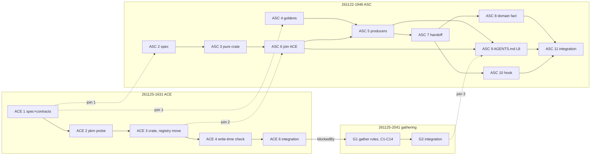

# ACE / ASC / rule gathering: plans recut to the owner's join points

Date 2026-11-25 (Asia/Saigon). Branch `docos/asc-plan-refresh`, worktree `docos-asc-plan`. Plans commit `884cfb450`
(on top of `f9b750607`); this report is the next commit. Everything stays `draft`; no lead line, nothing landed.

Owner decisions applied (2026-11-25 20:4x, not reopened): ACE 1 first and alone; then ASC and ACE in parallel,
joined only at ASC start after ACE 1, ASC 6 after ACE 3, ASC 9 after the gathering; the gathering is its own plan.

## 1. What changed

- **New plan** [`261125-2041-gather-fgos-rules-to-one-owner`](../261125-2041-gather-fgos-rules-to-one-owner/plan.md)
  (name from `fgos convention path --kind plan`). Old ACE phase 5 moved there as phase 1 (`git mv`, history kept),
  plus an integration phase 2. Carries ACE-D4: not done until all 14 conflicts are resolved (criteria 1, 3). Source
  `p-y3umlovk73`, `ds-e26zcar63f`. `blockedBy`: ACE (whole), `261122-2108`, `261124-0004`.
- **ACE plan** `261125-1631`: phase 5 row and file removed (ids kept, so links resolve; no other file linked the old
  phase file, checked with `git grep`). Phase 2 now depends on phase 1 ("first and alone" read literally; see §5
  point C). Criterion 5 points to the gathering plan. Footprint drops the gathering-only paths. Owner questions 2 and
  3 moved to the gathering plan; old Q5 recorded as answered.
- **ASC plan** `261122-1946`: `261125-1631` removed from `blockedBy` and from the "phases 3 and later start when ACE is
  done" text; phase-level waits only (ASC 2/4 ← ACE 1, ASC 6 ← ACE 3, ASC 9 ← gathering). To make every data edge pass
  through those three points:
  - phase 3 is now the pure crate only (`packages/agent-start-context/rust/**`, `Cargo.toml`, `Cargo.lock`), tested
    with ACE 1's vectors; it no longer links ACE's crate;
  - phase 6 is now "join ACE": ACE reader and `ValueSource` wired into the ports, the host door, component
    registration, reading-map row, and the projection through `compose` (it was only the projection);
  - phase 5 now depends on phase 6 (ids kept; wave order 2,4 → 3 → 6 → 5 → 7,9 → 8,10 → 11);
  - phase 8 now depends on phase 7 (both update goldens; found while checking overlaps);
  - phases 7 and 8 got `packages/agent-start-context/goldens/**` in their footprint (they update goldens but did not
    list them); phase 5 got `docs/platform/component-boundary.md` (its new door row changes the rendered door count,
    `packages/component-authority/rust/src/render.rs:87,157`).
- The ASC Authority map from `f9b750607` is kept; one note added (ritual and first steps become ACE units in phase 5).

## 2. Dependency graph across the three plans



| from | to | kind | reason |
|---|---|---|---|
| ACE 1 | ACE 2 | in-plan | ACE 1 runs alone; the probe maps phase 1's `rule-unit.v1.json` |
| ACE 1, 2 | ACE 3 | in-plan | schema and pkm fit |
| ACE 3 | ACE 4 | in-plan | check uses the crate and door |
| ACE 1-4 | ACE 6 | in-plan | integration |
| ACE (whole) | gathering 1 | `blockedBy` | needs ACE 3's door and ACE 4's check; both write `CHANGELOG.md` last |
| gathering 1 | gathering 2 | in-plan | integration |
| ACE 1 | ASC 2, ASC 4 | owner join 1 | spec cites ACE contracts; ASC 4 waits only because ACE 1 runs alone |
| ASC 2 | ASC 3 | in-plan | contracts and vectors |
| ASC 3 | ASC 6 | in-plan | the crate |
| ACE 3 | ASC 6 | owner join 2 | reader, `ValueSource`, `rules.json`, interim filter |
| ASC 4, ASC 6 | ASC 5 | in-plan | goldens; composer reading ACE rules |
| ASC 5 | ASC 7, ASC 9 | in-plan | producers moved |
| ASC 6 | ASC 9 | in-plan | selection through `compose` |
| gathering (done) | ASC 9 | owner join 3 | AGENTS.md sections are already units |
| ASC 7 | ASC 8, ASC 10 | in-plan | goldens (8); hook verb after the contributor (10) |
| all | ASC 11 | in-plan | integration |

Old ASC → ACE data edges, re-checked:

| ASC phase | old edge | fits the three joins? |
|---|---|---|
| 2 | ACE 1 | yes, join 1 |
| 3 | ACE 3 | yes after the recut: reader, `ValueSource`, door and registration moved to ASC 6 |
| 5 | ACE 3, 4, 5 | yes: ACE 3 through ASC 6 (5 depends on 6). ACE 4 is not a data need (ASC 5 runs ACE 3's `check` op itself; ACE 4's hook only adds the nearest-rule refusal when landed). The gathering is not a data need (it takes the ritual units into its corpus if they land first) |
| 6 | ACE 3 | yes, join 2 |
| 9 | ACE 5 | yes, join 3 |
| 11 | ACE 6 | already ordered: ACE 6 → gathering → ASC 9 → ASC 11 |

No extra join point is needed for data. Critical path: ACE 1 → 2 → 3 → 4 → 6 → G1 → G2 → ASC 9 → ASC 11; the ASC
chain 2 → 3 → 6 → 5 → 7 → 8/10 runs beside it.

## 3. Overlaps between phases that can now run at the same time

Concurrency windows: after ACE 1, {ACE 2, ACE 3, ACE 4, ACE 6} can run beside {ASC 2, 3, 4} and, after ACE 3, beside
{ASC 6, 5, 7, 8, 10}; after ACE is done, gathering 1 can run beside {ASC 3 … 10}. Every pair was checked file by file
against the footprints in the three phase tables.

| pair | shared files | resolution |
|---|---|---|
| ACE 3 ∥ ASC 3 | `Cargo.toml` (one `members` line), `Cargo.lock` | second lander re-adds its line and regenerates `Cargo.lock` with cargo (owner question B) |
| gathering 1 ∥ ASC 5 | `core/instructions/**` (ASC 5 adds new files only), `.fgos/instructions/effective/**`, `.claude/agents/**`, `packages/agent-start-context/goldens/**` | different files or generated files; second lander regenerates (compile, `project-agents.mjs`, golden update); a restated rule is refused by ACE's check for the second lander (owner question B) |
| gathering 1 ∥ ASC 7, ASC 8 | `packages/agent-start-context/goldens/**` | as above |
| ASC 7 ∥ ASC 8 (in-plan, old wave 4) | goldens | fixed: 8 now depends on 7 |
| none else | ACE 2/4/6 vs any ASC phase; ASC 6 vs ACE 4; ASC 10 vs any ACE phase (ASC 10 is after ASC 6, so after ACE 3); `wiring/mod.rs`, `routing.rs`, host manifest and routes, the model and its views (ASC 6 after ACE 3); `AGENTS.md`, `test/docs/**` (ASC 9 after the gathering); `CHANGELOG.md` (ACE 6 → G2 → ASC 11) | ordered by the join points |

Inside each plan, `fgos resource-check` reports every collision across different waves only (§5).

## 4. Owner questions (five-part, `core/skills/_shared/decision-question.md`)

**A. How the three plans are admitted side by side.**
- What is happening: the owner's order runs ACE, ASC and the gathering in parallel, but their plan-level footprints
  overlap (`Cargo.lock`, the model, unit roots, `AGENTS.md`, goldens).
- Cause: the supervisor admits only a whole `ready` plan whose footprint overlaps no `running` plan
  (`packages/supervision/rust/src/portfolio.rs:252-268`), and `plan-contract-check` refuses a `ready` plan that
  overlaps an active one (`core/skills/_shared/plan-contract.md` §5). Phase-level waits across plans exist only as
  prose. Worse, ASC 9 waits for the gathering: if ASC is running, the gathering is never admissible, so ASC 9 deadlocks.
- Options:
  - (a) The owner (or the secretary on the owner's order) admits ASC after ACE 1 and the gathering after ACE, by
    direct order (`status: running` with a lead). Overlap is then only a warning for running plans. Cost: two orders;
    leads follow the waits tables and the shared-file rule of B. No code change.
  - (b) Add phase-level cross-plan waits to the plan contract and to `admissible()`. Cost: a new mechanism (RUL104: a
    separate item), and ASC waits until it lands.
  - (c) Serialize: ACE, then the gathering, then ASC. Cost: drops the parallel order the owner chose; ASC starts days
    later.
- Recommendation: (a). It keeps the owner's order with no new mechanism; the plans already carry the waits.
- Scope: admission of these three plans only.

**B. Files shared by phases that run at the same time.**
- What is happening: §3 lists three cross-plan pairs that share files.
- Cause: two plans each add a crate (`Cargo.toml`, `Cargo.lock`), and the gathering and ASC 5 both regenerate the rule
  set, agent files and goldens.
- Options:
  - (a) Second lander regenerates: rebase, re-add the one `members` line, regenerate `Cargo.lock`, the compiled set,
    `.claude/agents/**` and the touched goldens with their own tools; never a hand merge. Cost: a rebase step for
    whichever lands second.
  - (b) Extra join points: ASC 3 after ACE 3, and an order between gathering 1 and ASC 5 (either way). Cost: ASC 3 is
    off the overall critical path, so the first edge costs little time; the second either puts the gathering's parked
    conflict questions back on ASC's start path or makes the gathering wait for ASC 5.
- Recommendation: (a). Every shared file is generated or a one-line registration, which the plan contract treats as
  "regenerated, never hand-merged".
- Scope: the pairs in §3.

**C. "ACE 1 runs first and alone" and the pkm probe (ACE 2).** Read literally, so ACE 2 now waits for ACE 1 (cost:
the probe's duration on the critical path). If "alone" meant only "before ASC", ACE 2 can go back to wave 1 beside
ACE 1. Not a join point; confirm or correct.

Still open from earlier rounds, now owned by these plans and not decided here:
- Approval question id for `declare` of ASC-D1 and ACE-D3: ACE owner question 1, ASC owner question 2.
- Nearest-rule check without the embedding model (pre-commit refusing): ACE owner question 2.
- Order with `261122-1950` before the gathering: gathering owner question 1.
- Scope of "every rule" for skill-local rules: gathering owner question 2.

## 5. Check outputs

`fgos plan-lint` (run from the main checkout on the worktree files):

```
261122-1946-agent-start-context/plan.md: OK -- no hard findings
261125-1631-agent-context-engine/plan.md: OK -- no hard findings
261125-2041-gather-fgos-rules-to-one-owner/plan.md: OK -- no hard findings
```

`CARGO_TARGET_DIR=/home/vantt/projects/forgentX/target flock /home/vantt/projects/.doc-work/doc-heavy.lock node scripts/plan-contract-check.mjs --plan …`
(the ASC copy `plans/zz-asc-authority-map-proof` had `created: 2026-11-25` so its Authority map is checked; deleted
before commit):

```
ok 261122-1946-agent-start-context
ok 261125-1631-agent-context-engine
ok 261125-2041-gather-fgos-rules-to-one-owner
ok zz-asc-authority-map-proof
```

`fgos resource-check --plan` (main checkout, read-only): ASC `accept (10 units, 0 findings)`, waves 2,4 / 3 / 6 / 5 /
7,9 / 8,10 / 11; ACE `accept (5 units, 0 findings)`, waves 1 / 2 / 3 / 4 / 6; gathering `accept (2 units, 0
findings)`. All listed collisions are between phases in different waves.

## 6. Head

Plans commit `884cfb450`; the report commit follows it on `docos/asc-plan-refresh` (sha in the team-lead message).

## 7. Owner decision on question A, from the three plans checked together

The lead ran `fgos resource-check --units` once over all 17 phases of the three plans, with the in-plan edges and the
owner's three join points (§5 checked each plan alone). Layers are collision-aware:

| order | layers | critical path |
|---|---|---|
| ACE, then the gathering, then ASC | 14 | 14 |
| parallel at the three join points | 12 | 9 |
| parallel, ACE 2 beside ACE 1 | 11 | 8 |

The 17 phases form one connected group. In parallel the gathering's phase 1 still lands after ASC 8, because both
write the goldens and `core/instructions/**`. ACE 3 (34 paths, 7 collisions) and the ASC goldens (6 collisions) are
the main serializers.

The owner chose the sequence (2026-11-25 21:0x): ASC's `blockedBy` now names ACE and the gathering, and question B is
moot. Question C (whether ACE 2 waits for ACE 1) stays open.
