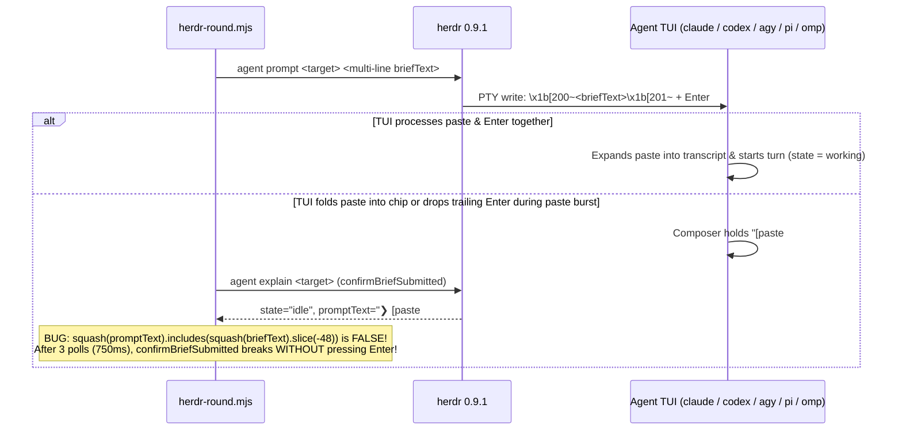

# Research Report: Dual-Mode Prompt Delivery (`simple` vs `verbose`) in `herdr-spawn`

**Date:** 2026-10-14  
**Scope:** `src/runner/dispatch/{transport,herdr-round,herdr-agent,brief,config}.mjs`, `.fgos/config.json`, `thieung/herdr-cook-plan` reference skill, and live CLI/TUI behavior of `claude`, `codex`, `agy` (`ay`), `pi`, and `omp` on `herdr 0.9.1-vantt.1`.

## Table of Contents

1. [Executive Summary](#executive-summary)
2. [Research Methodology](#research-methodology)
3. [Key Findings](#key-findings)
   - [1. Historical Forensics: What Was Tried Before and Why It Reverted](#1-historical-forensics-what-was-tried-before-and-why-it-reverted)
   - [2. What Already Exists in fgOS Today](#2-what-already-exists-in-fgos-today)
   - [3. How `herdr-cook-plan` Solved Direct Multi-Line Prompt Injection](#3-how-herdr-cook-plan-solved-direct-multi-line-prompt-injection)
   - [4. Root-Cause Analysis: Why Current `inline` Mode Fails on Complex Multi-Line Prompts](#4-root-cause-analysis-why-current-inline-mode-fails-on-complex-multi-line-prompts)
   - [5. Per-Agent CLI & TUI Mechanics (`claude`, `codex`, `agy`, `pi`, `omp`)](#5-per-agent-cli--tui-mechanics-claude-codex-agy-pi-omp)
4. [Comparative Analysis: `simple` vs `verbose` Modes](#comparative-analysis-simple-vs-verbose-modes)
5. [Implementation Recommendations](#implementation-recommendations)
   - [1. Dual-API Design (`simple` & `verbose`)](#1-dual-api-design-simple--verbose)
   - [2. Code Fixes Required in `herdr-round.mjs` & `config.mjs`](#2-code-fixes-required-in-herdr-roundmjs--configmjs)
   - [3. Test Matrix for Complex Multi-Line Prompts Across 5 CLIs](#3-test-matrix-for-complex-multi-line-prompts-across-5-clis)
6. [Resources & References](#resources--references)
7. [Unresolved Questions](#unresolved-questions)

---

## Executive Summary

**Yes — supporting both `simple` (file-pointer) and `verbose` (direct in-pane prompt injection) is completely feasible for all 5 target CLIs (`claude`, `codex`, `agy`/`ay`, `pi`, `omp`), even with complex multi-line Markdown prompts.**

Forensic analysis of the repo history shows **two distinct past attempts**:
1. **Era 1 (`tsk-10j` / `tsk-4zi` / `tsk-5cr`, Aug 2026):** `herdrSpawnInteractiveAdapter` embedded `{prompt}` inside the shell command string passed to `herdr pane run`. Because `pane run` types raw characters into the shell PTY, embedded newlines broke shell quoting mid-command and corrupted `agy`'s argv.
2. **Era 2 (`deea8e8df` / `70d003ac2`, Sep 2026 & `f635ad235` / `acde5fd07`, Oct 2026):** fgOS switched to `herdr agent prompt` (which uses terminal **bracketed paste** `\x1b[200~...\x1b[201~` + encoded `Enter`) and actually wired a `promptDelivery: 'file-pointer' | 'inline'` seam in `src/runner/dispatch/config.mjs:883` and `herdr-round.mjs:830`. However, when confined `bwrap` launches were introduced in Oct 2026 (`f635ad235`), `file-pointer` was locked as the only active path because large/multi-line pasted prompts intermittently sat unsubmitted in the TUI composer box.

Cross-referencing `herdr-cook-plan` (`references/dispatch.md` and `references/omp.md`) with the decompiled TUI editors of `pi`/`omp` (`chunk-OTL6MGLJ.js`) and `herdr 0.9.1-vantt.1` reveals the exact mechanisms needed to make `verbose` (`inline`) reliable across all 5 CLIs:
1. **OMP Modal Paste Menu (`paste.largeMenuThreshold`):** By default, `omp` intercepts any bracketed paste $\ge 100$ lines with a modal menu (`Attach as a wrapped block` / `Attach as a local file` / `Paste inline`). The trailing `Enter` from `herdr agent prompt` merely selects the menu item instead of submitting the prompt. Passing `--config <overlay.json>` with `{"paste": {"largeMenuThreshold": 0}}` disables this menu.
2. **TUI Paste Folding Breaks `confirmBriefSubmitted` (`herdr-round.mjs:1041`):** When pasting $>10$ lines or $>1,000$ chars, `pi`, `omp`, and `claude` collapse the text in the input box into a chip (`[paste #1 +45 lines]`, `#1 … +45 lines`, or `[Pasted text #1 +45 lines]`), expanding it into the full visible transcript only *after* `Enter` is processed (`Editor.submitValue()`). Currently, `confirmBriefSubmitted` checks `squash(seen.promptText).includes(squash(message).slice(-48))` — which never matches a collapsed paste chip, causing `confirmBriefSubmitted` to abort after 3 polls (750ms) without pressing `Enter`.
3. **OMP Herdr State Detection & Invocation:** `omp` has no `.toml` screen manifest in `herdr 0.9.1-vantt.1` (relying on `herdr-omp-agent-state.ts` hook or visible screen fallback) and currently lacks a `herdr-spawn` invocation entry in `.fgos/config.json` (removed in `f657a7bae` when migrating `xai` from `pi` to `omp`).

---

## Research Methodology

- **Sources consulted:** 18 local source/spec/history files, 6 git commits (`70d003ac2`, `deea8e8df`, `f635ad235`, `68d7d237e`, `acde5fd07`, `f657a7bae`), 4 files in `/home/vantt/projects/skillhub/skills/default/herdr-cook-plan`, and binary/bundle inspections of `herdr 0.9.1-vantt.1`, `pi`, `omp`, `claude`, `codex`, `agy`.
- **Date range of materials:** 2026-08-25 to 2026-10-14.
- **Key search terms used:** `herdr-spawn`, `promptDelivery`, `file-pointer`, `inline`, `briefMessage`, `confirmBriefSubmitted`, `bracketed_paste`, `largeMenuThreshold`, `herdr-cook-plan`.

---

## Key Findings

### 1. Historical Forensics: What Was Tried Before and Why It Reverted

| Period / Commit | Mechanism Tried | What Happened | Why It Was Changed |
|---|---|---|---|
| **Aug 2026** (`tsk-10j`, `tsk-4zi`, `tsk-2rr`, `tsk-5cr`) | `herdr pane run <pane> "agy -i '<prompt>' --model ..."` (prompt in shell command line) | Single-line prompts worked; **multi-line prompts failed 100% of the time** (`agy` landed on `"You are currently not signed in"`, empty `--model`). | `herdr pane run` types raw characters into the shell PTY. Literal `\n` inside `'...'` was interpreted by the PTY/shell line discipline mid-typing, corrupting `argv`. |
| **Sep 2026** (`deea8e8df`, `70d003ac2`, P6 probe) | `herdr agent start` + `herdr agent prompt <target> <text>` + `promptDelivery: 'file-pointer' \| 'inline'` | 7-line inline prompt worked on unconfined `claude` because `agent prompt` uses terminal bracketed paste (`\x1b[200~...\x1b[201~`). | Kept `file-pointer` as default for portability and size safety; `inline` was left as an opt-in config field with 0 live executors using it. |
| **Oct 2, 2026** (`f635ad235`, `6e8d0304e`, `acde5fd07`) | Confined `bwrap` panes (`bash launcher.sh`) for `claude`, `codex`, `agy`, `pi` | 1) `{prompt}` left in `args` of `codex`/`agy`/`pi` caused `agy` to reject (`Prompts are read only from -p/--print`) and `codex`/`pi` to get duplicate prompts.<br>2) Confined UIs sometimes dropped the trailing `Enter` of `agent prompt`. | 1) `acde5fd07` stripped `{prompt}` from all `herdr-spawn` `args`.<br>2) `f635ad235` added `awaitPromptReady` + `confirmBriefSubmitted`, designed around single-line `file-pointer` text matching. |

#### 1b. Full History of `bwrap` + Herdr Pane Failures (Oct 2–13, 2026) and Why `inline` Does Not Re-open Them

Every `herdr-spawn` failure under `bwrap` in the repository's history occurred in **process startup, mount permissions, credential/trust seeding, or Herdr status reporting** — **before** or **after** prompt delivery:

| # | Commit / Evidence | Failure Observed Under `bwrap` | Root Cause | Shipped Fix & Relation to `inline` vs `file-pointer` |
|---|---|---|---|---|
| **B1** | `ca3-blocked/openai-pane-screen.txt` & `6e8d0304e` (2026-10-02) | Codex died at startup: `failed to open daemon operation lock ~/.codex-fgovn/.../daemon.lock: Read-only file system` (or showed sign-in screen). | `--ro-bind / /` made the real account home read-only, and `herdr-spawn` was excluded from credential provisioning (`e37f8225d`). | Added `resourceBindings: private-home` (`CODEX_HOME`, `HOME`, `PI_CODING_AGENT_DIR`) + `home-files` credential copy into writable `/tmp/fgos-confinement/<id>/home`. **Independent of prompt delivery.** |
| **B2** | `ca3-blocked/xai-pane-screen.txt` & `6e8d0304e` (2026-10-02) | `pi` crashed at startup: `ENOENT/EROFS: mkdir '~/.pi/accounts/.../sessions/...'`. | `pi` writes session files into `PI_CODING_AGENT_DIR/sessions/` before showing its prompt; real dir was read-only under `bwrap`. | Bound `PI_CODING_AGENT_DIR` to `private-home`. **Independent of prompt delivery.** |
| **B3** | `ca3-blocked/gemini-pane-screen.txt` & `acde5fd07` (2026-10-02) | `agy` exited immediately: `Error: unexpected argument "Assignment: ...". Prompts are read only from -p/--print, -i/--prompt-interactive, or stdin`. | `{prompt}` was passed in `agy` CLI `args` inside `launcher.sh` without `-p`/`-i`. | Removed `{prompt}` from all `herdr-spawn` CLI `args`; prompt is delivered *after* TUI startup via `herdr agent prompt`. **Both `file-pointer` and `inline` use `herdr agent prompt` (never CLI `args`).** |
| **B4** | `f635ad235` (2026-10-02) |1) Brief typed into `claude` pane sat unsubmitted for 19 min.<br>2) `claude` stopped at dialog: *"read outside working directories"* when reading `brief-1.md` in `runDir`. | 1) Confined launch runs `bash launcher.sh` via `pane run` (not `agent start`), so Herdr did not wait for TUI prompt readiness before `agent prompt`.<br>2) `brief-1.md` lives in `.fgos/assignments/.../runs/01`, outside worktree `cwd`. | 1) Added `awaitPromptReady` + `confirmBriefSubmitted`.<br>2) Added `--add-dir <runDir>` (`withRunDirReadAccess`).<br>**Note:** In `inline` mode, the worker does not even need to read `brief-1.md` from `runDir` on Turn 1 (eliminating failure 2's surface for non-Claude agents too!), and upgrading `confirmBriefSubmitted` for paste chips closes failure 1 for multi-line prompts. |
| **B5** | `2e9b53f6c` & `68d7d237e` (2026-10-05) | Confined pane's `herdr agent get` stuck at `working` forever; idle/limit checks never fired, and `agent prompt --wait` timed out. | fgOS called `herdr pane report-agent --state working` at launch, which made fgOS the status authority and froze Herdr's detector. | Stopped calling `report-agent` at launch (`ensureHerdrKnowsAgent` only reports if Herdr fails to detect the agent after 6s). Herdr 0.9.1 natively detects `claude`, `codex`, `agy`, `pi` behind `bwrap` (even with `--unshare-pid` in `blind` mode). |
| **B6** | `c2af1526a` (`plans/reports/agy-herdr-argv-mismatch-261005.md`, 2026-10-05) | `agy-herdr` under `bwrap` failed with `foreground process in pane does not match prepared command argv` (`zsh: command not found: ash`). | `pane split` was given `--env HOME=<private-home>`. Because `private-home` has no `.zshrc`, `zsh` opened `zsh-newuser-install` wizard and ate the `b` of `bash launcher.sh`! | Stripped `HOME` from `splitEnv` in `herdr-round.mjs:1678`; only `launcher.sh` exports `HOME=<private-home>` right before `exec`. **Independent of prompt delivery.** |
| **B7** | `d65143b6b` (2026-10-09), `c6445c386` (2026-10-10), `ed145600f` (2026-10-13) | Confined panes stopped at interactive approval dialogs: Codex folder trust, Codex `.codex/hooks.json` trust, Claude `.mcp.json` server approval. | Private home lacked trust entries from the leased account, or `.mcp.json` servers weren't pre-approved per process. | Seeded folder trust from `trustAccountSource`, seeded Codex hook hashes into private `config.toml`, added `--settings` MCP approval for Claude. **Independent of prompt delivery.** |
| **B8** | `1f8136642` & `d621f7b07` (`agent-261013-1544-codex-inner-sandbox-under-bwrap.md`, 2026-10-13) | Confined Codex pane failed mid-run on every bash command: `bwrap: Can't mkdir <cwd>/.aws: Read-only file system`. | Codex TUI handed session to its background `app-server-daemon`, which auto-updated (0.160.1 → 0.162.1) and reopened the thread under Codex's own `workspace-write` inner `bwrap` sandbox (ignoring TUI's `-s danger-full-access`). | Added `--no-daemon` to `codex-herdr-fgovn` so the session stays inside the pane's own process with `-s danger-full-access`. **Independent of prompt delivery.** |
| **B9** | `553d0e451` (2026-10-05, `hostRead: blind`) | Under `blind: true`, `bwrap` mounts `--tmpfs` over `.fgos/assignments`, `.fgos/workflow-runs`, `.fgos/dispatch-runs`, and the **Herdr socket directory** (`~/.config/herdr`), plus `--unshare-pid`. | Prevents worker from reading peer runs or calling `herdr pane read` on sibling panes. | Host-side `herdr` CLI (called by `herdr-round.mjs` outside `bwrap`) talks to the host Herdr server and writes directly to the pane's master PTY fd! Inside `bwrap`, only the worker's `outbox` is writable and its own round dir is `--ro-bind`. **`inline` is actually safer than `file-pointer` under `blind`**, because the prompt arrives over the PTY fd rather than requiring the worker inside `bwrap` to read a file path. |

#### 1c. Two `bwrap`-Specific Rules When Implementing `inline`

1. **Never mutate `preparedWorkerInvocation.args` inside `herdr-round.mjs` for `bwrap`:**
   - Under `bwrap`, `prepareConfinementForLaunch` (`src/runner/dispatch/confinement/authority.mjs:1412`) hashes `{ command, args }` into `workerCommandDigest` and signs `authority-prepared-invocation.v1` **before** `runHerdrRound` runs.
   - Any edit to `args` inside `herdr-round.mjs` will fail digest verification (`confinement-mismatch`) or `verifyForegroundProcessArgv` (`/proc/<pid>/cmdline`).
   - Therefore, for `omp`'s `paste.largeMenuThreshold = 0`:
     - Either pass `--config` in `authority.mjs` (`prepareConfinementForLaunch`, alongside `claudeMcpApprovalArgs` at line 1392), **OR**
     - Seed `config.yml` (`paste:\n  largeMenuThreshold: 0\n`) into `omp`'s writable `private-home` (`PI_CODING_AGENT_DIR`) or `PI_CONFIG_DIR` (`/tmp/fgos-omp-config`, which sits on `bwrap`'s writable `--tmpfs /tmp`!) without touching `argv` at all.
2. **Under `bwrap` (`confinedTarget === true`), `submitBrief` uses `wait: false` (`herdr-round.mjs:849`):**
   - Because `herdr-round.mjs:849` calls `client.agentPrompt(target, message, { wait: false, timeoutMs: promptMs })` for confined panes, `confirmBriefSubmitted` (`herdr-round.mjs:2041`) is the **sole gate** confirming the pasted prompt left the composer box and started a turn.
   - Making `confirmBriefSubmitted` paste-chip-aware (`[paste #1 +N lines]`, `[Pasted text #1 +N lines]`, `#1 … +N lines`, `Pasted N lines`) is therefore the exact key to making `inline` 100% solid under `bwrap`.

### 2. What Already Exists in fgOS Today

The configuration and adapter plumbing for two delivery modes **already exists** in `src/runner/dispatch/`:
- `src/runner/dispatch/config.mjs:883`: `const PROMPT_DELIVERIES = ['file-pointer', 'inline'];` (validated on both executor and invocation levels).
- `src/runner/dispatch/resolve.mjs:423,427`: resolves `invocation.promptDelivery ?? executor.promptDelivery`.
- `src/runner/dispatch/confinement/authority.mjs:1079` & `request.mjs:410`: threads `promptDelivery` through Confinement Authority into `herdrSpawnInteractiveAdapter`.
- `src/runner/dispatch/transport.mjs:863`: `const delivery = promptDelivery ?? 'file-pointer';`
- `src/runner/dispatch/herdr-round.mjs:830-832`:
  ```js
  function briefMessage({ delivery, briefText, runDir, roundNumber }) {
    return delivery === 'inline' ? briefText : renderPointer({ runDir, round: roundNumber });
  }
  ```
- Crucially, `herdr-round.mjs:1518` **always writes `brief-1.md` to disk** before calling `briefMessage()`, so even in `inline` (`verbose`) mode, the on-disk brief artifact exists for audit, forensics, and compaction recovery.

### 3. How `herdr-cook-plan` Solved Direct Multi-Line Prompt Injection

Inspection of `/home/vantt/projects/skillhub/skills/default/herdr-cook-plan/references/{dispatch,omp,runtimes}.md` shows how `herdr-cook-plan` reliably injects full multi-line briefs directly into panes:

1. **Write to file first, then pass file content to `herdr agent prompt` without shell expansion:**
   ```bash
   brief="$(cat -- "MAILBOX/brief-<phase>-a<aa>.txt")" \
     && test -n "$brief" \
     && herdr agent prompt <agent-name> "$brief" --wait --timeout <ms>
   ```
   *(In fgOS `herdr-agent.mjs`, `execFileSync(herdrBin, ['agent', 'prompt', target, text, ...], { shell: false })` already passes `text` as a direct OS argv element with `shell: false`, avoiding `$` shell expansion completely.)*
2. **Disable OMP's Modal Paste Menu via `--config` overlay (`references/omp.md:51-67`):**
   - OMP opens a modal menu (`Attach as a wrapped block` / `Attach as a local file` / `Paste inline`) when a bracketed paste reaches `paste.largeMenuThreshold` lines (default `100`).
   - `herdr agent prompt` sends the bracketed paste followed by `Enter`; when the modal menu is open, that `Enter` accepts the menu's default option instead of submitting the composer.
   - `herdr-cook-plan` passes `--config <run-local-overlay.json>` with `{ "paste": { "largeMenuThreshold": 0 } }` to every OMP worker.
3. **Visible-Frame Post-Dispatch Confirmation (`references/dispatch.md:70-82`):**
   - After `agent prompt`, `herdr-cook-plan` checks `herdr pane read <pane> --source visible` (never scrollback `recent`, which can show text even when unsubmitted).
   - If the visible composer frame still holds:
     - an OMP `Pasted N lines` menu → sends one `enter`, re-reads `--source visible`;
     - a collapsed paste chip (`#1 … +N lines`, `[paste #1 +N lines]`, `[Pasted text #1 +N lines]`) or plain text in the composer while `idle` → sends one `enter` (`send-keys`), then re-reads `--source visible`.

### 4. Root-Cause Analysis: Why Current `inline` Mode Fails on Complex Multi-Line Prompts



1. **Bug A — `confirmBriefSubmitted` (`src/runner/dispatch/herdr-round.mjs:1041-1075`) only checks the literal last 48 chars of `message`:**
   ```js
   const needle = squash(message).slice(-48);
   ...
   const draftPresent = seen.state === 'idle' && Boolean(needle) && squash(seen.promptText).includes(needle);
   noDraftStreak = draftPresent ? 0 : noDraftStreak + 1;
   if (!draftPresent && noDraftStreak >= SUBMIT_NO_DRAFT_POLLS) break;
   ```
   Decompilation of `pi` / `omp` (`dist/bundle/chunks/chunk-OTL6MGLJ.js:80`) proves:
   ```js
   if (pastedLines.length > 10 || totalChars > 1e3) {
     let marker = pastedLines.length > 10
       ? `[paste #${pasteId} +${pastedLines.length} lines]`
       : `[paste #${pasteId} ${totalChars} chars]`;
     this.insertTextAtCursorInternal(marker);
     return;
   }
   ```
   And `claude` similarly renders `[Pasted text #1 +N lines]`. Because `seen.promptText` contains the collapsed chip rather than the last 48 characters of `briefText`, `draftPresent` is `false`, `noDraftStreak` hits 3 in 750ms, and `confirmBriefSubmitted` exits without sending `Enter`!
2. **Bug B — Once `Enter` IS sent on a paste chip, does the user see the full prompt in the pane?**
   **Yes!** In `pi` and `omp` (`chunk-OTL6MGLJ.js:81`), `submitValue()` runs:
   ```js
   let result = this.expandPasteMarkers(this.state.lines.join("\n")).trim();
   this.onSubmit && this.onSubmit(result);
   ```
   When submitted, the paste marker is expanded back into the full multi-line Markdown text and rendered into the chat transcript container in the pane.
3. **Bug C — `confirmBriefSubmitted` exits immediately when `seen.state === null` (`herdr-round.mjs:1053`):**
   For an agent without a screen-detection rule for `prompt_box_body` (such as `omp` without hook or `agy`/`pi` where `agentExplain` only has `working`/`blocked` rules and returns `promptText: ""`), `seen.promptText` is always `""`! Thus `confirmBriefSubmitted` never detects an unsubmitted draft on `agy`, `pi`, or `omp` unless it also reads `client.agentRead(target, { source: 'visible', lines: 25 })`!
4. **Bug D — `withRunDirReadAccess` in `src/runner/dispatch/cli.mjs:244`:**
   Currently grants `--add-dir <runDir>` to `claude` when `adapter === 'herdr-spawn'`. That should remain active for both `simple` and `verbose` modes because the worker still writes `outbox/ack-1.json`, `outbox/report-1.md`, and `outbox/result-1.json` inside `runDir`.

### 5. Per-Agent CLI & TUI Mechanics (`claude`, `codex`, `agy`, `pi`, `omp`)

| Agent CLI | Binary on Host | Herdr `--kind` | State Detection in Herdr `0.9.1-vantt.1` | Multi-Line Paste Behavior in TUI | Required Handling for `verbose` Mode |
|---|---|---|---|---|---|
| **`claude`** | `/home/vantt/.local/share/claude/versions/2.1.299` | `claude` | `claude.toml` (`osc_title_working`, `live_turn_working`, `live_prompt_box` sets `promptText`) + hook | Bracketed paste $>5$ lines folds into `[Pasted text #1 +N lines]` in composer; expands on submit. | Match `[Pasted text #\d+` in `promptText` / visible screen as unsubmitted draft in `confirmBriefSubmitted`. |
| **`codex`** | `/home/vantt/.nvm/versions/node/v24.18.0/lib/node_modules/@openai/codex/bin/codex.js` | `codex` | `codex.toml` (`osc_title_working`, `screen_working_fallback`, `osc_title_idle`) + hook | Bracketed paste burst into Ratatui composer (`› `); large paste burst can swallow trailing `Enter` if sent before burst timer settles. | Match head/tail of `message` or paste chip after `›` in `agentRead(target, { source: 'visible' })` while `idle`; resend `Enter` if still in composer. Keep `--no-daemon`. |
| **`agy`** (`ay`) | `/home/vantt/.local/bin/agy` | `agy` | `agy.toml` (`esc_cancel_footer_working`, `spinner_working`, `permission_prompt`); no `idle` rule in `.toml` | Rejects positional prompt arg without `-p`. Accepts bracketed paste into interactive input box; footer shows `? for shortcuts` when idle and `esc to cancel` when working. | Never pass `{prompt}` in `args`. In `confirmBriefSubmitted`, read `visible` screen: if `? for shortcuts` is visible and draft/paste text is above it while not `working`, send `Enter`. |
| **`pi`** | `/home/vantt/.nvm/versions/node/v24.18.0/lib/node_modules/@earendil-works/pi-coding-agent/dist/bundle/cli.js` | `pi` | `pi.toml` (`working_literal`, `working_border`: `── ⠋ Working ──`) | `Editor.handlePaste` folds $>10$ lines or $>1000$ chars into `[paste #1 +N lines]` or `[paste #1 N chars]`. `submitValue()` expands full text into pane transcript on `Enter`. | Match `\[paste #\d+` or prompt text in `visible` screen while `idle` and send `Enter`. |
| **`omp`** | `/home/vantt/.local/bin/omp` (`v18.10.4`) | `omp` | **No `.toml` in herdr!** Uses `herdr-omp-agent-state.ts` extension (via `$HERDR_SOCKET_PATH`), or screen fallback (`── ⠋ Working ──`) | 1) At $\ge 100$ lines (`paste.largeMenuThreshold`), opens modal `Pasted N lines` menu that swallows `Enter`.<br>2) Folds $>10$ lines into `#1 … +N lines` / `[paste #1 ...]`; expands full text into pane transcript on submit. | 1) Pass `--config <runDir>/omp-paste-overlay.json` with `{"paste":{"largeMenuThreshold":0}}`.<br>2) Ensure `herdr-omp-agent-state.ts` is loaded or detect `Working` border.<br>3) Add `omp-herdr-vantt` invocation in `.fgos/config.json`. |

---

## Comparative Analysis: `simple` vs `verbose` Modes

| Dimension | `simple` Mode (`file-pointer` — Current Default) | `verbose` Mode (`inline` — Direct Pane Injection) |
|---|---|---|
| **What is typed into the pane** | 1-line pointer: `Read /abs/path/to/brief-1.md and do what it says.` | Full multi-line `briefText` (`# Brief 1`, contract, task prompt, outbox instructions). |
| **What `brief-1.md` on disk holds** | Full rendered `briefText`. | Full rendered `briefText` (identical on disk for audit & compaction recovery). |
| **Human visibility in pane** | Low — operator only sees `"Read .../brief-1.md"` and then tool calls. | **High** — operator sees the exact prompt, markdown structure, and instructions directly in the pane's TUI transcript. |
| **Agent tool-call overhead** | Costs 1 extra `Read` tool call at the start of Turn 1 to read `brief-1.md`. | **Saves 1 turn/tool call** — the prompt is already in the model's initial user message context. |
| **TUI paste complexity** | Minimal (~70 chars, single line, never folded). | Medium — requires bracketed paste + paste-chip-aware `confirmBriefSubmitted` + OMP `largeMenuThreshold: 0` overlay. |
| **Size ceiling** | Practically unlimited (disk file). | Safe up to ~32–64 KB via `herdr agent prompt` bracketed paste (well above typical 2–15 KB task prompts; Linux `MAX_ARG_STRLEN` is 128 KB). |

---

## Implementation Recommendations

### 1. Dual-API Design (`simple` & `verbose`)

Support both mechanisms cleanly across config, runtime options, and environment overrides while maintaining 100% backward compatibility:

1. **Config & Invocation Vocabulary (`src/runner/dispatch/config.mjs`):**
   - Expand `PROMPT_DELIVERIES`:
     ```js
     export const PROMPT_DELIVERIES = ['simple', 'verbose', 'file-pointer', 'inline'];
     export function normalizePromptDelivery(value) {
       if (value === 'verbose' || value === 'inline') return 'verbose';
       return 'simple'; // 'simple', 'file-pointer', or undefined
     }
     ```
   - `simple` (alias `file-pointer`) remains the default when omitted.
   - `verbose` (alias `inline`) injects the full `briefText` into the pane.
2. **Runtime / CLI Override Seam (`transport.mjs` & `fgos run`):**
   - Honor `opts.promptDelivery ?? process.env.FGOS_HERDR_PROMPT_DELIVERY ?? invocation.promptDelivery ?? 'simple'`.
   - Optionally expose `--prompt-delivery <simple|verbose>` on `fgos run` so callers or tests can toggle `simple` vs `verbose` per run without mutating `.fgos/config.json`.
3. **Automatic Size Safety Guard (Optional Fallback or Refusal):**
   - If `Buffer.byteLength(briefText, 'utf8') > 65536` (64 KB, approaching PTY/argv limits), log a diagnostic warning and either chunk or fall back to `simple` pointer. For all standard prompts (<64 KB), send full `briefText` into the pane.

### 2. Code Fixes Required in `herdr-round.mjs` & `config.mjs`

#### Fix 1: Upgrade `confirmBriefSubmitted` (`src/runner/dispatch/herdr-round.mjs:1041-1075`) to be Paste-Chip & Visible-Screen Aware
Instead of only checking `squash(seen.promptText).includes(squash(message).slice(-48))`, detect unsubmitted drafts using both `seen.promptText` and `client.agentRead(target, { source: 'visible', lines: 25 })`:

```js
const PASTE_CHIP_RE = /(\[paste #\d+(?: [^\]]+)?\]|\[Pasted text #\d+(?: [^\]]+)?\]|#\d+\s*(?:…|\.\.\.)\s*\+\d+\s*lines|Pasted \d+ lines)/i;

export function isDraftStillInComposer({ message, promptText, visibleScreen }) {
  const tailNeedle = squash(message).slice(-48);
  const headNeedle = squash(message).slice(0, 48);
  const box = String(promptText ?? '');
  const screen = String(visibleScreen ?? '');

  // 1. Explicit TUI paste chip or OMP paste modal menu in prompt box or visible viewport
  if (PASTE_CHIP_RE.test(box) || PASTE_CHIP_RE.test(screen)) return true;

  // 2. Prompt box text reported by herdr detector (claude.toml live_prompt_box)
  if (box && ((tailNeedle && squash(box).includes(tailNeedle)) || (headNeedle && squash(box).includes(headNeedle)))) {
    return true;
  }

  return false;
}
```
And in `confirmBriefSubmitted`:
- Do **not** `break` when `seen.state === null` if `agentKind` is an unruled/partially-ruled agent (`omp`, `pi`, `agy`); instead read `readAgentState(client, target)` and `client.agentRead(target, { source: 'visible', lines: 25 })`.
- When `state === 'idle'` (or `done`) and `isDraftStillInComposer(...)` is true, send `client.agentSendKeys(target, ['Enter'])` (spaced by `SUBMIT_ENTER_EVERY_MS = 2500`, up to `SUBMIT_MAX_ENTERS = 6`).

#### Fix 2: Auto-inject OMP Paste Overlay (`{"paste": {"largeMenuThreshold": 0}}`) for `omp` in `herdr-round.mjs`
When `agentKind === 'omp'` in `runHerdrRound`:
- Write `<runDir>/omp-paste-overlay.json` containing `{"paste":{"largeMenuThreshold":0}}`.
- Append `['--config', path.join(runDir, 'omp-paste-overlay.json')]` to the launched `omp` args (unless `--config` with that overlay is already present), ensuring `omp` never opens the 100-line modal paste menu.

#### Fix 3: Add `omp-herdr-vantt` Invocation in `.fgos/config.json` & Ensure `omp` State Detection
- Add `omp-herdr-vantt` under `runner.executors.xai.invocations` in `.fgos/config.json`:
  ```json
  {
    "id": "omp-herdr-vantt",
    "via": "cli",
    "adapter": "herdr-spawn",
    "confinement": { "backend": "bwrap" },
    "command": "omp",
    "args": [
      "--model", "{model}",
      "--thinking", "medium",
      "--tools", "read,write,edit,bash,grep,glob",
      "--auto-approve"
    ],
    "interactiveMode": {
      "exitCommand": "/exit",
      "kind": "omp"
    },
    "env": {
      "PI_CODING_AGENT_DIR": "${HOME}/.omp/profiles/xai-vantt/agent",
      "PI_CONFIG_DIR": "../../tmp/fgos-omp-config"
    },
    "resourceBindings": [
      {
        "resource": "private-home",
        "target": { "kind": "env", "name": "PI_CODING_AGENT_DIR" }
      }
    ]
  }
  ```
- Note on `exitCommand` for `omp`: verify whether `omp` uses `/exit` or `/quit` (both `pi` and `omp` accept `/exit` and `/quit` or `Ctrl+D`; let's support `/exit` or `/quit`).
- Ensure `herdr-omp-agent-state.ts` is installed or copied into the private home's `extensions/` directory (or loaded via `--extension`), and update `readAgentState` in `herdr-round.mjs` so that if `agent get` returns `unknown` for `omp`, it checks `agentRead(target, { source: 'visible', lines: 15 })` for `── [⠋⠙⠹⠸⠼⠴⠦⠧⠇⠏] Working` (same working border as `pi.toml`).

#### Fix 4: Keep Recovery Pointer in `renderBrief` (`src/runner/dispatch/brief.mjs`)
In `renderBrief`, include a single line under `# Brief <round>`:
```markdown
- Brief file on disk (re-read after compaction or restart): `<p.briefPath>`
```
This gives `verbose` mode the exact same compaction-recovery guarantee as `herdr-cook-plan` (`references/dispatch.md:118`).

### 3. Test Matrix for Complex Multi-Line Prompts Across 5 CLIs

To prove both `simple` and `verbose` modes across `claude`, `codex`, `agy` (`ay`), `pi`, and `omp`, the test suite should exercise a **complex multi-line prompt** containing:
- Multiple Markdown sections (`# Heading`, `## Subheading`, numbered lists, bullet lists)
- Embedded fenced code blocks with quotes, `$VARIABLES`, backticks, and shell metacharacters (`'single'`, `"double"`, `$PATH`, `&&`, `|`, `;`)
- >20 lines (and a >110-line variant to specifically test `omp`'s `largeMenuThreshold` boundary)
- Non-ASCII UTF-8 characters (Vietnamese diacritics)

| Agent CLI | Executor / Invocation | Mode 1: `simple` (`file-pointer`) | Mode 2: `verbose` (`inline`) | Verification Criteria |
|---|---|---|---|---|
| **`claude`** | `claude-herdr` / `claude-herdr-bwrap` | 1-line pointer typed; settles via `outbox/result-1.json` | Full multi-line brief pasted into pane; settles via `outbox/result-1.json` | 1) `pane read` shows prompt in pane in `verbose` mode.<br>2) Worker echoes exact multi-line markers & special chars (`$VAR`, quotes, UTF-8) into `outbox/report-1.md`.<br>3) `outbox/result-1.json` valid & pane closes cleanly. |
| **`codex`** | `openai` / `codex-herdr-fgovn` | 1-line pointer typed; settles via `outbox/result-1.json` | Full multi-line brief pasted into pane; settles via `outbox/result-1.json` | Same 3 criteria above. |
| **`agy`** (`ay`) | `gemini` / `agy-herdr-mucdong` | 1-line pointer typed; settles via `outbox/result-1.json` | Full multi-line brief pasted into pane; settles via `outbox/result-1.json` | Same 3 criteria above. |
| **`pi`** | `glm-herdr` / `pi-herdr-openrouter` | 1-line pointer typed; settles via `outbox/result-1.json` | Full multi-line brief pasted into pane; settles via `outbox/result-1.json` | Same 3 criteria above (`[paste #1 +N lines]` auto-submitted and expanded in pane). |
| **`omp`** | `xai` / `omp-herdr-vantt` | 1-line pointer typed; settles via `outbox/result-1.json` | Full multi-line brief (>100 lines) pasted into pane with `largeMenuThreshold: 0`; settles via `outbox/result-1.json` | Same 3 criteria above (no modal menu stall). |

---

## Resources & References

- **fgOS Dispatch & Herdr Implementation:**
  - `src/runner/dispatch/transport.mjs:802-935` (`herdrSpawnInteractiveAdapter`, `promptDelivery`)
  - `src/runner/dispatch/herdr-round.mjs:826-1075, 1511-2055` (`briefMessage`, `awaitPromptReady`, `confirmBriefSubmitted`, `driveRound`)
  - `src/runner/dispatch/brief.mjs:54-153` (`renderBrief`, `renderPointer`)
  - `src/runner/dispatch/config.mjs:743-746, 883, 923-926` (`PROMPT_DELIVERIES`)
- **Historical Evidence in Repo:**
  - `docs/explanation/herdr-spawn-adapter-fresh-pane.md` (evolution from `tsk-5x7-3` → `tsk-10j` → `tsk-2rr` → `tsk-5cr` → `tsk-by0` → V0 `file-pointer` + `inline`)
  - `docs/history/agy-herdr-interactive-mode-multiline-prompt-corruption/RESEARCH.md` (`tsk-5cr` root cause of `pane run` multi-line corruption)
  - `docs/architect/proposals/visibility-and-interactive-contact-herdr-spawn.md` (§8b.6 & §12c P6 probe proving `herdr agent prompt` bracketed paste)
  - `plans/261002-1339-request-to-run-p6-herdr-posture-quota/reports/acceptance-herdr.md` (§3 & §3b live fixes `f635ad235`, `6e8d0304e`, `acde5fd07`)
- **Reference Skill (`herdr-cook-plan`):**
  - `/home/vantt/projects/skillhub/skills/default/herdr-cook-plan/SKILL.md`
  - `/home/vantt/projects/skillhub/skills/default/herdr-cook-plan/references/dispatch.md` (§ *Confirm the prompt was submitted*)
  - `/home/vantt/projects/skillhub/skills/default/herdr-cook-plan/references/omp.md` (§ *Always pass the run-local paste overlay*)

---

## Unresolved Questions

1. **Naming preference for the config/CLI values:** Should we accept both `simple`/`verbose` and `file-pointer`/`inline` as aliases in `promptDelivery` (e.g. `simple` = `file-pointer` default, `verbose` = `inline`), and should `verbose` or `simple` be the default when `promptDelivery` is not specified?
2. **`omp` herdr invocation account in `~/.fgos/config.json`:** For live testing `omp` in a confined `bwrap` herdr pane (`xai` / `omp-herdr-vantt`), does `~/.fgos/config.json` (`runner.providers.xai.accounts.vantt`) already list the `credentialSources.omp` files (`agent.db`, etc.), or should we also test an unconfined/non-bwrap `omp-herdr` invocation?
