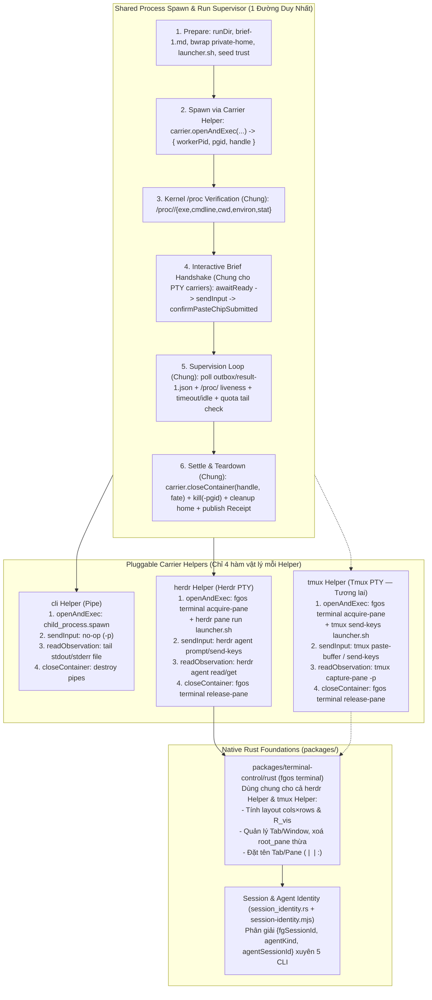
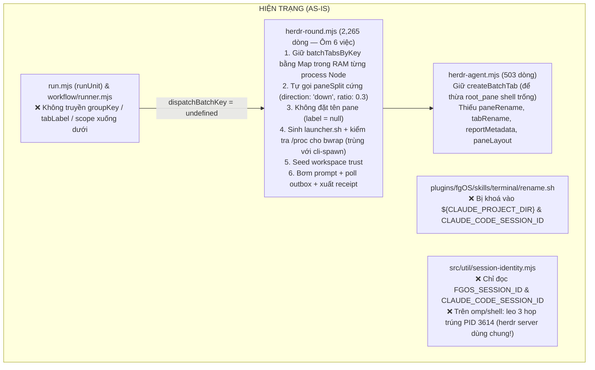
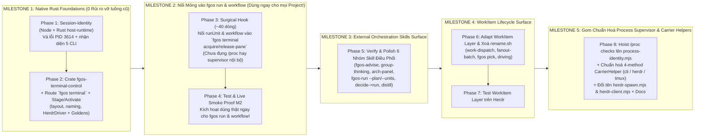

# Research Report: Unified Process Spawn Supervisor, Pluggable Carrier Helpers (`cli` / `herdr` / `tmux`), Rust `terminal-control` & `session-identity`

**Date:** 2026-10-15  
**Scope:** End-to-end research and architecture design covering:
1. Herdr `0.9.1-vantt.1` (protocol 22) Space / Tab / Pane / Layout / Metadata primitives.
2. First-principles comparison of `cli-spawn`, `herdr-spawn`, and future `tmux-spawn` $\rightarrow$ unifying Process Spawn & Supervision with pluggable Carrier Helpers (`cli`, `herdr`, `tmux`).
3. Native Rust components `packages/terminal-control/rust` (`fgos-terminal-control`, CLI `fgos terminal`) and independent `session-identity` (`packages/host-runtime/rust/src/session_identity.rs` + `src/util/session-identity.mjs`) across all 5 CLIs (`claude`, `codex`, `agy`, `pi`, `omp`).
4. Resolution & Aspect-Ratio-Aware TUI Layout (`cols × rows` & $R_{\text{vis}} = \frac{w}{2h}$) and Layered Naming Convention (Lower-Layer Grammar, Upper-Layer Adaptation).
5. Codebase-wide Impact / Blast-Radius Analysis, Sizing, and **5-Milestone Low-Risk Incremental Rollout Sequence** designed for minimum disruption and fastest return to live production use.

---

## Table of Contents

1. [Executive Summary](#executive-summary)
2. [Herdr 0.9.1 Primitives: Spaces, Tabs, Panes, Layouts & Display Metadata](#herdr-091-primitives-spaces-tabs-panes-layouts--display-metadata)
3. [First-Principles Comparison: `cli-spawn` vs. `herdr-spawn` vs. `tmux-spawn`](#first-principles-comparison-cli-spawn-vs-herdr-spawn-vs-tmux-spawn)
   - [1. Where `cli-spawn` and `herdr-spawn` Live in Code Today](#1-where-cli-spawn-and-herdr-spawn-live-in-code-today)
   - [2. Lifecycle Stage-by-Stage Comparison (85% Shared Process Management vs. 15% Carrier Helper)](#2-lifecycle-stage-by-stage-comparison-85-shared-process-management-vs-15-carrier-helper)
   - [3. The Unified Target Architecture: Shared Process Spawn Supervisor + 4-Method Carrier Helper (`cli` / `herdr` / `tmux`)](#3-the-unified-target-architecture-shared-process-spawn-supervisor--4-method-carrier-helper-cli--herdr--tmux)
4. [As-Is vs. To-Be Architecture & Authority Boundary Map](#as-is-vs-to-be-architecture--authority-boundary-map)
   - [1. As-Is State (Hiện trạng — 2 thế giới song song & `herdr-round.mjs` ôm 6 việc)](#1-as-is-state-hiện-trạng--2-thế-giới-song-song--herdr-roundmjs-ôm-6-việc)
   - [2. To-Be State (Hình thái cuối cùng — 1 Process Supervisor Chung + Carrier Helpers + Rust Foundations)](#2-to-be-state-hình-thái-cuối-cùng--1-process-supervisor-chung--carrier-helpers--rust-foundations)
5. [Core Technical Designs](#core-technical-designs)
   - [1. Native Rust Component: `packages/terminal-control/rust` (`fgos-terminal-control`, CLI `fgos terminal`)](#1-native-rust-component-packagesterminal-controlrust-fgos-terminal-control-cli-fgos-terminal)
   - [2. Resolution & Aspect-Ratio-Aware Layout Algorithm (`cols × rows` & $R_{\text{vis}}$)](#2-resolution--aspect-ratio-aware-layout-algorithm-cols--rows--r_textvis)
   - [3. Layered Naming & Metadata Convention (Lower-Layer Grammar, Upper-Layer Adaptation)](#3-layered-naming--metadata-convention-lower-layer-grammar-upper-layer-adaptation)
   - [4. Independent Session & Agent Identity Authority Across 5 CLIs (Fixing Live PID `3614` Bug)](#4-independent-session--agent-identity-authority-across-5-clis-fixing-live-pid-3614-bug)
6. [Inventory of WorkItem-Independent Orchestration Skills (Milestone 3 Surface)](#inventory-of-workitem-independent-orchestration-skills-milestone-3-surface)
7. [Impact Analysis, Blast Radius & Sizing Assessment](#impact-analysis-blast-radius--sizing-assessment)
   - [1. Component-by-Component Blast Radius & Sizing Table](#1-component-by-component-blast-radius--sizing-table)
   - [2. Critical Technical Constraints Uncovered by Impact Scan](#2-critical-technical-constraints-uncovered-by-impact-scan)
8. [Five-Milestone Low-Risk Rollout Sequence (Fastest Return to Live Use, Zero Big-Bang Breakage)](#five-milestone-low-risk-rollout-sequence-fastest-return-to-live-use-zero-big-bang-breakage)
9. [Resources & References](#resources--references)

---

## Executive Summary

1. **Unified Process Spawn & Supervision + Pluggable Carrier Helpers (`cli` / `herdr` / `tmux`):**
   - Across all 6 stages of running an agent worker (Prepare Sandbox $\rightarrow$ Open Carrier & Exec $\rightarrow$ Verify `/proc/<workerPid>` $\rightarrow$ Deliver Brief $\rightarrow$ Supervise Liveness/Outbox/Quota $\rightarrow$ Settle/Teardown/Receipt), **85% of the lifecycle is identical OS process management**.
   - Target state converges **Process Spawn, `/proc` Verification, Outbox/Liveness Supervision, and Receipt Teardown into one Shared Process Supervisor**, which delegates the 4 carrier-specific primitives (`openAndExec`, `sendInput`, `readObservation`, `closeContainer`) to a thin **Carrier Helper** (`cli`, `herdr`, `tmux`).
2. **Native Rust `packages/terminal-control/rust` (`fgos-terminal-control`, CLI `fgos terminal`):**
   - Owns screen-adaptive layout calculation (`cols × rows` + character cell aspect ratio $R_{\text{vis}} = \frac{w}{2h}$, floor `85 cols × 20 rows`), workspace-locked tab/pane acquisition (`acquire-pane`), dead-root-pane elimination, pane/tab naming (`label`), and pane/tab cleanup (`release-pane`).
   - 80% is multiplexer-agnostic core logic (`layout.rs`, `naming.rs`, `lock.rs`); 20% is `drivers/herdr.rs` implementing `trait TerminalDriver` (ready for `drivers/tmux.rs` later).
3. **Independent `session-identity` Authority (Fixing Live PID `3614` Collision Bug):**
   - Resolves `{ fgSessionId, writerSource, agentKind, agentSessionId }` across `claude`, `codex`, `agy`, `pi`, and `omp` in any environment (Herdr, tmux, plain terminal, SSH, headless).
   - Fixes a **critical live bug discovered during this research**: in `omp` (and bare shells), `resolveWriterIdentity()` walks 3 parent PIDs (`node → zsh → herdr server`) and returns `{ id: 3614, source: 'pid' }` — the shared `herdr server` daemon PID — causing all concurrent `omp` panes across the machine to collide on `writer.id = 3614`.
4. **Five-Milestone Low-Risk Rollout Strategy (Separating Immediate Live Value from Deep Internal Refactoring):**
   - **Milestone 1 — Native Rust Foundations (`session-identity` + `fgos-terminal-control` + `fgos terminal` CLI):** 100% additive + PID `3614` bugfix. Zero breakage to existing dispatch. Activated immediately.
   - **Milestone 2 — Surgical Wiring of `fgos terminal` into `fgos run` & `fgos workflow` (~40-Line Hook):** Replaces only the ~40 lines of `batchTabsByKey` / `paneSplit(down 0.3)` in `herdr-round.mjs` with `fgos terminal acquire-pane` / `release-pane` without touching process supervision internals. **Activated immediately — `fgos run` and `fgos workflow` gain full tab grouping, resolution-aware layout, and `<scope> | <role> | <cli>:<model>` naming across all projects right here!**
   - **Milestone 3 — External Orchestration Skills Surface (`fgos-advise`, `fgos-group-thinking`, `fgos-architecture-panel`, `fgos-run`, `decide -> run`, `distill`):** Verify & polish the WorkItem-independent orchestration skills on top of M2's live engine.
   - **Milestone 4 — Upper `WorkItem` Lifecycle Surface (`work-dispatch`, `fanout-batch`, `fgos pick`, `fgos-coding-driving`, delete `rename.sh`):** Adapt the `WorkItem` layer onto the proven engine.
   - **Milestone 5 — Structural Consolidation of `Shared Process Supervisor` + `Carrier Helpers` (`cli` / `herdr` / `tmux`) & File Renames (`herdr-spawn.mjs`, `herdr-client.mjs`):** Perform the internal deduplication of `/proc` checks and process supervision safely behind the already-live, fully-tested M1–M4 surfaces.

---

## Herdr 0.9.1 Primitives: Spaces, Tabs, Panes, Layouts & Display Metadata

Verified live against `/home/vantt/.local/bin/herdr` (`0.9.1-vantt.1`, protocol 22):

| Level | Handle Format | Env Var in Pane | Creation & Placement Primitives | Naming & Metadata Primitives |
|---|---|---|---|---|
| **Workspace (Space)** | `w1`, `wS` | `HERDR_WORKSPACE_ID` | `herdr workspace create --cwd <path> --label <text>` | `herdr workspace rename <ws_id> <label>`<br>`herdr workspace report-metadata <ws_id> --source fgos --token k=v` |
| **Tab** | `wS:t1`, `wS:tD2` | `HERDR_TAB_ID` | `herdr tab create --workspace <ws_id> --label <text> --cwd <path> --no-focus` *(returns `.result.tab.tab_id` + `.result.root_pane.pane_id`)* | `herdr tab rename <tab_id> <label>` (`TabInfo.label`) |
| **Pane** | `wS:p1`, `wS:p54R` | `HERDR_PANE_ID` | `herdr pane layout --pane <id>` *(returns `area` + `panes[].rect`)*<br>`herdr pane split --pane <target_id> --direction <right\|down> --ratio <0..1> --cwd <path> --env K=V --no-focus`<br>`herdr pane move <pane_id> --tab <tab_id> --split <right\|down> --target-pane <id>` | `herdr pane rename <pane_id> <label>` (`PaneInfo.label`)<br>`herdr pane report-metadata <pane_id> --source fgos --title <t> --display-agent <a> --state-label <s=l> --token <k=v>`<br>`herdr agent rename <target> <name>` |

1. **`pane split` targets a `pane_id`, never a `tab_id`:** To place a new pane inside a specific tab, the caller must pass `--pane <target_pane_id>` of an existing pane in that tab.
2. **`tab create` always creates a `root_pane` (`pane_count: 1`):** Splitting `worker_pane_1` off `root_pane` and immediately closing `root_pane` (`herdr pane close <root_pane>`) gives `worker_pane_1` 100% of the tab while keeping every worker in a fresh split pane (`tsk-1nih`).
3. **`pane report-metadata` is purely display-only:** Unlike `pane report-agent` (which claims status authority and freezes `agent_status` at `working`), `pane report-metadata` attaches `title`, `display_agent`, `state_labels`, and up to 16 `tokens` (`^[A-Za-z0-9_-]{1,32}$`) without affecting native agent state detection.

---

## First-Principles Comparison: `cli-spawn` vs. `herdr-spawn` vs. `tmux-spawn`

### 1. Where `cli-spawn` and `herdr-spawn` Live in Code Today

In `src/runner/dispatch/transport.mjs:958-972`, `EXECUTOR_ADAPTERS` registers peer adapters underneath the Shared Dispatch & Confinement layer:

```txt
runUnit() [src/runner/execution/run.mjs]
  └──► executeAssignment() [src/runner/dispatch/assignment-runner.mjs]
         └──► executeExecutorCli() [src/runner/dispatch/cli.mjs]
                └──► executeThroughConfinement() [src/runner/dispatch/confinement/authority.mjs]
                       │
                       ├──► EXECUTOR_ADAPTERS['cli-spawn']
                       │      └── cliSpawnAdapter (transport.mjs:364) + detached-run-supervisor.mjs (1,224 lines)
                       │
                       └──► EXECUTOR_ADAPTERS['herdr-spawn']
                              └── herdrSpawnInteractiveAdapter (transport.mjs:802, 110 lines)
                                    └──► runHerdrRound() (herdr-round.mjs, 2,265 lines)
                                           └──► createHerdrClient() (herdr-agent.mjs, 503 lines)
```

### 2. Lifecycle Stage-by-Stage Comparison (85% Shared Process Management vs. 15% Carrier Helper)

| Lifecycle Stage | `cli` (Headless Subprocess) | `herdr` (Interactive Herdr Pane) | `tmux` (Interactive Tmux Pane) | **Shared Process Supervisor vs. Carrier Helper?** |
|---|---|---|---|---|
| **1. Prepare Run & Sandbox** | Create `runDir`, `outbox/`, `brief-1.md`, `bwrap` `private-home`, copy account credentials, seed trust, write `launcher.sh`, record `commands/<id>.json`. | **Identical 100%** | **Identical 100%** | **100% SHARED** in Process Supervisor. |
| **2. Launch Process & Bind `workerPid`** | `child_process.spawn('bash', [launcher.sh])` with `stdio: ['ignore', 'pipe', 'pipe']` $\rightarrow$ returns `workerPid = child.pid`. | `fgos terminal acquire-pane` $\rightarrow$ `herdr pane run <paneId> "bash launcher.sh"` $\rightarrow$ resolve `workerPid` from `pane process-info` / `/proc`. | `fgos terminal acquire-pane` $\rightarrow$ `tmux send-keys -t <paneId> "bash launcher.sh" Enter` $\rightarrow$ resolve `workerPid` from `#{pane_pid}` / `/proc`. | **Carrier Helper (`openAndExec`)** starts the process and returns `{ workerPid, pgid, handle }`. |
| **3. Verify Kernel `/proc/<workerPid>`** | Check `/proc/<pid>/{exe,cmdline,cwd,environ}` against prepared invocation; read `processStartTime` & `bootId` from `/proc/<pid>/stat`. | **Identical 100%** | **Identical 100%** | **100% SHARED** in Process Supervisor (`process-identity.mjs`). |
| **4. Deliver Brief (First Turn)** | No-op after spawn (`-p` already read prompt from `argv` / file). | Wait for TUI prompt ready; inject `briefText` via `herdr agent prompt`; if folded into paste chip (`[paste #1 +N lines]`), send `Enter`. | Wait for TUI prompt ready; inject `briefText` via `tmux load-buffer` + `paste-buffer -p`; if folded into paste chip, send `Enter`. | **Shared Interactive Handshake Loop** calling Carrier Helper's `sendInput` / `readObservation`. |
| **5. Supervise Liveness, Outbox & Quota** | Poll `outbox/result-1.json` & `/proc/<workerPid>/stat`; check `timeoutMs` & `idleTimeoutMs`; scan `stderr.log`/`stdout.log` tail for quota/rate-limit errors. | Poll `outbox/result-1.json` & `/proc/<workerPid>/stat`; check `timeoutMs` & `idleTimeoutMs`; scan pane screen tail (`evaluateWorkingScreen`) for quota/rate-limit or blocker dialogs. | **Identical to `herdr` 100%** | **95% SHARED** in Process Supervisor; Carrier Helper only supplies `readObservation(handle)`. |
| **6. Settle, Kill PGID & Receipt** | Read `outbox/result-1.json` & `report-1.md`; `kill(-pgid, SIGTERM)`; remove `private-home` & `launcher.sh`; write `adapter-receipt.v1`. | Send `/exit`, `kill(-pgid, SIGTERM)`, call `fgos terminal release-pane` (or retain pane on failure); read `outbox/result-1.json`; remove `private-home` & `launcher.sh`; write `adapter-receipt.v1`. | **Identical to `herdr` 100%** | **95% SHARED** in Process Supervisor; Carrier Helper only implements `closeContainer(handle, fate)`. |

---

### 3. The Unified Target Architecture: Shared Process Spawn Supervisor + 4-Method Carrier Helper (`cli` / `herdr` / `tmux`)



---

## As-Is vs. To-Be Architecture & Authority Boundary Map

### 1. As-Is State (Hiện trạng — 2 thế giới song song & `herdr-round.mjs` ôm 6 việc)



### 2. To-Be State (Hình thái cuối cùng — 1 Process Supervisor Chung + Carrier Helpers + Rust Foundations)

| Quyền quyết định (Authority) | Hiện trạng (As-Is) | Hình thái cuối cùng (To-Be) |
|---|---|---|
| **1. Gom nhóm (`groupKey`) & Ngữ cảnh hiển thị (`scope`, `role`)** | Bỏ trống (`dispatchBatchKey = undefined` ở `run.mjs`). | **`Execution Core` (`run.mjs`)** sinh mặc định từ `Unit`; **Tầng trên (`Workflow`/`Work`)** adapt và truyền đè xuống. Tầng dưới mù hoàn toàn về `WorkItem` (chuẩn RUL73). |
| **2. Bật Process, Kiểm tra `/proc/<pid>`, Canh `outbox/result-1.json`, Timeout/Quota & Xuất Receipt** | Viết lặp 2 nơi: `detached-run-supervisor.mjs` (`cli-spawn`) và `herdr-round.mjs` (`herdr-spawn`). | **1 Bộ `Process Spawn & Run Supervisor` Chung**: dùng chung `/proc/<pid>/{exe,cmdline,cwd,environ,stat}` (`process-identity.mjs`), `liveness.mjs`, `brief.mjs`, `trust-store.mjs`, và chỉ gọi 4 hàm của `CarrierHelper` (`cli` / `herdr` / `tmux`). |
| **3. Tìm/tạo Tab, tính hướng Split theo màn hình (`cols × rows`), xoá `root_pane` thừa, đặt tên Tab/Pane** | `herdr-round.mjs` + `herdr-agent.mjs` (lưu `Map` trong RAM, cắt cứng `down 0.3`, `label: null`). | **`packages/terminal-control/rust` (`fgos terminal`)**: giữ file lock `.fgos/runtime/terminal-layout.lock`, tính theo `cols × rows` & $R_{\text{vis}}$, đặt tên `<scope> \| <role> \| <cli>:<model>`. Dùng chung cho cả `herdr` và `tmux`. |
| **4. Phân giải `fgSessionId`, `agentKind`, `agentSessionId` xuyên 5 CLI** | `session-identity.mjs` + `rename.sh` (chỉ biết Claude; trên `omp` bị leo nhầm vào PID `3614`). | **Component `session-identity` độc lập** (`packages/host-runtime/rust/src/session_identity.rs` + `src/util/session-identity.mjs`): nhận diện 5 CLI qua Env + `/proc` (dừng trước daemon `herdr`/`tmux`/`sshd`). |

---

## Core Technical Designs

### 1. Native Rust Component: `packages/terminal-control/rust` (`fgos-terminal-control`, CLI `fgos terminal`)

```txt
packages/
  terminal-control/
    contracts/
      terminal.layout.golden.v1.json    # Golden test vectors for resolution/aspect-ratio split & overflow
      terminal.naming.golden.v1.json    # Golden test vectors for tab/pane label formatting & parsing
      terminal.control.v1.json          # Request/Outcome JSON schema for `fgos terminal`
    rust/
      Cargo.toml                        # crate `fgos-terminal-control`, depends on `fgos-host-runtime`, `serde`, `serde_json`
      src/
        lib.rs
        layout.rs                       # Pure: `choose_next_split`, `match_batch_tabs`, `LayoutPolicy`, `Rect`
        naming.rs                       # Pure: `format_tab_label`, `format_pane_label`, `parse_pane_label`, `format_metadata`
        lock.rs                         # Per-workspace `.fgos/runtime/terminal-layout.lock`
        operations.rs                   # `acquire_pane`, `label_pane`, `release_pane`, `inspect_identity`, `plan_split`
        provider.rs                     # `OperationProvider` for `terminal.control` (`TERMINAL_CONTROL_DESCRIPTOR`)
        drivers/
          mod.rs                        # `pub trait TerminalDriver`
          herdr.rs                      # `HerdrDriver` (v1 implementation)
      tests/
        golden.rs                       # Runs golden contract vectors without needing a live Herdr server
```

### 2. Resolution & Aspect-Ratio-Aware Layout Algorithm (`cols × rows` & $R_{\text{vis}}$)

- **Character Cell Aspect Ratio ($\approx 1 : 2$):** 1 terminal row is roughly twice as tall as 1 column is wide ($R_{\text{vis}} = \frac{\text{cols}}{2.0 \times \text{rows}}$).
- **Minimum Usable TUI Viewport:** `min_pane_cols = 85`, `min_pane_rows = 20`, `max_panes_per_tab = 4`.

```rust
pub fn choose_next_split(layout: &TabLayout, policy: &LayoutPolicy) -> SplitDecision {
    if layout.panes.len() >= policy.max_panes_per_tab {
        return SplitDecision::OverflowNewTab {
            reason: OverflowReason::MaxPanesReached,
        };
    }

    // Sort candidates by area descending; tie-break by right-most (x desc) then bottom-most (y desc)
    // so Pane #1 (top-left / left column, the primary producer) stays full-height when pane_count = 3.
    let mut candidates: Vec<&LayoutPane> = layout.panes.iter().collect();
    candidates.sort_by(|a, b| {
        let area_a = a.rect.width * a.rect.height;
        let area_b = b.rect.width * b.rect.height;
        area_b
            .cmp(&area_a)
            .then_with(|| b.rect.x.cmp(&a.rect.x))
            .then_with(|| b.rect.y.cmp(&a.rect.y))
    });

    for pane in candidates {
        let w = pane.rect.width;
        let h = pane.rect.height;
        let can_right = (w / 2) >= policy.min_pane_cols;
        let can_down = (h / 2) >= policy.min_pane_rows;

        if !can_right && !can_down {
            continue;
        }

        let visual_ratio = (w as f64) / (policy.cell_aspect_ratio * (h.max(1) as f64));
        let direction = match (can_right, can_down) {
            (true, true) => {
                if visual_ratio >= policy.wide_threshold {
                    SplitDirection::Right
                } else {
                    SplitDirection::Down
                }
            }
            (true, false) => SplitDirection::Right,
            (false, true) => SplitDirection::Down,
            (false, false) => unreachable!(),
        };

        return SplitDecision::Split {
            target_pane_id: pane.pane_id.clone(),
            direction,
            ratio: 0.5,
        };
    }

    SplitDecision::OverflowNewTab {
        reason: OverflowReason::InsufficientResolution,
    }
}
```

| Screen Profile | `area` (`cols × rows`) | $R_{\text{vis}}$ | Pane 1 | Pane 2 | Pane 3 | Pane 4 |
|---|---|---|---|---|---|---|
| **4:3 or 16:9 Standard (`180 × 48`)** | `180 × 48` | `1.88` | Full (`180×48`) | Split `right` $\rightarrow$ `90×48` \| `90×48` | Split right col `down` $\rightarrow$ Left `90×48` \| Right T/B `90×24` | Split left col `down` $\rightarrow$ **2×2 Grid (`90×24` × 4)** |
| **Ultrawide (`352 × 69`, Live Host)** | `352 × 69` | `2.55` | Full (`352×69`) | Split `right` $\rightarrow$ `176×69` \| `176×69` | Split right col `down` (or `right`) $\rightarrow$ `176×34` | **2×2 Grid (`176×34` × 4)** |
| **Small Window / Large Font (`140 × 36`)** | `140 × 36` | `1.94` | Full (`140×36`) | `140/2 < 85`, `36/2 < 20` $\rightarrow$ **Overflows to `<tab>#2`** | Overflows to `<tab>#3` | Never crams unreadable panes |
| **Portrait / Vertical (`110 × 80`)** | `110 × 80` | `0.69` | Full (`110×80`) | `110/2 < 85` $\rightarrow$ Splits **`down`** (`110×40` × 2) | Splits **`down`** (`110×40` + two `110×20`) | Overflows to `<tab>#2` (`20/2 < 20`) |

---

### 3. Layered Naming & Metadata Convention (Lower-Layer Grammar, Upper-Layer Adaptation)

- **Lower-Layer Grammar (`packages/terminal-control/rust/src/naming.rs`):**
  - **Tab Label:** `<tabLabel>` (overflow tabs append `#2`, `#3`, ...; base truncated at 24 chars).
  - **Pane Label (`herdr pane rename`):** `<scope> | <role> | <cli>:<modelShort>[ | s:<shortSsid>]`
  - **Metadata (`herdr pane report-metadata --source fgos`):** `--title "<scope> · <role>"` + `--display-agent "<cli>/<modelShort>"` + `--token ...`

| Layer Calling Down | `groupKey` | `tabLabel` | `scope` (Segment 1) | `role` (Segment 2) | Resulting `pane.label` |
|---|---|---|---|---|---|
| **Lower Layer Default (`fgos run`)** | `unitRunId` | `run:<cap>#<u4>` | `<unitId>` | `<role>[#<round>]` | `u1 \| producer#1 \| codex:gpt-5.6` |
| **Workflow Layer (`fgos workflow`)** | `workflowRunId` | `wf:<workflowId>#<w4>` | `<stepId>/<unitId>` | `<role>[(<persona>)]` | `explore/u1 \| panelist-1(kongming) \| claude:opus` |
| **Work Layer (`work-dispatch` / `fanout`)** | `rootWorkId ?? workId` | `fg:<rootOrWorkId>` | `<workId>` | `<operation/role>[#<round>]` | `tsk-4zo \| implement \| agy:gemini-3.1` |
| **Interactive (`fgos pick` / `driving`)** | *(current tab)* | *(unchanged)* | `<workId>` | `<workflowStep>` | `tsk-4zo \| planning \| omp \| s:3879309` |

---

### 4. Independent Session & Agent Identity Authority Across 5 CLIs (Fixing Live PID `3614` Bug)

| Agent CLI (`kind`) | Herdr Integration | How Herdr Receives Native Session ID (`a.ssid`) | Child Shell Env Vars |
|---|---|---|---|
| **`claude`** | `~/.claude/hooks/herdr-agent-state.sh` (`v10`) | `SessionStart` stdin `session_id` $\rightarrow$ `pane.report_agent_session` | `CLAUDECODE=1`, `CLAUDE_PROJECT_DIR`, `CLAUDE_CODE_SESSION_ID` |
| **`codex`** | `~/.codex/herdr-agent-state.sh` (`v8`) | `SessionStart` stdin `session_id` $\rightarrow$ `pane.report_agent_session` | `CODEX_THREAD_ID`, `CODEX_HOME` |
| **`agy`** | `~/.gemini/config/hooks/herdr-agent-state.sh` (`v3`) | Stdin `conversationId` $\rightarrow$ `pane.report_agent_session` | `HOME=~/.agy-homes/<account>` |
| **`pi`** | `~/.pi/agent/extensions/herdr-agent-state.ts` (`v9`) | `ctx.sessionManager.getSessionId()` $\rightarrow$ `pane.report_agent_session` | `PI_CODING_AGENT_DIR`, `PI_PROFILE` |
| **`omp`** | `~/.omp/agent/extensions/herdr-omp-agent-state.ts` (`v10`) | `ctx.sessionManager.getSessionId()` $\rightarrow$ `pane.report_agent_session` | `OMPCODE=1`, `OMP_PROFILE`, `PI_PROFILE`, `PI_CODING_AGENT_DIR` |

- **Live PID `3614` Bug Fix in `session-identity`:**
  In `src/util/session-identity.mjs` and `packages/host-runtime/rust/src/session_identity.rs`, `/proc/<pid>/stat` (`<pid> (<comm>) <state> <ppid> ...`) is parsed for both `<comm>` and `<ppid>` in a single read:
  - Stops on `AGENT_CLI_COMMS` (`claude`, `codex`, `agy`, `pi`, `omp`) and records `agentKind = comm`.
  - Stops **before** stepping onto `SHARED_DAEMON_COMMS` (`herdr`, `tmux`, `tmux: server`, `zellij`, `wezterm-mux-ser`, `sshd`, `systemd`).
  - Adds `CODEX_THREAD_ID` to `envSessionId(env)`.

---

## Inventory of WorkItem-Independent Orchestration Skills (Milestone 3 Surface)

| # | Skill / Surface | Đường dẫn nguồn (`core/skills/`) | Cơ chế gọi xuống Lớp Dưới | Tab Label & Pane Label sinh ra trên Herdr |
|---|---|---|---|---|
| **1** | **`fgos-advise`** | `core/skills/fgos-advise/SKILL.md` | Chọn route và uỷ quyền sang `fgos-group-thinking` hoặc `fgos-architecture-panel` | Theo workflow hoặc preset được chọn bên dưới |
| **2** | **`fgos-group-thinking`** | `core/skills/fgos-group-thinking/SKILL.md` + `core/workflows/*.yaml` | - `fgos workflow start <council-lite\|delphi\|nominal-group\|group-cognition\|business-discussion>`<br>- `fgos run --pattern <rfc\|consult\|research-fan-out\|code-change> --unit <file>` | - **Tab:** `wf:council-lite#8449`, `wf:delphi#3c1a`, `run:rfc#9f2b`<br>- **Panes:** `explore/u1 \| panelist-1(kongming) \| claude:opus`, `explore/u1 \| panelist-2 \| omp:grok-4.6` |
| **3** | **`fgos-architecture-panel`** | `core/skills/fgos-architecture-panel/SKILL.md` + `core/workflows/architecture-advisory*.yaml` | `fgos workflow start architecture-advisory[--reopen] --request "..." --dir <repo> --worktree <target>` | - **Tab:** `wf:architecture-advisory#4d1e`<br>- **Panes:** `frame/u1 \| producer \| claude:opus`, `shape/u1 \| panelist-1 \| codex:gpt-6.1` |
| **4** | **`fgos-run`** | `core/skills/fgos-run/SKILL.md` | - Mode A1: `fgos run "<prompt>"`<br>- Mode A2: `fgos workflow start --units <file.yaml>`<br>- Mode B: `fgos workflow start --plan <plan.md>` | - **Tab:** `wf:plan-<slug>#7a2c` / `wf:units-<id>#7a2c` / `run:execute#1b3f`<br>- **Panes:** `phase-01/u1 \| producer#1 \| agy:gemini-3.1` |
| **5** | **Shared Delegation Fragment (`decide` $\rightarrow$ `fgos run`)** | `core/skills/_shared/{executor-dispatch-fallback,capability-matching}.md` | `fgos dispatch decide --for <cap>` $\rightarrow$ `fgos run "<prompt>" --provider <id> --capability <cap>` | - **Tab:** `run:<cap>#<u4>`<br>- **Pane:** `<unitId> \| producer#1 \| <cli>:<model>` |
| **6** | **`distill` & `fgos-researching`** | `core/skills/distill/SKILL.md`, `core/skills/fgos-researching/SKILL.md` | Gọi `decide` $\rightarrow$ `fgos run` (`consult` / `research-fan-out`) | - **Tab:** `run:consult#<u4>` / `run:research-fan-out#<u4>` |

---

## Impact Analysis, Blast Radius & Sizing Assessment

### 1. Component-by-Component Blast Radius & Sizing Table

| Milestone / Slice | Target Files | Blast Radius & Consumers | Risk Level | Effort / Size |
|---|---|---|---|---|
| **M1.1: `session-identity` (Node + Rust Host)** | `src/util/session-identity.mjs`, `packages/host-runtime/rust/src/{session_identity.rs,lib.rs}` | 12 importers (gồm `.githooks/pre-commit`); 4 test files (`session-identity.test.mjs` + 3 hook E2E tests) | **Low** (Giữ 0-dep cho `pre-commit`) | **Small** (~200 LOC) |
| **M1.2: Crate `fgos-terminal-control` + Route `fgos terminal`** | `Cargo.toml`, `packages/terminal-control/{contracts,rust}/**`, `catalog.rs`, `command-route-annotations.json`, `command-routes.json`, `command-registry.mjs`, `apps/fgos/**` | Crate mới + binary `fgos` router (0 caller hiện hữu bị đụng) | **Low** (100% cộng thêm, không đụng runtime cũ) | **Medium** (~930 LOC Rust + golden JSON) |
| **M2: Surgical Wiring of `fgos terminal` into `run.mjs`, `workflow`, `herdr-round.mjs`** | `src/runner/execution/run.mjs`, `src/workflow/runner.mjs`, `src/runner/dispatch/{herdr-agent,herdr-round}.mjs` (~40 dòng thay thế `batchTabsByKey` + `paneSplit`) | Chỉ thay đúng 40 dòng mở tab/pane trong `herdr-round.mjs` (giữ nguyên toàn bộ phần `/proc`, prompt, outbox, receipt!) + cập nhật `fake-herdr-pane.mjs` | **Low-Medium** (Phạm vi sửa cực hẹp, có kết quả dùng ngay) | **Small** (JS giảm ròng ~35 LOC; cập nhật ~120 LOC test) |
| **M3: External Orchestration Skills Surface Verification** | `core/skills/{fgos-advise,fgos-group-thinking,fgos-architecture-panel,fgos-run,_shared/*}` | 6 nhóm skill điều phối độc lập `WorkItem` | **Very Low** | **Small** (~40 LOC doc/skill sync + live smoke proof) |
| **M4: Upper `WorkItem` Layer Cutover & Delete `rename.sh`** | `src/runner/{work-dispatch,fanout-batch}.mjs`, `bin/fgos.mjs` (`pick`), `core/skills/fgos-coding-driving/**`, `plugins/fgOS/skills/**`, xoá `rename.sh` | Luồng `WorkItem`, `/fgOS:pick`, `/fgOS:terminal`, `fgos-coding-driving` | **Low** | **Small** (~75 LOC, xoá `rename.sh`) |
| **M5: Structural Consolidation of `Shared Process Supervisor` + `Carrier Helpers`** | `src/runner/dispatch/{process-identity,herdr-round->herdr-spawn,herdr-agent->herdr-client,detached-run-supervisor}.mjs`, `docs/architecture-manifest.json` | Refactor nội bộ tầng Dispatch sau khi M1–M4 đã chạy ổn định và có đủ test bảo vệ | **Medium** (Làm từng bước nhỏ sau khi tính năng đã live) | **Medium** (~300 LOC refactor, xoá code trùng) |

### 2. Critical Technical Constraints Uncovered by Impact Scan

1. **Hook Copy Constraint (`test/e2e/main-checkout-lock-hook.test.mjs:35`, `root-file-guard-hook.test.mjs:36`):**
   - E2E hook tests copy an explicit 5-file list into temporary repositories: `.githooks/pre-commit`, `main-checkout-lock.mjs`, `process-identity.mjs`, `run-timeout.mjs`, and `src/util/session-identity.mjs`.
   - **Rule:** `src/util/session-identity.mjs` MUST stay 100% zero-dependency (Node builtins only).
2. **Import-Graph Guard (`test/runner/dispatch-reconciliation-import-graph.test.mjs:82` & `test/verbs/dispatch-observe.test.mjs:95`):**
   - Read-only / reconciliation modules (`herdr-reconcile.mjs`, `confinement/cleanup.mjs`, `worker-session-boot.mjs`, `dispatch/cli.mjs`) import the low-level client (`herdr-agent.mjs` / `herdr-client.mjs`) and are forbidden from importing the spawn driver (`herdr-round.mjs` / `herdr-spawn.mjs`).
3. **Mock Herdr Compatibility (`test/helpers/fake-herdr-pane.mjs:52`):**
   - Splitting `worker_pane_1` (`mock-pane-1`) off `tab create`'s `root_pane` (`mock-root`) and then closing `mock-root` preserves the exact 1-based `mock-pane-1` numbering expected by all 20+ tests in `test/runner/execution/run-herdr.test.mjs`.

---

## Five-Milestone Low-Risk Rollout Sequence (Fastest Return to Live Use, Zero Big-Bang Breakage)

Nguyên tắc sắp xếp: **Tách bạch hoàn toàn việc "Đưa tính năng Tab/Layout/Naming vào sử dụng ngay với rủi ro tối thiểu" (M1 → M4) khỏi việc "Gom cấu trúc nội bộ Process Supervisor" (M5)**. Nhờ đó hệ thống không bao giờ bị bung 2 mặt trận cùng lúc và có thể stage/activate để dùng ngay từ cuối Milestone 2!



| Milestone | Mục tiêu & Phạm vi thay đổi | Tại sao ít đổ vỡ nhất & Dùng lại được ngay? | Trạng thái hệ thống sau khi xong Milestone |
|---|---|---|---|
| **Milestone 1: Native Rust Foundations**<br>*(Phases 1–2)* | - **Phase 1:** Vá lỗi PID `3614` trong `session-identity.mjs` + thêm `session_identity.rs` (Rust).<br>- **Phase 2:** Xây crate `packages/terminal-control/rust` (`fgos-terminal-control`), nối route `fgos terminal <acquire-pane\|label\|release-pane\|plan-split\|identity>`, chạy golden tests và stage/activate binary `fgos`. | **0 dòng code trong `src/runner/` bị chạm tới.** Toàn bộ là sửa lỗi cô lập + thêm mới crate Rust. | Binary `fgos` đã có lệnh `fgos terminal` chạy thật; lỗi trùng `writer.id = 3614` trên `omp`/`pi`/`agy` được dập tắt. |
| **Milestone 2: Nối Mỏng `fgos terminal` vào `fgos run` & `fgos workflow`**<br>*(Phases 3–4)* | - **Phase 3:** Truyền `displayContext` từ `workflow/runner.mjs` và `run.mjs` xuống `herdr-round.mjs`; thay **đúng ~40 dòng mở tab/pane** (`batchTabsByKey` + `paneSplit(down 0.3)`) bằng lời gọi `fgos terminal acquire-pane` / `release-pane`. **Giữ nguyên 100% phần `/proc`, prompt, outbox, receipt hiện có.**<br>- **Phase 4:** Cập nhật `fake-herdr-pane.mjs`, chạy unit test + live smoke test trên Herdr và activate. | Chỉ thay đúng khâu "xin `paneId` lúc đầu và trả `paneId` lúc cuối" (~40 dòng), không đụng tới cơ chế chạy process bên trong nên không sợ vỡ các ca edge-case của `bwrap`/TUI. | **🚀 ĐƯA VÀO SỬ DỤNG NGAY:** Mọi lệnh `fgos run` và `fgos workflow start` trên mọi project đã tự gom Tab, chia Layout theo độ phân giải màn hình (`cols × rows`), đóng `root_pane` thừa và đặt tên `<scope> \| <role> \| <cli>:<model>` xuyên 5 CLI! |
| **Milestone 3: External Orchestration Skills Surface**<br>*(Phase 5)* | - **Phase 5:** Kiểm tra, tinh chỉnh và chạy smoke test thực tế cho 6 nhóm skill điều phối không cần `WorkItem` (`fgos-advise`, `fgos-group-thinking`, `fgos-architecture-panel`, `fgos-run --plan/--units`, `_shared/executor-dispatch-fallback`, `distill`). | Tầng dưới (M2) đã chạy thật ổn định; M3 chỉ kiểm tra lớp skill bề mặt gọi xuống M2. | **🚀 ĐƯA VÀO SỬ DỤNG NGAY:** Toàn bộ hội đồng panel, advise, chạy plan AgentKit hoạt động mượt mà với Tab/Pane/Layout mới trên mọi project. |
| **Milestone 4: `WorkItem` Lifecycle Surface**<br>*(Phases 6–7)* | - **Phase 6:** Cho `work-dispatch.mjs` và `fanout-batch.mjs` truyền `displayContext` (`fg:<workId>`) xuống `runUnit`; cho `fgos pick` và `fgos-coding-driving` gọi `fgos terminal label`; xoá `rename.sh`.<br>- **Phase 7:** Test luồng `pick` / `driving` / `fanout` trên Herdr. | Cô lập hoàn toàn rủi ro của `WorkItem` vào M4 sau khi M1–M3 đã vững chắc. | **🚀 100% TÍNH NĂNG NGƯỜI DÙNG HOÀN TẤT:** Cả `fgos run`, `fgos workflow`, lẫn `WorkItem` (`pick`, `driving`, `fanout`) đều đi qua 1 cửa `fgos terminal`. |
| **Milestone 5: Chuẩn Hoá Nội Bộ `Shared Process Supervisor` + `Carrier Helpers`**<br>*(Phase 8)* | - **Phase 8a:** Rút các hàm kiểm tra `/proc/<pid>/{exe,cmdline,cwd,environ,stat}` và `launcher.sh` từ `herdr-round.mjs` lên `process-identity.mjs` (Tầng Dispatch Chung).<br>- **Phase 8b:** Chuẩn hoá interface 4 hàm của `CarrierHelper` (`openAndExec`, `sendInput`, `readObservation`, `closeContainer`) cho `cli` / `herdr` (sẵn sàng cho `tmux`), đổi tên `herdr-round.mjs` $\rightarrow$ `herdr-spawn.mjs` & `herdr-agent.mjs` $\rightarrow$ `herdr-client.mjs`, cập nhật `docs/` & `CHANGELOG.md`. | Đây là bước dọn dẹp kiến trúc nội bộ (RUL11). Đặt ở M5 giúp toàn bộ tính năng ở M1–M4 không phải chờ đợi, và bộ test của M1–M4 trở thành lưới bảo vệ chống hồi quy tuyệt đối cho đợt gộp này. | Codebase sạch bóng, không còn chữ `round` lịch sử, sẵn sàng cắm thêm `tmux` bất cứ lúc nào. |

---

## Resources & References

- `docs/platform/component-boundary.md`
- `docs/architect/host-invocation-routing/host-invocation-provider-routing.md`
- `src/runner/dispatch/{transport,process-identity,detached-run-supervisor,herdr-round,herdr-agent}.mjs`
- `core/skills/{fgos-advise,fgos-group-thinking,fgos-architecture-panel,fgos-run}/SKILL.md`
- `src/util/session-identity.mjs`
