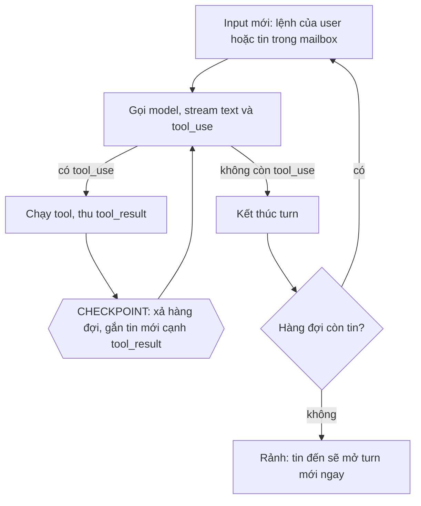
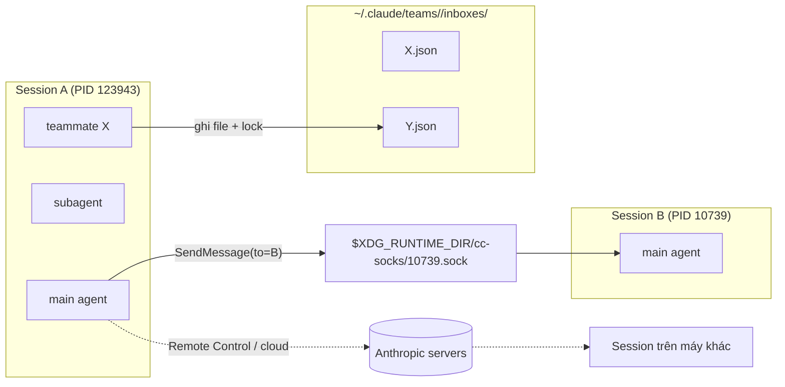
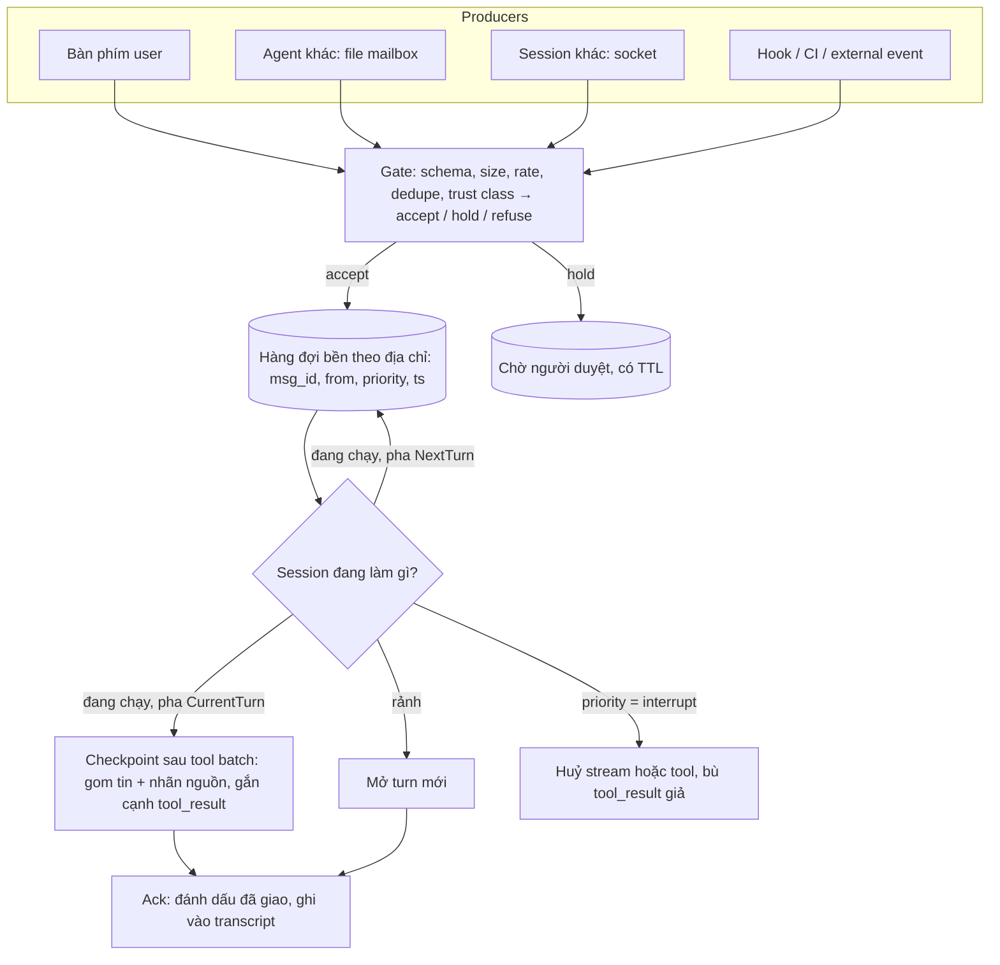

# Nghiên cứu: hệ thống message/mailbox cho các agent nói chuyện với nhau

- Thời điểm nghiên cứu: 2026-10-15 15:02 (Asia/Saigon)
- Phạm vi: khái niệm, đặc tính kỹ thuật, giới hạn, vướng mắc và các giải pháp hiện có cho việc nhắn tin giữa các agent LLM. Báo cáo gom lại toàn bộ nội dung đã trao đổi trong phiên chat, có kiểm chứng thêm bằng tài liệu chính thức và source code.
- Bằng chứng gốc: binary Claude Code `2.1.300` trên máy này, tài liệu chính thức của Claude Code, source Codex (`openai/codex`, commit `e89b7c4`, ngày 2026-10-15), đặc tả A2A 1.0, tài liệu LangGraph, README của MCP Agent Mail.

## Mục lục

1. [Kết luận chính](#1-kết-luận-chính)
2. [Khái niệm nền: session, agent, turn, step](#2-khái-niệm-nền-session-agent-turn-step)
3. [Checkpoint: vì sao có agent nhận tin ngay, có agent phải đợi](#3-checkpoint-vì-sao-có-agent-nhận-tin-ngay-có-agent-phải-đợi)
4. [Các giải pháp hiện có](#4-các-giải-pháp-hiện-có)
5. [Những chiều thiết kế bắt buộc phải quyết](#5-những-chiều-thiết-kế-bắt-buộc-phải-quyết)
6. [Giới hạn kỹ thuật và vướng mắc thường gặp](#6-giới-hạn-kỹ-thuật-và-vướng-mắc-thường-gặp)
7. [Thiết kế tham chiếu](#7-thiết-kế-tham-chiếu)
8. [Liên hệ với fgOS](#8-liên-hệ-với-fgos)
9. [Bước tiếp theo](#9-bước-tiếp-theo)
10. [Câu hỏi còn mở](#10-câu-hỏi-còn-mở)
11. [Nguồn](#11-nguồn)

---

## 1. Kết luận chính

1. **Nhận tin "ngay lập tức" không phải phép màu. Nó là kết quả của việc đặt checkpoint ở mỗi vòng tool.** Agent LLM chạy theo vòng lặp: gọi model, chạy tool, gọi model tiếp. API bắt buộc mỗi `tool_use` phải được trả lời bằng `tool_result` ở message ngay sau đó, nên chỉ có một chỗ an toàn để chèn tin mới: sau khi tool xong và trước lần gọi model kế tiếp. Hệ nào xả hàng đợi ở mọi chỗ như vậy thì có cảm giác phản hồi tức thì. Hệ nào chỉ xả ở cuối task thì có cảm giác "nằm đợi".
2. **Codex bản hiện tại đã làm giống Claude Code.** Trong source Codex mới nhất, vòng lặp turn xả `pending_input` trước mỗi lần gọi model (`session/turn.rs`). Enter là steer, tức chèn vào turn đang chạy; Tab là queue, tức đợi turn sau. Nếu thấy Codex "đợi xong task", nguyên nhân nhiều khả năng là bản cũ (trước khi steer thành mặc định), là dùng Tab, hoặc là đang kẹt trong một bước rất dài. Nhận định trước đó trong phiên chat rằng Codex chỉ có checkpoint ở cuối task là **sai với bản hiện tại** và được sửa ở đây.
3. **Phải tách hai khái niệm "agent" và "session".** Session là một tiến trình, có ranh giới quyền và người dùng riêng. Agent là một luồng model bên trong session. Claude Code dùng hai kênh khác hẳn nhau: mailbox dạng file cho agent trong team (bền, gửi được cho agent đang không chạy), và socket theo từng session cho tin xuyên session (chỉ sống cùng tiến trình, mang ranh giới tin cậy).
4. **"Checkpoint" có hai nghĩa dễ nhầm.** Nghĩa thứ nhất là *điểm an toàn để chèn tin* trong vòng lặp. Nghĩa thứ hai, như LangGraph dùng, là *ảnh chụp trạng thái được lưu bền* để tạm dừng và chạy tiếp. Một hệ mailbox tốt cần cả hai, nhưng phải đặt tên tách bạch.
5. **Phần khó nhất của mailbox cho agent không nằm ở phần vận chuyển, mà ở bốn chỗ**: chèn tin ở đâu trong vòng lặp, tin cậy tin của ai, chặn vòng lặp tin nhắn và bão tin, và chi phí context của mỗi tin nhắn.

---

## 2. Khái niệm nền: session, agent, turn, step

| Khái niệm | Định nghĩa dùng trong báo cáo |
|---|---|
| **Session** | Một tiến trình agent, có một cuộc hội thoại gốc, một người dùng và một permission mode. Ví dụ: một tiến trình `claude` với PID `123943`. |
| **Agent** | Một luồng model chạy bên trong session: luồng main, subagent hoặc teammate. Một session có thể chứa nhiều agent. |
| **Turn** | Một lượt làm việc bắt đầu từ một input và kết thúc khi model trả lời mà không gọi thêm tool. |
| **Step (vòng)** | Một lần gọi model cộng với việc chạy các tool mà lần gọi đó yêu cầu. Một turn gồm nhiều step. |
| **Checkpoint (điểm an toàn)** | Ranh giới giữa hai step, nơi hội thoại đang hợp lệ nên được phép chèn input mới. |
| **Mailbox / inbox** | Hàng đợi tin gửi tới một địa chỉ. Hàng đợi này có thể nằm trong bộ nhớ, trong file hoặc sau một socket. |

Hệ quả quan trọng: **ranh giới tin cậy nằm ở session, không nằm ở agent.** Các agent trong cùng session dùng chung quyền. Hai session thì có quyền riêng. Vì vậy, tin giữa hai session luôn phải được coi là tin của bên thứ ba.

---

## 3. Checkpoint: vì sao có agent nhận tin ngay, có agent phải đợi

### 3.1 Vòng lặp agent và ràng buộc của API



API của model yêu cầu: sau mỗi `tool_use` phải có một message `user` chứa `tool_result` tương ứng. Từ đó suy ra ba trạng thái:

| Agent đang ở trạng thái nào | Chèn tin được không | Lý do |
|---|---|---|
| Model đang stream | Không. Chỉ có thể huỷ cả lượt gọi. | Lượt gọi model chưa kết thúc. |
| Tool đang chạy | Không. | Còn `tool_use` chưa có kết quả. |
| Tool đã xong, chưa gọi model lần tiếp | **Được.** | Tin mới đi chung message `user` với các `tool_result`, nên không vi phạm contract. |

**Độ trễ nhận tin tối đa bằng độ dài của step dài nhất.** Thường mỗi step chỉ mất vài giây, nên người dùng có cảm giác tin được nhận ngay. Nhưng một lệnh `npm test` chạy 10 phút sẽ chặn checkpoint suốt 10 phút. Vì vậy các hệ tốt đều cho tool dài chạy nền và trả về ngay một handle, như `run_in_background` và `Monitor` trong Claude Code.

### 3.2 Bằng chứng trong Claude Code (binary 2.1.300)

- Trình tự sự kiện trong query loop: `query_tool_execution_end`, rồi `tengu_query_before_attachments`, rồi `queued_command attachments`, rồi `tengu_query_after_attachments`, cuối cùng là `query_recursive_call`. Nghĩa là: tool xong, hàng đợi được xả thành attachment, rồi model được gọi đệ quy.
- Tin của người dùng chèn giữa task được mở đầu bằng câu `"The user sent a new message while you were working: "`. Tin từ nguồn khác có nhãn riêng: `"Messages arrived in the bound thread while you were working:"` và `"[MESSAGE FROM NON-USER SOURCE - NOT USER INPUT]"`.
- `InboxPoller` có hai đường giao tin. `"Session idle, delivering"` mở turn mới khi session đang rảnh. `"Cleaning up processed message(s) that were delivered mid-turn"` xoá khỏi hàng đợi những tin đã giao giữa task, để không giao lần hai. Ngoài ra, `"Submission rejected, keeping messages queued"` giữ lại tin khi đẩy không thành công.
- Tài liệu chính thức nói thẳng: *"The receiving Claude reads the message between tool calls during an active turn, so a running tool is never interrupted. When the receiving session is idle, Claude Code starts a new turn with the message."*

### 3.3 Bằng chứng trong Codex (source `openai/codex`, commit `e89b7c4`)

- `codex-rs/core/src/session/turn.rs`: mỗi vòng `loop` trong `run_turn` lấy `sess.input_queue.get_pending_input(...)` khi cờ `can_drain_pending_input` đang bật. Comment ngay tại đó viết: *"pending_input would be something like a message the user submitted through the UI while the model was running."* Sau mỗi lần lấy mẫu, cờ được bật lại (`can_drain_pending_input = true`). Khi vừa compact giữa turn (`CompactionPhase::MidTurn`) thì cờ bị tắt cho vòng ngay sau đó.
- `session/input_queue.rs` phân biệt hai loại hoạt động: `InputQueueActivity::{Mailbox, Steer}`. Hàng đợi có phạm vi session, và các tin giữa agent (`InterAgentCommunication`) có hàng `mailbox_pending_mails` riêng.
- `state/turn.rs` định nghĩa `MailboxDeliveryPhase::{CurrentTurn, NextTurn}`. Comment của `NextTurn` viết: *"The current turn already emitted visible final answer text; mailbox messages should remain queued for a later turn."* Đây là một chi tiết thiết kế đáng học (xem mục 5.4).
- `tasks/regular.rs`: khi một turn kết thúc mà hàng đợi vẫn còn input thì vòng ngoài chạy tiếp một turn mới, không trả quyền về cho người dùng.
- Ở giao diện: Enter khi đang chạy sẽ steer, tức chèn vào turn hiện tại; Tab sẽ queue, tức đợi turn sau. Theo các nguồn thứ cấp, steer từng là tính năng thử nghiệm rồi mới thành mặc định. Em chưa xác minh được phiên bản cụ thể.

### 3.4 Vì sao có hệ trông như "đợi xong task"

Có bốn nguyên nhân khả dĩ, xếp từ hay gặp đến ít gặp:

1. **Bản cũ hoặc chế độ queue.** Input đang chạy được coi là turn mới và chỉ được đọc khi vòng lặp kết thúc.
2. **Đang kẹt trong một step dài**: lệnh build hay test chạy lâu, hoặc model đang sinh câu trả lời rất dài.
3. **Theo thiết kế, tin bị hoãn sang turn sau**, như `NextTurn` của Codex: model đã bắt đầu trả lời cuối cùng thì tin mới đợi.
4. **Vòng lặp chạy như một lời gọi kín**, ví dụ kiểu `run_task()`, nên giao diện không có chỗ nào để đưa tin vào giữa các bước.

Với Antigravity, em không tìm được tài liệu công khai mô tả cơ chế steer giữa task. Nguồn thứ cấp chỉ nhắc tới việc bình luận lên Artifact trong khi agent vẫn chạy. Phần này cần kiểm chứng thêm.

### 3.5 Phân biệt hai nghĩa của "checkpoint"

| | Checkpoint *điểm an toàn* | Checkpoint *ảnh chụp bền* (LangGraph) |
|---|---|---|
| Là gì | Ranh giới giữa hai step, nơi được phép chèn input | Bản lưu trạng thái của đồ thị sau mỗi super-step, gắn theo `thread_id` |
| Giải quyết việc gì | Độ trễ nhận tin, khả năng steer | Tạm dừng vô thời hạn, chạy tiếp, human-in-the-loop, khôi phục sau khi tiến trình chết |
| Cơ chế | Xả hàng đợi trong bộ nhớ tại ranh giới | `interrupt()` lưu state và dừng lại; gọi lại với `Command` thì chạy tiếp |
| Bị mất khi tiến trình chết? | Có, trừ khi hàng đợi được lưu bền | Không, nếu dùng checkpointer bền |

Hệ thống mailbox cho agent cần **cả hai**. Checkpoint điểm an toàn giúp nhận tin nhanh. Checkpoint ảnh chụp bền giúp một agent đang chờ trả lời (ví dụ trạng thái `input-required`) có thể ngủ hàng giờ mà không giữ tiến trình.

---

## 4. Các giải pháp hiện có

### 4.1 Claude Code: ba kênh tách biệt



**(a) Mailbox của agent trong team (`TeammateMailbox`)**

- Lưu ở file `~/.claude/teams/{team}/inboxes/{agent-name}.json`. Tài liệu chính thức và code trong binary khớp nhau ở điểm này.
- Khoá là *tên agent* đã được làm sạch bằng `e.replace(/[^a-zA-Z0-9_-]/g, "-")`. Agent id đầy đủ có dạng `name@team`. Vì đã có thư mục team, phần còn lại chỉ là `name`, nên tên đó là id *trong phạm vi team*, không phải id toàn cục.
- Mỗi lần ghi đều có lockfile (`<path>.lock`) và ghi nguyên tử. Khi đọc, mỗi entry được kiểm tra theo schema; entry sai bị loại bỏ, còn tin hợp lệ vẫn được giao. Mỗi tin có các trường `from`, `text`, `timestamp`, `read` và `msg_id`.
- Tin chỉ được báo là "đã gửi" khi ghi file thành công. Nếu đĩa đầy hoặc thư mục không ghi được, bên gửi nhận lỗi.
- Mailbox dạng file chở được cả tin có cấu trúc: yêu cầu shutdown, yêu cầu duyệt plan và phản hồi duyệt plan.
- Giới hạn chính thức: một team cho mỗi session; không có team lồng nhau; lead cố định; teammate chạy in-process không được khôi phục sau `/resume`; muốn gửi cho cả team phải gửi từng người.
- Tranh chấp khi nhận task trong task list chung được giải bằng file locking.

**(b) Inbox xuyên session trên cùng máy**

- Mỗi session bind một Unix domain socket ở `$XDG_RUNTIME_DIR/cc-socks/<pid>.sock`. Nếu đường dẫn dài hơn 103 byte hoặc thư mục không an toàn thì dùng `/tmp/cc-socks-<uid>/<pid>.sock`. Trên Windows dùng named pipe. Trên máy này đang có 3 socket còn sống.
- Socket chỉ cho người dùng hệ điều hành đó truy cập. Đường dẫn và token được export qua `CLAUDE_CODE_MESSAGING_SOCKET` và `CLAUDE_CODE_MESSAGING_TOKEN`. Một kết nối phải gửi xong một dòng trong vòng 30 giây, nếu không sẽ bị đóng.
- Tin chỉ là văn bản thuần. Tin vượt khoảng 1 triệu ký tự bị từ chối ngay tại phía gửi. Tin có cấu trúc của agent team không đi qua kênh này.
- Bên nhận kiểm tra tin theo `crossSessionInbound` với ba giá trị: `accept`, `hold` hoặc `refuse`. Nếu không cấu hình, mặc định được quyết theo *lớp permission mode* của hai bên: session đang bỏ qua prompt quyền sẽ giữ tin để người dùng duyệt. Dialog duyệt hết hạn sau 5 phút (`dialogExpiry`). Mỗi session giữ tối đa 100 tin đang chờ duyệt; vượt quá thì bỏ tin cũ nhất.
- Chống vòng lặp: giới hạn tốc độ theo từng người gửi, bỏ các tin giống hệt nhau đến trong khoảng ngắn, xếp hàng tối đa 50 tin đã chấp nhận, và từ chối các đợt gửi dồn dập ngay tại phía gửi.
- Một tin từ session khác không được phép duyệt prompt quyền, không được đổi cấu hình, và các lệnh trong đó (ví dụ `/compact`) không được chạy.
- `notify_when_idle` nhận đúng một thông báo khi session kia rảnh hoặc thoát. Chỉ main agent được đăng ký, chỉ cho session trên cùng máy, và đăng ký hết hạn sau 12 giờ.
- Tin do chính tiến trình con của session gửi về (ví dụ một hook) được tự động chấp nhận nếu xác minh được qua bằng chứng tiến trình hoặc token.

**(c) Remote Control và cloud**

- Tin đi qua máy chủ Anthropic. Session bên kia đang offline thì tin vẫn đi và đến nơi khi máy đó kết nối lại. Gửi khi session mình không kết nối Remote Control thì tin không có địa chỉ trả lời, tức là tin một chiều.
- Bên nhận nhận một thông báo, rồi gọi `FetchInboxMessage(file_id)` để lấy nội dung.
- `isolatePeerMachines: true` buộc phải có người duyệt trước khi bất kỳ tin nào rời khỏi máy.

**Hai hệ quả cần nhớ**

- Khi subagent gửi tin sang session khác, tin đi với địa chỉ của session cha, và câu trả lời quay về cuộc hội thoại của session cha, không về subagent.
- Gửi tới tên của một teammate in-process đã dừng sẽ đánh thức nó, khôi phục hội thoại đã lưu, và đưa tin vào làm prompt kế tiếp. Nhờ đó mailbox sống lâu hơn tiến trình của agent.

### 4.2 Codex: hàng đợi input theo session, mailbox giữa agent, chia pha giao tin

- `InputQueue` có phạm vi session, chứa input cho turn và một mailbox riêng cho `InterAgentCommunication`. Các bộ đếm giám sát như `core.mailbox.pending` đo số tin đang chờ.
- Tin được xả ở mỗi vòng lấy mẫu (mục 3.3). Turn kết thúc mà còn tin thì vòng ngoài tự mở turn tiếp.
- Pha giao tin: khi model đã phát ra câu trả lời cuối cùng mà người dùng nhìn thấy, mailbox chuyển sang `NextTurn`. Mục đích là không chèn tin vào một câu trả lời đã chốt, tránh làm câu trả lời đó lệch đi. Nếu model vẫn cần làm tiếp (`model_needs_follow_up`), pha được đặt lại về `CurrentTurn`.
- Có tool `wait` cho multi-agent: chờ đến khi có hoạt động mailbox từ bất kỳ agent nào đang sống, hoặc đến khi hết thời gian.
- Tin chèn giữa task cũng đi qua hook (`inspect_pending_input`, `record_pending_input`). Nhờ vậy chính sách hoặc bộ lọc có thể chặn tin trước khi nó vào context.

### 4.3 A2A (Agent2Agent), đặc tả 1.0

- Là giao thức giữa *các hệ agent độc lập qua mạng*, không phải giữa các luồng trong một tiến trình. Các đối tượng chính: `AgentCard` (danh tính và năng lực), `Task`, `Message` gồm nhiều `Part`, `Artifact` và `contextId` để gom một cuộc hội thoại.
- Vòng đời task: `SUBMITTED` → `WORKING` → `INPUT_REQUIRED` hoặc `AUTH_REQUIRED` → `COMPLETED`, `FAILED`, `CANCELED` hoặc `REJECTED`. Trạng thái `INPUT_REQUIRED` chính là điểm dừng chờ trả lời: client gửi tin mới với cùng `taskId` và `contextId` thì task chạy tiếp.
- Có ba cách nhận cập nhật: hỏi lại (`GetTask`), stream SSE (sự kiện đến đúng thứ tự sinh ra) và push qua webhook.
- Đặc tả nói rõ message *không phải* cơ chế giao tin tin cậy: client kết nối lại có thể lỡ cập nhật trạng thái. Huỷ task chỉ là cố gắng tốt nhất.
- Bài học: A2A chuẩn hoá *vòng đời task và cách thông báo*, chứ không chuẩn hoá việc chèn tin giữa các step bên trong một agent. Bên trong agent vẫn cần checkpoint như mục 3.

### 4.4 MCP Agent Mail

- Là một MCP server làm lớp "email" cho nhiều coding agent. Mỗi agent có danh tính dạng tên dễ nhớ (ví dụ `GreenCastle`), có inbox và outbox, và có thể đặt *lease tự nguyện* lên file để báo "tôi đang sửa file này". Một pre-commit guard so các file đã staged với các lease đó.
- Lưu bằng Git (để người đọc và kiểm tra được) cộng SQLite (để đánh chỉ mục và truy vấn). Các agent trong cùng thư mục dùng chung một `project_key`.
- Bài học: kết hợp nhắn tin với *khoá tư vấn trên tài nguyên* giải quyết đúng loại xung đột phổ biến nhất của coding agent, đó là hai agent cùng sửa một file. Nhược điểm: agent phải *chủ động* đọc inbox. Không có checkpoint đẩy tin vào context, trừ khi harness tự gọi tool lấy tin.

### 4.5 LangGraph: interrupt và checkpointer

- `interrupt()` lưu state qua checkpointer rồi dừng vô thời hạn. Gọi lại với `Command(resume=...)` và cùng `thread_id` thì giá trị đó trở thành giá trị trả về của `interrupt()`. Môi trường production nên dùng checkpointer bền.
- Bài học: đây là mẫu "chờ trả lời mà không giữ tiến trình". Mailbox cho agent nên có trạng thái này cho các câu hỏi phải chờ người.

### 4.6 Actor model (Erlang, Akka) — kiến thức nền

Mỗi actor có một mailbox và xử lý tuần tự từng tin. Khác biệt lớn với agent LLM là *thời gian xử lý một tin*: actor xử lý mỗi tin trong vài micro giây, còn agent xử lý một tin trong nhiều phút. Vì vậy agent cần thêm hai thứ mà actor không cần: **chèn tin vào giữa lúc đang xử lý** (checkpoint) và **mức ưu tiên ngắt** (steer, queue, interrupt). Những ý tưởng nên giữ lại từ actor: mailbox theo địa chỉ, không chia sẻ bộ nhớ, cây giám sát (lead và teammate) và "let it crash" đi kèm khả năng chạy lại.

### 4.7 Bảng so sánh

| Tiêu chí | CC team mailbox | CC cross-session | Codex | A2A | MCP Agent Mail | LangGraph |
|---|---|---|---|---|---|---|
| Đơn vị địa chỉ | tên agent trong team | session (PID/tên) | thread hoặc agent | agent (Agent Card) + task | tên agent trong project | thread_id |
| Lưu bền | file JSON | không (socket) | trong bộ nhớ | tuỳ server | Git + SQLite | checkpointer |
| Đẩy vào context | có, ở checkpoint | có, ở checkpoint | có, ở mỗi vòng lấy mẫu | không áp dụng (giữa các hệ) | không, agent phải tự lấy | khi resume |
| Phân loại tin cậy | cùng team; auto mode có bộ phân loại kiểm tra | bên thứ ba, accept/hold/refuse | hook kiểm tra | auth theo Agent Card | không rõ | không áp dụng |
| Chống vòng lặp | không công bố | giới hạn tốc độ, bỏ tin trùng, tối đa 50 tin | không công bố | không áp dụng | không rõ | không áp dụng |
| Tin có cấu trúc | có (shutdown, plan approval) | chỉ văn bản thuần | có (InterAgentCommunication) | có (Part, Artifact) | có | state |

---

## 5. Những chiều thiết kế bắt buộc phải quyết

### 5.1 Địa chỉ và danh tính

- Phải tách *địa chỉ agent* (ổn định, gắn với vai trò, ví dụ `researcher@team`) khỏi *địa chỉ session* (gắn với tiến trình, mất khi tiến trình chết).
- Phải định nghĩa phạm vi duy nhất của tên: trong team, trong project, hay toàn cục. Phải có quy tắc giải quyết khi trùng tên. Claude Code chọn "agent mới nhất thắng", và yêu cầu thêm `[ref]` khi trùng.
- Bước làm sạch tên phải là đơn ánh, tức hai tên khác nhau không được ra cùng một tên file. Nếu không, hai agent sẽ âm thầm dùng chung inbox (xem mục 6).

### 5.2 Độ bền và ngữ nghĩa giao tin

- **Ít nhất một lần + loại trùng theo `msg_id`** là lựa chọn thực tế. **Đúng một lần** chỉ đạt được ở mức ứng dụng, bằng cách ack sau khi tin đã vào transcript.
- Phải phân biệt rõ bốn trạng thái: *đã gửi* (ghi xong), *đã giao* (vào context), *đã đọc* và *đã xử lý*. Tài liệu Claude Code nhấn mạnh: gửi thành công không có nghĩa là Claude bên kia đã đọc.
- Phải ghi tin xuống đĩa trước khi ack bên gửi, nếu muốn tin còn lại sau khi tiến trình chết.

### 5.3 Thứ tự

- Thứ tự theo từng người gửi là đủ cho phần lớn trường hợp. Thứ tự toàn cục rất đắt và hiếm khi cần.
- Khi nhiều tin cùng được xả ở một checkpoint, phải gom chúng thành một khối và giữ thứ tự đến.

### 5.4 Điểm chèn và mức ưu tiên

| Mức | Hành vi | Ví dụ |
|---|---|---|
| **steer** | Chèn ở checkpoint kế tiếp của turn đang chạy | Enter trong Codex; tin gõ vào trong lúc Claude Code đang chạy |
| **queue** | Đợi turn hiện tại kết thúc | Tab trong Codex |
| **interrupt** | Huỷ ngay lượt gọi model hoặc tool đang chạy, rồi ghi `tool_result` giả kiểu "đã bị ngắt" cho các `tool_use` còn dang dở | Esc |
| **wake** | Session đang rảnh: mở turn mới ngay | `InboxPoller "Session idle, delivering"` |

Còn một quy tắc *pha giao tin* nữa: khi agent đã bắt đầu câu trả lời cuối cùng, tin của mailbox nên được hoãn sang turn sau, như `NextTurn` của Codex, để không phá một câu trả lời đã chốt.

### 5.5 Áp lực ngược, hạn mức và chống vòng lặp

Hai agent trả lời qua lại tự động có thể đốt token không giới hạn. Cần cả bốn thứ sau:

- giới hạn kích thước một tin;
- giới hạn tốc độ theo người gửi;
- giới hạn số tin đang xếp hàng;
- bỏ các tin giống hệt nhau đến gần nhau.

Thêm một quy tắc nên có: *ưu tiên một tin gom nhiều nội dung hơn nhiều tin nhỏ*. Tài liệu Claude Code hướng dẫn model gom thành một tin khi bị từ chối vì gửi dồn dập.

### 5.6 Tin cậy, nguồn gốc và quyền

- Mỗi tin phải mang nhãn nguồn gốc mà model nhìn thấy được, ví dụ `<cross-session-message from=…>` hoặc `[MESSAGE FROM NON-USER SOURCE - NOT USER INPUT]`.
- Tin từ agent khác **không bao giờ** được coi là sự đồng ý của người dùng. Tin đó không được duyệt prompt quyền, không được đổi cấu hình, và không được chạy slash command.
- Phải chống *permission laundering*: agent A bị từ chối một hành động thì không được nhờ agent B làm hộ.
- Mặc định phải tính đến chênh lệch quyền giữa hai bên. Session có quyền cao hơn nên giữ tin đến từ session có quyền thấp hơn để người dùng duyệt.
- Tin nhắn chính là bề mặt prompt injection. Tốt nhất có một bộ lọc hoặc hook xem tin trước khi nó vào context, như hook của Codex hay bộ phân loại trong auto mode của Claude Code.

### 5.7 Nội dung

- Văn bản thuần dùng cho trao đổi tự do. Tin có cấu trúc dùng cho giao thức điều khiển: shutdown, duyệt plan, nhận task. Không nên trộn hai loại vào cùng một kênh không có schema.
- `@path` trong tin không được tự động đính kèm file ở phía nhận. Muốn chuyển nội dung thì phải gửi chính nội dung, hoặc gửi đường dẫn để bên nhận tự đọc bằng quyền của mình.

### 5.8 Hiện diện và quan sát

- Cần một lệnh kiểu `ListAgents`: ai đang sống, đang bận hay rảnh, có nhận tin được không.
- Cần một cơ chế đăng ký "báo khi rảnh" thay cho việc hỏi liên tục. Hỏi liên tục vừa tốn token vừa tạo vòng lặp tin.
- Cần chỉ số đo và nhật ký: số tin đang chờ, số tin bị từ chối hoặc hết hạn, độ trễ từ lúc gửi đến lúc giao.

### 5.9 Context và chi phí

- Mỗi tin được giao đều tốn token như một prompt. Tin dài và nhiều tin làm context phình nhanh và kích hoạt compact sớm.
- Tin phải sống sót qua compact và resume. Một tin đã giao mà bị compact mất thì agent coi như chưa từng nhận.

---

## 6. Giới hạn kỹ thuật và vướng mắc thường gặp

1. **Không chèn được khi model đang stream hoặc tool đang chạy.** Muốn ngắt thì phải huỷ, và phải bù `tool_result` cho mọi `tool_use` dang dở. Quên bước bù này thì lần gọi API kế tiếp bị từ chối.
2. **Một step dài chặn checkpoint.** Cách giải: cho tool dài chạy nền và trả về handle, cho tool có thể bị huỷ, và giới hạn độ dài câu trả lời.
3. **Tin đến sau khi đã có câu trả lời cuối.** Nếu chèn vào, model có thể sửa lại một câu trả lời đã chốt. Nên hoãn sang turn sau.
4. **Trùng tên do bước làm sạch tên.** `a.b` và `a-b` đều thành `a-b.json`. Cách giải: dùng id không đổi làm khoá file, còn tên chỉ dùng để hiển thị.
5. **Tranh chấp khi ghi file mailbox.** Bắt buộc có lockfile và ghi nguyên tử. Khi đọc phải kiểm tra schema và bỏ entry hỏng, không để một entry hỏng làm mất cả inbox.
6. **"Đã giao" không có nghĩa là "đã đọc".** Tin có thể bị giữ để duyệt, hết hạn, hoặc bị từ chối. Với kênh cloud và Remote Control không có báo ngược, nên im lặng không được hiểu là đồng ý.
7. **Bão tin và vòng lặp tin** giữa hai agent tự động trả lời nhau (mục 5.5).
8. **Prompt injection qua tin nhắn** (mục 5.6).
9. **Context phình to** khi nhận nhiều tin (mục 5.9).
10. **Resume làm mất agent.** Teammate in-process không được khôi phục sau `/resume`; lead có thể gửi tin tới những agent không còn tồn tại.
11. **Ranh giới môi trường.** Session trong container và session ngoài host không gửi tin cho nhau được. Tương tự với WSL 2 và Windows gốc.
12. **Trả lời đi về session, không về agent.** Subagent gửi tin ra ngoài thì câu trả lời quay về session cha. Nếu không thiết kế đường chuyển tiếp, subagent không bao giờ nhận được câu trả lời.
13. **Cache prompt.** Teammate in-process có TTL cache riêng, mặc định 5 phút. Một agent nằm chờ tin quá 5 phút sẽ mất cache và tốn tiền nạp lại context.

---

## 7. Thiết kế tham chiếu



Mã giả cho vòng lặp:

```ts
while (true) {
  const resp = await model.call(history);                 // không chèn được trong lúc này
  if (!resp.toolUses.length) {                             // câu trả lời cuối
    mailbox.setPhase("NextTurn");
    break;
  }
  const results = await runTools(resp.toolUses, { cancellable: true, background: longRunning });
  const msgs = mailbox.phase === "CurrentTurn" ? await mailbox.drain(self) : [];
  history.push(userMessage([...results, ...msgs.map(labelWithProvenance)]));
  await mailbox.ack(msgs);                                 // ack sau khi đã vào transcript
}
if (await mailbox.hasPending(self)) startNewTurn();        // không trả quyền khi còn tin
```

Mười quy tắc cụ thể:

1. Vòng lặp tường minh theo step; mỗi ranh giới step là một checkpoint.
2. Mỗi địa chỉ có một hàng đợi, nhận từ mọi nguồn. Khoá của hàng đợi là id không đổi.
3. Gate ở đầu vào: schema, kích thước, tốc độ, loại trùng và lớp tin cậy.
4. Tin được bọc nhãn nguồn gốc. Tin của bên thứ ba không bao giờ mang quyền của người dùng.
5. Bốn mức ưu tiên (steer, queue, interrupt, wake) và quy tắc pha giao tin.
6. Ghi bền trước khi ack bên gửi; ack giao tin sau khi tin đã vào transcript.
7. Tool dài chạy nền để giữ độ trễ checkpoint thấp.
8. Hiện diện (`list`) và đăng ký "báo khi rảnh"; không hỏi liên tục.
9. Trạng thái `input-required` được lưu bền theo kiểu checkpointer, để agent chờ người mà không giữ tiến trình.
10. Đo lường: số tin chờ, số tin bị từ chối hoặc hết hạn, độ trễ giao tin, và token tiêu cho tin nhắn.

---

## 8. Liên hệ với fgOS

- **Tiền lệ đã có:** `docs/architect/agent-coordination/vision.md` (V-011) ghi rõ: *"The first foundation does not require a scheduler, durable Job queue, daemon, general mailbox, mandatory Mission lifecycle, unrestricted peer chat…"* và *"New persisted entities require a distinct authority, recovery need, or invariant that existing entities cannot represent correctly."* Thêm vào đó, `contracts/coordination-session.md` mô tả Deliberation Contribution Ledger là các link bất biến có kiểu, *"never a general message/thread/mailbox subsystem"*.
- **Ý nghĩa:** muốn đưa mailbox vào fgOS thì phải chứng minh được một nhu cầu khôi phục, một quyền hạn hoặc một bất biến mà Assignment, RunResult và Contribution Ledger hiện tại không biểu diễn được. Nếu chỉ để "cho agent nói chuyện" thì chưa đủ lý do.
- **Ứng viên có giá trị thật:**
  - *Steer cho Unit đang chạy.* Ranh giới giữa các round của runner là checkpoint tự nhiên. Một hàng đợi steer theo `unitRunId`, được xả ở ranh giới round, cho phép người dùng chỉnh hướng mà không huỷ cả Unit. Việc này phục vụ trực tiếp mục tiêu "Release con người" trong thứ tự ưu tiên sản phẩm.
  - *Câu hỏi treo không nghẽn việc khác.* Trạng thái `input-required` lưu bền theo kiểu checkpointer khớp với yêu cầu "một câu hỏi treo không được nghẽn phần việc khác" trong AGENTS.md.
  - *Lease tự nguyện trên file*, theo kiểu MCP Agent Mail, cho các worker chạy song song trong cùng repo.
- **Không nên** dựng một hệ peer chat tự do. Lý do: chính V-011 đã loại, và rủi ro bão tin, permission laundering và chi phí context là có thật (mục 6).

---

## 9. Bước tiếp theo

1. Đọc `src/runner/` để xác định chính xác ranh giới round hiện có, và xem đã có chỗ nào cho phép đưa input vào giữa các round chưa. Kết quả nên là một bản ghi facts ngắn.
2. Nếu ranh giới đó có, viết một câu hỏi quyết định theo mẫu `core/skills/_shared/decision-question.md` về việc mở lại V-011 chỉ cho phạm vi "hàng đợi steer theo Unit". Cách mở lại là supersede, không sửa tại chỗ.
3. Viết kịch bản thử với Claude Code: hai session trên cùng máy, đo độ trễ giao tin khi bên nhận đang chạy một tool 60 giây và khi đang rảnh. Mục đích là có số đo thật cho mục 3.1.
4. Nếu cần so sánh, kiểm chứng Codex bằng cách cài bản mới nhất và thử Enter so với Tab trong lúc một lệnh shell dài đang chạy.

---

## 10. Câu hỏi còn mở

1. Gửi `SendMessage` tới một subagent trong cùng session (không thuộc team) thì tin đi qua hàng đợi trong bộ nhớ hay qua file? Em chưa đọc tới đoạn code đó.
2. Antigravity có cơ chế steer giữa task không? Chưa có nguồn chính thức.
3. Steer của Codex trở thành mặc định từ phiên bản nào? Các nguồn thứ cấp mâu thuẫn nhau.
4. Mailbox dạng file của Claude Code có giới hạn kích thước hay số tin cho mỗi inbox không? Tài liệu không nói.
5. Với fgOS, một hàng đợi steer có cần lưu bền hay không, nếu Unit vốn đã có thể chạy lại? Câu trả lời phụ thuộc vào việc chạy lại một round có tốn kém hay không.

---

## 11. Nguồn

Nguồn chính:

- Claude Code, cross-session messaging: https://code.claude.com/docs/en/cross-session-messaging
- Claude Code, agent teams: https://code.claude.com/docs/en/agent-teams
- Binary Claude Code `2.1.300` (`~/.local/share/claude/versions/2.1.300`): các hàm `getInboxPath`, `$P`, `readMailbox`, `writeToMailbox`, `InboxPoller`, `startCrossSessionInbox` và socket `cc-socks`.
- Source Codex, `openai/codex` commit `e89b7c4`: `codex-rs/core/src/session/turn.rs`, `session/input_queue.rs`, `state/turn.rs`, `tasks/regular.rs`, `stream_events_utils.rs`, `tools/handlers/multi_agents_v2/wait.rs`.
- Đặc tả A2A 1.0: https://a2a-protocol.org/latest/specification/
- LangGraph, human-in-the-loop: https://docs.langchain.com/oss/python/langgraph/human-in-the-loop
- LangGraph, persistence: https://docs.langchain.com/oss/python/langgraph/persistence
- MCP Agent Mail: https://github.com/Dicklesworthstone/mcp_agent_mail

Nguồn thứ cấp, chỉ dùng để tham khảo:

- Codex TUI, Enter so với Tab: https://codex.danielvaughan.com/2026/04/08/codex-cli-tui-shortcuts-slash-commands/
- Steer mode của Codex: https://blog.devgenius.io/codex-clis-busy-week-steer-mode-fork-and-7-releases-in-3-days-ece5c742923e
- Giải thích A2A: https://www.instaclustr.com/blog/scaling-agent-systems-with-kafka-and-a2a-part-3-agent2agent-protocol-explained/
- Antigravity, bình luận trên artifact: https://www.altamira.ai/blog/antigravity-is-agent-first-coding-tool/

Tài liệu fgOS liên quan:

- `docs/architect/agent-coordination/vision.md` (V-011)
- `docs/architect/agent-coordination/contracts/coordination-session.md` (Deliberation Contribution Ledger)
