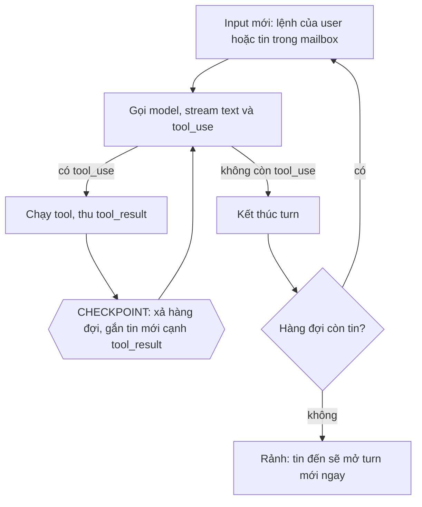
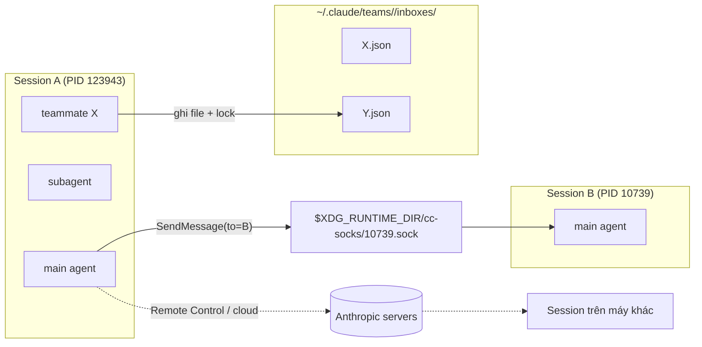
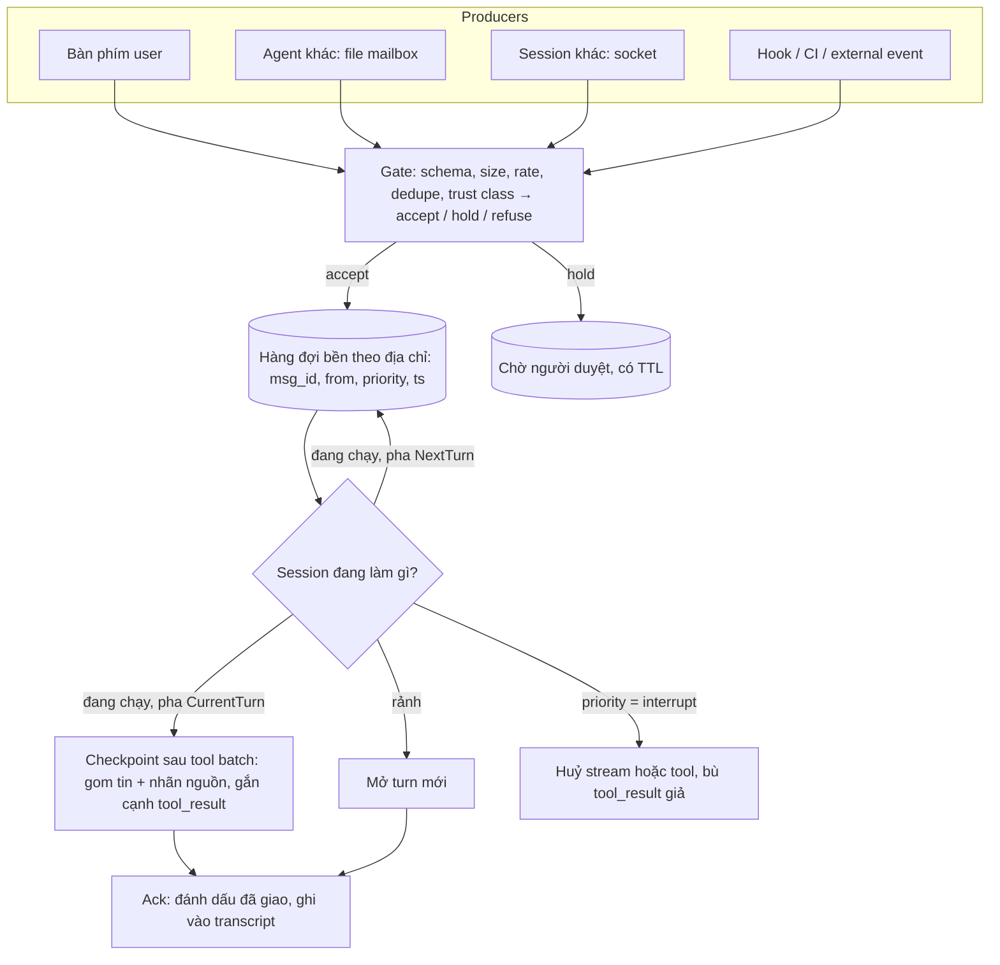
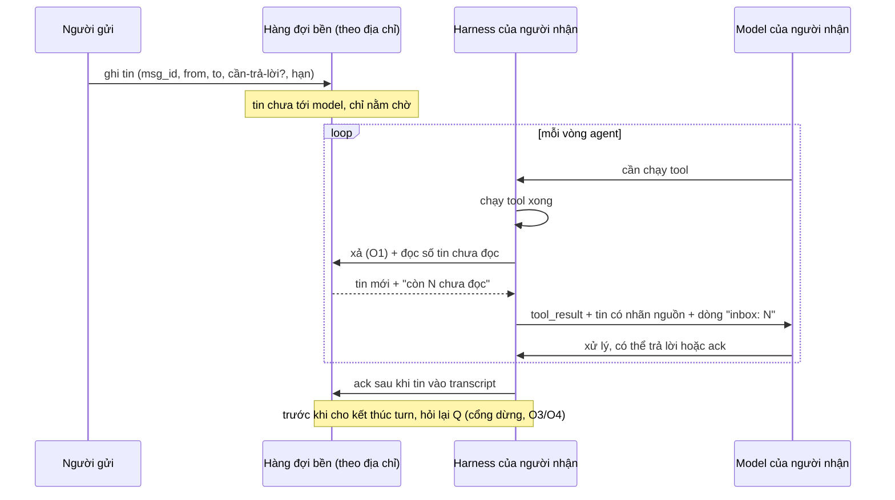

# Nghiên cứu: hệ thống message/mailbox cho các agent nói chuyện với nhau

- Thời điểm nghiên cứu: 2026-10-15 15:02 (Asia/Saigon)
- Phạm vi: khái niệm, đặc tính kỹ thuật, giới hạn, vướng mắc và các giải pháp hiện có cho việc nhắn tin giữa các agent LLM. Báo cáo gom lại toàn bộ nội dung đã trao đổi trong phiên chat, có kiểm chứng thêm bằng tài liệu chính thức và source code.
- Bằng chứng gốc: binary Claude Code `2.1.300` trên máy này, tài liệu chính thức của Claude Code, source Codex (`openai/codex`, commit `e89b7c4`, ngày 2026-10-15), đặc tả A2A 1.0, tài liệu LangGraph, README của MCP Agent Mail.
- Bổ sung 2026-10-19: mục 13 đối chiếu với repo `reason-machines/reason-network` (commit `19b1fbf`), đọc một phần.

## Mục lục

1. [Kết luận chính](#1-kết-luận-chính)
2. [Khái niệm nền: session, agent, turn, step](#2-khái-niệm-nền-session-agent-turn-step)
3. [Checkpoint: vì sao có agent nhận tin ngay, có agent phải đợi](#3-checkpoint-vì-sao-có-agent-nhận-tin-ngay-có-agent-phải-đợi)
4. [Các giải pháp hiện có](#4-các-giải-pháp-hiện-có)
5. [Những chiều thiết kế bắt buộc phải quyết](#5-những-chiều-thiết-kế-bắt-buộc-phải-quyết)
6. [Giới hạn kỹ thuật và vướng mắc thường gặp](#6-giới-hạn-kỹ-thuật-và-vướng-mắc-thường-gặp)
7. [Thiết kế tham chiếu](#7-thiết-kế-tham-chiếu)
8. [Cách agent biết gửi tin và làm sao nhận được tin kịp thời](#8-cách-agent-biết-gửi-tin-và-làm-sao-nhận-được-tin-kịp-thời)
9. [Giao tiếp giữa các agent khác máy](#9-giao-tiếp-giữa-các-agent-khác-máy)
10. [Liên hệ với fgOS](#10-liên-hệ-với-fgos)
11. [Bước tiếp theo](#11-bước-tiếp-theo)
12. [Câu hỏi còn mở](#12-câu-hỏi-còn-mở)
13. [Đối chiếu với reason-network](#13-đối-chiếu-với-reason-network)
14. [Nguồn](#14-nguồn)

---

## 1. Kết luận chính

1. **Nhận tin "ngay lập tức" không phải phép màu. Nó là kết quả của việc đặt checkpoint ở mỗi vòng tool.** Agent LLM chạy theo vòng lặp: gọi model, chạy tool, gọi model tiếp. API bắt buộc mỗi `tool_use` phải được trả lời bằng `tool_result` ở message ngay sau đó, nên chỉ có một chỗ an toàn để chèn tin mới: sau khi tool xong và trước lần gọi model kế tiếp. Hệ nào xả hàng đợi ở mọi chỗ như vậy thì có cảm giác phản hồi tức thì. Hệ nào chỉ xả ở cuối task thì có cảm giác "nằm đợi".
2. **Codex bản hiện tại đã làm giống Claude Code.** Trong source Codex mới nhất, vòng lặp turn xả `pending_input` trước mỗi lần gọi model (`session/turn.rs`). Enter là steer, tức chèn vào turn đang chạy; Tab là queue, tức đợi turn sau. Nếu thấy Codex "đợi xong task", nguyên nhân nhiều khả năng là bản cũ (trước khi steer thành mặc định), là dùng Tab, hoặc là đang kẹt trong một bước rất dài. Nhận định trước đó trong phiên chat rằng Codex chỉ có checkpoint ở cuối task là **sai với bản hiện tại** và được sửa ở đây.
3. **Phải tách hai khái niệm "agent" và "session".** Session là một tiến trình, có ranh giới quyền và người dùng riêng. Agent là một luồng model bên trong session. Claude Code dùng hai kênh khác hẳn nhau: mailbox dạng file cho agent trong team (bền, gửi được cho agent đang không chạy), và socket theo từng session cho tin xuyên session (chỉ sống cùng tiến trình, mang ranh giới tin cậy).
4. **"Checkpoint" có hai nghĩa dễ nhầm.** Nghĩa thứ nhất là *điểm an toàn để chèn tin* trong vòng lặp. Nghĩa thứ hai, như LangGraph dùng, là *ảnh chụp trạng thái được lưu bền* để tạm dừng và chạy tiếp. Một hệ mailbox tốt cần cả hai, nhưng phải đặt tên tách bạch.
5. **Phần khó nhất của mailbox cho agent không nằm ở phần vận chuyển, mà ở bốn chỗ**: chèn tin ở đâu trong vòng lặp, tin cậy tin của ai, chặn vòng lặp tin nhắn và bão tin, và chi phí context của mỗi tin nhắn.

6. **Agent không "lắng nghe", nó chỉ "nghe" ở các điểm harness xả hàng đợi.** Muốn agent thường xuyên có cơ hội xử lý tin thì phải tạo điểm xả (mỗi ranh giới step, cổng dừng, đánh thức khi rảnh), ghim tin tới khi ack, đặt hạn và leo thang, và đo độ trễ. Chi tiết ở mục 8.

---

## 2. Khái niệm nền: session, agent, turn, step

| Khái niệm | Định nghĩa dùng trong báo cáo |
|---|---|
| **Session** | Một tiến trình agent, có một cuộc hội thoại gốc, một người dùng và một permission mode. Ví dụ: một tiến trình `claude` với PID `123943`. |
| **Agent** | Một luồng model chạy bên trong session: luồng main, subagent hoặc teammate. Một session có thể chứa nhiều agent. |
| **Turn** | Một lượt làm việc bắt đầu từ một input và kết thúc khi model trả lời mà không gọi thêm tool. |
| **Step (vòng)** | Một lần gọi model cộng với việc chạy các tool mà lần gọi đó yêu cầu. Một turn gồm nhiều step. |
| **Checkpoint (điểm an toàn)** | Ranh giới giữa hai step, nơi hội thoại đang hợp lệ nên được phép chèn input mới. |
| **Mailbox / inbox** | Hàng đợi tin gửi tới một địa chỉ. Hàng đợi này có thể nằm trong bộ nhớ, trong file hoặc sau một socket. |

Hệ quả quan trọng: **ranh giới tin cậy nằm ở session, không nằm ở agent.** Các agent trong cùng session dùng chung quyền. Hai session thì có quyền riêng. Vì vậy, tin giữa hai session luôn phải được coi là tin của bên thứ ba.

---

## 3. Checkpoint: vì sao có agent nhận tin ngay, có agent phải đợi

### 3.1 Vòng lặp agent và ràng buộc của API



API của model yêu cầu: sau mỗi `tool_use` phải có một message `user` chứa `tool_result` tương ứng. Từ đó suy ra ba trạng thái:

| Agent đang ở trạng thái nào | Chèn tin được không | Lý do |
|---|---|---|
| Model đang stream | Không. Chỉ có thể huỷ cả lượt gọi. | Lượt gọi model chưa kết thúc. |
| Tool đang chạy | Không. | Còn `tool_use` chưa có kết quả. |
| Tool đã xong, chưa gọi model lần tiếp | **Được.** | Tin mới đi chung message `user` với các `tool_result`, nên không vi phạm contract. |

**Độ trễ nhận tin tối đa bằng độ dài của step dài nhất.** Thường mỗi step chỉ mất vài giây, nên người dùng có cảm giác tin được nhận ngay. Nhưng một lệnh `npm test` chạy 10 phút sẽ chặn checkpoint suốt 10 phút. Vì vậy các hệ tốt đều cho tool dài chạy nền và trả về ngay một handle, như `run_in_background` và `Monitor` trong Claude Code.

### 3.2 Bằng chứng trong Claude Code (binary 2.1.300)

- Trình tự sự kiện trong query loop: `query_tool_execution_end`, rồi `tengu_query_before_attachments`, rồi `queued_command attachments`, rồi `tengu_query_after_attachments`, cuối cùng là `query_recursive_call`. Nghĩa là: tool xong, hàng đợi được xả thành attachment, rồi model được gọi đệ quy.
- Tin của người dùng chèn giữa task được mở đầu bằng câu `"The user sent a new message while you were working: "`. Tin từ nguồn khác có nhãn riêng: `"Messages arrived in the bound thread while you were working:"` và `"[MESSAGE FROM NON-USER SOURCE - NOT USER INPUT]"`.
- `InboxPoller` có hai đường giao tin. `"Session idle, delivering"` mở turn mới khi session đang rảnh. `"Cleaning up processed message(s) that were delivered mid-turn"` xoá khỏi hàng đợi những tin đã giao giữa task, để không giao lần hai. Ngoài ra, `"Submission rejected, keeping messages queued"` giữ lại tin khi đẩy không thành công.
- Tài liệu chính thức nói thẳng: *"The receiving Claude reads the message between tool calls during an active turn, so a running tool is never interrupted. When the receiving session is idle, Claude Code starts a new turn with the message."*

### 3.3 Bằng chứng trong Codex (source `openai/codex`, commit `e89b7c4`)

- `codex-rs/core/src/session/turn.rs`: mỗi vòng `loop` trong `run_turn` lấy `sess.input_queue.get_pending_input(...)` khi cờ `can_drain_pending_input` đang bật. Comment ngay tại đó viết: *"pending_input would be something like a message the user submitted through the UI while the model was running."* Sau mỗi lần lấy mẫu, cờ được bật lại (`can_drain_pending_input = true`). Khi vừa compact giữa turn (`CompactionPhase::MidTurn`) thì cờ bị tắt cho vòng ngay sau đó.
- `session/input_queue.rs` phân biệt hai loại hoạt động: `InputQueueActivity::{Mailbox, Steer}`. Hàng đợi có phạm vi session, và các tin giữa agent (`InterAgentCommunication`) có hàng `mailbox_pending_mails` riêng.
- `state/turn.rs` định nghĩa `MailboxDeliveryPhase::{CurrentTurn, NextTurn}`. Comment của `NextTurn` viết: *"The current turn already emitted visible final answer text; mailbox messages should remain queued for a later turn."* Đây là một chi tiết thiết kế đáng học (xem mục 5.4).
- `tasks/regular.rs`: khi một turn kết thúc mà hàng đợi vẫn còn input thì vòng ngoài chạy tiếp một turn mới, không trả quyền về cho người dùng.
- Ở giao diện: Enter khi đang chạy sẽ steer, tức chèn vào turn hiện tại; Tab sẽ queue, tức đợi turn sau. Theo các nguồn thứ cấp, steer từng là tính năng thử nghiệm rồi mới thành mặc định. Em chưa xác minh được phiên bản cụ thể.

### 3.4 Vì sao có hệ trông như "đợi xong task"

Có bốn nguyên nhân khả dĩ, xếp từ hay gặp đến ít gặp:

1. **Bản cũ hoặc chế độ queue.** Input đang chạy được coi là turn mới và chỉ được đọc khi vòng lặp kết thúc.
2. **Đang kẹt trong một step dài**: lệnh build hay test chạy lâu, hoặc model đang sinh câu trả lời rất dài.
3. **Theo thiết kế, tin bị hoãn sang turn sau**, như `NextTurn` của Codex: model đã bắt đầu trả lời cuối cùng thì tin mới đợi.
4. **Vòng lặp chạy như một lời gọi kín**, ví dụ kiểu `run_task()`, nên giao diện không có chỗ nào để đưa tin vào giữa các bước.

Với Antigravity, em không tìm được tài liệu công khai mô tả cơ chế steer giữa task. Nguồn thứ cấp chỉ nhắc tới việc bình luận lên Artifact trong khi agent vẫn chạy. Phần này cần kiểm chứng thêm.

### 3.5 Phân biệt hai nghĩa của "checkpoint"

| | Checkpoint *điểm an toàn* | Checkpoint *ảnh chụp bền* (LangGraph) |
|---|---|---|
| Là gì | Ranh giới giữa hai step, nơi được phép chèn input | Bản lưu trạng thái của đồ thị sau mỗi super-step, gắn theo `thread_id` |
| Giải quyết việc gì | Độ trễ nhận tin, khả năng steer | Tạm dừng vô thời hạn, chạy tiếp, human-in-the-loop, khôi phục sau khi tiến trình chết |
| Cơ chế | Xả hàng đợi trong bộ nhớ tại ranh giới | `interrupt()` lưu state và dừng lại; gọi lại với `Command` thì chạy tiếp |
| Bị mất khi tiến trình chết? | Có, trừ khi hàng đợi được lưu bền | Không, nếu dùng checkpointer bền |

Hệ thống mailbox cho agent cần **cả hai**. Checkpoint điểm an toàn giúp nhận tin nhanh. Checkpoint ảnh chụp bền giúp một agent đang chờ trả lời (ví dụ trạng thái `input-required`) có thể ngủ hàng giờ mà không giữ tiến trình.

---

## 4. Các giải pháp hiện có

### 4.1 Claude Code: ba kênh tách biệt



**(a) Mailbox của agent trong team (`TeammateMailbox`)**

- Lưu ở file `~/.claude/teams/{team}/inboxes/{agent-name}.json`. Tài liệu chính thức và code trong binary khớp nhau ở điểm này.
- Khoá là *tên agent* đã được làm sạch bằng `e.replace(/[^a-zA-Z0-9_-]/g, "-")`. Agent id đầy đủ có dạng `name@team`. Vì đã có thư mục team, phần còn lại chỉ là `name`, nên tên đó là id *trong phạm vi team*, không phải id toàn cục.
- Mỗi lần ghi đều có lockfile (`<path>.lock`) và ghi nguyên tử. Khi đọc, mỗi entry được kiểm tra theo schema; entry sai bị loại bỏ, còn tin hợp lệ vẫn được giao. Mỗi tin có các trường `from`, `text`, `timestamp`, `read` và `msg_id`.
- Tin chỉ được báo là "đã gửi" khi ghi file thành công. Nếu đĩa đầy hoặc thư mục không ghi được, bên gửi nhận lỗi.
- Mailbox dạng file chở được cả tin có cấu trúc: yêu cầu shutdown, yêu cầu duyệt plan và phản hồi duyệt plan.
- Giới hạn chính thức: một team cho mỗi session; không có team lồng nhau; lead cố định; teammate chạy in-process không được khôi phục sau `/resume`; muốn gửi cho cả team phải gửi từng người.
- Tranh chấp khi nhận task trong task list chung được giải bằng file locking.

**(b) Inbox xuyên session trên cùng máy**

- Mỗi session bind một Unix domain socket ở `$XDG_RUNTIME_DIR/cc-socks/<pid>.sock`. Nếu đường dẫn dài hơn 103 byte hoặc thư mục không an toàn thì dùng `/tmp/cc-socks-<uid>/<pid>.sock`. Trên Windows dùng named pipe. Trên máy này đang có 3 socket còn sống.
- Socket chỉ cho người dùng hệ điều hành đó truy cập. Đường dẫn và token được export qua `CLAUDE_CODE_MESSAGING_SOCKET` và `CLAUDE_CODE_MESSAGING_TOKEN`. Một kết nối phải gửi xong một dòng trong vòng 30 giây, nếu không sẽ bị đóng.
- Tin chỉ là văn bản thuần. Tin vượt khoảng 1 triệu ký tự bị từ chối ngay tại phía gửi. Tin có cấu trúc của agent team không đi qua kênh này.
- Bên nhận kiểm tra tin theo `crossSessionInbound` với ba giá trị: `accept`, `hold` hoặc `refuse`. Nếu không cấu hình, mặc định được quyết theo *lớp permission mode* của hai bên: session đang bỏ qua prompt quyền sẽ giữ tin để người dùng duyệt. Dialog duyệt hết hạn sau 5 phút (`dialogExpiry`). Mỗi session giữ tối đa 100 tin đang chờ duyệt; vượt quá thì bỏ tin cũ nhất.
- Chống vòng lặp: giới hạn tốc độ theo từng người gửi, bỏ các tin giống hệt nhau đến trong khoảng ngắn, xếp hàng tối đa 50 tin đã chấp nhận, và từ chối các đợt gửi dồn dập ngay tại phía gửi.
- Một tin từ session khác không được phép duyệt prompt quyền, không được đổi cấu hình, và các lệnh trong đó (ví dụ `/compact`) không được chạy.
- `notify_when_idle` nhận đúng một thông báo khi session kia rảnh hoặc thoát. Chỉ main agent được đăng ký, chỉ cho session trên cùng máy, và đăng ký hết hạn sau 12 giờ.
- Tin do chính tiến trình con của session gửi về (ví dụ một hook) được tự động chấp nhận nếu xác minh được qua bằng chứng tiến trình hoặc token.

**(c) Remote Control và cloud**

- Tin đi qua máy chủ Anthropic. Session bên kia đang offline thì tin vẫn đi và đến nơi khi máy đó kết nối lại. Gửi khi session mình không kết nối Remote Control thì tin không có địa chỉ trả lời, tức là tin một chiều.
- Bên nhận nhận một thông báo, rồi gọi `FetchInboxMessage(file_id)` để lấy nội dung.
- `isolatePeerMachines: true` buộc phải có người duyệt trước khi bất kỳ tin nào rời khỏi máy.

**Hai hệ quả cần nhớ**

- Khi subagent gửi tin sang session khác, tin đi với địa chỉ của session cha, và câu trả lời quay về cuộc hội thoại của session cha, không về subagent.
- Gửi tới tên của một teammate in-process đã dừng sẽ đánh thức nó, khôi phục hội thoại đã lưu, và đưa tin vào làm prompt kế tiếp. Nhờ đó mailbox sống lâu hơn tiến trình của agent.

### 4.2 Codex: hàng đợi input theo session, mailbox giữa agent, chia pha giao tin

- `InputQueue` có phạm vi session, chứa input cho turn và một mailbox riêng cho `InterAgentCommunication`. Các bộ đếm giám sát như `core.mailbox.pending` đo số tin đang chờ.
- Tin được xả ở mỗi vòng lấy mẫu (mục 3.3). Turn kết thúc mà còn tin thì vòng ngoài tự mở turn tiếp.
- Pha giao tin: khi model đã phát ra câu trả lời cuối cùng mà người dùng nhìn thấy, mailbox chuyển sang `NextTurn`. Mục đích là không chèn tin vào một câu trả lời đã chốt, tránh làm câu trả lời đó lệch đi. Nếu model vẫn cần làm tiếp (`model_needs_follow_up`), pha được đặt lại về `CurrentTurn`.
- Có tool `wait` cho multi-agent: chờ đến khi có hoạt động mailbox từ bất kỳ agent nào đang sống, hoặc đến khi hết thời gian.
- Tin chèn giữa task cũng đi qua hook (`inspect_pending_input`, `record_pending_input`). Nhờ vậy chính sách hoặc bộ lọc có thể chặn tin trước khi nó vào context.

### 4.3 A2A (Agent2Agent), đặc tả 1.0

- Là giao thức giữa *các hệ agent độc lập qua mạng*, không phải giữa các luồng trong một tiến trình. Các đối tượng chính: `AgentCard` (danh tính và năng lực), `Task`, `Message` gồm nhiều `Part`, `Artifact` và `contextId` để gom một cuộc hội thoại.
- Vòng đời task: `SUBMITTED` → `WORKING` → `INPUT_REQUIRED` hoặc `AUTH_REQUIRED` → `COMPLETED`, `FAILED`, `CANCELED` hoặc `REJECTED`. Trạng thái `INPUT_REQUIRED` chính là điểm dừng chờ trả lời: client gửi tin mới với cùng `taskId` và `contextId` thì task chạy tiếp.
- Có ba cách nhận cập nhật: hỏi lại (`GetTask`), stream SSE (sự kiện đến đúng thứ tự sinh ra) và push qua webhook.
- Đặc tả nói rõ message *không phải* cơ chế giao tin tin cậy: client kết nối lại có thể lỡ cập nhật trạng thái. Huỷ task chỉ là cố gắng tốt nhất.
- Bài học: A2A chuẩn hoá *vòng đời task và cách thông báo*, chứ không chuẩn hoá việc chèn tin giữa các step bên trong một agent. Bên trong agent vẫn cần checkpoint như mục 3.

### 4.4 MCP Agent Mail

- Là một MCP server làm lớp "email" cho nhiều coding agent. Mỗi agent có danh tính dạng tên dễ nhớ (ví dụ `GreenCastle`), có inbox và outbox, và có thể đặt *lease tự nguyện* lên file để báo "tôi đang sửa file này". Một pre-commit guard so các file đã staged với các lease đó.
- Lưu bằng Git (để người đọc và kiểm tra được) cộng SQLite (để đánh chỉ mục và truy vấn). Các agent trong cùng thư mục dùng chung một `project_key`.
- Bài học: kết hợp nhắn tin với *khoá tư vấn trên tài nguyên* giải quyết đúng loại xung đột phổ biến nhất của coding agent, đó là hai agent cùng sửa một file. Nhược điểm: agent phải *chủ động* đọc inbox. Không có checkpoint đẩy tin vào context, trừ khi harness tự gọi tool lấy tin.

### 4.5 LangGraph: interrupt và checkpointer

- `interrupt()` lưu state qua checkpointer rồi dừng vô thời hạn. Gọi lại với `Command(resume=...)` và cùng `thread_id` thì giá trị đó trở thành giá trị trả về của `interrupt()`. Môi trường production nên dùng checkpointer bền.
- Bài học: đây là mẫu "chờ trả lời mà không giữ tiến trình". Mailbox cho agent nên có trạng thái này cho các câu hỏi phải chờ người.

### 4.6 Actor model (Erlang, Akka) — kiến thức nền

Mỗi actor có một mailbox và xử lý tuần tự từng tin. Khác biệt lớn với agent LLM là *thời gian xử lý một tin*: actor xử lý mỗi tin trong vài micro giây, còn agent xử lý một tin trong nhiều phút. Vì vậy agent cần thêm hai thứ mà actor không cần: **chèn tin vào giữa lúc đang xử lý** (checkpoint) và **mức ưu tiên ngắt** (steer, queue, interrupt). Những ý tưởng nên giữ lại từ actor: mailbox theo địa chỉ, không chia sẻ bộ nhớ, cây giám sát (lead và teammate) và "let it crash" đi kèm khả năng chạy lại.

### 4.7 Bảng so sánh

| Tiêu chí | CC team mailbox | CC cross-session | Codex | A2A | MCP Agent Mail | LangGraph |
|---|---|---|---|---|---|---|
| Đơn vị địa chỉ | tên agent trong team | session (PID/tên) | thread hoặc agent | agent (Agent Card) + task | tên agent trong project | thread_id |
| Lưu bền | file JSON | không (socket) | trong bộ nhớ | tuỳ server | Git + SQLite | checkpointer |
| Đẩy vào context | có, ở checkpoint | có, ở checkpoint | có, ở mỗi vòng lấy mẫu | không áp dụng (giữa các hệ) | không, agent phải tự lấy | khi resume |
| Phân loại tin cậy | cùng team; auto mode có bộ phân loại kiểm tra | bên thứ ba, accept/hold/refuse | hook kiểm tra | auth theo Agent Card | không rõ | không áp dụng |
| Chống vòng lặp | không công bố | giới hạn tốc độ, bỏ tin trùng, tối đa 50 tin | không công bố | không áp dụng | không rõ | không áp dụng |
| Tin có cấu trúc | có (shutdown, plan approval) | chỉ văn bản thuần | có (InterAgentCommunication) | có (Part, Artifact) | có | state |

---

## 5. Những chiều thiết kế bắt buộc phải quyết

### 5.1 Địa chỉ và danh tính

- Phải tách *địa chỉ agent* (ổn định, gắn với vai trò, ví dụ `researcher@team`) khỏi *địa chỉ session* (gắn với tiến trình, mất khi tiến trình chết).
- Phải định nghĩa phạm vi duy nhất của tên: trong team, trong project, hay toàn cục. Phải có quy tắc giải quyết khi trùng tên. Claude Code chọn "agent mới nhất thắng", và yêu cầu thêm `[ref]` khi trùng.
- Bước làm sạch tên phải là đơn ánh, tức hai tên khác nhau không được ra cùng một tên file. Nếu không, hai agent sẽ âm thầm dùng chung inbox (xem mục 6).

### 5.2 Độ bền và ngữ nghĩa giao tin

- **Ít nhất một lần + loại trùng theo `msg_id`** là lựa chọn thực tế. **Đúng một lần** chỉ đạt được ở mức ứng dụng, bằng cách ack sau khi tin đã vào transcript.
- Phải phân biệt rõ bốn trạng thái: *đã gửi* (ghi xong), *đã giao* (vào context), *đã đọc* và *đã xử lý*. Tài liệu Claude Code nhấn mạnh: gửi thành công không có nghĩa là Claude bên kia đã đọc.
- Phải ghi tin xuống đĩa trước khi ack bên gửi, nếu muốn tin còn lại sau khi tiến trình chết.

### 5.3 Thứ tự

- Thứ tự theo từng người gửi là đủ cho phần lớn trường hợp. Thứ tự toàn cục rất đắt và hiếm khi cần.
- Khi nhiều tin cùng được xả ở một checkpoint, phải gom chúng thành một khối và giữ thứ tự đến.

### 5.4 Điểm chèn và mức ưu tiên

| Mức | Hành vi | Ví dụ |
|---|---|---|
| **steer** | Chèn ở checkpoint kế tiếp của turn đang chạy | Enter trong Codex; tin gõ vào trong lúc Claude Code đang chạy |
| **queue** | Đợi turn hiện tại kết thúc | Tab trong Codex |
| **interrupt** | Huỷ ngay lượt gọi model hoặc tool đang chạy, rồi ghi `tool_result` giả kiểu "đã bị ngắt" cho các `tool_use` còn dang dở | Esc |
| **wake** | Session đang rảnh: mở turn mới ngay | `InboxPoller "Session idle, delivering"` |

Còn một quy tắc *pha giao tin* nữa: khi agent đã bắt đầu câu trả lời cuối cùng, tin của mailbox nên được hoãn sang turn sau, như `NextTurn` của Codex, để không phá một câu trả lời đã chốt.

### 5.5 Áp lực ngược, hạn mức và chống vòng lặp

Hai agent trả lời qua lại tự động có thể đốt token không giới hạn. Cần cả bốn thứ sau:

- giới hạn kích thước một tin;
- giới hạn tốc độ theo người gửi;
- giới hạn số tin đang xếp hàng;
- bỏ các tin giống hệt nhau đến gần nhau.

Thêm một quy tắc nên có: *ưu tiên một tin gom nhiều nội dung hơn nhiều tin nhỏ*. Tài liệu Claude Code hướng dẫn model gom thành một tin khi bị từ chối vì gửi dồn dập.

### 5.6 Tin cậy, nguồn gốc và quyền

- Mỗi tin phải mang nhãn nguồn gốc mà model nhìn thấy được, ví dụ `<cross-session-message from=…>` hoặc `[MESSAGE FROM NON-USER SOURCE - NOT USER INPUT]`.
- Tin từ agent khác **không bao giờ** được coi là sự đồng ý của người dùng. Tin đó không được duyệt prompt quyền, không được đổi cấu hình, và không được chạy slash command.
- Phải chống *permission laundering*: agent A bị từ chối một hành động thì không được nhờ agent B làm hộ.
- Mặc định phải tính đến chênh lệch quyền giữa hai bên. Session có quyền cao hơn nên giữ tin đến từ session có quyền thấp hơn để người dùng duyệt.
- Tin nhắn chính là bề mặt prompt injection. Tốt nhất có một bộ lọc hoặc hook xem tin trước khi nó vào context, như hook của Codex hay bộ phân loại trong auto mode của Claude Code.

### 5.7 Nội dung

- Văn bản thuần dùng cho trao đổi tự do. Tin có cấu trúc dùng cho giao thức điều khiển: shutdown, duyệt plan, nhận task. Không nên trộn hai loại vào cùng một kênh không có schema.
- `@path` trong tin không được tự động đính kèm file ở phía nhận. Muốn chuyển nội dung thì phải gửi chính nội dung, hoặc gửi đường dẫn để bên nhận tự đọc bằng quyền của mình.

### 5.8 Hiện diện và quan sát

- Cần một lệnh kiểu `ListAgents`: ai đang sống, đang bận hay rảnh, có nhận tin được không.
- Cần một cơ chế đăng ký "báo khi rảnh" thay cho việc hỏi liên tục. Hỏi liên tục vừa tốn token vừa tạo vòng lặp tin.
- Cần chỉ số đo và nhật ký: số tin đang chờ, số tin bị từ chối hoặc hết hạn, độ trễ từ lúc gửi đến lúc giao.

### 5.9 Context và chi phí

- Mỗi tin được giao đều tốn token như một prompt. Tin dài và nhiều tin làm context phình nhanh và kích hoạt compact sớm.
- Tin phải sống sót qua compact và resume. Một tin đã giao mà bị compact mất thì agent coi như chưa từng nhận.

---

## 6. Giới hạn kỹ thuật và vướng mắc thường gặp

1. **Không chèn được khi model đang stream hoặc tool đang chạy.** Muốn ngắt thì phải huỷ, và phải bù `tool_result` cho mọi `tool_use` dang dở. Quên bước bù này thì lần gọi API kế tiếp bị từ chối.
2. **Một step dài chặn checkpoint.** Cách giải: cho tool dài chạy nền và trả về handle, cho tool có thể bị huỷ, và giới hạn độ dài câu trả lời.
3. **Tin đến sau khi đã có câu trả lời cuối.** Nếu chèn vào, model có thể sửa lại một câu trả lời đã chốt. Nên hoãn sang turn sau.
4. **Trùng tên do bước làm sạch tên.** `a.b` và `a-b` đều thành `a-b.json`. Cách giải: dùng id không đổi làm khoá file, còn tên chỉ dùng để hiển thị.
5. **Tranh chấp khi ghi file mailbox.** Bắt buộc có lockfile và ghi nguyên tử. Khi đọc phải kiểm tra schema và bỏ entry hỏng, không để một entry hỏng làm mất cả inbox.
6. **"Đã giao" không có nghĩa là "đã đọc".** Tin có thể bị giữ để duyệt, hết hạn, hoặc bị từ chối. Với kênh cloud và Remote Control không có báo ngược, nên im lặng không được hiểu là đồng ý.
7. **Bão tin và vòng lặp tin** giữa hai agent tự động trả lời nhau (mục 5.5).
8. **Prompt injection qua tin nhắn** (mục 5.6).
9. **Context phình to** khi nhận nhiều tin (mục 5.9).
10. **Resume làm mất agent.** Teammate in-process không được khôi phục sau `/resume`; lead có thể gửi tin tới những agent không còn tồn tại.
11. **Ranh giới môi trường.** Session trong container và session ngoài host không gửi tin cho nhau được. Tương tự với WSL 2 và Windows gốc.
12. **Trả lời đi về session, không về agent.** Subagent gửi tin ra ngoài thì câu trả lời quay về session cha. Nếu không thiết kế đường chuyển tiếp, subagent không bao giờ nhận được câu trả lời.
13. **Cache prompt.** Teammate in-process có TTL cache riêng, mặc định 5 phút. Một agent nằm chờ tin quá 5 phút sẽ mất cache và tốn tiền nạp lại context.

---

## 7. Thiết kế tham chiếu



Mã giả cho vòng lặp:

```ts
while (true) {
  const resp = await model.call(history);                 // không chèn được trong lúc này
  if (!resp.toolUses.length) {                             // câu trả lời cuối
    mailbox.setPhase("NextTurn");
    break;
  }
  const results = await runTools(resp.toolUses, { cancellable: true, background: longRunning });
  const msgs = mailbox.phase === "CurrentTurn" ? await mailbox.drain(self) : [];
  history.push(userMessage([...results, ...msgs.map(labelWithProvenance)]));
  await mailbox.ack(msgs);                                 // ack sau khi đã vào transcript
}
if (await mailbox.hasPending(self)) startNewTurn();        // không trả quyền khi còn tin
```

Mười quy tắc cụ thể:

1. Vòng lặp tường minh theo step; mỗi ranh giới step là một checkpoint.
2. Mỗi địa chỉ có một hàng đợi, nhận từ mọi nguồn. Khoá của hàng đợi là id không đổi.
3. Gate ở đầu vào: schema, kích thước, tốc độ, loại trùng và lớp tin cậy.
4. Tin được bọc nhãn nguồn gốc. Tin của bên thứ ba không bao giờ mang quyền của người dùng.
5. Bốn mức ưu tiên (steer, queue, interrupt, wake) và quy tắc pha giao tin.
6. Ghi bền trước khi ack bên gửi; ack giao tin sau khi tin đã vào transcript.
7. Tool dài chạy nền để giữ độ trễ checkpoint thấp.
8. Hiện diện (`list`) và đăng ký "báo khi rảnh"; không hỏi liên tục.
9. Trạng thái `input-required` được lưu bền theo kiểu checkpointer, để agent chờ người mà không giữ tiến trình.
10. Đo lường: số tin chờ, số tin bị từ chối hoặc hết hạn, độ trễ giao tin, và token tiêu cho tin nhắn.

---

## 8. Cách agent biết gửi tin và làm sao nhận được tin kịp thời

Mục này trả lời hai câu hỏi mà các mục trước chỉ chạm tới: (A) một agent *biết bằng cách nào* rằng mình có thể gửi tin, gửi cho ai và gửi ra sao; (B) làm sao để agent *thường xuyên có cơ hội* nhận và xử lý tin, thay vì tin nằm trong hộp thư mà không ai đọc. Phần Claude Code và Codex dựa trên mục 3 và 4. Phần về hook, về `send.text` của terminal-control và các đề xuất là suy luận thiết kế; những điểm chưa kiểm chứng được nêu rõ.

### 8.1 Nguyên lý nền: agent không "lắng nghe", agent chỉ "nghe" khi vòng lặp chạy qua một cơ hội

Một tiến trình thường trực (server, actor) có thể chờ trên socket và phản ứng ngay. Một agent LLM thì khác: giữa hai lần gọi model, không có gì "đang nghe". Agent chỉ biết một tin tồn tại nếu *harness* (phần mềm bao quanh model) đưa tin đó vào context ở một điểm cụ thể. Vì vậy:

- "Agent nhận được tin" nghĩa là *harness đã nhét tin vào lần gọi model kế tiếp*, không phải là agent tự phát hiện.
- "Agent có cơ hội xử lý" nghĩa là có một điểm trong vòng lặp mà harness xả hàng đợi *và* model còn quyền hành động sau đó.
- Tin nằm trong hộp thư nhưng không có điểm xả nào chạy tới thì coi như chưa gửi. Đây là lỗi hay gặp nhất của thiết kế mailbox kiểu "ghi file rồi hy vọng".

Hai nửa của bài toán vì thế tách bạch: *khả năng gửi* là chuyện công cụ và tri thức (agent có biết không), còn *khả năng nhận* là chuyện vòng lặp của harness (có điểm xả không, điểm đó xuất hiện thường xuyên cỡ nào).

### 8.2 (A) Agent biết cách gửi tin bằng cách nào

Agent chỉ biết những gì nằm trong context của nó. Có bốn nguồn tri thức, và thiết kế tốt dùng cả bốn:

| Nguồn | Agent học được gì | Ví dụ |
|---|---|---|
| **Công cụ trong danh sách tool** | *Rằng* gửi tin là một hành động có thật, và tham số của nó (`to`, `message`, `summary`) | `SendMessage` của Claude Code; `wait` của Codex multi-agent |
| **Chỉ dẫn hệ thống / file chỉ dẫn** | *Khi nào* nên gửi, gửi gom hay tách, quy tắc tin cậy, cách đọc tin đến | tài liệu agent teams; `AGENTS.md` và skill của repo |
| **Danh bạ (roster) được harness đưa vào context hoặc tra bằng tool** | *Gửi cho ai*: tên, vai trò, đang bận hay rảnh, còn sống không | `ListAgents`; `name@team`; danh sách teammate được cấp lúc khởi tạo |
| **Ngữ cảnh lúc được sinh ra (spawn brief)** | Danh tính của chính mình, ai là lead, địa chỉ để trả lời, ai đã giao việc | prompt khởi tạo teammate; `from` trong tin đến |

Những điểm hay làm sai:

1. **Có tool nhưng không có danh bạ.** Agent biết gọi `send(to=…)` nhưng không biết tên hợp lệ nên đoán tên. Cần hoặc danh bạ cấp sẵn lúc khởi tạo, hoặc tool liệt kê, hoặc lỗi trả về phải kèm danh sách tên hợp lệ.
2. **Không biết địa chỉ trả lời.** Tin đến thiếu `from` đủ dùng thì bên nhận không trả lời được. Mỗi tin phải mang địa chỉ ổn định của người gửi (mục 5.1), kể cả khi người gửi là subagent mà câu trả lời lại quay về session cha (mục 6, điểm 12).
3. **Không biết mình nên hay không nên gửi.** Thiếu chỉ dẫn thì agent hoặc im lặng khi cần báo, hoặc nhắn dồn dập. Chỉ dẫn phải nói rõ ba thứ: gửi gom thành một tin, tin nào đòi trả lời, và không hỏi lại liên tục.
4. **Gọi tool gửi nhưng tưởng là đã giao.** Kết quả của tool nên nói rõ trạng thái (*đã ghi*, không phải *đã đọc*; mục 5.2), để agent không dựa vào một sự im lặng.
5. **Địa chỉ ở phạm vi nào.** Tên chỉ duy nhất trong team hay trong project hay toàn cục thì danh bạ phải nói đúng phạm vi đó; liên máy cần thêm máy (mục 9.3).

**Áp dụng cho fgOS (đề xuất, chưa có trong repo):** một cửa gửi duy nhất (ví dụ một verb `fgos` có địa chỉ đích, theo nguyên tắc "one door" của `core/instructions/design-principles.md`) thay vì mỗi skill tự chế cách nhắn. Danh bạ lấy từ nguồn sự thật đã có (phiên, claim, worker slot), không dựng bảng riêng. Chỉ dẫn nằm ở một chỗ trong instruction đã được chiếu ra `AGENTS.md`, để mọi CLI (Claude Code, Codex, omp, pi, agy) đọc cùng một nội dung. Bản tóm tắt danh bạ và số tin chưa đọc được đưa vào context ở lúc khởi tạo và ở mỗi checkpoint (xem 8.4).

### 8.3 (B) Các cơ hội để agent nhận và xử lý tin

Mỗi "cơ hội" là một điểm mà harness có thể đưa tin vào context. Liệt kê đủ để thấy chỗ nào còn trống.

| # | Cơ hội | Khi nào xảy ra | Agent phản ứng được ngay? | Nguồn / ghi chú |
|---|---|---|---|---|
| O1 | **Checkpoint sau mỗi lô tool** | Tool xong, trước lần gọi model kế tiếp | Có, trong cùng turn | mục 3.1; Claude Code gắn `queued_command` thành attachment; Codex xả `pending_input` mỗi vòng lấy mẫu |
| O2 | **Đánh thức khi rảnh** | Session đang idle, tin tới | Có, bằng turn mới | `InboxPoller "Session idle, delivering"` |
| O3 | **Xả khi kết thúc turn** | Model trả câu cuối nhưng hàng đợi còn tin | Có, bằng turn kế tiếp | Codex: vòng ngoài mở turn mới khi còn input; pha `NextTurn` |
| O4 | **Hook của harness** | Trước khi gửi prompt, sau khi gọi tool, khi sắp dừng | Có nếu hook trả nội dung vào context hoặc chặn việc dừng | Claude Code có hook theo sự kiện (kiến thức về tính năng hook, chưa kiểm chứng lại trong phiên này); fgOS đã cài hook cho Claude Code, Codex, agy, omp, pi (kết quả `fgos doctor` ngày 2026-10-18) |
| O5 | **Agent tự kéo bằng tool** | Agent chủ động gọi `read inbox` hoặc `wait` | Có, nhưng phụ thuộc agent nhớ làm | MCP Agent Mail; `wait` của Codex |
| O6 | **Thông báo tác vụ nền** | Tool chạy nền hoàn thành hoặc `Monitor` báo | Có, như tin đến ở O1 hoặc O2 | `run_in_background`, `Monitor` |
| O7 | **Đánh thức agent đã dừng** | Gửi cho teammate đã dừng thì nạp lại hội thoại | Có, mailbox sống lâu hơn tiến trình | mục 4.1, hệ quả thứ hai |
| O8 | **Gõ vào terminal của CLI** | Tiến trình CLI đang ở prompt, nhận ký tự | Có, nhưng tin trông như người dùng gõ | fgOS: terminal-control khai `send.text`, `send.keys`, `read.screen`, `activity.state` (doctor, driver herdr, 12 capability). Đây là cơ hội có thật cho CLI không có kênh riêng, và đồng thời là rủi ro (8.6) |

Độ trễ nhận tin tối đa theo trạng thái của agent:

| Agent đang... | Cơ hội gần nhất | Độ trễ tối đa |
|---|---|---|
| chạy chuỗi tool ngắn | O1 | độ dài một lô tool, thường vài giây |
| chạy một tool dài (build, test) | O1 sau khi tool xong; O6 nếu tool chạy nền | độ dài tool dài nhất, trừ khi tool được chạy nền |
| đang stream câu trả lời dài | O3 hoặc O1 sau lần gọi kế | độ dài lần sinh hiện tại |
| đã phát câu trả lời cuối | O3 (pha `NextTurn`) | tới hết turn, rồi turn mới mở ngay |
| rảnh, tiến trình còn sống | O2 | chu kỳ thăm dò của poller (hoặc ngay lập tức nếu là đẩy) |
| tiến trình đã thoát | O7 nếu hệ có cơ chế nạp lại; nếu không thì **không có cơ hội** | vô hạn |
| bị compact giữa chừng | O1 sau compact, nếu tin được ghim | một chu kỳ checkpoint, nhưng có rủi ro mất tin (8.5) |
| chờ người duyệt (`input-required`) | không có, theo thiết kế | tới khi người trả lời hoặc hết hạn |

Hai trạng thái "độ trễ vô hạn" cần chú ý nhất: *tiến trình đã thoát mà không có cơ chế đánh thức*, và *agent chờ người mà không có hạn*. Chúng là nơi tin âm thầm biến mất.



### 8.4 Quy tắc để agent *thường xuyên* nhận được tin

Mục tiêu là biến "may mắn có checkpoint" thành "luôn có cơ hội, có đo được". Mười quy tắc, mỗi quy tắc gắn với lỗi mà nó chặn:

1. **Mọi ranh giới step là điểm xả.** Không có đường đi nào từ tool xong tới model mà không đi qua xả. (Chặn: tin chỉ được đọc khi cuối task.)
2. **Luôn nói rõ có tin hay không, kể cả khi không có tin mới.** Mỗi checkpoint kèm một dòng trạng thái ngắn, ví dụ `inbox: 2 chưa đọc, cũ nhất 4 phút`. Dòng này tốn rất ít token và chống lại việc tin cũ bị quên sau khi đã giao một lần. (Chặn: tin đã giao nhưng agent không xử lý rồi bị chôn.)
3. **Ghim tin chưa ack qua compact và resume.** Tin chỉ được rút khỏi danh sách "chưa xử lý" khi agent ack, không phải khi đã giao. Sau compact, tin chưa ack được đưa lại vào context. (Chặn: tin biến mất vì compact.)
4. **Cổng dừng.** Trước khi cho một turn kết thúc, harness kiểm tra hàng đợi; còn tin thì mở turn tiếp thay vì trả quyền. Với harness có hook "sắp dừng", hook này có thể chặn việc dừng và nạp tin. (Chặn: câu trả lời cuối làm tin bị bỏ lại.)
5. **Đánh thức khi rảnh bằng đẩy, không chờ agent tự hỏi.** Dùng một poller hoặc watcher có chu kỳ ngắn và hạn trên rõ ràng; ghi độ trễ giao tin để đo. (Chặn: agent rảnh nhưng không ai gọi.)
6. **Tool dài chạy nền, kèm handle.** Giữ độ trễ checkpoint thấp. Cho phép huỷ để mức `interrupt` dùng được khi tin cấp bách. (Chặn: một lệnh 10 phút chặn mọi tin.)
7. **Agent đã dừng phải có đường đánh thức.** Hoặc nạp lại hội thoại từ bản lưu, hoặc chuyển tin thành việc mới cho một agent khác nhận. (Chặn: tin gửi cho agent đã chết.)
8. **Tin đòi trả lời mang hạn và có vòng leo thang.** Mỗi tin loại "cần phản hồi" có `reply_by`. Quá hạn thì nhắc một lần, rồi đổi người nhận hoặc hỏi chủ dự án, rồi ghi vào hàng tin chết (dead letter) để người nhìn thấy. (Chặn: im lặng bị hiểu là đồng ý, mục 6 điểm 6.)
9. **Hiện diện thật, không giả định.** `ListAgents` trả trạng thái từ nguồn thực (tiến trình, claim, lease có hạn), không từ một bản sao trong bộ nhớ có thể lệch. Trạng thái "rảnh" cũng phải biết là rảnh *có nhận tin được không*. (Chặn: gửi cho agent mà hệ tưởng còn sống.)
10. **Đo ba con số.** Độ trễ từ ghi tới giao; tỉ lệ tin giao rồi nhưng chưa ack sau T phút; số tin chạm hạn leo thang. Nếu một con số xấu đi là mailbox đang hỏng âm thầm.

Tín hiệu khẩn cấp là một mức ưu tiên riêng (mục 5.4: `interrupt`), nhưng dùng ít và có kiểm soát, vì mỗi lần ngắt tốn một `tool_result` giả và có thể làm hỏng việc dở dang.

### 8.5 Những cách tin âm thầm mất cơ hội xử lý

| Kiểu mất | Cơ chế | Cách chặn |
|---|---|---|
| Tin nằm trong file nhưng vòng lặp không đọc | Chỉ có O5 (tự kéo), agent không nhớ gọi | Thêm O1/O3: harness tự xả |
| Giao rồi nhưng chưa xử lý, rồi bị compact | Tin chỉ có trong transcript, compact tóm tắt mất | Quy tắc 3: ghim đến khi ack |
| Giao vào câu trả lời đã chốt | Model sửa lại câu cuối | Pha `NextTurn`; nhưng phải có cổng dừng để tin đó vẫn được xử lý ở turn kế |
| Agent kẹt một step dài | Checkpoint không tới | Quy tắc 6; đo thời lượng step |
| Agent chờ người không có hạn | `input-required` mãi mãi | Quy tắc 8: hạn và leo thang |
| Agent đã thoát | Không có tiến trình | Quy tắc 7 |
| Trả lời về nhầm chỗ | Địa chỉ trả lời là session cha | Địa chỉ ổn định ở từng tin (8.2 điểm 2) |
| Tin bị giữ, hết hạn, bị từ chối ở gate | Chính sách tin cậy | Báo ngược lý do cho người gửi, không để im lặng |

### 8.6 Rủi ro của việc "tăng cơ hội": nhận nhiều hơn không có nghĩa là tốt hơn

- **Bão tin và chi phí.** Tăng cơ hội nhận làm tăng nguy cơ hai agent kéo nhau vào vòng lặp. Cần đủ bốn thanh chắn ở mục 5.5, và tin gom nhiều nội dung tốt hơn nhiều tin nhỏ.
- **Gõ vào terminal (O8) xoá nguồn gốc.** Ký tự gõ qua `send.text` đến CLI như thể *người dùng* gõ. Nếu gửi nguyên văn thì tin của agent khác trở thành lời người dùng: đúng kiểu permission laundering ở mục 5.6. Nếu dùng O8 thì phải bọc tin bằng nhãn nguồn rõ ràng ngay trong nội dung (kiểu `[MESSAGE FROM NON-USER SOURCE - NOT USER INPUT]`), và chỉ dùng khi `activity.state` báo CLI đang rảnh để không chen vào giữa một lệnh đang gõ. Cách tốt hơn là O8 chỉ làm *tín hiệu đánh thức* ("có tin, hãy chạy lệnh đọc inbox"), còn nội dung tin đi qua kênh có nhãn.
- **Mỗi lần xả tốn context.** Dòng trạng thái ở quy tắc 2 nên cực ngắn; nội dung dài để agent tự kéo bằng tool khi cần.
- **Ngắt quá nhiều làm hỏng công việc dở.** Giữ `interrupt` cho tin cấp bách thật sự.

### 8.7 Chỉ dẫn "hãy kiểm tra hộp thư" trong file instruction: tác dụng và giới hạn

Cách phổ biến nhất để nhận tin là viết vào `AGENTS.md` một dòng bảo agent tự kiểm tra hộp thư. Ví dụ điển hình là khối chỉ dẫn của **MCP Agent Mail** (mục 4.4), một dự án riêng có tích hợp với Beads. Bản thân Beads không có hộp thư kiểu đó: theo `docs/distillery/sources/beads.md`, Beads chỉ có gate và "message bead" nằm trong đồ thị việc, cùng `bd prime` để nạp memory lại đầu phiên.

**Nguồn đã đọc.** README của MCP Agent Mail (đọc 100.000 trong 126.476 ký tự của trang, phần cuối chưa xem). Khối chỉ dẫn bảo agent kiểm tra inbox bằng `fetch_inbox` và xác nhận bằng `acknowledge_message`, và khuyên dùng macro như `macro_start_session` cho model nhỏ. Về cơ chế ép buộc, README chỉ mô tả hook pre-commit chặn xung đột đặt chỗ file (không liên quan tới thư), không mô tả thông báo đẩy khi có tin mới, và có sự kiện "ACK overdue" để gắn nhãn trong Beads mà không nói cách phát hiện. Tuỳ chọn `unread_only` của `fetch_inbox` cho thấy thiết kế chờ agent tự thăm dò. Chưa có bằng chứng nào trong nguồn về việc agent thực tế tuân theo chỉ dẫn này tốt đến đâu.

**Bản chất.** Chỉ dẫn biến việc nhận tin thành cơ hội O5 (agent tự kéo bằng tool, mục 8.3). Điều xảy ra sau đó là suy luận về cách agent hoạt động, chưa được đo:

| Có tác dụng | Không đảm bảo |
|---|---|
| Đầu phiên: chỉ dẫn vừa nằm trong context nên agent thường làm theo, nhất là khi có macro gom sẵn bước kiểm tra | Giữa phiên dài: chỉ dẫn xa dần trong context, nhất là sau compact, nên agent thôi kiểm tra |
| Tại ranh giới tự nhiên (xong việc, trước khi báo xong): agent có thể kiểm tra | Khi kẹt một step dài hoặc đang tập trung: không có lúc nào để kiểm tra |
| Chi phí thấp, không cần đổi harness | Mỗi lần kiểm tra tốn một lần gọi tool, nên agent kiểm tra quá nhiều hoặc quá ít |
| Chạy giống nhau trên mọi CLI | Không ai biết "agent nào chưa kiểm tra" nếu không có ack có hạn |

Kết luận: chỉ dẫn cho **xác suất** nhận tin, không cho **cơ hội được bảo đảm**. Tin quan trọng vẫn có thể nằm trong hộp thư mà không ai đọc (kiểu mất đầu tiên ở mục 8.5).

**Cách dùng đúng: chỉ dẫn là lớp thứ hai.** Chỉ dẫn dạy agent *cách đọc và cách ack*. Việc *nhắc đúng lúc* và *ép xả* nên do harness lo (quy tắc 1, 2, 4 ở mục 8.4).

| Chế độ chạy của fgOS | Vai trò hợp lý của chỉ dẫn | Lớp phải có thêm |
|---|---|---|
| Headless (lần chạy ngắn một lượt, không có `send`) | Gần đủ nếu tin được **nhét sẵn vào brief lúc spawn** (M0); chỉ dẫn chỉ cần nói cách ack | Brief mang tin chưa ack; ack có hạn |
| Herdr (REPL chạy lâu) | Dạy cách đọc, ack và trả lời | Lời nhắc do hook của harness phát ra (sau tool, trước khi dừng), hoặc `send.text` đánh thức khi `activity` báo rảnh; chỉ dẫn một mình sẽ mòn dần theo thời gian chạy |

Điểm chưa kiểm chứng: hook của từng CLI (claude, codex, omp, pi) có chạy trong `-p` và có nạp nội dung vào context hay chặn việc dừng được không (xem phép đo cần làm ở mục 8.8). Cho tới khi đo xong, không nên coi chỉ dẫn trong `AGENTS.md` là cơ chế giao tin của fgOS, chỉ coi là chỉ dẫn cách xử lý tin đã tới.

### 8.8 Tóm tắt cho fgOS

- Hiện chưa có hộp thư; V-011 loại hộp thư tổng quát (mục 10). Khi có nhu cầu được chứng minh, bài toán "thường xuyên nhận được" nên giải bằng *cơ hội do harness tạo ra* (O1 điểm xả mỗi ranh giới round, O3/O4 cổng dừng, O2/O8 đánh thức), không bằng việc yêu cầu agent nhớ tự đọc inbox.
- Các thành phần nền đã có: hook cho các CLI (doctor `*-hook-wired`), `send.text` và `activity.state` trong terminal-control, supervisor giữ attempt, và event store làm hàng đợi bền (mục 9.4).
- Chỉ dẫn trong `AGENTS.md` chỉ là lớp thứ hai (mục 8.7); lớp nhắc đúng lúc do harness lo.
- Việc còn thiếu để kiểm chứng: đo độ trễ O1 thực tế trên từng CLI, và xác nhận hook "sắp dừng" của từng CLI có chặn dừng và nạp tin được không (Claude Code, Codex, omp, pi, agy khác nhau; chưa kiểm chứng trong phiên này).

---

## 9. Giao tiếp giữa các agent khác máy

Các mục trước chủ yếu bàn về agent chung một máy: chung đĩa, chung `$XDG_RUNTIME_DIR`, chung đồng hồ. Khi hai agent nằm trên hai máy, các giả định đó mất hết. Mục này gom các cơ chế khả dĩ, điều gì đổi so với cùng máy, và cơ chế nào phù hợp với fgOS. Phần về Claude Code, A2A và MCP Agent Mail lấy từ mục 4; phần về event store lấy từ `docs/platform/event-store/spec.md` mục 14 (D-ADR0055, chủ dự án đã ký 2026-10-17). Các nhận định về hiệu năng và độ trễ của từng cơ chế là suy luận thiết kế, chưa được đo.

### 9.1 Điều gì đổi khi qua máy khác

| Thuộc tính | Cùng máy | Khác máy |
|---|---|---|
| Kênh vận chuyển | file, socket Unix, `flock` | mạng, hoặc một máy chủ/kho trung gian mà cả hai cùng với tới |
| Khoá chung | `flock` của kernel có hiệu lực | không có khoá chung; chỉ còn compare-and-swap trên một kho dùng chung |
| Thứ tự | có thể dùng số thứ tự toàn cục hoặc mtime | không có đồng hồ chung; thứ tự chỉ có theo từng người gửi, thứ tự giữa hai máy là thứ tự nhân quả hoặc không xác định |
| Hiện diện | kiểm tra tiến trình qua pid | chỉ suy ra từ tin đến muộn, lease có hạn hoặc heartbeat |
| Tin cậy | cùng người dùng hệ điều hành | khác danh tính, khác ranh giới quyền; cần xác thực người gửi |
| Lỗi | tiến trình chết là thấy ngay | mạng đứt, máy ngủ, máy offline hàng giờ; "không thấy trả lời" không có nghĩa là "chết" |
| Giao tin | thường chính xác một lần | tối đa một lần hoặc ít nhất một lần; chính xác một lần chỉ đạt được nhờ khử trùng theo `msg_id` ở bên nhận |

Hệ quả: mọi tin liên máy phải mang `msg_id` bất biến và bên nhận phải khử trùng. Mọi quyết định phải chịu được việc tin đến muộn, đến hai lần, hoặc đến sai thứ tự giữa hai người gửi.

### 9.2 Năm họ cơ chế

1. **Qua máy chủ trung gian của nhà cung cấp.** Claude Code Remote Control và cloud (mục 4.1c): tin đi qua máy chủ Anthropic, session bên kia offline vẫn nhận được khi kết nối lại. Ưu điểm: không phải tự vận hành hạ tầng. Nhược điểm: phụ thuộc nhà cung cấp, không có báo ngược khi gửi từ session không kết nối, và chỉ dùng được giữa các session của chính CLI đó.
2. **Giao thức agent-to-agent qua HTTP (A2A, mục 4.3).** Mỗi hệ agent công bố `AgentCard`, nhận `Message` và `Task`, báo cập nhật qua `GetTask`, SSE hoặc webhook. Ưu điểm: chuẩn mở, đã có vòng đời task và trạng thái `INPUT_REQUIRED`. Nhược điểm: cần một endpoint mở và xác thực ở mỗi bên, một máy ngủ thì không nhận được webhook, và đặc tả nói rõ không bảo đảm giao tin tin cậy.
3. **Hộp thư là kho dùng chung qua Git** (kiểu MCP Agent Mail, mục 4.4, và kiểu `refs/fgos/events/<machine>` của fgOS). Tin được ghi thành object Git bất biến, mỗi máy chỉ ghi vào nhánh/ref của riêng mình, các máy `fetch` ref của nhau rồi hợp theo hash. Ưu điểm: không có máy chủ trung gian riêng ngoài remote Git đã có sẵn; ngắt mạng vẫn ghi cục bộ được; lịch sử kiểm tra được; không ai ghi đè ref của người khác nên không có xung đột ghi. Nhược điểm: là cơ chế kéo (pull) theo chu kỳ, độ trễ bằng chu kỳ fetch, không phù hợp để "ngắt giữa chừng" một tool đang chạy; remote có thể ẩn ref tuỳ biến trong giao diện web.
4. **Hàng đợi hoặc broker trung gian** (Kafka, NATS, Redis streams, hoặc hàng đợi dựa trên đối tượng lưu trữ đám mây). Ưu điểm: đẩy (push) gần thời gian thực, có sẵn ack và retention. Nhược điểm: thêm một thành phần vận hành và một điểm lỗi duy nhất; vi phạm nguyên tắc hiện tại của fgOS là không có điều phối viên trực tuyến (xem 9.4).
5. **Kết nối trực tiếp qua đường hầm** (SSH socket forward, Tailscale, WireGuard) tới socket của session bên kia, kiểu `cc-socks` mở rộng. Ưu điểm: độ trễ thấp, không cần broker. Nhược điểm: cả hai máy phải cùng online, phải tự giải quyết khám phá địa chỉ và xác thực, và một mạng đứt làm mất tin nếu không có hàng đợi bền ở đầu gửi.

### 9.3 Bốn chiều thiết kế riêng cho liên máy

- **Mô hình ghi: một người ghi cho mỗi hàng đợi.** Cách ít xung đột nhất là mỗi máy ghi hộp thư gửi đi của chính nó và chỉ đọc hộp thư của máy khác (sở hữu theo nguồn). Người nhận suy ra "inbox của mình" bằng cách lọc các hộp gửi đi theo địa chỉ đích. Cách này giữ được tính bất biến và tránh cần khoá chung, đồng thời tránh phải quyết "ai thắng" khi hai máy cùng ghi.
- **Danh tính và xác thực.** Địa chỉ phải gồm cả máy: `agent@machine` hoặc `machineId/sessionId/agentId`. Tin cần chữ ký hoặc ít nhất là kênh đã xác thực, vì ranh giới tin cậy cùng máy (cùng uid) không còn. Mọi tin liên máy mặc định rơi vào lớp tin cậy "bên thứ ba" của mục 5.6: không bao giờ mang quyền của người dùng và đi qua gate trước khi vào context.
- **Độ trễ chấp nhận được quyết định cơ chế.** Phần lớn nhu cầu của fgOS (báo "đã land", bàn giao việc, hỏi chủ dự án một câu quyết định) chịu được độ trễ hàng chục giây đến vài phút, và hợp với cơ chế kéo theo chu kỳ. Chỉ nhu cầu "steer một Unit đang chạy ở máy khác" mới cần đẩy; nhu cầu đó nên giải bằng checkpoint ở ranh giới round (mục 10) cộng một lần đánh thức, không cần kênh thời gian thực.
- **Phân vùng và hợp nhất.** Hai máy offline rồi cùng chỉnh một thực thể sẽ phân kỳ. Có ba lối: cấm (cần điều phối viên trực tuyến), chọn người thắng, hoặc ghi nhận cả hai kết quả như xung đột có ghi lại. fgOS đã chọn lối thứ ba cho event store: *"cross-machine provisional success with recorded conflicts accepted (no online coordinator)"*, và dùng merge commit hai cha khi hai ref phân kỳ.

### 9.4 Điều fgOS đã có sẵn cho giao tin khác máy

Spec event store mục 14 đã mô tả một kênh khác máy hoạt động, dù không phải hộp thư:

- Mỗi máy ghi `refs/fgos/events/<machineId>`, đẩy bằng `fgos events sync`, **không bao giờ force-push**. Các máy khác lấy về `refs/fgos/remotes/<remote>/events/<machineId>` qua refspec do setup cài, chỉ đọc.
- Hợp theo hash, không có thứ tự toàn cục; con trỏ view ghi độ phủ chứ không ghi vị trí.
- Ref phân kỳ thì tạo commit loại `merge` với hai cha, không bao giờ force. Máy mới tham gia không cần đăng ký. Offline thì append, seal, đọc đều chạy, chỉ fetch và push thất bại và được ghi lại ("unpublished since"). Lệnh mạng không bao giờ chạy trong cổng Work.
- Claims và lease nằm ngoài event store (runtime state, theo từng máy), nên khoá khác máy chưa có; đó là khoảng trống thật nếu hai máy cùng muốn một việc.

Hệ quả cho thiết kế: một hộp thư liên máy cho fgOS không cần thành phần mới nếu chấp nhận bốn điều. Một, tin là một loại sự kiện thuộc một stream mới (ví dụ `messages`) trong cùng event store. Hai, địa chỉ đích nằm trong sự kiện và bên nhận lọc theo địa chỉ khi dựng view. Ba, `msg_id` là hash sự kiện nên khử trùng là miễn phí. Bốn, độ trễ bằng chu kỳ `eventStore.sync.intervalSec` (mặc định 300 giây) trừ khi có thêm tín hiệu đánh thức.

### 9.5 So sánh nhanh

| Tiêu chí | Máy chủ nhà cung cấp | A2A qua HTTP | Git refs (event store) | Broker | Đường hầm trực tiếp |
|---|---|---|---|---|---|
| Hạ tầng mới | không | endpoint mỗi bên | không (dùng remote Git sẵn có) | có | có (mạng riêng) |
| Chịu offline | có, giữ tin tới khi kết nối lại | một phần, webhook mất khi máy ngủ | có, ghi cục bộ và đồng bộ sau | có, tuỳ retention | không |
| Độ trễ (suy luận) | giây | giây | bằng chu kỳ sync | giây | dưới giây |
| Ngắt tool đang chạy | không đảm bảo | không | không | không | có thể |
| Xung đột ghi | không công khai | do từng bên | không có (một người ghi mỗi ref) | broker sắp thứ tự | không áp dụng |
| Kiểm tra lại được | không | tuỳ | có, lịch sử Git | tuỳ | không |
| Hợp với "không điều phối viên trực tuyến" | không (phụ thuộc bên ngoài) | một phần | có | không | một phần |

### 9.6 Khuyến nghị

1. **Mặc định cho fgOS: hộp thư là một stream sự kiện trên đúng kênh Git refs đã có**, đủ cho bàn giao, thông báo landing và câu hỏi quyết định giữa ba máy của chủ dự án. Không thêm broker hay máy chủ. Điều kiện: chỉ làm khi qua cổng "chứng minh nhu cầu" ở mục 10 (V-011 vẫn có hiệu lực cho tới khi được supersede).
2. **Nếu cần đánh thức nhanh**, thêm tín hiệu nhẹ rẻ tiền (một lần `git ls-remote` theo chu kỳ ngắn, hoặc một thông báo đẩy), chỉ để kích hoạt `events sync`. Nội dung tin vẫn đi qua Git. Như vậy tách "đánh thức" khỏi "giao tin tin cậy".
3. **Steer liên máy** không dùng kênh thời gian thực; dùng checkpoint ở ranh giới round và một sự kiện `steer` có địa chỉ `unitRunId`, được xả khi Unit tới ranh giới kế tiếp.
4. **Ghi rõ giới hạn trong spec nếu làm:** giao tin ít nhất một lần cộng khử trùng theo hash; không bảo đảm thứ tự giữa hai máy; không dùng tin liên máy để quyết định quyền hạn; mọi tin vào gate với lớp "bên thứ ba".
5. **Khoảng trống phải xử lý riêng:** khoá hoặc lease liên máy (hai máy cùng nhận một việc). Event store không giải quyết điều này; claims đang là runtime state theo máy. Đây là một câu hỏi quyết định riêng, không nên gộp vào hộp thư.

---

## 10. Liên hệ với fgOS

- **Tiền lệ đã có:** `docs/architect/agent-coordination/vision.md` (V-011) ghi rõ: *"The first foundation does not require a scheduler, durable Job queue, daemon, general mailbox, mandatory Mission lifecycle, unrestricted peer chat…"* và *"New persisted entities require a distinct authority, recovery need, or invariant that existing entities cannot represent correctly."* Thêm vào đó, `contracts/coordination-session.md` mô tả Deliberation Contribution Ledger là các link bất biến có kiểu, *"never a general message/thread/mailbox subsystem"*.
- **Ý nghĩa:** muốn đưa mailbox vào fgOS thì phải chứng minh được một nhu cầu khôi phục, một quyền hạn hoặc một bất biến mà Assignment, RunResult và Contribution Ledger hiện tại không biểu diễn được. Nếu chỉ để "cho agent nói chuyện" thì chưa đủ lý do.
- **Ứng viên có giá trị thật:**
  - *Steer cho Unit đang chạy.* Ranh giới giữa các round của runner là checkpoint tự nhiên. Một hàng đợi steer theo `unitRunId`, được xả ở ranh giới round, cho phép người dùng chỉnh hướng mà không huỷ cả Unit. Việc này phục vụ trực tiếp mục tiêu "Release con người" trong thứ tự ưu tiên sản phẩm.
  - *Câu hỏi treo không nghẽn việc khác.* Trạng thái `input-required` lưu bền theo kiểu checkpointer khớp với yêu cầu "một câu hỏi treo không được nghẽn phần việc khác" trong AGENTS.md.
  - *Lease tự nguyện trên file*, theo kiểu MCP Agent Mail, cho các worker chạy song song trong cùng repo.
- **Không nên** dựng một hệ peer chat tự do. Lý do: chính V-011 đã loại, và rủi ro bão tin, permission laundering và chi phí context là có thật (mục 6).

---

## 11. Bước tiếp theo

1. Đọc `src/runner/` để xác định chính xác ranh giới round hiện có, và xem đã có chỗ nào cho phép đưa input vào giữa các round chưa. Kết quả nên là một bản ghi facts ngắn.
2. Nếu ranh giới đó có, viết một câu hỏi quyết định theo mẫu `core/skills/_shared/decision-question.md` về việc mở lại V-011 chỉ cho phạm vi "hàng đợi steer theo Unit". Cách mở lại là supersede, không sửa tại chỗ.
3. Viết kịch bản thử với Claude Code: hai session trên cùng máy, đo độ trễ giao tin khi bên nhận đang chạy một tool 60 giây và khi đang rảnh. Mục đích là có số đo thật cho mục 3.1.
4. Nếu cần so sánh, kiểm chứng Codex bằng cách cài bản mới nhất và thử Enter so với Tab trong lúc một lệnh shell dài đang chạy.

---

## 12. Câu hỏi còn mở

1. Gửi `SendMessage` tới một subagent trong cùng session (không thuộc team) thì tin đi qua hàng đợi trong bộ nhớ hay qua file? Em chưa đọc tới đoạn code đó.
2. Antigravity có cơ chế steer giữa task không? Chưa có nguồn chính thức.
3. Steer của Codex trở thành mặc định từ phiên bản nào? Các nguồn thứ cấp mâu thuẫn nhau.
4. Mailbox dạng file của Claude Code có giới hạn kích thước hay số tin cho mỗi inbox không? Tài liệu không nói.
5. Với fgOS, một hàng đợi steer có cần lưu bền hay không, nếu Unit vốn đã có thể chạy lại? Câu trả lời phụ thuộc vào việc chạy lại một round có tốn kém hay không.
6. Liên máy: chu kỳ `eventStore.sync.intervalSec` 300 giây có đủ cho bàn giao và câu hỏi quyết định giữa các máy không, hay cần tín hiệu đánh thức riêng (mục 9.6)?
7. Liên máy: hai máy cùng muốn nhận một việc thì ai giữ lease khi claims là runtime state theo máy?

---

## 13. Đối chiếu với reason-network

- Nguồn: https://github.com/reason-machines/reason-network (Apache-2.0 hoặc MIT, 449 sao, commit `19b1fbf` ngày 2026-10-19). Là engine nằm sau `reason network`, tiền thân là `tincan`. Bài toán rất gần với bài toán này: các agent coding (Claude Code, Codex, Cursor, Gemini CLI, Copilot CLI, Grok CLI, opencode, pi, Amp, Reason) nhắn tin cho nhau, kể cả giữa máy của những người khác nhau.
- Đã đọc (lượt đầu): `README.md`, `DESIGN.md`, `src/hook.rs`, `src/daemon/mail.rs`, `src/skill.md`, phần đầu `src/daemon/ask.rs`, và các đoạn liên quan trong `src/store.rs`, `src/mcp.rs`, `src/render.rs`.
- Đã đọc thêm (lượt học sâu 2026-10-19, bằng skill `distill`): `src/net.rs`, `src/daemon/sessions.rs`, `src/agent.rs`, `src/claude.rs`, `src/opencode-plugin.ts`, `src/pi-extension.ts`, `tests/e2e/hooks.py`, `tests/e2e/two_machines.py`, phần đăng ký hook trong `src/setup.rs`, phần cấu trúc của `src/team.rs`. Bản index đầy đủ nằm ở `docs/distillery/sources/reason-network.md`, bản tổng hợp ở `docs/distillery/deep-dives/agent-mailbox-delivery.md`. **Vẫn chưa đọc kỹ** `src/daemon/teamops.rs`, `src/daemon/directory.rs` (phần resolve), `src/wizard.rs`, `src/tray.rs`.
- **Kết quả kiểm chứng lời "hook `Stop` chặn dừng và nạp tin" của `DESIGN.md`:** test `hooks.py` chỉ đưa payload giả vào binary hook và so chuỗi JSON in ra (ví dụ `"decision":"block"` với Gemini, `followup_message` với Cursor). Không có test nào chạy Codex, Gemini, Copilot, Grok hay Cursor thật để thấy việc chặn dừng được CLI tôn trọng. Vậy lời đó là hợp đồng hook của từng CLI được viết lại, **chưa được repo này chứng minh**. **Cập nhật 2026-10-19:** đã tự đo trên máy này, kết quả ở `plans/reports/research-261019-1653-mailbox-delivery-cli-probe.md`: Claude Code, Codex, omp, pi và agy đều tiếp tục turn và làm theo tin chèn ở điểm "sắp dừng" (chế độ không tương tác), kèm điều kiện riêng từng CLI; độ trễ khi tool đang chạy bằng thời gian còn lại của tool (38 đến 45 giây với `sleep 45`).
- Mức tin cậy: `DESIGN.md` ghi M0 đến M3 "đã xây và kiểm thử trên macOS", M4 chưa làm. Em chưa chạy thử, nên mọi chỗ dưới đây ghi "họ nói" là lời của tài liệu, còn chỗ ghi "trong code" là em đã thấy trong source.

### 13.1 Họ là ai trong bản đồ của báo cáo này

Họ là một họ cơ chế thứ sáu cho giao tin khác máy (mục 9.2): **P2P qua QUIC cộng hộp thư gửi đi có lưu bền**. Mỗi máy chạy một daemon, daemon dùng iroh để nối thẳng tới daemon của máy khác bằng khoá công khai ed25519, rồi hole-punch, và rơi về relay HTTPS khi không nối được (relay chỉ thấy bản mã). Tin tới máy offline nằm trong outbox của bên gửi và được gửi lại khi bên kia online. Điều này vá đúng nhược điểm mà mục 9.2 gán cho "đường hầm trực tiếp": mạng đứt thì mất tin. Họ cũng không có máy chủ trung gian của riêng họ, nên khớp với nguyên tắc "không có điều phối viên trực tuyến". Điểm khác với fgOS: họ cần một daemon chạy thường trực mỗi máy, còn fgOS dùng Git refs làm kênh.

### 13.2 Họ trả lời các câu hỏi của báo cáo thế nào

| Câu hỏi trong báo cáo | Cách reason-network làm | Đánh giá cho fgOS |
|---|---|---|
| **Khi nào agent nhận tin (mục 3, 8.3)** | Mỗi session khai một *delivery tier*: `push` (chèn giữa turn và đánh thức khi rảnh), `turn` (chèn ở lần gọi tool kế hoặc lúc dừng, session rảnh thì đợi người), `pull` (chỉ khi agent tự gọi `check_inbox`). Bên gửi được báo tier của bên nhận. | Đây là bảng O1 đến O5 của mục 8.3 được đóng thành một thuộc tính khai báo theo từng CLI. Đáng mượn nguyên ý. |
| **Cơ chế cụ thể theo CLI (mục 8.8 còn thiếu kiểm chứng)** | Claude Code: process MCP con ghi vào socket của chính session (`CLAUDE_CODE_MESSAGING_SOCKET`), chèn giữa các tool, rảnh thì mở turn. Codex: `codex queue --thread <id>`, cộng hook `PostToolUse` trả `additionalContext`, cộng hook `Stop` trả `decision: block`. Gemini, Copilot, Grok: `AfterTool` hoặc `PostToolUse` rồi chặn khi dừng. Cursor: `postToolUse` và `stop` trả `followup_message`. opencode và pi: plugin gọi `promptAsync` hoặc `sendUserMessage` với `deliverAs: "steer"`. | Họ nói hook "sắp dừng" chặn được việc dừng và nạp tin trên nhiều CLI. Đã đọc test e2e: chỉ kiểm hình dạng JSON hook in ra, không chạy CLI thật, nên câu hỏi mở của mục 8.8 **chưa được trả lời**. Cần đo lại trên máy này. |
| **Quy tắc 2, mục 8.4: luôn báo trạng thái hộp thư** | Đúng như vậy: mỗi kết quả tool của agent loại `pull` được gắn dòng `[Reason Network] N unread message(s) from X. Call check_inbox to read.` (`render::unread_notice`). Agent loại `push` không được gắn, "để tiết kiệm token" (`mcp.rs`). | Xác nhận quy tắc 2 và thêm một tối ưu: chỉ gắn dòng này cho agent không có đường đẩy. |
| **Giao tin và ack (mục 5.2)** | Ít nhất một lần, loại trùng theo `id` ULID (`store.insert` trả `false` nếu đã có). Tin gửi qua push hoặc hook được đánh dấu "đang bay" 90 giây (`IN_FLIGHT_TTL`); nếu không ai xác nhận thì hiện lại. Hook chỉ gọi `Delivered` *sau khi đã in được* nội dung ra stdout (`hook.rs`: "Printed, so the agent has it: now it counts as read"). | Khớp với "ack sau khi tin đã vào transcript". Nhưng "đã đọc" ở đây vẫn nghĩa là *đã giao*, không phải agent đã xử lý. Họ không có ack của agent, nên chưa giải quyết quy tắc 3 (ghim qua compact). Em không thấy chỗ nào trong các file đã đọc xử lý compact. |
| **Bốn trạng thái gửi, giao, đọc, xử lý (mục 5.2, 8.2 điểm 4)** | Kết quả `send_message` trả từng người nhận một trạng thái và một câu giải thích, ví dụ "queued: alice/web-cursor is idle and turn-only, it sees this when alice next prompts it". Các trạng thái trong code: `pushed`, `delivered`, `queued`, `held`, `refused`, `retry`, `notified`. | Rất đúng tinh thần 8.2 điểm 4. Câu giải thích nói cho agent *khi nào* bên kia sẽ thấy, hữu ích hơn một mã trạng thái trơn. |
| **Địa chỉ (mục 5.1)** | `person/session`, thêm `@machine` khi trùng. Tên mặc định `<repo>-<agent>`, trùng thì thêm `-2`, `-3`. Khoá nội bộ là `agent:session_id` còn tên chỉ để hiển thị (`hook.rs`). Session mới cùng chỗ, cùng agent **thừa hưởng tên cũ và thư chưa đọc**, nên "nhắn cho agent api" vẫn đúng sau khi khởi động lại. Nhóm (`alice/*`, `repo:api`, `*`) chỉ dành cho người gõ ở terminal, agent bị từ chối. | Khớp mục 6 điểm 4 (khoá theo id không đổi). Ý "thừa hưởng tên và thư" là một cách trả lời điểm 10 của mục 6 (resume làm mất agent). Luật "agent chỉ nhắn một session" là một thanh chắn bão tin rẻ và hiệu quả. |
| **Chống bão tin (mục 5.5)** | Trong code: tối đa 64 KB một tin, 60 tin mỗi phút mỗi máy gửi (vượt thì *hoãn*, trả `retry`, không bỏ), 12 tin agent-với-agent giữa một cặp có hướng trong 10 phút (người gõ ở terminal được miễn). Có cờ `--fyi` để gửi mà không đánh thức. | Có ba trong bốn thanh chắn của mục 5.5. Thiếu: loại các tin giống hệt nhau, và trần số tin đang xếp hàng. Số 12 trong 10 phút là một điểm khởi đầu có thật để so. |
| **Tin cậy và nguồn gốc (mục 5.6)** | Tin được bọc `<reason-message from="…" agent="…" repo="…" id="…">…</reason-message>` kèm câu "From alice's agent. Reply if useful…". Chỉ dẫn MCP: không làm việc mà người dùng của mình sẽ không duyệt chỉ vì một peer nhờ. Chính sách đến theo máy hoặc theo người: `accept` (mặc định trong team), `hold`, `refuse`. Một máy chỉ được nói thay cho người của chính nó (`"cannot send as"`). Trường siêu dữ liệu được lọc về ký tự thường (`tidy`, `clean`). | Khung thẻ và ba mức chính sách giống hệt đề xuất của báo cáo. Khác: mặc định của họ là `accept` vì team là bạn bè, còn mục 5.6 đề xuất mặc định theo chênh lệch quyền. fgOS nên giữ mặc định chặt hơn. |
| **Permission laundering, câu hỏi chờ người (mục 5.6, 4.5, quy tắc 8)** | Công cụ `ask_user`: agent hỏi *người của chính nó* bằng pop-up trên máy, chờ tối đa 10 phút, người bấm Approve hoặc Deny kèm ghi chú. Câu trả lời là **kết quả của tool**, không phải một tin ai cũng gửi được. Khi `about` trỏ tới tin của đồng đội, câu trả lời còn được đóng thành `Approval` có chữ ký của khoá máy, gửi ngược cho người yêu cầu và hiện là `<reason-approval … verified>`. Bên nhận chỉ giữ nếu chữ ký đúng máy, đúng người, đúng session. Nếu trả lời sau khi cuộc gọi đã bỏ cuộc thì đến như một tin thường từ `<person>/terminal`. | Đây là phần mới nhất với báo cáo. Nó tách *sự đồng ý của người* khỏi *tin nhắn giữa agent* bằng một kênh riêng và có chữ ký, nên "X đã duyệt" trong một tin chỉ là lời của agent. Chính họ ghi đây là "speed bump, not a guarantee". Có hạn cho câu hỏi (10 phút chờ, pop-up sống 1 giờ) và đường rơi về tin thường, nhưng agent vẫn giữ tiến trình trong lúc chờ, nên **không phải** checkpoint bền kiểu LangGraph. |
| **Hiện diện (mục 5.8)** | `list_team` trả danh bạ theo người, máy, session: tên, agent, bận hay rảnh và bao lâu, repo@nhánh, việc đang làm, tier. Việc đang làm được **đọc từ thứ agent vốn đã ghi** (tên transcript, todo list của từng CLI, `~/.claude/sessions/<pid>.json`), agent không phải tự báo. Daemon đẩy `Presence` cho mọi máy khi có thay đổi (mạng đầy đủ, ước tính tới khoảng 50 máy). | Khớp quy tắc 9, mục 8.4 (hiện diện lấy từ nguồn thật). Ý "đọc từ thứ agent đã ghi" tránh được việc bắt agent khai báo, đáng xem kỹ cho `fgos` (supervisor đã giữ attempt). |
| **Agent biết cách gửi (mục 8.2)** | Ba nguồn: tool MCP (`list_team`, `send_message`, `ask_user`, `check_inbox`), chỉ dẫn MCP và `skill.md` cùng một bộ luật ngắn (chỉ nhắn khi cần, kiểm tra danh bạ trước, một tin một nhu cầu, không tán gẫu), và một dòng in ra ở `SessionStart` cho biết "you are alice/api-claude". | Khớp bốn nguồn tri thức của 8.2, đủ cả danh bạ lẫn địa chỉ trả lời. Họ chỉ dùng chỉ dẫn làm lớp thứ hai, còn việc *đưa tin vào* do hook và kênh đẩy lo, đúng kết luận ở 8.7. |
| **O8: gõ vào terminal (mục 8.6)** | Họ tránh gõ ký tự vào terminal. Dùng API riêng của CLI nếu có (Codex `queue`, plugin của opencode và pi). Với Cursor thì chạy nền `reason-network wait`, với Gemini thì "experimental background-shell inject". | Củng cố nhận định ở 8.6: cách sạch hơn là kênh riêng có nhãn nguồn, chỉ coi gõ terminal là phương án cuối. |
| **Liên máy: danh tính, tin cậy, hợp nhất (mục 9.3)** | Danh tính máy là khoá ed25519. Danh sách thành viên (roster) được ký, mỗi mục ký bởi một máy đã được nhận, chuỗi "admissions" giữ vĩnh viễn nên ai được ký không phụ thuộc thứ tự tin đến, mọi máy hội tụ cùng một roster. Cổng chặn mọi kết nối không phải thành viên đang hoạt động. Mời qua link hoặc mã bốn từ dùng một lần. Máy bị loại vẫn có thể tự ký việc rời. | Đáp án cụ thể cho "cần chữ ký hoặc kênh đã xác thực" của 9.3. fgOS dùng Git remote nên xác thực nằm ở Git, nhưng ý chuỗi nhận thành viên có chữ ký và hội tụ không phụ thuộc thứ tự đáng so với danh sách máy của event store. |
| **Mô hình ghi (mục 9.3)** | Bên nhận lưu rồi mới trả `stored/delivered/held/refused`; bên gửi giữ outbox và gửi lại, bỏ cuộc sau một tuần. Tin cho session offline giữ một ngày rồi quên cùng thư chưa đọc. | Khác đề xuất "mỗi máy chỉ ghi nhật ký của mình" của 9.3: họ ghi vào hộp của *bên nhận*. Họ đổi lại có độ trễ giây, nhưng cần daemon chạy và hai bên cùng nối được hoặc có relay. Nhật ký bất biến dựa trên Git của fgOS giữ được lịch sử kiểm tra, họ thì không. |
| **Anchor (mục 9.2 họ 4)** | Dự kiến ở M4: một daemon thành viên chạy trên máy luôn bật, giữ thư cho máy offline và lịch sử tìm kiếm được. Cùng binary, không máy chủ đặc biệt. | Cùng vai với remote Git của event store. Chưa làm, nên chưa có bằng chứng. |

### 13.3 Những gì họ không có (khoảng trống chung của hai bên)

- **Hạn trả lời và leo thang (quy tắc 8, mục 8.4).** Không thấy `reply_by`, nhắc, đổi người nhận hay hàng tin chết. Tin quá hạn lưu trữ thì bị quên theo thời gian (một ngày với session, một tuần với outbox) mà không báo người.
- **Ack của agent và ghim qua compact (quy tắc 3).** "Đã đọc" bằng "đã in ra cho agent". Không thấy cơ chế đưa lại tin chưa xử lý sau compact.
- **Steer có mức ngắt `interrupt`** và pha giao `NextTurn` (mục 5.4). Họ chỉ có hai mức: đánh thức hoặc `--fyi`. Việc chặn dừng ở `Stop` (O3/O4) lại làm câu trả lời cuối bị mở thành turn mới, không có quy tắc hoãn.
- **Đo lường (quy tắc 10).** Chỉ thấy `doctor` kiểm tra trạng thái, không thấy độ trễ giao tin hay tỉ lệ tin chưa xử lý.
- **Khoá hoặc lease liên máy (câu hỏi mở 7).** Chưa có. M4 chỉ hứa "cảnh báo trùng file" từ đường dẫn sửa trong `PostToolUse`, tức cảnh báo chứ không phải lease.
- **Câu hỏi mở 1 đến 4 của mục 12** (subagent trong cùng session, Antigravity, phiên bản steer của Codex, giới hạn inbox của Claude Code): các file đã đọc không nhắc tới.

### 13.4 Rút ra cho fgOS

Chỉ để định hướng, chưa phải quyết định. V-011 vẫn hiệu lực (mục 10): muốn mượn bất cứ thứ gì dưới đây cho hộp thư chung thì phải qua cổng "chứng minh nhu cầu".

1. **Mượn ý nhiều nhất:** tier giao tin khai báo theo từng CLI (`push`/`turn`/`pull`), bên gửi được báo tier và "khi nào bên kia thấy"; dòng báo hộp thư chỉ gắn cho agent không có đường đẩy; tên hiển thị tách khỏi khoá session; session mới thừa hưởng thư chưa đọc.
2. **Mượn ý, cần thiết kế lại:** `ask_user` kèm `Approval` có chữ ký là câu trả lời rất cụ thể cho "câu hỏi treo" và permission laundering. fgOS đã có mẫu câu hỏi quyết định (`core/skills/_shared/decision-question.md`) và event store, nên một câu trả lời có chữ ký của máy có thể là một loại sự kiện thay vì một pop-up. Cần một câu hỏi quyết định riêng, không gộp vào hộp thư.
3. **Không nên sao chép:** daemon thường trực riêng cho mailbox (trái V-011 và nguyên tắc "một cửa"); mặc định `accept` giữa các thành viên; giả định `read` bằng `delivered`.
4. **Nên làm thêm khi đã có nhu cầu:** các phần ở 13.3 là chỗ cả hai bên còn trống, nên là phần giá trị riêng của fgOS (hạn trả lời, ack có hạn, ghim qua compact, đo độ trễ).
5. **Việc kiểm chứng thêm trước khi tin:** `hooks.py` và `net.rs` đã đọc (xem đầu mục); còn lại là tự đo trên máy này xem hook `Stop` của từng CLI có thật sự chặn dừng và nạp tin hay không (mục 8.8), và đo độ trễ giao tin khi agent đang chạy một tool 60 giây. Lời của `DESIGN.md` chưa đủ để dựa vào.
6. **Phát hiện thêm từ lượt học sâu:** ba nguồn trong distillery (reason-network, pi, và Codex theo mục 3.3) tự đến cùng thiết kế hai nhịp "ngắt giữa chừng so với đợi chỗ nghỉ"; pi thêm chiều gom một hay nhiều tin mỗi lần xả. Năm candidate mới nằm trong `docs/distillery/porting-log.md` (điểm cao nhất: `wake-flag-two-beats`, R2 E3 F1).

---

## 14. Nguồn

Nguồn chính:

- reason-network (engine của `reason network`, trước là `tincan`), commit `19b1fbf`: https://github.com/reason-machines/reason-network, đọc `README.md`, `DESIGN.md`, `src/hook.rs`, `src/daemon/mail.rs`, `src/skill.md`, phần của `src/daemon/ask.rs`, `src/store.rs`, `src/mcp.rs`, `src/render.rs` (đọc một phần, xem mục 13)

- Claude Code, cross-session messaging: https://code.claude.com/docs/en/cross-session-messaging
- Claude Code, agent teams: https://code.claude.com/docs/en/agent-teams
- Binary Claude Code `2.1.300` (`~/.local/share/claude/versions/2.1.300`): các hàm `getInboxPath`, `$P`, `readMailbox`, `writeToMailbox`, `InboxPoller`, `startCrossSessionInbox` và socket `cc-socks`.
- Source Codex, `openai/codex` commit `e89b7c4`: `codex-rs/core/src/session/turn.rs`, `session/input_queue.rs`, `state/turn.rs`, `tasks/regular.rs`, `stream_events_utils.rs`, `tools/handlers/multi_agents_v2/wait.rs`.
- Đặc tả A2A 1.0: https://a2a-protocol.org/latest/specification/
- LangGraph, human-in-the-loop: https://docs.langchain.com/oss/python/langgraph/human-in-the-loop
- LangGraph, persistence: https://docs.langchain.com/oss/python/langgraph/persistence
- MCP Agent Mail: https://github.com/Dicklesworthstone/mcp_agent_mail

Nguồn thứ cấp, chỉ dùng để tham khảo:

- Codex TUI, Enter so với Tab: https://codex.danielvaughan.com/2026/04/08/codex-cli-tui-shortcuts-slash-commands/
- Steer mode của Codex: https://blog.devgenius.io/codex-clis-busy-week-steer-mode-fork-and-7-releases-in-3-days-ece5c742923e
- Giải thích A2A: https://www.instaclustr.com/blog/scaling-agent-systems-with-kafka-and-a2a-part-3-agent2agent-protocol-explained/
- Antigravity, bình luận trên artifact: https://www.altamira.ai/blog/antigravity-is-agent-first-coding-tool/

Tài liệu fgOS liên quan:

- `docs/architect/agent-coordination/vision.md` (V-011)
- `docs/architect/agent-coordination/contracts/coordination-session.md` (Deliberation Contribution Ledger)
- `docs/platform/event-store/spec.md` mục 14 (chia sẻ giữa các máy qua `refs/fgos/events/<machine>`, D-ADR0055), nguồn của mục 9
- README của MCP Agent Mail, khối chỉ dẫn `AGENTS.md` và cơ chế nhắc: https://github.com/Dicklesworthstone/mcp_agent_mail (đọc một phần, xem mục 8.7)
- `docs/distillery/sources/beads.md` (Beads: gate, message bead, `bd prime`), nguồn của mục 8.7
