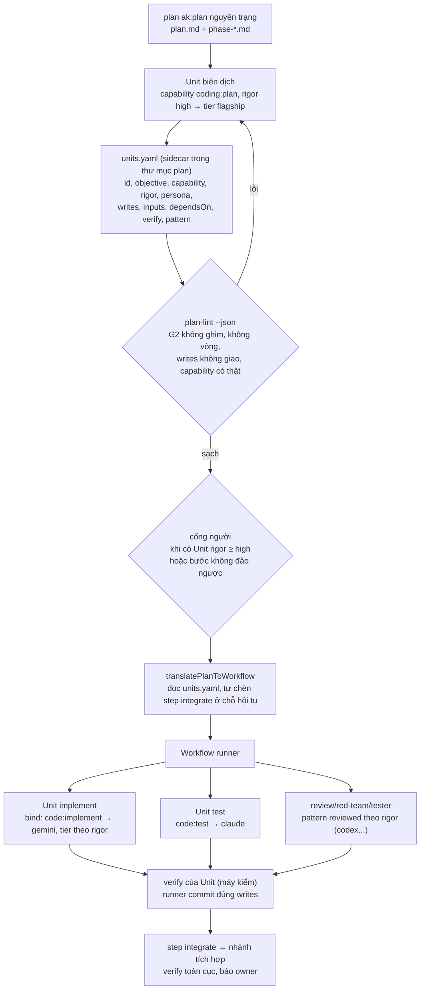

# Nghiên cứu: chạy plan ak:plan phân tán ra provider/tier/persona (cook phân tán)

> **Đã thay thế** bởi `research-261016-2141-plan-conductor-coding.md` (owner bác bỏ hướng biên dịch plan thành cấu hình). Phần khoảng trống runner G1–G9 bên dưới vẫn đúng.

Thời điểm: 2026-10-16 20:23 (Asia/Saigon). Phạm vi: chỉ nghiên cứu, không sửa code. Impact-analysis: không dùng (không sửa symbol).

## Kết luận

Làm được, và phần lớn hạ tầng đã có. fgOS đã có sẵn đường `fgos workflow start --plan <dir>` (`src/workflow/plan-source.mjs`). Đường này dịch plan ak:plan thành Workflow, mỗi Unit đi qua `bind()`: capability chọn pool provider, `rigor` quyết định tier, `persona` đi theo Unit. Pattern `reviewed` thêm reviewer, red-team, tester theo rigor. Runner tự commit đúng `writes` của Unit trong worktree riêng.

Cái thiếu là **bước biên dịch plan → Unit**. Bộ dịch hiện tại quá mỏng nên chạy plan ak:plan thật sẽ không ra kết quả: mỗi phase thành một Unit chỉ mang **tiêu đề phase**, không mang nội dung phase, `writes` rỗng nên Unit là chỉ-đọc, và runner không verify gì cả. Đây là thiết kế làm dở: plan P2/P3 (2026-10-01) đã vẽ đủ đường, nhưng code chỉ ship nửa đầu.

Khuyến nghị: giữ ak:plan nguyên trạng làm đầu vào và thêm một bước **biên dịch có kiểm** ở giữa. Một Unit `coding:plan` chạy ở tier mạnh, đọc plan rồi sinh `units.yaml`. `plan-lint` kiểm tất định file này, rồi qua cổng người khi rigor cao. Sau đó runner phân từng Unit nhỏ đến provider/tier/persona phù hợp. Đi kèm là bốn sửa nhỏ trong runner (mục 4).

## Mục lục

1. Hai bên đang làm gì
2. Đã có gì để tái dùng
3. Prior art: thiết kế đã vẽ nhưng chưa ship đủ
4. Khoảng trống trong fgOS (có bằng chứng)
5. Điểm yếu của plan ak:plan khi đem đi phân việc
6. Kiến trúc đề xuất
7. Các phương án và khuyến nghị
8. Bước tiếp theo
9. Câu hỏi còn mở

## 1. Hai bên đang làm gì

**ak:plan** (`.claude/skills/ak-plan/`, thuộc AgentKit, không phải của fgOS) sinh ra `plan.md` (có frontmatter) cùng các file `phase-NN-*.md`. Template phase (`references/cli-integration.md`) có frontmatter `phase/title/status/priority/effort/dependencies` và các mục Goal, Files, Steps, Verification. Có hai cờ đáng chú ý: `--parallel` buộc mỗi phase sở hữu tập file rời nhau, còn `--advice` (`references/advice-handover-plan.md`) chia phase thành task, mỗi task có file đích, bước làm, điều kiện verify máy kiểm được và Failure Protocol. Đây là dạng gần Unit nhất mà ak:plan sinh được.

**ak:cook** chạy toàn bộ trong một phiên. Nó chỉ giao việc cho subagent in-process (`fullstack-developer`, `tester`, `code-reviewer`...) qua `delegate_agent capability` (`references/subagent-patterns.md`). Cook không chọn provider, tier hay persona cho từng mảnh việc. Vòng làm việc của nó (implement, verify hẹp rồi rộng, review, sửa, finalize) là thứ ta muốn giữ lại.

**fgos-advise** là mẫu điều phối cần học theo. Skill suy ra loại yêu cầu, tra bảng route duy nhất (`references/request-kinds-and-routes.md`), rồi khởi chạy Workflow YAML hoặc preset đã đăng ký. Skill **không bao giờ** ghim provider, model hay tier; việc đó để `bind()` quyết. Cook phân tán nên dùng đúng nguyên tắc này: skill chỉ chọn route và điền đầu vào, còn dữ liệu và runner quyết định phần thực thi.

## 2. Đã có gì để tái dùng

| Năng lực | Nơi | Trạng thái |
|---|---|---|
| Dịch plan → Workflow (phase → step, `dependencies` → `dependsOn`, `gate`) | `src/workflow/plan-source.mjs` | Có, nhưng mỏng (mục 4) |
| Đọc block Unit trong phase file, kiểm G2, vòng phụ thuộc, `writes` giao nhau | `lintPhaseUnits` trong `src/report/capability-plan-lint.mjs`, `fgos plan-lint --phase N --json` | Có, nhưng bộ dịch chưa gọi |
| Chạy Unit trong worktree riêng, runner commit đúng `writes` | `src/runner/execution/run.mjs`, `src/workflow/runner.mjs` | Có |
| Capability → pool provider (soft prefer, failover) | `bind.mjs`; config: `code:implement`→gemini, `code:review`→codex, `code:test`→claude | Có |
| Rigor → tier | `rigorToTier`: low→nano, standard→standard, high→flagship, critical→frontier | Có |
| Persona theo Unit hoặc theo capability | `bind.mjs:435-467`; `core/agents/{fullstack-developer,code-reviewer,debugger,...}.yaml` | Có |
| Vòng review theo rigor | pattern `reviewed`, `checkersByRigor` (standard: reviewer; high: +red-team; critical: +tester), `maxRounds: 2` | Có |
| Đưa file vào brief của worker | `unit.inputs` → `resolveUnitInputs` (`run.mjs:427`) | Có |
| Chuỗi ghi (Unit ghi đứng trên nhánh của Unit ghi trước), step `integrate` | `writeBaseOf` (`runner.mjs:226`), kind `integrate` (`definition.mjs:29`) | Có |
| Cổng người, gom câu hỏi | `fgos workflow answer` | Có |

Nhìn bảng này thì phần "đẩy mảnh việc đến provider/tier/persona" **đã xong**. Thứ cần xây chỉ là cách tạo ra các mảnh việc đúng từ một plan ak:plan.

## 3. Prior art: thiết kế đã vẽ nhưng chưa ship đủ

- Plan `261001-0327-request-to-run-p2-runnable-plans/phase-02` đã quy định "đầu ra `plan-lint --json` là **đầu vào của bộ dịch plan → Workflow (P3a)**, một đường đọc Unit duy nhất."
- Plan P3 `phase-02` đã giao `plan-source.mjs`: đọc Unit qua `plan-lint --json`, và **authorize = cổng người**.
- P2 `phase-03` (driver `fgos-run`) vẽ ba đường vào: (a) prompt → `--units`; (b) plan có `- unit:` → `--plan`; (c) **plan không có block thì Lead viết Unit từ prose phase, trình owner ở cổng khi rigor ≥ high, rồi đi như (a)**. Rủi ro đã ghi ở P2 phase-02: "Plan AgentKit thật không có block → driver xử lý (phase 3)."
- Code đã ship ở commit `07f82b202`: `plan-source.mjs` **không gọi `lintPhaseUnits`**, và skill `fgos-run` Mode B **không có đường (c)**. Cả hai phase đều được tick `[x]` là xong.
- Plan `261006-1415-fgos-convention-component` (commit `b3d8fa489`) có mục "Executor brief (`ak:cook`)" do người viết tay: chọn chế độ theo từng phase và gợi ý model ("phase cơ khí chạy được với bậc sonnet... chưa đo"). Đây là bằng chứng thật cho nhu cầu gán tier theo mảnh việc, và hiện nó vẫn nằm ở prose ngoài mọi đường máy đọc.

Như vậy cook phân tán chính là **đường (c) đã thiết kế**, cộng thêm việc nối bộ dịch vào `lintPhaseUnits` như thiết kế gốc. Đây không phải khái niệm mới. Theo RUL11, làm xong phần dở dang này là "gom", không phải mở scope.

## 4. Khoảng trống trong fgOS (có bằng chứng)

| # | Khoảng trống | Bằng chứng | Hậu quả khi chạy plan ak:plan thật |
|---|---|---|---|
| G1 | `objective` của Unit chỉ là tiêu đề phase; phase file không được đưa vào `inputs` | `plan-source.mjs:110-117` | Worker chỉ nhận một dòng "Phase 01: crate fgos-process", không thấy yêu cầu, file hay bước làm |
| G2 | `writes` lấy từ frontmatter `writes`, nhưng ak:plan không bao giờ sinh khóa này | `plan-source.mjs:113` | `writes: []` nên Unit chạy chỉ-đọc, không sửa được gì |
| G3 | Mỗi phase đúng một Unit, capability cố định `code:implement`, không có persona | `plan-source.mjs:108-118` | Không chia nhỏ được, không tách test/review/docs ra provider khác |
| G4 | Không dùng `lintPhaseUnits` (lệch thiết kế ở mục 3) | grep: `translatePlanToWorkflow` không import capability-plan-lint | Plan có block Unit cũng bị bỏ qua |
| G5 | Schema Unit **bỏ trường `verify`** khi chuẩn hoá, nên `targetUnit.verify` ở `run.mjs:903` luôn là `undefined`. Config cũng không có capability nào khai `verify`, nên verify luôn trả `pass` | `unit.mjs:303-321` (không có `verify`); `run.mjs:339,400` gọi `validateUnit` | Không Unit nào bị kiểm bằng lệnh của nó; "xanh" không có nghĩa gì |
| G6 | `dependencies: []` (mặc định của template ak:plan) được hiểu là "không phụ thuộc" | `plan-source.mjs:84-91` | Mọi phase chạy song song cùng lúc |
| G7 | Step dựa trên ≥2 nhánh ghi bị từ chối nếu không có step `integrate`, mà bộ dịch không sinh step này | `writeBaseOf` (`runner.mjs:226-252`) | Plan hình kim cương (vd holder-lock P12 dựa trên P00–P11) dừng ở chỗ hội tụ |
| G8 | Cổng authorize chỉ bật khi frontmatter có `gate: human` hoặc `requiresReview` | `plan-source.mjs:94-97` | Plan ak:plan không có khóa này nên không có cổng duyệt nào |
| G9 | Skill `fgos-run` Mode B không có đường (c) | `.agents/skills/fgos-run/SKILL.md` Mode B | Agent làm theo skill sẽ chạy thẳng `--plan` và gặp G1–G8 |

Test hiện có (`test/workflow/workflow-runner.test.mjs:240`) chỉ kiểm hình DAG với fixture có frontmatter, nên không bắt được G1, G2, G5, G7.

## 5. Điểm yếu của plan ak:plan khi đem đi phân việc

Em quan sát trên template ak:plan và trên plan thật `plans/261016-1104-holder-lock-kernel-lock-foundation/` (14 phase, 52h).

1. **Định dạng trôi khỏi template.** Template yêu cầu frontmatter cho phase, nhưng phase thật không có frontmatter. Heading cũng đã Việt hoá ("File sở hữu", "Bước", "Tiêu chí nghiệm thu"). Parser tất định theo template sẽ đọc trượt.
2. **Phụ thuộc nằm ở prose.** Phụ thuộc thật nằm trong bảng "Phụ thuộc (nghiệm thu)" và sơ đồ wave của `plan.md`, không nằm trong frontmatter. Plan còn phân biệt "code song song, **nghiệm thu** theo mũi tên", một ngữ nghĩa mà `dependencies` không diễn tả được. `[]` mặc định gây nhập nhằng giữa "không có" và "chưa khai".
3. **Hạt quá to.** Một phase dài 2–10 giờ, nhiều mục tiêu, là quá tải cho một Unit giao tier rẻ. Task bên trong phase không có địa chỉ riêng, trừ khi plan được viết với `--advice`.
4. **File chưa phải write scope.** Danh sách file viết dạng brace (`src/{facts.rs,control.rs}`), trộn file tạo, sửa và test. Quyền sở hữu file dùng chung nằm ở prose ("Chủ file dùng chung: registry → P00"). Plan cũng không khai các file sinh ra (`Cargo.lock`, render skill).
5. **Verify là danh sách lệnh prose, không phải điều kiện pass.** Phải có `--advice` thì mới ra dạng "lệnh X exit 0 và in Y".
6. **Không có loại việc và mức rủi ro theo mảnh.** Không có capability (implement, test, docs, review) hay rigor, nên tier phải đoán. Bằng chứng: người phải viết tay "Executor brief" (mục 3).
7. **Plan tự quy định cách thực thi.** Plan quy định nhánh, worktree (`.claude/worktrees/hl-pNN`) và thứ tự merge. Những thứ này xung đột với runner, vốn tự quản worktree và tích hợp, nên bộ biên dịch phải bỏ qua chúng một cách có chủ đích.
8. **Có việc không giao ra ngoài được.** Plan có phase "Lead" (P12: activate ba workspace) và "track riêng" (P14). Plan không có ký hiệu máy đọc cho "việc của người/Lead", "bước không đảo ngược" hay "chạy sau, ngoài plan".
9. **Hiệu chỉnh nối thêm cuối file.** Các mục "Hiệu chỉnh sau red-team" được thêm vào cuối file và thắng nội dung cũ. Bộ biên dịch phải đọc hết file và áp hiệu chỉnh; cắt theo heading sẽ lấy nhầm bản cũ.
10. **Quyết định của owner nằm rải rác.** Các quyết định như A1–A3 và D1–D8 nằm trong `plan.md`. Mảnh việc nào cũng cần chúng, nên mỗi Unit phải nhận `plan.md` làm input, không chỉ phase file của nó.

Hệ quả: một parser tất định thuần không đủ để đọc ak:plan. Cần một bước có hiểu biết (LLM) để biên dịch, và một bước tất định để kiểm kết quả biên dịch.

## 6. Kiến trúc đề xuất

Các điểm chính:

- **Biên dịch là một Unit.** Chính bước biên dịch cũng được `bind()` giao tới provider mạnh. Skill không tự đọc plan rồi tự chia việc trong phiên, nên đúng nguyên tắc "skill chọn route, dữ liệu quyết thực thi" của fgos-advise.
- **Quy tắc biên dịch là doctrine dạng dữ liệu** (một reference duy nhất, như `request-kinds-and-routes.md`):
  - Tách phase thành Unit theo ranh giới capability và ranh giới file.
  - Mỗi Unit có `inputs: [plan.md, phase file, report được trích dẫn]`.
  - `writes` lấy từ danh sách file sau khi bung brace, cộng file sinh ra.
  - `verify` là một lệnh có điều kiện pass.
  - Rigor tra theo bảng: docs/cơ khí → low; code thường → standard; đổi contract hay luật khóa → high; dữ liệu hay không đảo ngược → critical.
  - Persona chỉ lấy từ `fgos agents list`.
  - Phase "Lead" hoặc không đảo ngược thành cổng người, không thành Unit.
  - Phần nhánh, worktree, thứ tự merge trong plan bị bỏ qua.
- **Sidecar, không sửa plan.** Giữ quyết định "fgOS chỉ đọc plan". `units.yaml` là sản phẩm biên dịch, có thể duyệt và diff. Khi plan đổi thì biên dịch lại.
- **Đường đọc Unit duy nhất.** Bộ dịch đọc qua `lintPhaseUnits` hoặc cùng normalizer, đúng như thiết kế P2.

## 7. Các phương án và khuyến nghị

| Phương án | Ưu | Nhược | Kết luận |
|---|---|---|---|
| A. Sửa ak:plan để sinh block Unit | Nguồn sạch | ak:plan thuộc AgentKit, không phải của fgOS; project khác dùng bản ak:plan khác; trái yêu cầu "dùng plan nguyên trạng" | Không chọn |
| B. Parser tất định đọc prose ak:plan | Rẻ, không tốn model | Gãy ngay trên plan thật (mục 5.1, 5.2, 5.9); không suy ra được rigor hay capability | Chỉ dùng làm gợi ý cho C |
| C. Unit biên dịch (LLM) + `plan-lint` + cổng | Đọc được plan thật, giữ G2, có kiểm tất định, dogfood được `bind()` | Tốn một lượt model mạnh mỗi plan; cần doctrine biên dịch | **Chọn** |
| D. Mỗi phase giao nguyên cho một ak:cook từ xa | Ít code | Không chia nhỏ, không chọn tier theo mảnh; ak:cook chỉ có ở Claude | Không chọn |

Phương án C phục vụ trực tiếp mission #1: bất kỳ project nào đã dùng ak:plan cùng fgOS đều chạy được plan của mình ra nhiều provider, không cần viết lại plan.

## 8. Bước tiếp theo

1. **Sửa bốn lỗi runner (nhỏ, độc lập, nên làm trước).** Đây là lỗi thật ngay cả với đường `--units` hiện có:
   - G5: giữ `verify` trong `validateUnit`.
   - G6: `[]` không còn nghĩa là "chạy song song tất cả" khi plan không khai rõ.
   - G7: bộ dịch tự chèn step `integrate` ở chỗ hội tụ.
   - G1: tối thiểu đưa phase file và `plan.md` vào `inputs`.
2. **Nối bộ dịch vào đường đọc Unit duy nhất (G4).** `translatePlanToWorkflow` đọc `units.yaml` nếu có, nếu không thì đọc block Unit qua `lintPhaseUnits`. Khi không có cả hai thì **từ chối kèm hướng dẫn biên dịch**, thay vì âm thầm chạy Unit chỉ-đọc mang tiêu đề.
3. **Doctrine biên dịch cùng đường (c) trong `fgos-run` (G9).** Viết một reference quy tắc biên dịch (mục 6) và bổ sung Mode B: plan không có Unit thì chạy Unit `coding:plan` để sinh `units.yaml`, qua `plan-lint`, rồi qua cổng.
4. **Chạy thử trên plan ak:plan thật.** Chọn một plan cỡ vừa (3–5 phase), chạy hết, rồi đo: số Unit, số vòng review, tỉ lệ verify fail, chi phí theo tier, và bao nhiêu điểm yếu ở mục 5 làm bộ biên dịch sai.
5. **Ghi lại điểm yếu ak:plan cho người viết plan.** Viết hướng dẫn ngắn "muốn chạy phân tán thì gọi `ak:plan --advice` hoặc `--parallel`". Không sửa ak:plan.

Thứ tự: bước 1 và 2 là code fgOS có test, bước 3 là skill/doc, bước 4 là bằng chứng. Nếu anh đồng ý, bước tiếp theo là lập plan triển khai.

## 9. Câu hỏi còn mở

1. **Chỗ đặt `units.yaml`:** em đề xuất để cạnh plan (`plans/<slug>/units.yaml`), có commit và diff được. Cách này có vi phạm quyết định "fgOS chỉ đọc plan, không ghi vào plan" không, hay nên để ở `.fgos/runtime/`? Em nghiêng về cạnh plan, vì đây là nội dung đã duyệt, không phải trạng thái chạy.
2. **Cổng duyệt bản biên dịch:** luôn có cổng, hay chỉ khi có Unit rigor ≥ high? Theo ưu tiên "Release con người", em nghiêng về chỉ khi rigor ≥ high hoặc có bước không đảo ngược.
3. **Verify toàn cục:** sau step `integrate`, `npm test` đầy đủ nên là một Unit `code:test` riêng, hay là `verify` của chính step integrate?
