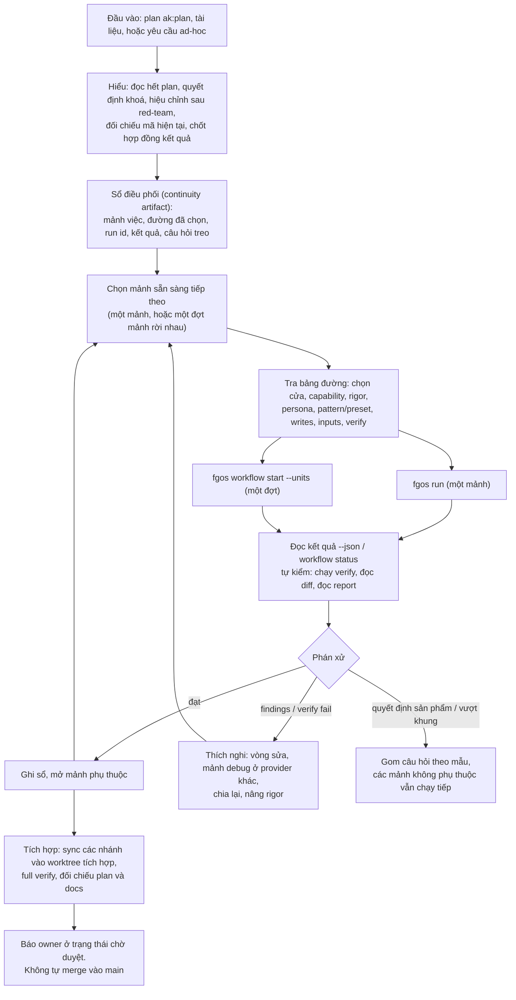

# Nghiên cứu: agent điều phối chạy plan bằng các đường vận hành tiêu chuẩn của fgOS

Thời điểm: 2026-10-16 21:41 (Asia/Saigon). Phạm vi: chỉ nghiên cứu, không sửa code. Thay thế hướng "biên dịch plan" trong `research-261016-2023-ak-plan-distributed-cook.md`; phần khoảng trống runner trong report đó vẫn đúng và được dùng lại ở đây.

## Kết luận

Không chuyển plan thành cấu hình. Thay vào đó, một **agent điều phối** chạy ở tier mạnh đọc hiểu plan như một lead, rồi giao từng mảnh việc qua **hai cửa đã có** là `fgos run` (một Unit) và `fgos workflow start --units` (một đợt nhiều Unit). Agent chọn mảnh việc theo một **bảng đường vận hành tiêu chuẩn**: mỗi đường có mô tả, thông số và điều kiện không dùng, giống bảng route của fgos-advise. Agent đọc kết quả, tự kiểm, rồi quyết bước sau. Cách làm giữ được tinh thần của ak:cook (hiểu mục tiêu, làm, kiểm hẹp rồi rộng, review theo rủi ro, sửa trong phạm vi, chỉ dừng khi thật cần). Phần thực thi thì có độ cứng của fgOS: `bind()` chọn provider/tier/persona, worktree riêng, runner commit đúng phạm vi ghi, có provenance, failover quota, gom câu hỏi cho người.

Gần như không cần cơ chế mới. Cần một skill điều phối cho domain coding, một reference bảng đường, và bảy điều chỉnh nhỏ cho rõ ràng hơn (mục 6). Trong đó có hai lỗi thật: `verify` của Unit bị mất, và preset `code-change` ghim cứng `npm test`. Không cần pattern mới. Workflow chỉ dùng cho từng đợt việc đã rõ hình, không dùng cho cả plan.

## Mục lục

1. Bản đồ khái niệm: hai cửa, ba khái niệm
2. Lấy gì từ ak:cook, lấy gì từ fgOS
3. Agent điều phối hoạt động thế nào
4. Bảng đường vận hành tiêu chuẩn (bản nháp)
5. Agent phải tự hiểu gì khi đọc plan ak:plan
6. Điều chỉnh cần làm trong fgOS
7. Những gì không làm và lý do
8. Bước tiếp theo
9. Câu hỏi còn mở

## 1. Bản đồ khái niệm: hai cửa, ba khái niệm

**Hai cửa thực thi** (AGENTS.md "two doors, one runUnit"):

| Cửa | Chạy gì | Cách chờ | Khi dùng |
|---|---|---|---|
| `fgos run "<prompt>"` hoặc `--unit <file>` | Một Unit, qua một collaboration pattern | Chờ tại chỗ đến khi xong; `--json` trả kết quả | Một mảnh việc |
| `fgos workflow start <id> \| --units <file>` | DAG nhiều Unit, có cổng người, có step `integrate` | Trả về ngay, chạy nền; đọc `fgos workflow status`, trả lời `fgos workflow answer` | Nhiều mảnh có hình cố định, hoặc cần chạy song song |

`fgos dispatch` chỉ còn các lệnh đọc (`decide`, `inspect`...), không thực thi.

**Ba khái niệm** quanh "giao tiếp giữa các agent". Thực chất là hai khái niệm, cộng một tên gọi cho bộ thông số:

| Khái niệm | Phạm vi | Thành viên hiện có | Nơi định nghĩa |
|---|---|---|---|
| **CollaborationPattern** | Các vai làm việc cùng nhau **bên trong một Unit run** | `solo` (một producer), `reviewed` (producer + checker theo rigor + verify, tối đa N vòng), `panel` (N người độc lập + synthesizer) | `src/runner/execution/patterns/` |
| **Preset** | Một **bộ thông số có tên** của một pattern. Không phải khái niệm mới | `rfc` = reviewed 1 vòng, reviewer + red-team, kiểm tài liệu chứ không kiểm commit; `consult` = solo vai advisor; `research-fan-out` = panel 3 researcher; `code-change` = reviewed + reviewer + red-team + verify | `presets.mjs` |
| **Workflow** | **DAG các step**, mỗi step chứa Unit; có cổng người, step `integrate` | `council-lite`, `delphi`, `nominal-group`, `group-cognition`, `business-discussion`, `architecture-advisory(-reopen)`; Workflow sinh từ `--units` hoặc `--plan` | `core/workflows/*.yaml`, `src/workflow/` |

Vậy: `solo` là pattern; `rfc` là preset của pattern `reviewed`; `council-lite` là workflow, bên trong có một Unit dùng pattern `panel`. Lẫn lộn có bốn nguồn:

- Bảng route của fgos-advise để workflow và preset cạnh nhau như cùng một loại "route".
- Cờ `fgos run --pattern` nhận cả tên pattern lẫn tên preset.
- `docs/specs/runner.md:1474-1476` vẫn viết "Workflow dùng DAG steps + tích hợp vòng đời Work". Từ quyết định 0049, Work không còn stage nữa.
- `core/skills/_shared/coordination-driver.md` vẫn mô tả các lệnh `fgos coordination ...` của CoordinationSession, vốn đã bị thu hồi từ P4 (2026-10-02). `src/runner/coordination/` không còn tồn tại và CLI không còn verb `coordination`. fgos-advise vẫn đang tải file này.

## 2. Lấy gì từ ak:cook, lấy gì từ fgOS

**Tinh thần ak:cook** (`.claude/skills/ak-cook/SKILL.md` và `references/workflow-steps.md`) mà agent điều phối giữ lại:

- Chốt hoặc dùng lại hợp đồng kết quả trước khi làm: outcome, ràng buộc, non-goals, tiêu chí nghiệm thu.
- Đọc plan đối chiếu với mã hiện tại trước khi giao việc. Dùng lại bằng chứng còn mới thay vì chạy lại.
- Kiểm hẹp trước, rồi mở rộng ra caller, contract, full suite theo rủi ro. Không làm yếu kiểm tra.
- Mức review theo rủi ro: việc nhỏ thì kiểm nhẹ; việc chạm contract, bảo mật hay dữ liệu thì có checker độc lập.
- Tự sửa regression do chính mình gây ra, trong phạm vi được duyệt.
- Chỉ dừng khi đổi quyết định sản phẩm, gặp hành động phá huỷ chưa được phép, hoặc có blocker có bằng chứng.
- Kết thúc bằng đối chiếu trạng thái plan, cập nhật docs bị ảnh hưởng, báo kết quả, bằng chứng và phần còn thiếu.

Khác biệt duy nhất: ak:cook tự làm hoặc gọi subagent trong phiên. Agent điều phối **không tự sửa code sản phẩm**; mọi mảnh thực thi đi ra ngoài qua hai cửa.

**Độ cứng của fgOS** dùng nguyên như hiện có:

- `bind()` chọn executor theo capability, tier theo rigor (`rigorToTier`: low→nano, standard→standard, high→flagship, critical→frontier) và persona. Agent điều phối không ghim provider hay tier (luật G2); chỉ được gợi ý mềm bằng `--provider`.
- Unit ghi chạy trong worktree riêng. Worker không commit; runner commit đúng `writes` sau một vòng đạt. Đường ghi ngoài phạm vi thì đi vào `needsWrites`.
- Kết quả có phân loại trung thực: `pass`, `findings`, `execution-failure`, `policy-refusal`, `provider-limit`, `blocked`. Provenance nằm ở `.fgos/assignments/<unitRunId>/`.
- Pattern `reviewed` có checker theo rigor (standard: reviewer; high: + red-team; critical: + tester) và tối đa 2 vòng.
- Cổng người gom câu hỏi theo mẫu câu hỏi quyết định. herdr là pane mặc định để người xem worker chạy.

## 3. Agent điều phối hoạt động thế nào

Đề xuất một skill domain coding, tạm tên `fgos-coding-conduct`, làm "fgos-advise cho thực thi". Skill dựa trên kỷ luật driver chung (`coordination-driver.md`, sau khi viết lại theo hai cửa, xem mục 6) và điền chín hook slot của kỷ luật đó.

Các hook slot chính:

| Hook | Giá trị |
|---|---|
| Unit of iteration | Một mảnh việc giao qua một cửa (một `fgos run` hoặc một đợt `workflow start --units`) |
| Open inputs | Kind: work-product. Một capability canonical cho mỗi mảnh. Inputs: `plan.md`, phase liên quan, report được trích |
| Evidence verification | Tự chạy lệnh verify của mảnh trong worktree, đọc diff so với `writes`, đọc report của checker. Không tin lời tự kể của worker |
| Disposition | Findings của checker: accepted thì sửa và kiểm lại; rejected thì ghi lý do; deferred chỉ khi ngoài phạm vi đã duyệt |
| Adaptation bounds | Mỗi mảnh tối đa: vòng của pattern, một mảnh debug, một lần nâng rigor. Quá giới hạn thì hỏi người |
| Human-escalation | Quyết định sản phẩm, bước không đảo ngược, hiệu chỉnh mâu thuẫn với mã thật, cần ghi ngoài phạm vi, vượt ngân sách đã duyệt |
| Close criteria | Mọi mảnh đạt verify, mọi finding đã phán xử, full verify trên nhánh tích hợp xanh |
| After-close | Báo owner kèm nhánh tích hợp, bằng chứng, phần còn thiếu. Merge là quyết định của người |
| Continuity artifact | Sổ điều phối, đường dẫn lấy từ `fgos convention path`, kèm `fgos workflow status` của từng đợt |

Agent điều phối chạy trong phiên của người dùng, ở tier mạnh nhất có. Nó là "lead", không phải một Unit.

## 4. Bảng đường vận hành tiêu chuẩn (bản nháp)

Đây là nội dung của reference duy nhất cho chọn đường, tương tự `request-kinds-and-routes.md`. Các thông số đều có sẵn trên CLI hôm nay, trừ những thông số đánh dấu (★), cần điều chỉnh ở mục 6.

| # | Loại mảnh việc | Cửa và thông số | Không dùng khi |
|---|---|---|---|
| R1 | Tìm hiểu mã, trả lời câu hỏi về repo | `fgos run "<câu hỏi>" --capability coding:explore --rigor low` (chỉ đọc, solo) | Cần quyết định giữa các phương án (R9) |
| R2 | Sửa cơ khí, nhỏ, phạm vi rõ (đổi tên, cập nhật import, docs) | `fgos run "<việc>" --capability code:implement --rigor low --writes <paths> --worktree <wt> --verify "<lệnh>"★ --input <phase>★` | Chạm contract công khai hoặc luật khoá |
| R3 | Code thường | Như R2 nhưng `--rigor standard --pattern reviewed --persona fullstack-developer` | Có hiệu chỉnh hoặc quyết định chưa rõ |
| R4 | Đổi contract, schema, luật khoá, đường dùng chung | Như R3 nhưng `--rigor high` (thêm red-team) | Chưa có quyết định của owner |
| R5 | Dữ liệu, bước không đảo ngược, bảo mật | Hỏi người trước, rồi `--rigor critical` (thêm tester) | — |
| R6 | Test trước (TDD, characterization) | Mảnh `--capability code:test --writes test/...`, sau đó mảnh R3 phụ thuộc vào nó | Việc chỉ là docs |
| R7 | Verify fail hoặc lỗi khó | `fgos run "<chẩn đoán>" --capability code:debug` (chỉ đọc; pool mặc định là provider khác người làm), rồi mảnh sửa | Lỗi đã rõ nguyên nhân |
| R8 | Kiểm một tài liệu hay thiết kế do agent tạo ra | `fgos run --unit <file> --pattern rfc` | Kiểm code (dùng pattern `reviewed`) |
| R9 | Gặp ngã rẽ thiết kế giữa chừng | Chuyển sang fgos-advise (`council-lite`, hoặc `architecture-advisory` nếu là kiến trúc) | Phương án đã rõ: tự quyết và báo cáo |
| R10 | Docs, CHANGELOG | `--capability docs:write --rigor low` | — |
| R11 | Nhiều mảnh rời nhau, hình đã rõ (một wave của plan) | Agent tự viết units file cho **đợt này**, chạy `fgos workflow start --units <file>`, theo dõi `status` | Mảnh có `writes` giao nhau mà không phụ thuộc nhau |
| R12 | Tích hợp các nhánh | Worktree tích hợp; mỗi nhánh một `fgos run --sync <branch> --writes <paths> --worktree <wt-int>` (chỉ gọi worker khi conflict); xong thì `code:test` chạy full suite | Một nhánh duy nhất |

Quy tắc chung của bảng:

- Capability lấy từ `capability-catalog.md`. Persona chỉ lấy tên có trong `fgos agents list`.
- Rigor là chỗ duy nhất quyết định tier. Muốn mạnh hơn thì nâng rigor, không ghim model.
- Mảnh song song phải có `writes` rời nhau.

## 5. Agent phải tự hiểu gì khi đọc plan ak:plan

Đây là các điểm yếu của plan ak:plan (đã quan sát ở report trước, trên template và trên plan `261016-1104-holder-lock-kernel-lock-foundation`). Chúng giờ trở thành chỉ dẫn đọc cho agent điều phối, không phải lý do để viết parser:

1. Phase file thường không có frontmatter, heading có thể đã Việt hoá. Hãy đọc theo nghĩa.
2. Phụ thuộc thật nằm ở bảng và sơ đồ wave trong `plan.md`. Phân biệt "phụ thuộc để code" với "phụ thuộc để nghiệm thu". `dependencies: []` không có nghĩa là độc lập.
3. Một phase thường dài 2–10 giờ. Chia thành mảnh theo ranh giới capability và ranh giới file, lúc chạy, khi đã thấy mã thật.
4. Danh sách file chưa phải phạm vi ghi: bung dạng brace, cộng file sinh ra (`Cargo.lock`, render), tôn trọng "chủ file dùng chung".
5. Verify trong plan là danh sách lệnh. Agent tự chọn lệnh pass/fail cho từng mảnh và để full suite cho bước tích hợp.
6. Plan không ghi rigor. Suy từ nội dung: contract, luật khoá, dữ liệu, có đảo ngược được không.
7. Bỏ qua phần nhánh, worktree, thứ tự merge mà plan tự quy định; runner và R12 lo việc đó.
8. Phase "Lead" hoặc chạm môi trường thật (activate, nhiều workspace) là việc của người hoặc của agent điều phối, kèm cổng.
9. Mục "Hiệu chỉnh sau red-team" ở cuối phase thắng nội dung cũ. Phải đọc hết file.
10. Quyết định của owner trong `plan.md` (kiểu A1–A3, D1–D8) đi vào `inputs` của mọi mảnh liên quan.

Muốn plan dễ điều phối hơn thì khuyến nghị người viết plan gọi `ak:plan --advice` hoặc `--parallel`. Không sửa ak:plan, vì đó là bộ kit của người khác.

## 6. Điều chỉnh cần làm trong fgOS

Xếp theo thứ tự nên làm. Không có cái nào là cơ chế mới.

| # | Điều chỉnh | Lý do và bằng chứng |
|---|---|---|
| C1 | **Giữ `verify` trên Unit** và thêm `--verify` cho one-liner | `validateUnit` bỏ trường này (`unit.mjs:303-321`), nên `targetUnit.verify` ở `run.mjs:903` và `reviewed.mjs:69` luôn rỗng. Config không có capability nào khai `verify`, vì vậy verify luôn trả `pass`. Đây là lỗi thật |
| C2 | **Bỏ `npm test` ghim cứng trong preset `code-change`** | `presets.mjs:11`. Project dùng fgOS không phải project nào cũng dùng npm (mission #1). Verify phải đến từ Unit hoặc config của project |
| C3 | **Thêm `--input <path>` cho one-liner** | Unit đã có `inputs` (`run.mjs:427`) nhưng `fgos run "<prompt>"` không có cờ để đưa plan hay phase vào brief. Hiện phải viết file Unit |
| C4 | **Viết lại `coordination-driver.md` theo hai cửa** | File vẫn dạy các lệnh `fgos coordination ...` đã bị xoá. fgos-advise và agent điều phối mới đều dựa vào file này |
| C5 | **Ghi rõ bản đồ khái niệm trong spec**: Unit ← Pattern (+ preset là bộ thông số có tên); Workflow ghép nhiều Unit. Sửa câu cũ về "vòng đời Work" | `runner.md:1474-1476`. Đúng câu hỏi anh đang lẫn |
| C6 | **Cho units file khai được step `integrate`**, hoặc ghi rõ R12 là đường tích hợp chuẩn | `translateUnitsToWorkflow` tạo một step cho mỗi Unit và không có `integrate`. `writeBaseOf` từ chối step dựa trên hai nhánh ghi trở lên (`runner.mjs:226-252`). Cần chọn một trong hai cách (câu hỏi mở 2) |
| C7 | **Rút đường `--plan` dịch cơ học** (`plan-source.mjs`, Mode B của `fgos-run`) và trỏ về agent điều phối | Bộ dịch chỉ chuyển tiêu đề phase, `writes` rỗng, `dependencies: []` thành song song tất cả (report trước, G1–G8). Đúng thứ anh không muốn. Theo luật một cửa, giữ hai đường cho cùng việc là tùm lum |

Không cần pattern mới. Ba pattern hiện có đã phủ đủ vòng của cook: `solo` cho việc nhẹ, `reviewed` có verify và checker theo rigor cho việc thường, `panel` cho khảo sát. Vòng thích nghi (chia lại, debug ở provider khác, nâng rigor) là phán đoán của agent điều phối, không nên đóng cứng vào pattern. Nếu dùng thật mà thấy một tổ hợp thông số lặp đi lặp lại, thì thêm **preset**, không thêm pattern.

Không cần workflow mới cho cả plan. Workflow là DAG tĩnh, trái với điều phối thích nghi. Agent điều phối dùng workflow cho từng đợt (R11), và vẫn dùng các workflow advisory sẵn có khi gặp ngã rẽ (R9).

## 7. Những gì không làm và lý do

- **Không biên dịch plan thành cấu hình**, kể cả bằng model. Plan là tài liệu; phân việc là phán đoán lúc chạy.
- **Không sửa ak:plan hay ak:cook.** Đó là kit của người khác; ta chỉ đọc đầu ra của nó.
- **Không để agent điều phối ghim provider, model hay tier** (G2). Nó chỉ chọn capability, rigor, persona, pattern.
- **Không tự merge vào main.** Merge là quyết định của owner, giống `/fgOS:cook`.
- **Chưa gộp với `/fgOS:cook` và `fgos-coding-driving`.** Hai skill này dựa trên vòng đời Work item (pick, stage, return). `fgos-coding-driving` hiện còn câu tự mâu thuẫn ("Work items do not have stage"). Quan hệ giữa chúng với agent điều phối nên ghi thành một item riêng (RUL11: tùm lum ngoài phạm vi thì ghi lại, không gom luôn).

## 8. Bước tiếp theo

1. **Sửa C1, C2, C3** trong một plan nhỏ có test. Đây là điều kiện để bảng đường dùng được thật.
2. **Viết lại C4, C5** (doctrine và spec), để agent điều phối đứng trên nền đúng.
3. **Viết skill `fgos-coding-conduct`** cùng reference bảng đường (mục 3 và 4), theo đúng khuôn của fgos-advise.
4. **Chạy thử trên một plan ak:plan thật cỡ vừa.** Đo số mảnh, đường được chọn, số vòng review, tỉ lệ verify fail, chi phí theo tier, và số lần phải hỏi người. Dùng số đo đó để quyết C6 và các preset cần thêm.
5. **C7** (rút `--plan`) làm sau khi bước 4 xanh, để không mất đường cũ trước khi đường mới chứng minh được.

Nếu anh đồng ý, bước tiếp theo là lập plan triển khai cho bước 1–3.

## 9. Câu hỏi còn mở

1. **Tên skill:** `fgos-coding-conduct`, hay để nó thành core skill (vì bảng đường gần như trung lập domain)? Em nghiêng về domain coding trước, vì luật "chứng minh trên một domain rồi mới tổng quát".
2. **Tích hợp nhánh (C6):** cho units file khai step `integrate`, hay chuẩn hoá R12 (sync từng nhánh vào worktree tích hợp)? Em nghiêng về R12, vì nó dùng cửa có sẵn và để worker giải conflict.
3. **Ngân sách đã duyệt:** agent điều phối cần một khung do anh duyệt lúc bắt đầu (số mảnh tối đa, rigor tối đa không cần hỏi, chi phí). Đặt khung ở đâu: tham số khi gọi skill, hay một mục trong sổ điều phối được anh duyệt ở lượt đầu?
