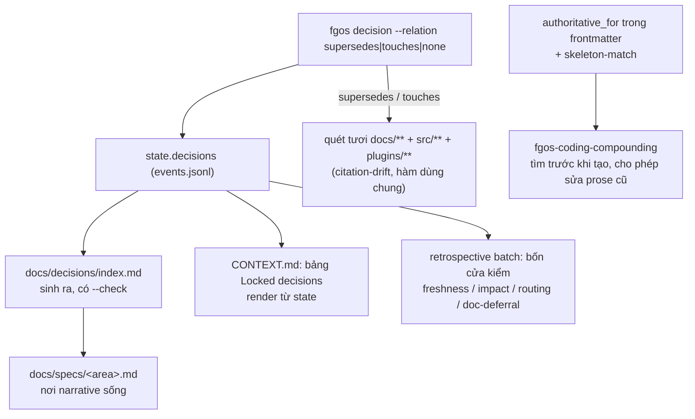

# Nghiên cứu: component quản lý decision (canonical-decision-projection, `tsk-1lv`)

Viết ngày 2026-10-21 16:43 (Asia/Saigon) trên `main` ở `10c412c90`, chỉ đọc. Theo yêu cầu của owner: tìm lại component từng được thiết kế để gom và làm tươi luật còn hiệu lực, để agent không dùng lẫn luật cũ; nói rõ nó là gì, làm tới đâu, còn thiếu gì. Phương pháp theo `ak-research` (phạm vi, thu thập, đối chiếu, tổng hợp), nhưng đề tài nằm hoàn toàn trong repo nên nguồn là tài liệu thiết kế, mã, work item và log, không có tìm kiếm web.

## Mục lục

1. Kết luận
2. Nó giải bài toán gì
3. Thiết kế: bốn lớp
4. Bản đồ mã và hiện trạng đo được
5. Trạng thái từng work item
6. Nó không làm gì (ranh giới với việc giao luật tới agent)
7. Quan hệ với các thành phần khác
8. Hệ quả cho nhóm 1A và cho Agent Context Engine
9. Việc tiếp theo đề nghị
10. Giới hạn của nghiên cứu và câu hỏi còn mở

## 1. Kết luận

- Component có thật: dòng việc `tsk-1lv` (thiết kế ở `docs/history/canonical-decision-projection/`, 17 vòng Q&A, 14 quyết định khoá D1–D14). Toàn bộ `tsk-1lv` và sáu item con `tsk-1lv-1` đến `-6` đã **done** và merge (`83a3684b2`).
- Nó **chặn mâu thuẫn và tài liệu cũ tại thời điểm ghi**, và **sinh bản chiếu từ một nguồn**. Nó **chưa tính ra "tập quyết định đang hiệu lực"** để đưa cho agent. Index sinh ra liệt kê cả quyết định đã bị thay lẫn quyết định mới; việc phân biệt vẫn nằm trong câu chữ.
- Phần "tính tập hiệu lực" nằm trong đề xuất tài liệu 260925 dưới tên *Effective Decision Reducer*, và em chỉ tìm thấy nó trong proposal, không có mã.
- Còn các đuôi chưa xong, đáng kể nhất: `tsk-3uw` (skill lập plan và verify vẫn đọc `CONTEXT.md` thay vì `state.decisions`), `tsk-2yu` (hàng nghìn vi phạm trích dẫn còn lại), hơn 124 con trỏ tới `docs/decisions/00xx` đã retired.
- Việc **giao luật tới đúng agent** (Agent Context Engine) là bài toán khác, chưa được xây. Hai bài toán gặp nhau ở một chỗ: engine cần biết quyết định nào còn hiệu lực.

## 2. Nó giải bài toán gì

Vấn đề gốc (ghi ở `DISCUSSION.md` §6): rule, decision và doc tích luỹ theo ba kênh tách rời mà không kênh nào có cách nói "đây là bản mới nhất".

| Kênh | Ví dụ | Hỏng thế nào |
|---|---|---|
| Quyết định cấp item | `CONTEXT.md` của từng plan | Viết tay song song với log quyết định |
| Quyết định cấp platform | 35 file `docs/decisions/000N-*.md` | Viết tay, `0000-index.md` cũng tay; supersede xong không ai sửa nơi trích dẫn |
| Tài liệu người dùng cuối | 267 file Diataxis do `fgos-coding-compounding` sinh | Luật cấm sửa hay rút gọn prose cũ, nên tài liệu chỉ phình |

Sự cố thật làm khởi đầu: STR72 (2026-07-21), một quyết định đổi nhưng agent phiên sau vẫn đọc ra kết luận cũ. Số liệu từ upstream bee mà thiết kế dựa vào: 70 trong 99 quyết định từng giấu supersession trong prose, chỉ 29 khai tường minh.

## 3. Thiết kế: bốn lớp

Nguyên tắc (D2, D3): **không dựng store, graph hay daemon mới**. `state.decisions` (các event `type:decision` trong `.fgos/events.jsonl`) đã là nguồn sự thật; việc cần làm là nối các bề mặt đọc vào đó.

1. **Ghi có quan hệ (tsk-1lv-1).** `fgos decision` đòi `--relation none|supersedes:<id>|touches:<id>`. Văn bản đọc như thay thế mà không khai cờ thì bị từ chối (mẫu regex `SUPERSESSION_PROSE_PATTERN`, `src/state/store.mjs:1838`). Khi khai supersede hoặc touches, hệ thống quét lại `docs/**`, `src/**`, `plugins/**` tìm chỗ còn trích quyết định cũ. Không cache.
2. **Chiếu sinh ra (tsk-1lv-2, -3, -4).** Thêm trường `scope` cho quyết định cấp platform; `docs/decisions/index.md` sinh từ state và có `--check` chống lệch; bảng "Locked decisions" trong `CONTEXT.md` render từ state (chỉ render, không tự đặt); corpus 35 file bị retire, tường thuật dồn vào mục "Lịch sử quyết định" của `docs/specs/<area>.md`.
3. **Chống tài liệu cũ lúc đóng item (tsk-1lv-5).** Bốn cửa kiểm chạy trong lần gọi `retrospective` sẵn có (không thêm điểm gọi, không chặn `fgos approve`): freshness (con trỏ treo trong vùng vừa đụng), impact (tài liệu còn trích quyết định của item chưa reconcile), routing (D-ID đã khoá mà không có trích dẫn trong spec sống), doc-deferral (câu "để sau" không trỏ trigger). Áp mọi item, không theo mức rủi ro (D11). Kết quả là cảnh báo ghi vào friction, không phải chặn.
4. **Một chủ cho một chủ đề (tsk-1lv-6).** Trường `authoritative_for` trong frontmatter và bộ so khớp skeleton-match đặt sau một port/adapter (mô phỏng executor CTR009) để sau này thay bằng tìm kiếm ngữ nghĩa mà không đổi người gọi. Luật cấm sửa prose cũ của `fgos-coding-compounding` đổi thành cho phép reconcile khi có bằng chứng mâu thuẫn.

Điều kiện thiết kế đã chốt: năng lực này dành cho **mọi project dùng fgOS**, không chỉ repo này (D1). Một đính chính về phạm vi (D14): `authoritative_for` chỉ chống trùng chủ đề trong một không gian chủ đề đã định nghĩa, không mở rộng sang trục audience hay area, vì trục đó chưa tồn tại (việc chưa giải của `tsk-28x`).

## 4. Bản đồ mã và hiện trạng đo được

| Phần | Mã | Cách đo hôm nay |
|---|---|---|
| Ghi quan hệ, từ chối thay thế ngầm | `src/state/store.mjs` (quanh dòng 1824–1877), verb `fgos decision` | Trong `.fgos/events.jsonl`: 203 sự kiện `relation:none`, 107 `touches`, 18 `supersedes` |
| Quét lúc ghi | `scripts/check-decision-citation-drift.mjs` (hàm `collectWideSourceFiles`, `findWideCitationFindings`) | Dùng chung giữa CLI của script và đường ghi |
| Index sinh ra | `src/report/decision-index.mjs`, verb `fgos decision-index [--check]`, check doctor `decision-index-stale` (`src/setup/registrations.mjs:3786`) | `fgos decision-index --check` chạy hôm nay: `changed: false`. Index có 52 hàng dữ liệu (54 dòng bảng gồm tiêu đề) |
| Render CONTEXT.md | `src/report/context-render.mjs`, verb `context-render` | Chưa kiểm sống |
| Bốn cửa kiểm | `src/state/retrospective-doors.mjs`; gọi từ `bin/fgos.mjs:1404` trong nhánh `retrospective` | Chưa chạy lại |
| Tìm trước khi tạo | `src/report/authoritative-match.mjs`, verb `authoritative-match` | 223 file tài liệu đã mang `authoritative_for` |
| Check tài liệu gần trùng | `doc-near-duplicate`, `doc-provisional-aged`, `doc-topic-oversized` trong doctor | Thuộc hệ tài liệu, không chắc thuộc `tsk-1lv` |
| Kiểm supersession có con trỏ ngược | `scripts/check-decision-supersession.mjs` | Đã gỡ vì vô nghĩa sau khi corpus retired (`ff9de2608`) |

Ba điều đo được cần lưu ý:

- **Index không có cột trạng thái.** Header là `Scope | Decision | Rationale | Recorded`. Quyết định bị thay vẫn nằm cùng hàng loạt với quyết định mới (ví dụ hàng D-ADR0025 ghi trong prose "đã supersede bởi ADR0030"). Agent đọc index phải tự suy ra cái nào còn hiệu lực.
- **Phần lớn quyết định cũ không có quan hệ khai.** Trong 699 quyết định của state, chỉ 80 có trường `relation`. Hợp lý vì cờ mới đòi từ `tsk-1lv-1`, nhưng nghĩa là chuỗi thay thế của quyết định cũ nằm trong prose.
- **Index kết hợp state với các hàng đã commit.** Ghi chú trong `decision-index.mjs` nói rõ hàng đã commit được hợp với state cục bộ "cho tới khi event quyết định đi qua được giữa các máy". Cơ chế event liên máy là việc của event-store (D-ADR0055), chưa xong. Khi đó index phụ thuộc vào máy nào chạy sinh. Em không đếm được số quyết định có `scope` trong state từ `fgos list --json`, nên chưa kết luận về mức độ lệch.

## 5. Trạng thái từng work item

| Item | Nội dung | Trạng thái (kiểm bằng `fgos show`/`fgos list`) |
|---|---|---|
| `tsk-1lv` và `tsk-1lv-1`…`-6` | Toàn bộ thiết kế ở mục 3 | **done** |
| `tsk-37i` | Quy ước trích dẫn tự đủ nghĩa (`<ID> (<gloss>)`), nhận mảnh 1 và 3 theo D9 | done |
| `tsk-3x8` | Baseline citation-drift khoá theo nội dung, không theo số dòng | done |
| `tsk-2sp` | Kế hoạch và sửa 1664 vi phạm trích dẫn | done |
| `tsk-2iz`, `tsk-2ie` | Sửa trùng id khi merge decision-index; trường `duplicates`/`supersededBy` cho merge harness | done |
| `tsk-2yu` | Dọn 1788 vi phạm trích dẫn đang nằm trong baseline, cần đọc và viết lại từng chỗ | **blocked** |
| `tsk-5hs` | `--write-baseline` của citation-drift chưa chặn nuốt vi phạm mới | **todo** (mô tả từ 2026-08-20) |
| `tsk-3uw` | D7 bước 5–6: nối skill lập plan và verify vào `state.decisions`, trả `CONTEXT.md` về cho người đọc; phụ thuộc `tsk-1ud` | **todo** |
| `tsk-3xog` | Heading `## Locked decisions` giữa bên đọc (`src/intake/plan.mjs:159`) và bên viết (skill exploring) chưa được ghim; 31 trên 275 `CONTEXT.md` vô hình với máy | **blocked** |
| `tsk-o4f` | Guard supersession báo nhầm khi một quyết định chỉ định nghĩa từ vựng chứa chữ "superseded" | **todo** |
| `tsk-21fy` | 7 lệnh `fgos decision` trả exit 0 nhưng event không vào log | **todo** |
| `tsk-4ah` | Pointer chống nhầm nghĩa chữ "orchestrator" (hai nghĩa lịch sử) | **blocked** |
| `tsk-4dc` | Ví dụ trong skill exploring thiếu `--id`, tạo quyết định không gắn item | **blocked** |

## 6. Nó không làm gì

| Việc | Có trong `tsk-1lv`? |
|---|---|
| Chặn quyết định đổi mà nơi trích dẫn không được cập nhật | Có (mục 3, lớp 1 và 3) |
| Sinh index và bảng quyết định từ một nguồn | Có |
| Tìm tài liệu trùng chủ đề trước khi tạo | Có (lớp 4) |
| Tính **tập quyết định đang hiệu lực** (đã khử quyết định bị thay) | **Không.** Chỉ có trong proposal 260925 (*Effective Decision Reducer*) |
| Đưa luật tới **agent đúng việc, đúng lúc, đúng ngân sách** (domain, việc, vai, CLI, điểm inject) | **Không.** Đó là Agent Context Engine (RUL102), chưa có mã |
| Quản lý luật **không phải quyết định** (nguyên tắc thiết kế, mẫu câu hỏi, kỷ luật verify, `AGENTS.md`) | **Không.** Những thứ này không đi qua `state.decisions` |
| Quản lý trùng lặp luật giữa `AGENTS.md`, `.claude/rules/*`, `core/instructions/*` | Không |

Nói gọn: `tsk-1lv` giữ cho **kho quyết định và tài liệu đã viết ra** không tự mâu thuẫn. Nó không quyết định **cái gì tới tay agent**.

## 7. Quan hệ với các thành phần khác

- **Kế hoạch 260925 (hợp nhất thẩm quyền tài liệu).** Chồng một phần: cả hai chống tài liệu cũ. 260925 đề xuất claim registry, bí danh đường dẫn và *Effective Decision Reducer*. Owner ghi nhận (handoff gốc mục 0, 2026-10-21) rằng thay đổi vào `AGENTS.md`, `CLAUDE.md`, `docs/platform-foundations.md`, `docs/specs/platform-foundations.md` chỉ land sau cutover Phase 9. Phase 9 cũng land ba guard tài liệu thay "ratchet cũ"; em chưa biết ratchet cũ đó gồm `check-decision-citation-drift` hay không.
- **Agent Context Engine.** Báo cáo kongming đề xuất port đọc `RuleAuthoritySource`: nhận id bất biến (`L8`, `RUL102`, `D-ADR0062`) và trả trạng thái hiệu lực, câu chuẩn, digest. `state.decisions` cộng chuỗi `--relation supersedes` là nguồn dữ liệu tự nhiên cho port đó. Em chưa kiểm xem chuỗi supersede hiện có đủ để suy ra trạng thái hiệu lực (xem mục 4, chỉ 80 trong 699 có quan hệ khai).
- **Máy kiểm của nhóm 1A.** `retrospective-doors.mjs` **import** `collectWideSourceFiles`, `findWideCitationFindings` và `isDLocalId` từ `scripts/check-decision-citation-drift.mjs`. Nghĩa là script này không chỉ là công cụ chạy tay mà là phụ thuộc của cửa kiểm retrospective; sửa nó phải giữ nguyên các hàm export.
- **Event-store.** D-ADR0055 (event là changeset đã niêm phong trên ref theo từng máy) là nền để event quyết định đi qua giữa các máy; chưa xong.

## 8. Hệ quả cho nhóm 1A và cho Agent Context Engine

Nhóm 1A:

1. Việc 1A.5 **là** `tsk-5hs`, không phải phát hiện mới. Phase 1 nên thực hiện item đó.
2. Phase 1 phải giữ nguyên các hàm export của `check-decision-citation-drift.mjs` vì `retrospective-doors.mjs` đang dùng.
3. Hơn 124 con trỏ chết tới `docs/decisions/00xx` là hậu quả của `tsk-1lv-4` (retire corpus). Việc 1A.3b chỉ chữa vài chỗ trong skill; phần còn lại thuộc dòng `tsk-2yu`, và các chỗ trong `AGENTS.md` thuộc quyết định "land sau cutover Phase 9".
4. Cần hỏi `forgentx-5f` về ratchet cũ mà Phase 9 thay thế trước khi đầu tư thêm vào citation-drift.

Agent Context Engine:

- Không dựng thêm kho quyết định thứ hai. Port nguồn của engine nên đọc `state.decisions` (hoặc bản chiếu sinh của nó).
- Việc "tính tập hiệu lực" là mảnh còn thiếu chung cho cả `tsk-1lv` lẫn engine. Cần quyết nó thuộc ai (document engine theo proposal 260925, hay engine); em đề xuất document engine, đúng chiều phụ thuộc kongming vẽ, và không làm trước Phase 9.

## 9. Việc tiếp theo đề nghị

1. Gắn phase 1 của nhóm 1A vào `tsk-5hs` và ghi ràng buộc giữ export (đã nêu ở mục 8).
2. Hỏi `forgentx-5f`: ratchet cũ nào Phase 9 thay; `core/skills/**`, `core/agents/*` và template worker có trong manifest 331 file không.
3. Đưa `tsk-3uw`, `tsk-3xog`, `tsk-o4f` vào danh sách đuôi của lane RULE để owner chọn làm hay đóng, vì chúng làm cho luật trong skill và log quyết định khớp nhau.
4. Khi thiết kế 2a: không dựng máy kiểm con trỏ chết mới. Ở đây đã có bốn cửa freshness/routing và `doc-*` trong doctor; Phase 10 của 260925 cũng có `fgos doc check`. Chỉ làm phần còn thiếu: ngân sách byte theo CLI, và chống trùng định nghĩa giữa các nơi ghi luật.
5. Ghi một quyết định về nơi tính "tập quyết định hiệu lực" trước khi lát đầu của engine bắt đầu.

## 10. Giới hạn của nghiên cứu và câu hỏi còn mở

Đã kiểm trực tiếp: trạng thái work item (`fgos list`, `fgos show`), mã nguồn các module ở mục 4, kết quả `fgos decision-index --check`, số đếm trong `events.jsonl` và `index.md`, `DISCUSSION.md` §6–§7, `CONTEXT.md` D1–D14.

Chưa kiểm:

- Chưa chạy bộ test của các module này và chưa chạy `retrospective` để xem bốn cửa kiểm có thực sự bắn.
- Chưa kiểm skill nào hiện đang đọc `state.decisions` hay `authoritative-match` ngoài những gì work item `tsk-3uw` mô tả.
- Chưa đếm được số quyết định có trường `scope` trong state (`fgos list --json` không hiện trường đó).
- Chưa đọc code Effective Decision Reducer vì không thấy mã; chỉ thấy proposal (`docs/platform/proposals/documentation-system-unification.md:708`, `:1098`).
- Chưa kiểm ranh giới `doc-near-duplicate`, `doc-provisional-aged`, `doc-topic-oversized` thuộc dòng việc nào.

Câu hỏi còn mở:

1. Ratchet cũ mà cutover Phase 9 thay có gồm `check-decision-citation-drift` không?
2. "Tập quyết định đang hiệu lực" thuộc document engine hay Agent Context Engine?
3. Chuỗi `--relation supersedes` hiện có (18 sự kiện) cộng prose của index có đủ để dựng tập hiệu lực không, hay cần chạy một lượt gán quan hệ cho quyết định cũ?
4. Các đuôi `tsk-3uw`, `tsk-3xog`, `tsk-o4f`, `tsk-21fy` làm hay đóng?
