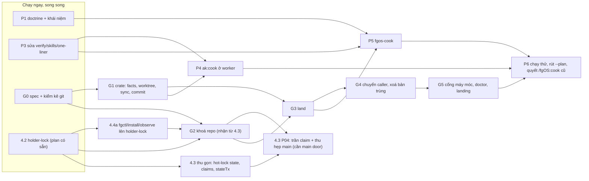

# Lộ trình tổng hợp: `fgos-cook` và component Git

Thời điểm: 2026-10-16 22:12 (Asia/Saigon). Tổng hợp từ ba report nghiên cứu hôm nay và các plan đang mở. Chỉ đọc, chưa sửa code.

## Kết luận

Có **6 phần lớn**. Phần lớn nhất và nằm trên đường găng là **component Git** (`fgos-git`, Rust). Nó phải đứng sau holder-lock (4.2) và việc activate `fgctl` (4.4a), và nó nhận lại phần khoá repo của plan 4.3. Các phần nhỏ (dọn doctrine, sửa verify, bảng đường) chạy song song được ngay. Skill `fgos-cook` nên viết khi thao tác land của component Git đã có; trước đó chỉ nên chạy thử với các mảnh không ghi chồng nhau.

Vướng plan đang mở: **4.3 phải sửa phạm vi** (theo quyết định b). **4.2 và 4.4a là tiền đề**. 6.2 và 6.5 không chồng nhưng có một điểm giao. Plan "hai cửa" đã đóng nhưng frontmatter vẫn ghi `pending`.

## Quyết định đã chốt trong phiên

| # | Quyết định | Nguồn |
|---|---|---|
| Q1 | Không dịch plan cơ học thành cấu hình. Agent điều phối hiểu plan và giao việc qua các đường vận hành tiêu chuẩn | Owner, 21:35 |
| Q2 | Skill thuộc domain coding, tên `fgos-cook` | Owner, 21:51 |
| Q3 | Worker bên ngoài có ak:cook thì dùng ak:cook để làm mảnh việc của mình | Owner, 21:58 |
| Q4 | Tách **component Git riêng**, ngang hàng Workflow và Execution Core, domain nào cũng dùng; gom mọi tinh túy về một chỗ, xoá các bản song song | Owner, 22:07 |
| Q5 | Phần khoá repo của 4.3 (main checkout, merge slot, `worktree-admin`) chuyển thành một phần của component Git; 4.3 giữ phần state và claim | Owner, 22:12 (phương án b) |
| Q6 | Component Git viết bằng Rust (crate, route nội bộ, facade Node) theo khuôn Convention và Session Identity | Owner, 22:12 |
| Q7 | WorkItem là tầng lưu requirement, tiến độ, giao tiếp với người; flow chạy không biết Work | Owner, nhắc lại 21:58 |

## Tài liệu nguồn

- `research-261016-2023-ak-plan-distributed-cook.md`: đã bị thay thế về hướng, nhưng danh sách lỗi runner G1–G9 vẫn đúng.
- `research-261016-2141-plan-conductor-coding.md`: agent điều phối, bản đồ khái niệm, bảng đường, điều chỉnh C1–C7.
- `research-261016-2158-work-harness-reuse-and-ak-cook-worker.md`: harness cũ, ba bản merge song song, ak:cook ở worker (đã cập nhật sau khi cài ak cho 5 runtime).
- Thiết kế lock r6: `design-261016-1238-lock-and-run-supervisor-foundation-v3-r6.md` §4, §11.
- Report guardrails: `research-261016-1118-agent-code-quality-guardrails.md` (vì sao trùng code, cổng máy móc).

## Sáu phần lớn

### P1. Dọn doctrine và bản đồ khái niệm (nhỏ, chạy ngay)

- Ghi rõ trong spec: Unit ← CollaborationPattern (`solo`/`reviewed`/`panel`) + preset (bộ thông số có tên: `rfc`, `consult`, `research-fan-out`, `code-change`). Workflow là DAG ghép nhiều Unit. Hai cửa: `fgos run` và `fgos workflow`.
- Sửa câu cũ ở `docs/specs/runner.md:1474-1476` ("Workflow ... tích hợp vòng đời Work").
- Viết lại `core/skills/_shared/coordination-driver.md` theo hai cửa. File này vẫn dạy `fgos coordination ...` đã xoá từ P4, và fgos-advise vẫn tải nó.
- Sửa trạng thái cũ: plan `261014-1400-two-doors-one-rununit` đã đóng (`cb0acb254`) nhưng frontmatter vẫn ghi `pending`; câu tự mâu thuẫn trong `fgos-coding-driving`.

Ước lượng: khoảng nửa đến 1 ngày. Không phụ thuộc gì.

### P2. Component Git `fgos-git` (lớn nhất, đường găng)

**Phạm vi:**
- Một crate Rust, route nội bộ, facade Node, spec `docs/platform/git/spec.md`, một dòng trong `component-boundary.md`.
- Sở hữu mọi thao tác ghi lên repo git:
  1. vòng đời worktree (tạo, cài dependency, chạy lệnh setup, tái dùng nhánh, dọn mồ côi);
  2. nhánh và ref;
  3. kéo base vào nhánh (sync, conflict để mở cho worker);
  4. land (merge chưa commit, verify, abort, CAS, không chạm cây của main checkout);
  5. trusted commit theo phạm vi ghi;
  6. sự thật chỉ đọc về repo;
  7. khoá repo nhận từ 4.3: main checkout door, checkpoint, merge slot, `worktree-admin`, mượn qua fd cho git commit có hook.
- Không sở hữu: drift sau land theo đồ thị Work (ở lại Work); resolver conflict riêng của repo fgOS (cắm từ ngoài); chọn worker (Execution Core).
- Phụ thuộc: host-runtime, holder-lock, process. Người dùng: Work, Workflow, Execution Core, Setup, Observe, `fgctl`.

**Các phase bên trong (gợi ý):**

| Phase | Nội dung | Cần trước |
|---|---|---|
| G0 | Spec, kiểm kê 42 file JS và 7 file Rust đang gọi git, danh mục sự cố đã làm harness cứng lên (mỗi lớp an toàn kèm lý do và test giữ nó) | — |
| G1 | Crate: sự thật repo, worktree (prepare, cleanup), sync, trusted commit. Chưa cần khoá | G0 |
| G2 | Khoá repo (nhận P03, P05, P06, P08 và một phần P07 của 4.3): main door, checkpoint nhận handle, merge slot, `worktree-admin`, mượn fd | G0, 4.2 landed, 4.4a activated (cho cutover main) |
| G3 | Land: no-commit, verify, abort, CAS, dưới slot | G1, G2 |
| G4 | Chuyển caller: Execution Core (`commit-unit-work`, `unit-sync`, worktree của `fgos run`), Workflow (xoá `integrate.mjs`), Work (`approve`, `sync-root`, `catchup`, `review` thành adapter mỏng; xoá phần lõi của `merge.mjs` và `worktree.mjs`), setup, session, state, scripts; Rust (`observe`, `distribution`) link crate | G1–G3 |
| G5 | Cổng máy móc: test kiến trúc cấm gọi `git` ngoài component (có allowlist giảm dần). Thêm doctor, setup, CHANGELOG, landing dừng-toàn-bộ theo khuôn của 4.2 | G4 |

Ước lượng thô: 14–17 ngày công. Phần G2 khoảng 3 ngày, lấy từ số giờ đã ước trong 4.3 (P03 7h, P05 6h, P06 2h, P08 1h, cộng phần P07, P09, P10).

### P3. Sửa đường chạy cho cook (nhỏ, phần lớn chạy ngay)

- Giữ `verify` trên Unit (hiện `validateUnit` bỏ mất trường này).
- Verify dùng bộ chạy lệnh có timeout cấu hình, thay `execSync` 60 giây ở `run.mjs:909`. Land của component Git dùng cùng bộ chạy này, để không thêm bản trùng.
- Bỏ `npm test` ghim cứng trong preset `code-change`.
- One-liner thêm `--input` và `--verify`.
- Khai `docs:write` trong config.
- Đưa `skills`/`requiresSkills` (hiện chỉ đến từ operation của Work, chỉ được ghi lại) xuống tầng flow, và để `bind()` dùng làm điều kiện chọn executor.

Ước lượng: khoảng 1,5 ngày. Đụng `run.mjs`, nên phải tránh va với 4.2 (guard resume ở `run.mjs`) bằng thứ tự merge.

### P4. ak:cook ở worker

- Mang skill vào worktree qua bước prepare của component Git (lệnh setup chép hoặc symlink `.agents/`, `.omp/`, `.pi/`, `.grok/`, `.claude/skills`). Lý do: cả 5 runtime đã có ak:cook 2.5.1, nhưng đều ở thư mục bị gitignore hoặc chưa track.
- Khai kỹ năng của executor, kèm check doctor.
- Hợp đồng brief: `--auto --skip-journal`; không git, không sửa plan, không ghi ngoài `writes`; review độc lập để fgOS lo.

Ước lượng: 1–1,5 ngày. Cần G1 (prepare) và P3 (skills ở tầng flow). Nên có một thử nghiệm tay trước: codex trong worktree có chép skill, chạy một mảnh chỉ-đọc.

### P5. Skill `fgos-cook`

- Theo khuôn fgos-advise: vòng điều phối (hiểu, sổ điều phối, chọn mảnh, giao, tự kiểm, phán xử, thích nghi, tích hợp, báo owner).
- Reference bảng đường (bản nháp 12 đường; ngưỡng rigor cần owner duyệt). Tích hợp nhánh qua land của component Git.
- Hook slot theo doctrine driver đã viết lại ở P1.

Ước lượng: 1,5–2 ngày. Cần P1, P3; cần G3 cho mảnh ghi song song. Có thể viết sớm và chạy với các mảnh nối tiếp trước khi có G3.

### P6. Chạy thử và rút đường cũ

- Chạy `fgos-cook` trên một plan ak:plan thật cỡ vừa. Đo số mảnh, đường được chọn, số vòng review, tỉ lệ verify fail, chi phí theo tier, số lần hỏi người. Sửa bảng đường theo số đo.
- Rút đường `--plan` cơ học (`src/workflow/plan-source.mjs`, Mode B của `fgos-run`).
- Quyết gộp hoặc rút `/fgOS:cook` cũ (vòng đời Work item), để chỉ còn một "cook".

Ước lượng: 1,5–2 ngày, cộng phí provider của plan chạy thử.

## Trình tự

Đường găng: 4.2 → 4.4a → G2 → G3 → G4 → G5 → P6. Phần còn lại chạy song song quanh đường găng.

## Vướng các plan đang mở

| Plan | Trạng thái thật | Quan hệ | Việc cần làm |
|---|---|---|---|
| `261016-1104` **4.2 holder-lock** | `pending`, chưa có nhánh | **Tiền đề** của G2 (kernel mutex, `run_borrowed` cho git có hook) | Giữ nguyên. G0 và G1 chạy song song với nó. Thứ tự merge: phần guard resume ở `run.mjs` của 4.2 trước, P3 sau |
| `261016-1306` **4.4a Rust callers** | `pending`, chưa có nhánh | **Tiền đề** cho cutover main checkout (nay nằm trong G2) | Giữ nguyên. Khi G4 chuyển Rust caller sang crate `fgos-git`, `fgctl` đọc trạng thái main qua crate này |
| `261016-1306` **4.3 main checkout + hot lock** | `pending`, chưa có nhánh | **Phải sửa phạm vi** (quyết định b) | Chuyển P03, P05, P06, P08, phần reset-trong-mutex của P07, cùng phần tương ứng của P00, P09, P10 sang G2. 4.3 giữ P01, P02, P04, phần `lock fence`/`lock-status` của P07, và phần state của P00, P09, P10. P04 của 4.3 phụ thuộc main door của G2. Sửa plan 4.3 **trước khi** ai bắt đầu code nó |
| `261016-1306` **6.5 terminal-control** | `pending` | Không chồng | Không |
| Thiết kế r6 **6.2 supervisor** | chưa có plan | Giao nhau một điểm: việc hoãn "khe attempt xong → writes được commit không có lease" (r6 §11, kongming N7) chạm trusted commit của G1 | Ghi vào G0 như một điểm phải quyết cùng 6.2; không làm trong G1 |
| `261014-1400` **hai cửa, một runUnit** | Frontmatter `pending`, thực tế đã đóng (`cb0acb254`) | Không chồng | Sửa frontmatter (P1) |
| `261014-1045` dispatch write boundary | `superseded` | Phần "observer ghi-path" còn chờ owner, liên quan trusted commit | Đưa vào G0 làm câu hỏi |
| `261006-1408` advisory capability | `partial` | Chồng nhẹ với P1 (pattern/workflow trong doc) | P1 đọc plan này trước khi sửa spec |
| `260925` documentation authority | chạy dở trên nhánh riêng, chưa merge | Sửa `reading-map.md`/`system-overview.md` là ngoại lệ phải ghi lại | Ghi ngoại lệ khi P1 và G5 sửa docs |
| `261015-2102` identity resolver crate (5.1) | lead riêng | Không chồng | Không |

## Tổng ước lượng

Khoảng 22–27 ngày công cho cả sáu phần, trong đó component Git chiếm khoảng 60%. Đây là ước lượng thô, chưa đo. Trên lịch có thể ngắn hơn nhiều nhờ chạy song song: P1, P3, G0 và G1 đều không chờ lock.

## Bước tiếp theo đề xuất

1. **Sửa phạm vi plan 4.3 ngay**, trước khi ai bắt đầu code nó: tách các phase sang G2 như bảng trên.
2. **Lập plan cho component Git**, bắt đầu từ G0 (spec và kiểm kê) để chốt hợp đồng.
3. **Lập một plan nhỏ cho P1 và P3**, chạy song song ngay.
4. P4, P5, P6 lập plan sau khi G0 chốt hợp đồng land và prepare.

## Câu hỏi còn mở

1. **Tên crate và verb:** `fgos-git`, kèm route nội bộ `fgos internal git-*`, và có verb công khai nào không (vd `fgos git land`)? Hay chỉ dùng qua facade?
2. **Main door có thuộc Git không?** `withMainCheckout` bảo vệ cả cây git lẫn checkpoint `.fgos` lên main. Em xếp nó vào Git (vì checkpoint là một git commit dưới mutex). State gọi nó qua facade. Anh xác nhận cách chia này chứ?
3. **Resolver conflict của `docs/decisions/index`:** giữ thành plugin cắm vào land, hay bỏ hẳn? Từ tsk-1lv-4, corpus `docs/decisions/*.md` đã retired, nên có thể không còn cần.
4. **Thứ tự P5 so với G3:** viết `fgos-cook` sớm và chạy thử với mảnh nối tiếp, hay đợi land xong mới viết?
